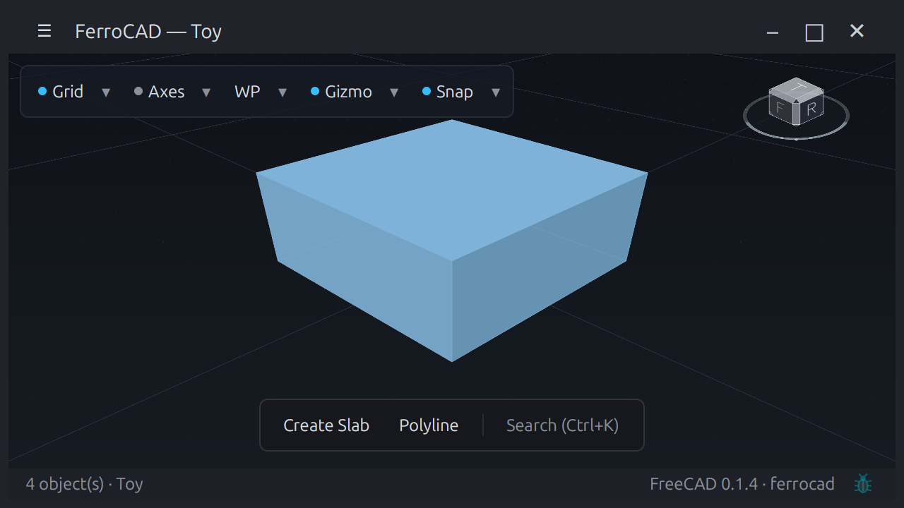
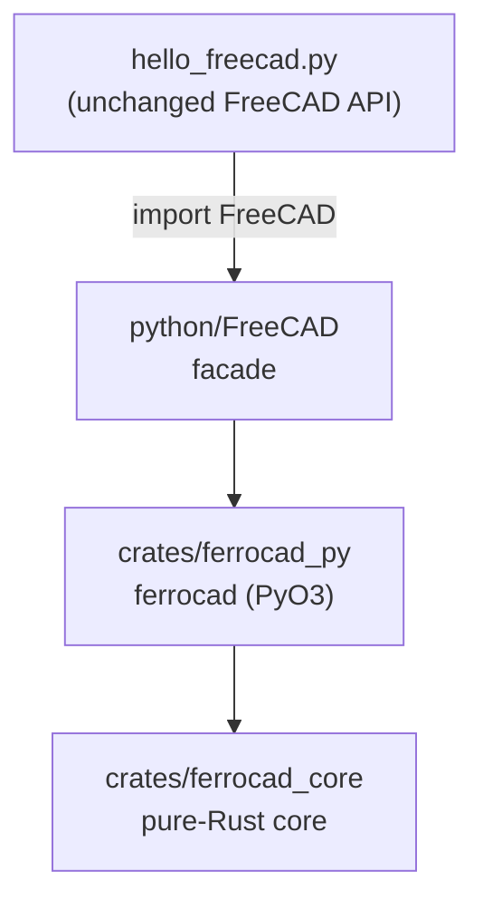

# FerroCAD



**FerroCAD** is a Rust/GPUI reimplementation of FreeCAD's C++ `App` core, designed to be
a **drop-in replacement for the `FreeCAD` Python package**. The Python import namespace
stays `FreeCAD`; the project/distribution is `ferrocad`.

## Status

| Track | What it is | State |
| --- | --- | --- |
| **Engine** | the Rust document model behind the `FreeCAD` API | units/quantities, properties, documents, links, expressions, observers, undo, and both serializers. The App/Base surface is the measured MVP. |
| **Part / OCCT** | the real geometry workbench | **531 upstream Part tests passed, 0 failed, 0 errored, 12 skipped**; primitives, booleans, dress-ups, curves/surfaces, NURBS, `ShapeFix`, `ChFi2d`, feature objects and topological lineage. **220/408 (53.9%)** upstream API names in the committed tree; **248/408 (60.8%)** in the current worktree. |
| **Workbench platform** | running upstream workbenches without Qt | `Part::FeaturePython`/`Part2DObjectPython` execute and persist Python proxies; Draft M2 is green (**27/27**), the Draft `--draft` group is **44/0/0/0**, and `test_modification` is **31/0/2** after the M4 import round. |
| **App shell** | the `bite-gpui` window driving the engine through embedded CPython | viewport, model tree, property editor, console, command registry, wheel/forms, transform gizmo, navigation cube and Dev Tools. SimpleCAD S4.1–S4.3 (view facade, ranked pick, selection object) are in the worktree. |
| **SimpleCAD** | the canvas-first proving ground | **88/88** unit modules load in one image: **702 passed, 44 failed, 368 errored, 2 skipped**, no aborts. That baseline predates the current Part/Draft batch. |
| **Distribution** | how it ships | `v0.1.4`, the base and Parametric artifacts (AppImage + Windows zip), and `cargo install ferrocad`. macOS is not shipped yet. |

This is a **working preview, not a finished product**. It exists to validate the single
riskiest assumption of the rewrite plan: *that a Python script written against FreeCAD's
public API can be served by a Rust implementation instead of the C++ one, without
changing the script.* PartDesign's feature tree, Sketcher's solver, FEM, CAM and the GUI
workbenches are deliberately out of scope; the measured subset is stated with every
number.

**Roadmap.** [`docs/project/ROADMAP.md`](docs/project/ROADMAP.md) is the three-horizon summary and
[`docs/project/TODO-30-10-2026.md`](docs/project/TODO-30-10-2026.md) the active backlog. The measured
history is [`docs/project/record/milestones.md`](docs/project/record/milestones.md); the labels
(`S1`, `P4`, `D0`, …) are indexed in [`docs/project/labels.md`](docs/project/labels.md). Screenshot
handling (generated viewport snapshots and manual app captures) is in
[`docs/developer/workbenches/screenshot-tool.md`](docs/developer/workbenches/screenshot-tool.md). The headless
engine MVP is defined in [`docs/project/direction/mvp-path.md`](docs/project/direction/mvp-path.md), the
shell in [`docs/project/direction/app-shell-vision.md`](docs/project/direction/app-shell-vision.md), and
the Part/Draft layering in
[`docs/developer/architecture/part-draft-layering.md`](docs/developer/architecture/part-draft-layering.md).

## Install

### Download a prebuilt app

Self-contained builds from the
[latest release](https://github.com/ferrocad/ferrocad/releases/latest). Each one
bundles CPython, the `FreeCAD` facade and the `Draft` workbench, so no system
Python is needed:

| Platform | Download |
| --- | --- |
| Linux (x86_64) | [`ferrocad-x86_64.AppImage`](https://github.com/ferrocad/ferrocad/releases/latest/download/ferrocad-x86_64.AppImage) |
| Windows (x86_64) | [`ferrocad-windows-x86_64.zip`](https://github.com/ferrocad/ferrocad/releases/latest/download/ferrocad-windows-x86_64.zip) |
| Linux (x86_64, Part edition) | [`ferrocad-parametric-x86_64.AppImage`](https://github.com/ferrocad/ferrocad/releases/latest/download/ferrocad-parametric-x86_64.AppImage) |

The Linux AppImage is a single executable:

```sh
chmod +x ferrocad-x86_64.AppImage && ./ferrocad-x86_64.AppImage
```

### Install from crates.io

`cargo install ferrocad` builds the same self-contained app from source. It needs a
Rust toolchain; install one with [rustup](https://rustup.rs) if you do not have it:

```sh
curl --proto '=https' --tlsv1.2 -sSf https://sh.rustup.rs | sh
cargo install ferrocad
ferrocad
```

The binary embeds the Python payload and unpacks it on first run (see
[Embedded Python](#embedded-python-running-scripts-from-rust)). The Python package
(`pip install ferrocad`, the `FreeCAD` API without a GUI) is not on PyPI yet.

> **macOS** is not shipped yet: the pinned GPUI Metal backend does not compile, so
> there is no `.dmg` in the releases. See
> [`docs/developer/architecture/macos.md`](docs/developer/architecture/macos.md) for the diagnosis and
> the re-enable checklist. **Windows**: the zip is unsigned, so SmartScreen may
> warn on first run.

## The idea



* **`hello_freecad.py`** uses only the public FreeCAD API. The same file is
  intended to run against upstream FreeCAD.
* **`python/FreeCAD/`** is a drop-in module that speaks that API; it knows nothing
  about C++ or Coin. Since `ferrocad` is just a document-object model (no "application"),
  the facade adds the small App-level layer it lacks: a document registry,
  `ActiveDocument`, unique-name allocation, and `Version`.
* **`crates/ferrocad_py/`** exposes the model as real `#[pyclass]` types via PyO3
  (importable as `ferrocad`).
* **`crates/ferrocad_core/`** is the pure-Rust implementation behind `ferrocad_py`: no Python,
  no UI, just the object model.

## Workspace layout

FerroCAD is a Cargo workspace (edition 2024). Crate status:

| Crate | Role | Status |
| --- | --- | --- |
| `crates/ferrocad` | the base app: runs the general edition (`cargo run -p ferrocad`) | published (app binary) |
| `crates/ferrocad_types` | base value types: quantities, units, geometry (`Vector3`, `Placement`, …) | primary |
| `crates/ferrocad_theme` | the visual-language token table: linear draw tokens and packed-sRGB UI tokens, with round-trip helpers | primary |
| `crates/ferrocad_graphics` | the neutral graphics primitives: the draw contract, camera/viewport, CPU picking | primary |
| `crates/ferrocad_core` | pure-Rust model: properties, documents, links, expressions, recompute DAG | primary |
| `crates/ferrocad_curves` | analytic curves and wires (no OCCT) | primary |
| `crates/ferrocad_lineage` | the payload-generic lineage vocabulary: element references, history, stable-name maps | primary |
| `crates/ferrocad_geom` | the geometry seam: opaque `Shape`, lineage re-exports, the `GeometryBackend` trait | primary |
| `crates/ferrocad_mesh` | the Mesh core: triangle meshes, STL/bms, analysis/editing, `Mesh::Feature` | primary — no OCCT |
| `crates/ferrocad_occt` | the OCCT backend: implements `GeometryBackend` and the Part-only algorithms | primary — needs OCCT 7.8+ |
| `crates/ferrocad_part` | the Part workbench: registers `Part::Feature`, `Part::PropertyPartShape` | primary — needs OCCT 7.8+ |
| `crates/ferrocad_part_py` | the `Part` Python module; the composition root that links OCCT | primary — needs OCCT 7.8+ |
| `crates/ferrocad_part_gui` | Part's presentation: the edge dress-up manipulator over the generic stage | primary |
| `crates/ferrocad_mesh_py` | the `Mesh` and `MeshPart` Python modules | primary |
| `crates/ferrocad_combined_py` | one extension exposing `ferrocad`, `Part`, `Mesh` and `MeshPart` over a shared core | primary |
| `crates/ferrocad_py` | PyO3 extension over `ferrocad_core` (module `ferrocad`) | primary |
| `crates/ferrocad_inventor` | the Coin/Inventor scene core: node AST, state accumulator, mesh compiler, events | primary |
| `crates/ferrocad_inventor_py` | the pivy-compatible `coin` facade (surfaced as `pivy.coin`) | primary |
| `crates/ferrocad_stage` | the modern declarative CAD presentation: `ShapeItem`s, tools, `TransformGizmo` | primary |
| `crates/ferrocad_stage_py` | the modern-stack Python surface (surfaced as `ferrocad.stage`) | primary |
| `crates/ferrocad_ui` | the Qt Designer `.ui` reader and typed form model (no Qt, no rendering) | primary |
| `crates/ferrocad_ui_py` | the PyO3 proxy layer over `ferrocad_ui` | primary |
| `crates/ferrocad_wgpu` | the wgpu backend: pipelines, uniforms, MSAA, offscreen target, readback, snapshots | primary |
| `crates/ferrocad_snapshot` | the small `ferrocad_snapshot` CLI over `ferrocad_wgpu::snapshot` (docs screenshots) | tool — not published |
| `crates/ferrocad_viewport` | the `bite-gpui` viewport: `InventorViewport`, the navigation cube, the sample scene | primary |
| `crates/ferrocad_widgets` | reusable `bite-gpui` widgets (window chrome, fields, console, wheel) | primary |
| `crates/ferrocad_gpui` | library: the reusable app shell (`run`/`run_with` + `HostConfig`), boots CPython | primary |
| `crates/ferrocad_parametric` | edition binary: the base app + the Part workbench | published — needs OCCT 7.8+ |
| `crates/ferrocad_toy` | kernel-free edition that exercises the generic manipulator registry | published |
| `crates/ferrocad_gen` | generated PyO3 skeleton bindings from the `.pyi` model (M3c) | useful — drives the codegen tests |
| `crates/xtask` | build tasks: `cargo xtask bundle` stages a distribution | tool |

The GUI crates (`ferrocad_viewport`, `ferrocad_widgets`, `ferrocad_gpui`, `ferrocad`) are excluded from
`default-members` so `cargo build`/`cargo test` stay fast; `ferrocad_gpui` additionally carries the PyO3
`auto-initialize` feature, which conflicts with the `extension-module` feature of the extension crates.

## Build & run

```sh
./build.sh     # cargo build --release, then package the native libs into python/
./run.sh       # PYTHONPATH=python python3 hello_freecad.py
cargo run -p ferrocad   # the base app window (needs a display)
cargo run -p ferrocad_parametric -- --open target/demo/headless.FCStd  # basic .FCStd viewer
cargo run -p ferrocad_toy -- --render target/demo/toy.png          # headless PNG (no display, no OCCT)
python3 tools/screenshot.py --spec target/demo/scene.json \
    --out target/demo/scene.png                                  # viewport snapshot (GPU)
python3 tools/screenshot.py --mode chrome --edition toy \
    --out target/demo/toy-window.png                              # app window (X11)
python3 tools/screenshot.py --mode desktop \
    --out target/demo/desktop.png                                 # whole display
cargo run -p ferrocad_parametric -- --render target/demo/part.png  # headless PNG with Part (needs OCCT)
cargo run -p ferrocad_parametric -- --script examples/headless_part.py \
    --render target/demo/part.png --size 1200x800             # box, bore, fillet
# full demo: headless script → .FCStd + PNG + STL
cargo run -p ferrocad_parametric -- --script examples/headless_gear.py \
    --render target/demo/gear.png --stl target/demo/gear.stl --size 1400x900
# open the saved file in the viewer
cargo run -p ferrocad_parametric -- --open target/demo/gear.FCStd
# or reopen and render/export it without a window
cargo run -p ferrocad_parametric -- --open target/demo/gear.FCStd \
    --render target/demo/gear_reopened.png --stl target/demo/gear_from_file.stl
cargo install ferrocad  # a self-contained binary: payload embedded, unpacked on first run
cargo xtask mods               # fetch upstream workbench scripts (default: Draft) into mods/
cargo xtask bundle             # stage the payload into target/dist/ferrocad (--debug for speed)
packaging/linux/appimage.sh    # wrap it into an AppImage (needs appimagetool)
```

`--render <png>` boots the edition's app script with `GuiUp == 0`, asks its display
hook for the tessellated document shapes, and draws one offscreen frame with the
same `Stage` → `WgpuRenderer` path the window uses. `tools/screenshot.py` drives the
same renderer from a JSON spec (see the screenshot-tool note). It needs a wgpu adapter (a
software Vulkan ICD is enough) but no display server; add `--size WxH` to choose
the framebuffer, and `--script <py>` to build the model first (the script runs after
the edition's sample document is created). `--open <file>` loads a saved document
at boot instead of the sample: with a window it is the basic `.FCStd` viewer (model
tree, properties and 3D view follow the file), and with `--render` it renders the
file. `--stl <path>` writes the same tessellation as a binary STL (it needs no GPU
and can be combined with `--render`). The generated `examples/toy_headless.png` is
the Toy edition's slab rendered this way; `examples/headless_part.py` is the Part
demo script, and `examples/headless_gear.py` builds the two-gear train shown in
`examples/gear_headless.png`.

The Parametric edition needs OCCT 7.8. Fetch the 7.8.1 prefix CI uses into
`.occt/prefix` once (recipe in
[docs/developer/architecture/occt-bundling.md](docs/developer/architecture/occt-bundling.md#31-local-development-no-exports-needed));
`.cargo/config.toml` then supplies `OpenCASCADE_DIR`, `OCCT_INCLUDE_DIR` and
`LD_LIBRARY_PATH` automatically, so no exports or `.env` file are needed.

Expected output:

```
FreeCAD version : 0.1.4
Active document : HelloWorld
Document label  : HelloWorld
Object count    : 1
  - Box (App::FeaturePython) label='Hello, FreeCAD'
obj.Description : Created by the Rust core
Properties      : ['Description']
Documents       : ['HelloWorld']
Active after close: None
OK
```

Tests:

```sh
cargo test -p ferrocad_core
cargo test -p ferrocad_part_py --test part_conformance -- --nocapture
LD_LIBRARY_PATH=.occt/prefix/lib PYTHONPATH=python python3 -m pytest tests -q
python3 tools/conformance.py --root ../freecad-upstream --draft
python3 tools/conformance.py --simplecad                    # needs ../simplecad
LD_LIBRARY_PATH=.occt/prefix/lib PYTHONPATH=python \
    python3 tools/part_api_audit.py --check                  # Part API contract
python3 tools/userdocs.py --check && python3 tools/api_docs.py --check
python3 tools/build_book.py --check
```
The Part suite needs OCCT (`.occt/prefix`); the Draft and SimpleCAD groups self-skip without
the sibling checkouts. Every published number records the upstream revision.

Regenerate the M3c skeleton (`crates/ferrocad_gen/src/lib.rs`, committed):

```sh
python3 tools/codegen.py --root ../freecad-upstream --out crates/ferrocad_gen/src/lib.rs
```

Run upstream tests against our `FreeCAD` (conformance harness, M3d):

```sh
python3 tools/conformance.py --root ../freecad-upstream            # default curated files
python3 tools/conformance.py --root ../freecad-upstream --part     # the Part group
python3 tools/conformance.py --root ../freecad-upstream --draft    # the headless Draft group
python3 tools/conformance.py --simplecad                           # SimpleCAD's 88 unit modules
python3 tools/conformance.py --root ../freecad-upstream --list     # list candidates
```

## Documentation

The Rust crates carry **Diátaxis-structured rustdoc** — a tutorial, how-to guides, an explanation of
the design, and the generated item reference:

```sh
cargo doc --no-deps --open                    # ferrocad_core + ferrocad_py
cargo doc --no-deps -p ferrocad_core          # one crate
cargo test --doc -p ferrocad_core             # the tutorial is a doc test
```

The crate page of `ferrocad_core` (`crates/ferrocad_core/src/lib.rs`) reads as a tutorial and an
explanation with `How-to`/`Reference` sections; it is rendered on docs.rs when published. The
per-module pages are the reference.

The **product surface is Python** (`import FreeCAD`) and deliberately mirrors upstream FreeCAD, so
the *behaviour* reference is FreeCAD's own. What FerroCAD adds is generated and verified:
[`docs/user/`](docs/user/README.md) renders one page per implemented workflow by **running** it
against the facade, and [`docs/python-api/`](docs/python-api/index.md) is a signature reference read
from the live modules. CI runs `tools/userdocs.py --check` and `tools/api_docs.py --check`, so neither
can drift from the code. Narrative notes live in the repository `docs/` ([index](docs/README.md)):
[`ROADMAP.md`](docs/project/ROADMAP.md) for the horizons, [`TODO-30-10-2026.md`](docs/project/TODO-30-10-2026.md)
for the active backlog, [`record/milestones.md`](docs/project/record/milestones.md) for the measured
history, [`record/tasks/`](docs/project/record/tasks/README.md) for the closed design specs, and
[`labels.md`](docs/project/labels.md) for every `S1`/`P4`/`D0`.
[`docs/INDEX.md`](docs/INDEX.md) is the complete document index: every note is listed
once under **general**, **user**, **mods**, **python-api**, **developer**, or **project**.
The [general concepts](docs/general/README.md) open with a
[gentle introduction to 3D CAD architecture](docs/general/README.md), which
maps NURBS/B-Rep, tessellation and naming onto FerroCAD's crates. The user pages
then open with [UI users and API users](docs/user/explanation/ui-and-api.md), which
explains why the Python API is the contract and the window is one client of it.
An mdBook edition of both — tutorials, how-to guides, reference, explanation — is
assembled by `tools/build_book.py` (`--build` renders it with
[mdBook](https://rust-lang.github.io/mdBook/)) and published at
<https://ferrocad.github.io/docs/> from the
[`ferrocad/docs`](https://github.com/ferrocad/docs) repository, whose Pages workflow
renders a shallow copy of `docs/` and `tools/`.
A Sphinx/mkdocstrings site is the natural next step once a Python doc build can run in CI; until
then rustdoc is the verifiable source of truth for the Rust side.

## Packaging

`pyproject.toml` builds the distribution **`ferrocad`** with
[`maturin`](https://www.maturin.rs/): it compiles `crates/ferrocad_py` into the top-level module
`ferrocad` and ships the pure-Python `FreeCAD`/`FreeCADGui` packages from `python/`. A user still
writes `import FreeCAD`.

The Rust library crates (`ferrocad_core`, `ferrocad_py`, `ferrocad_widgets`, `ferrocad_gpui`) and the
app (`ferrocad`) publish to **crates.io**, and the wheel publishes to **PyPI**. A `v*` tag drives both
[`.github/workflows/crates.yml`](.github/workflows/crates.yml) (publish order, payload staging) and
[`.github/workflows/release.yml`](.github/workflows/release.yml) (the platform artifacts). The
`abi3`/`extension-module` notes, the publish order, and the staging commands are in
[`docs/developer/architecture/releasing.md`](docs/developer/architecture/releasing.md) and [`docs/developer/architecture/distribution.md`](docs/developer/architecture/distribution.md).

`cargo install ferrocad` produces a **self-contained** binary: `crates/ferrocad` embeds the workspace
`python/` (and, when published with workbenches, `mods/`) and unpacks it on first run, because Cargo has
no data-file install step. The publish staging (`cargo xtask stage-payload`) keeps those directories out
of the crate source; they are copied in only for `cargo publish` and removed after.

Application artifacts (AppImage, `.dmg`, Windows zip) are built by
[`packaging`](packaging) from the payload staged by `cargo xtask bundle`.
Tagging `v*` runs [`.github/workflows/release.yml`](.github/workflows/release.yml),
which verifies the tag against the workspace version, runs the tests, builds the
base and Parametric artifacts with the pinned Python runtime, and publishes a
GitHub Release.
The same tag runs [`.github/workflows/crates.yml`](.github/workflows/crates.yml),
which publishes the library crates to crates.io (needs a `CARGO_REGISTRY_TOKEN`
secret).

## Embedded Python (running scripts from Rust)

The **shell library** (`crates/ferrocad_gpui`) embeds CPython and drives it from Rust. Its
headless `#[gpui::test]` suite covers the boot, model tree, property edits, console, command
registry, viewport and gizmo paths, including a click that round-trips through a Python
callback into a `bite-gpui` element. The base app (`crates/ferrocad`) is a thin binary over
it (`cargo run -p ferrocad`). This is the Blender-style model the design builds on: Python
declares the UI/workbench, Rust owns the process and renders.

Note the layering: `ferrocad_core` is **pure Rust and does not embed Python**; the embedding lives
in the shell library. Workbench Python is driven by the shell, while the `FreeCAD` facade talks to
the `ferrocad` extension the ordinary ways (import).

## Python-only scripts & file loading

A plain workbench-style script that uses only the public `FreeCAD` API runs today —
`hello_freecad.py` is one, and `examples/file_roundtrip.py` demonstrates the **file** path:
create a document, `doc.saveAs(path)`, `FreeCAD.open(path)`, and read the objects/`PropertyLength`
back. Documents save as native `.ferrocad` JSON or as a real `.FCStd` ZIP. The `.FCStd` reader
and writer round-trip our documents (shapes, expressions, links, appearance, mesh and
the lineage sidecar). Upstream's module-specific payloads and private `ElementMap` form
are not all covered yet, so opening a FerroCAD-written file in upstream FreeCAD is a
follow-up, not a guarantee.

```sh
PYTHONPATH=python python3 examples/file_roundtrip.py
```

## The Python bridge

`crates/ferrocad_py` builds the PyO3 extension `ferrocad` (M3b). `ferrocad.Document` /
`ferrocad.DocumentObject` are native `#[pyclass]` types over
`Arc<Mutex<ferrocad_core::Document>>`, built with `abi3` and
`PYO3_USE_ABI3_FORWARD_COMPATIBILITY=1`, because this sandbox runs CPython 3.14, which is
newer than PyO3 0.25 officially targets. `FreeCAD/__init__.py` imports it unconditionally
and reports `FreeCAD.backend == "ferrocad"`.

PyO3 is a **hard build dependency on the CPython headers** (CI installs `python3-dev`).
An earlier M0 `ctypes`/C-ABI fallback was removed: it was not a second transport for the
same core but a second, narrower model, and every capability it had is available through
PyO3. See [`docs/developer/architecture.md`](docs/developer/architecture.md) for the call-path diagrams
and the decision.

See [`docs/project/direction/rewrite-strategy.md`](docs/project/direction/rewrite-strategy.md) for the direction and
[`docs/project/research/coin-bridge-reuse-assessment.md`](docs/project/research/coin-bridge-reuse-assessment.md)
for the underlying analysis.

## What is implemented vs. not

Implemented and measured:

* **The App/Base surface** through `ferrocad_core` / `ferrocad_py`: a full
  `Quantity`/`Unit` system, properties (including dynamic, enum, link, quantity and
  placement), documents and naming, a dependency graph and topological recompute,
  expressions, observers, undo/redo, groups/extensions and the native/`.FCStd`
  serializers.
* **Part/OCCT** through `ferrocad_geom` → `ferrocad_occt` → `ferrocad_part_py`:
  primitives, booleans, dress-ups, curves/surfaces, NURBS conversion, `ShapeFix`,
  `ChFi2d`, feature objects, `Part::FeaturePython` and topological lineage. The upstream
  Part suite reports **531 passed, 0 failed, 0 errored, 12 skipped**; the API audit
  covers **220/408** names in the committed tree and **248/408** in the worktree.
* **Mesh** through `ferrocad_mesh` / `ferrocad_mesh_py`: triangle payloads, STL and
  `.bms`, analysis/editing, `Mesh::Feature`, `MeshPart.meshFromShape`, and the `.FCStd`
  `<Mesh>` member.
* **The workbench platform**: Python feature proxies (`Part::FeaturePython`,
  `Part::Part2DObjectPython`) execute, change, attach, persist and restore; the Draft M2
  modules are **27/27**, the Draft `--draft` group is **44/0/0/0**, and
  `test_modification` is **31/0/2** after the M4 import round.
* **The shell and interaction**: the viewport, model tree, property editor, console,
  command registry, wheel/forms, transform gizmo, navigation cube, Dev Tools, and the
  SimpleCAD S4.1–S4.3 view facade, ranked pick and selection object.

Not implemented, or deliberately partial:

* PartDesign's feature tree, Sketcher's solver and constraints, FEM, CAM and the GUI
  workbenches. `Part::Prism` and the `Sketcher::SketchObject` object type exist where
  Draft needs them; the `Sketcher` module and solver do not.
* The rest of the Part API: 160 distinct upstream names are still uncovered. The
  SimpleCAD/Draft runs are the work list.
* Full upstream `.FCStd` byte-for-byte compatibility and every module payload. The
  format is real and round-trips our documents; it is not a claim of upstream parity.
* The Qt-based Draft GUI paths. The native `FreeCADGui` facade, the `PySide` shim and
  the headless forms cover the non-GUI path; a Qt workbench GUI is not shipped.
* macOS packaging and signing, and thread-safety guarantees beyond the coarse global
  mutex.

The measured subset and its caveats are in
[`docs/developer/workbenches/conformance.md`](docs/developer/workbenches/conformance.md),
[`docs/developer/workbenches/part-api-audit.md`](docs/developer/workbenches/part-api-audit.md) and
[`docs/project/research/simplecad-bringup.md`](docs/project/research/simplecad-bringup.md).

## Current work

**H1 (finish Part/OCCT) is closed** except the optional two composed-alias element-map
counts. **H2 (the workbench platform)** is the Draft M3–M5 breadth: the M4 import round
took `test_modification` to 31/0/2, and the remaining two errors are the `Sketcher`
module and TechDraw's `DrawPage`. **H3 (proof by use)** is SimpleCAD: S1–S3 are measured
and S4.1–S4.3 are the view facade, ranked pick and selection object (integration baseline
**969 passed / 64 failed / 26 errored / 2 skipped**, 88/88 modules). Packaging is on
v0.1.4; macOS is the open distribution leg.

The most recent round closed the **workplane's visual hierarchy and the grid** — a real
plane state, `Part::DatumPlane`, an adaptive grid whose drawn pitch is the configured
pitch, and the Coin workplane uniform's host→renderer transport — plus the polyline's
in-flight editing and commit path. The round log is
[`docs/project/record/2026-10-29-workplane-visual-hierarchy-and-grid.md`](docs/project/record/2026-10-29-workplane-visual-hierarchy-and-grid.md).

The active backlog is [`docs/project/TODO-30-10-2026.md`](docs/project/TODO-30-10-2026.md); the
three-horizon summary is [`docs/project/ROADMAP.md`](docs/project/ROADMAP.md). The shell is no longer a
spike: `cargo run -p ferrocad_toy` (the kernel-free edition) or
`cargo run -p ferrocad_parametric` (with Part) opens the current window; the headless
`#[gpui::test]` suite is the CI-proof path.

## Repository layout

```
Cargo.toml                Cargo workspace (edition 2024)
LICENSE                   LGPL-2.1-or-later (the `license` field is the SPDX id)
screenshot.png            the shell screenshot above
pyproject.toml            maturin packaging (distribution `ferrocad`)
hello_freecad.py          the milestone script (public FreeCAD API only)
examples/file_roundtrip.py  saveAs / open a document (file loading)
run.sh / build.sh         convenience wrappers
python/FreeCAD/           drop-in module: __init__.py (facade)
    Base.py               core data types re-exported from ferrocad (Vector/Matrix/Rotation/…)
    Units.py              units facade (Quantity)
    Console.py            minimal Print* logging facade
python/ferrocad.abi3.so   built PyO3 bindings (module `ferrocad`, gitignored; for the wheel/`build.sh`, not the app)
python/ferrocad_combined.abi3.so  the combined App+Part+Mesh extension (gitignored; `./build.sh`)
python/Part.py            shim: publishes the combined extension and aliases its `Part`
python/Mesh.py            shim: the same extension's `Mesh`
python/MeshPart.py        shim: the same extension's `MeshPart`
python/ferrocad_gen.abi3.so generated skeleton bindings, M3c (gitignored)
python/FreeCADGui/        the upstream-compatible GUI facade (commands, view, selection, Draft tools)
python/PySide/            the import-time PySide/micro-shim surface (no Qt)
python/TechDraw/          the minimal TechDraw surface Draft's import/export tests need
python/BOPTools/          the SplitAPI shim the SimpleCAD suites import
docs/user/images/         committed workflow snapshots + manifest.json (spec/PNG digests)
python/ferrocad_spike/    Python declarative UI spike module (kept)
crates/ferrocad_core/     pure Rust core: quantities, properties, DAG, tx/observers/expr
crates/ferrocad_py/       PyO3 bindings over ferrocad_core (module `ferrocad`)
crates/ferrocad_gen/      generated PyO3 skeleton bindings (module `ferrocad_gen`)
    src/lib.rs            GENERATED by tools/codegen.py (committed)
crates/ferrocad_curves/   analytic curves and wires (no OCCT)
crates/ferrocad_lineage/  payload-generic lineage: element refs, history, stable-name maps
crates/ferrocad_geom/     geometry seam: Shape, lineage re-exports, GeometryBackend trait
crates/ferrocad_mesh/     Mesh core: triangle meshes, STL/bms, operations, Mesh::Feature
crates/ferrocad_occt/     OCCT backend (needs OCCT 7.8+)
crates/ferrocad_part/     Part workbench: Part::Feature, Part::PropertyPartShape
crates/ferrocad_part_py/  the `Part` Python module (makeBox, Shape, curves, dress-ups); links OCCT
crates/ferrocad_part_gui/ Part's presentation: the edge dress-up manipulator
crates/ferrocad_mesh_py/  the `Mesh` and `MeshPart` Python modules
crates/ferrocad_combined_py/ one `.so` linking ferrocad + Part + Mesh + MeshPart (shared core)
crates/ferrocad_ui/       the Qt Designer `.ui` reader and typed form model (no Qt)
crates/ferrocad_ui_py/    the PyO3 proxy layer over ferrocad_ui
crates/ferrocad/          the base app binary (cargo run -p ferrocad)
    src/main.rs           entry: calls ferrocad::run()
    src/lib.rs            run/run_as + register_core_module (edition entry point)
    src/payload.rs        finds/unpacks the embedded Python payload (cargo install)
    build.rs              embeds python/ + mods/ when staged (embedded-payload feature)
crates/ferrocad_parametric/ edition binary: base app + Part (cargo run -p ferrocad_parametric)
    src/main.rs           registers the Part module, then ferrocad::run_as
crates/ferrocad_toy/      kernel-free edition (cargo run -p ferrocad_toy)
crates/ferrocad_viewport/ the bite-gpui viewport: InventorViewport (image path), NaviCube, sample scene
    src/lib.rs            the crate surface (InventorViewport, NaviCube)
    src/inventor_view.rs  the gpui element + pointer→pick→listener interaction
    src/navicube.rs       the navigation-cube controller (placement, sync, hit-test, snap)
    src/scene.rs          the sample Inventor scene + hover listener
crates/ferrocad_gpui/     library: FerroCAD's bite-gpui app shell (boots CPython)
    src/lib.rs            run/run_with + HostConfig + window options
    src/python.rs         embedded-CPython bridge (boot, model_tree, properties, evaluate)
    src/shell.rs          the Shell state/bootstrap/core
    src/shell/            render, devtools, popovers, palette, viewport, picking, dispatch, dialogs, forms, properties
    src/spike.rs          kept feasibility spike (Python-declared UI, headless)
crates/ferrocad_widgets/  reusable bite-gpui widgets (window chrome, field, console)
crates/xtask/             cargo xtask tasks (bundle: stage a distribution)
    src/main.rs           `cargo xtask bundle [--debug]`
.cargo/config.toml        the `cargo xtask` alias
mods/                     workbenches (FreeCAD Mod/ equivalent); packaged into the dist
packaging/                per-platform packagers wrapping the staged payload
    linux/appimage.sh      AppImage (needs appimagetool)
    macos/app.sh           .app + .dmg
    windows/portable.ps1   portable folder + .zip
    icon/ferrocad.svg      icon source
python/ferrocad_shell/    Python side of the shell (sample document, console, model queries)
tools/inventory.py        M3a: parse upstream .pyi stubs into an API model (Python ast)
tools/test_inventory.py   M3a tests (hermetic fixtures + upstream integration guard)
tools/codegen.py          M3c: emit PyO3 skeleton bindings from the API model
tools/test_codegen.py     M3c tests (hermetic generator logic)
tools/screenshot.py       render one docs snapshot spec or a workflow's image ops
tools/conformance.py      M3d: run upstream Mod/Test files against our FreeCAD
tools/test_conformance.py M3d tests (hermetic harness helpers)
tests/test_parity.py      behavioural checks (M0/M1)
tests/test_base_surface.py  end-to-end FreeCAD surface tests (M4)
tests/test_gui_*.py       the Gui view facade, selection and document surface
tests/test_draft_import_surface.py  the Draft import-time surface (Quantity, getHomePath, TechDraw)
tests/test_packaged_modules.py      the combined-extension packaging gate
tests/test_fc_core.py     ferrocad_core via Python (M3b)
tests/test_codegen.py     generated skeleton surface (M3c)
```
