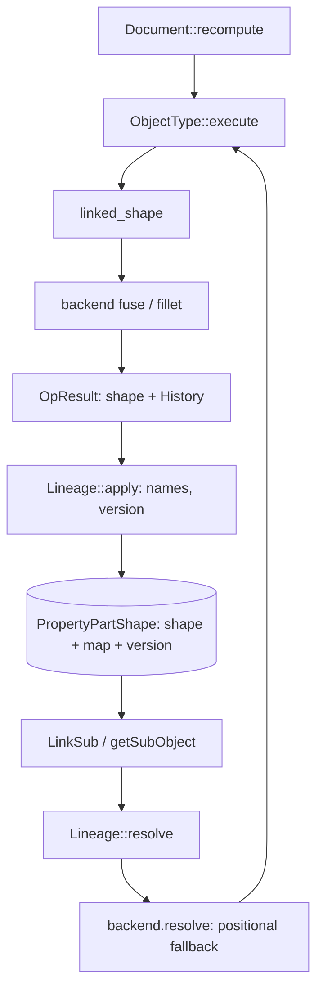

# Lineage and naming: a layer, not a geometry kernel

Status: design (2026-10-23). Refines [`geometry-and-topology.md`](geometry-and-topology.md) §1 and §4.
Companion to [`occt-history-spike.md`](occt-history-spike.md), [`occt-integration.md`](occt-integration.md),
[`part-draft-layering.md`](part-draft-layering.md), [`architecture.md`](../architecture.md) §6,
[`conformance.md`](../workbenches/conformance.md),
[`spikes/occt-history-rs/README.md`](../../spikes/occt-history-rs/README.md), and
[`format-serializers.md`](../tasks/format-serializers.md) (in flight on 2026-10-23, where
`ElementMap` is already listed as a follow-up).

The observation that started this note: **topological naming is not inherently a geometric kernel
problem.** Today's tree entangles the Part workbench (where parametric history lives), OCCT (which
reports provenance), and the FCStd format (which persists a map). The short answer: **right about
ownership, wrong if read as independence**. OCCT never names anything; every name is assigned by a
mapper outside the kernel, and that mapper depends entirely on provenance the kernel reports. A
separate layer can own identity, policy, versioning and persistence — and should — while the kernel
supplies raw `Modified`/`Generated`/`IsDeleted`. Naming needs **four** things, and only one is
geometry. Nothing here was implemented; no code was changed and no tests were run.

---

## 1. The decomposition

| Concern | Question | Nodes / edges | Owner | Status |
| --- | --- | --- | --- | --- |
| Object-graph sort | In what order do features execute? | Document objects / links, expressions | `ferrocad_core` | **Built** (`recompute_order`) |
| Sub-shape lineage | Which face/edge does a stored name mean after a rebuild? | Elements / provenance relations | **proposal:** `ferrocad_lineage` | **Partial**: types exist, nothing consumes them |
| Geometry construction | Inputs + parameters → shape | Solids, surfaces, algorithms | `ferrocad_occt` | **Built** for primitives, booleans, dress-ups |

The earlier note said naming "needs a geometry kernel, OCCT shape history, and a persistent element
map" — true as a dependency list, misleading as ownership. Refined:

> Naming is a **shape-lineage** problem. The kernel supplies *provenance*; the lineage layer assigns
> *identity*, *names*, *versions* and *collisions*; the document and formats persist *references* and
> *maps*. The kernel is necessary, not sufficient, and no naming policy lives in it.

A kernel with no history cannot be rescued by a better mapper; a mapper that is not separate cannot
be tested without a kernel; and `Face6` is a document fact, meaningless outside its object.

What the kernel owes, verified in [`occt-history-spike.md`](occt-history-spike.md): OCCT reports
relations, never names; whole-solid queries are useless (`Deleted=1`) so lineage exists only at
sub-shape level; there are **three** cases per input — modified, generated, and *unchanged* (absent
from both lists, not deleted, still present) — so a two-case model drops elements; and auto-fuzzy and
non-destructive mode are kernel policy. Element identity across a rebuild (`IsSame`/`IsPartner`) is
a kernel question, not an inference from a name table.

---

## 2. What exists today, measured

| Stage | Code | State |
| --- | --- | --- |
| Provenance | `ferrocad_occt/src/backend.rs` `build_history`; `include/fc_history.hxx` | Face-level, **first operand only**, names invented by the backend |
| Vocabulary and fold | `ferrocad_geom/src/lib.rs`: `ElementRef` L151, `History` L163, `ElementMap` L185, `apply` L230, `OpResult` L513 | Unit-tested; `ElementMap` has no production consumer; no `serde` |
| Document and property | `ferrocad_part/src/containers.rs`, `dress_up.rs`, `shape_property.rs` | `.map(\|out\| out.shape)` **discards** history; BREP bytes only, no map or version |
| Python | `ferrocad_part_py/src/lib.rs` L66 | `PartShape { shape: Mutex<Option<Shape>> }`; no map slot |

`build_history` (backend.rs L1726) enumerates the input's faces, asks the operation for
`Modified`/`Generated`/`IsDeleted`, maps each output into the **result's** face map, and emits
`(input_ref, output_ref)` pairs, both named `FaceN` from their own ordinal maps. `fuse`, `cut` and
`common` pass operand `a` as `in_shape`; operand `b` is never enumerated. Fillet and chamfer differ:
`topology.rs` resolves the *stored* edge names first, and `edge_lineage` (L330) reports what each
selected edge generated — so the backend already handles one stored and one positional convention.
Two judgments there are policy, not mechanics: `if !mapped && deleted` (L1761) treats an element that
both maps and is reported deleted as *not* deleted, and outputs outside `out_faces` are dropped
(L1743-1744, L1753-1754), so generated edges and vertices never reach `History`.

`ElementMap::apply` inserts only if the name is absent (`entry(...).or_insert_with(...)`). "First
output wins" holds for a fresh map, but an existing name is **never retargeted** on a later `apply`:
the doc comment says a name "comes to mean its output sub-shape", yet the code does that only for
`from_history`. Deletion works and is tested (L236-238); the ordinary rebuild case — a surviving name
following its new output — is not. The type has no `serde` dependency
(`crates/ferrocad_geom/Cargo.toml`), so it cannot be persisted as it stands.

### 2.1 The upstream contract we are opting out of

`../freecad-upstream/src/Mod/Part/parttests/TopoShapeTest.py` is the naming contract. Every assert on
an *operation result* is guarded by `if shape.ElementMapVersion != "":`; only the fresh-box
assertions (empty map, size 0, `Content`) are unconditional. The asserted sizes are exact:

| Shape | Test | `ElementMapSize` |
| --- | --- | ---: |
| Compound of two boxes | `testTopoShapeElementMap` | 52 |
| Fuse (`Refine` false and true) | `testPartFuse` | 58 |
| `makeShell(box.Faces)` / `makeSolid(box.Shells[0])` | `testAppPartMakeShell` / `testAppPartMakeSolid` | 26 |
| `makeLoft(Wires[0:2])` / `makeShellFromWires` | `testAppPartMakeLoft` / `testAppPartMakeShellFromWires` | 24 |
| `makeFace(box.Faces[0], "FaceMakerCheese")` | `testAppPartMakeFace` | 10 |
| `makeFilledFace(box.Faces[3].Edges)` | `testAppPartmakeFilledFace` | 9 |

`assertKeysInMap` (L36) only checks that names **exist**; the `Common` and `Cut` tests use it on
`ElementReverseMap` with friendly names (`Edge1`…`Edge12`, `Face1`…`Face6`, `Vertex1`…`Vertex8`). Two
numbers matter: **26 for a box shell/solid is exactly 6 faces + 12 edges + 8 vertices**, one entry
per sub-shape; **58 for the fused L is not** — the test's own comment gives 8F + 12V + 18E = 38. So
`ElementMapSize` counts **map entries**, not topology, and a boolean result carries extra names
(aliases or encoded tokens) beyond one per element. Which 20 cannot be determined here (§8). Our
facade returns `ElementMapVersion == ""`, `ElementMapSize == 0`, `ElementMap == {}`,
`ElementReverseMap == {}`, `Content == "<ElementMap/>\n"` and `Hasher is None` (part_py L668-700): the
*fresh box* assertions exactly (L98-101, L145-146), so every guarded naming assertion is skipped.
`mapSubElement` is a documented no-op too (L1350). We are not failing the naming tests; we are
skipping them.

---

## 3. The proposed component

### 3.1 Name and placement

**Recommendation: `ferrocad_lineage`.** `ferrocad_naming` names the output and invites the crate to
own syntax, selection translation and eventually UI. `lineage` names the input — the provenance DAG —
which is the thing with invariants, and it matches the vocabulary already used here. "Kernel" is
defensible, but this repository already uses *kernel* for OCCT; call it a **layer**, a leaf **below**
`ferrocad_geom`:

```text
ferrocad_lineage -> (no workspace deps; optional serde)   [name, history, map, policy]
ferrocad_geom    -> ferrocad_lineage, ferrocad_types, ferrocad_curves
ferrocad_occt    -> ferrocad_geom
ferrocad_part    -> ferrocad_core, ferrocad_geom, ferrocad_lineage
```

This is stronger than "it must not construct geometry": the layer is **unable** to name a `Shape`.
The map is generic over an opaque payload `T`, so `ferrocad_geom` instantiates it with `Shape`; core
never learns of it, and the algorithm runs in tests with `T = String` (the geom tests already use
`Shape::new("out-m")`). A lineage crate above `ferrocad_geom` would be easier and strictly worse.

### 3.2 Core types

Keep `ElementName = String` initially; a newtype would spend the compatibility budget on a guess
before the upstream encoding is readable. One `History<T>` is an operation's edge set; a `Lineage<T>`
is the per-shape accumulation.

```rust
pub struct ElementRef<T> { pub shape: T, pub name: String }
pub struct ElementId(u64);  pub struct OpId(u64);   // stable identities, assigned by lineage
pub struct History<T> {                    // what one operation reports
    pub modified:  Vec<(ElementRef<T>, ElementRef<T>)>,
    pub generated: Vec<(ElementRef<T>, ElementRef<T>)>,
    pub deleted:   Vec<ElementRef<T>>,
}
pub struct ElementMap<T> { /* name -> T */ }
pub struct ReverseMap<T> { /* element id -> names */ }
pub struct Lineage<T> { map: ElementMap<T>, reverse: ReverseMap<T>, version: MapVersion }
pub struct MapVersion { encoding: u16, policy: String, kernel: Option<String> }
pub trait NamePolicy {
    fn name(&self, kind: &str, ordinal: usize, input: Option<&str>) -> String;
    fn split(&self, stem: &str, count: usize) -> Vec<String>; // one input -> many outputs
}
```

`ElementKind` stays in `ferrocad_geom`; the caller passes its prefix (`Face`, `Edge`), so lineage
never names a geometry type.

### 3.3 Invariants

| Invariant | Statement | Why | How tested |
| --- | --- | --- | --- |
| Determinism | Same inputs + history + policy ⇒ byte-identical map | No churn across rebuilds | Apply twice to fresh maps, compare bytes |
| Stability | A name means the same logical element if inputs are unchanged | The point of TNP | Golden histories from the spike |
| No silent rebinding | If lineage cannot justify a name, retire it — never point it elsewhere | A wrong face is worse than a missing one | Split cases |
| Deletion | A deleted input's name is retired, and resolution reports why | Stale references must fail, not drift | Deleted-name test |
| Completeness | Every output element is named; every input has one of the four relations | Unnamed output is unreferenceable | Compare against `elements()` per kind |
| No-loss ambiguity | One input → many outputs is a set, not "first wins" | Today's `or_insert_with` drops outputs | The spike's split faces |
| Version honesty | A mismatch invalidates rather than guesses | Old files must not resolve through new rules | Round-trip with a bumped version |

### 3.4 What it must not know

No `GeometryBackend`, boolean, fillet, tessellation, tolerance or `TopoDS`; no document objects,
properties, recompute order or Python names; no selection (pick → name needs renderer primitive ids
and belongs to the translation layer in [`geometry-and-topology.md`](geometry-and-topology.md) §9,
which *consumes* `ReverseMap`); and no persistence *format*. It may *read* topology through a narrow
trait (`elements`, `same`) to check completeness; reading is not constructing.

---

## 4. The kernel boundary

The line is simple: **the kernel reports relations between opaque sub-shape handles; lineage turns
them into names**, and a string must never cross the FFI boundary.

| Item | Owner | Today | Required |
| --- | --- | --- | --- |
| `Modified` / `Generated` | OCCT → backend | Bridged (`fc_history.hxx`), face-only, operand A | All operands, all element kinds |
| `IsDeleted` | OCCT → backend | Suppressed when the element also maps | Report raw; lineage decides |
| Unchanged | OCCT (by absence) | Not represented | Derived by lineage from "in output, in neither list" |
| Input identity | backend | Ordinal in one operand's map | Handle + kind + ordinal + operand id |
| Operation identity | Part / lineage | Absent | `OpId` + kind + parameters (to re-derive and version) |
| Name syntax (`Face1`) | lineage | Invented in `face_ref` L1769 and `element_ref` | Never in the backend |
| Collision / retire / version / persistence | lineage + format | "first output wins"; `""`; raw BREP | Policy; composite version; shape + map together |

The immediate boundary violation is that the adapter assigns FreeCAD-shaped names: `face_ref` names
history outputs, and `elements()` returns positional labels that look like stable names. Both should
be kind + ordinal, with lineage naming stored references — after the crate split, so the tests keep a
working reference implementation. The boundary also runs the other way: lineage must demand
"non-destructive booleans and scaled auto-fuzzy, or this map is not reproducible"
([`occt-history-spike.md`](occt-history-spike.md) §2).

---

## 5. How Part consumes it

Part document objects are the frontend that records parametric history; they should not also name.



| Step | Today | Proposed |
| --- | --- | --- |
| `execute` | `.map(\|out\| out.shape)` drops `History` | Keep `OpResult`; pass history to `Lineage::apply` |
| Base reference | `LinkSub(object, [names])` resolved positionally (dress_up.rs L201) | Same stored reference; resolve through the map first |
| Result | `ShapeProperty { shape }` | `ShapeProperty { shape, lineage }` |
| Python surface | `ElementMapVersion == ""`; `mapSubElement` a no-op | Real version; map built from a selection; guards now assert |

The document does not learn naming: `recompute` already orders features and `execute` already has
inputs and result, so the new steps are only "keep the history" and "store the map beside the shape".
`LinkSub` names stay plain strings, so reference *persistence* is unchanged — only resolution does.
This fixes an asymmetry for free: a `Part::Fillet` with `Edge1` resolves positionally today, so an
inserted edge silently moves the fillet; with a map, a retired name fails loudly — which `store`
already turns into an invalid feature.

---

## 6. How the formats interact

Both formats persist **shape + forward map + version**, with the reverse map persisted or derived.

| Surface | Observed contract | Must persist |
| --- | --- | --- |
| `ElementMap` / `ElementReverseMap` | forward map empty on a fresh box; reverse map has friendly names as keys | Forward map, keys included; reverse map or enough to rebuild it |
| `ElementMapSize` | entry count, **not** sub-shape count (58 vs 38) | Alias entries, not one name per element |
| `ElementMapVersion` / `Content` | composite; every test guards on `""`; `"<ElementMap/>\n"` when empty | Encoding + policy + kernel provenance; the map itself |

`TopoShapeExpansion.cpp` L2113 pins the OCCT component to `0x070200` on purpose, so a kernel upgrade
does not invalidate saved maps. The other components (`OpCodes::Version`,
`ComplexGeoData::getElementMapVersion()`) live in `src/App` and cannot be read here; the spike
recorded the composite as `OpCodes::Version . <occt-hex> .` plus `"5"`, so treat the current value
as **unverified**. Version separately the map encoding, the naming policy, the provenance
assumptions, and the stored references (which should record the map version they were written
against, or be marked unresolved on mismatch).

The format split ([`format-serializers.md`](../tasks/format-serializers.md), in flight) helps because
native JSON and `.FCStd` become two encoders of one `Lineage` value instead of two changes to the
document model — and that task already isolates the shape payload (`.brp`) while listing `ElementMap`
as a follow-up. One hazard remains: `Property::Extension` persists an **opaque byte blob**, and
`ShapeProperty::save` returns raw BREP, so adding a map breaks existing documents unless the blob is
self-describing. Prefix it with a version and length before there are files in the wild. For `.FCStd`
interop the unresolved choice is adopting upstream's keys verbatim or translating; compatibility
argues for adoption, a clean scheme against, and the encoding cannot be read here (§8).

---

## 7. Migration path

Separate the types without changing behaviour, make the map real, then widen provenance. Only S3
turns the upstream map assertions on; S4 then changes their values.

| Step | Change | Breaking | Acceptance |
| --- | --- | --- | --- |
| S1 | Add `ferrocad_lineage` generic over `T`; replace the geom `History`/`ElementRef`/`ElementMap` definitions with type aliases over the generic ones (`pub type History = ferrocad_lineage::History<Shape>`, …). Keep the same field names and types so every literal compiles. | **No** | `cargo test -p ferrocad_geom -p ferrocad_occt` unchanged; no call site edited; geom still has no OCCT dependency |
| S2 | Add the lineage trait, `Lineage<T>`, `MapVersion`, and a `NamePolicy` whose default is today's behaviour. Add determinism and round-trip tests with `T = String`. | No | New unit tests; behaviour identical |
| S3 | Stop discarding history in Part; store `Lineage` in `ShapeProperty` behind a versioned blob; return the real version/size; fix "no silent rebinding" and "no-loss ambiguity". | **Yes, semantically** | Upstream map assertions become real; conformance re-measured |
| S4 | Backend emits kind + ordinal + operand id; lineage names them. Extend to both operands and edges/vertices; forward raw `IsDeleted`. | No (internal) | Golden histories from the spike |
| S5 | Resolve stored references through the map first, positional fallback only when no map exists; make `mapSubElement` real. | Behavioural for stale refs | Insert-an-early-face test: preserved or invalid, never moved |
| S6 | Serialize maps in both formats; `.FCStd` element-map form once §8 is answered. | Format | Round-trip in both encoders; old blob still loads |

S1 is deliberately boring: move types, add a trait. Until S3 the empty-map behaviour (`""`, `0`,
`<ElementMap/>`) stays exactly as it is — honest about having no map rather than faking a `Face1`
entry, because a provisional map would stop the guards skipping and start asserting numbers we cannot
reproduce yet. `docs/architecture.md` §1 and `docs/tasks/p2-architecture.md` call `ferrocad_geom` the
seam owning `History`/`ElementMap`; S1 keeps that true by re-export.

---

## 8. Open questions

- **Exact upstream name compatibility.** We know the Python contract but not the key encoding:
  `src/App/ElementMap.h`, `ElementMap.cpp` and `ComplexGeoData` are outside the checkout. Adopt the
  keys verbatim (best `.FCStd` interop), translate, or diverge?
- **What are the extra 20 entries in the 58?** Aliases, encoded tokens, or retained input names are
  all plausible. Measure against a real upstream build before freezing the policy.
- **Per-operation or per-document naming?** The evidence points to per-shape maps (`TopoShape` owns
  one, `PropertyPartShape` persists it), with a document-level override hinted at by
  `DocumentObject::getElementMapVersion` (a `todo!()` in `ferrocad_gen`). Recommendation: maps are
  **per shape** (portable, composed along the chain); *policy and version* are document-level, since
  a per-document identity counter would make maps order-dependent.
- **Retire or repair?** A deleted reference can fail (upstream's cautious behaviour) or be remapped
  through a surviving ancestor. Retirement matches today's `apply`; repair needs topology queries.
- **Do unchanged elements get entries?** They are invisible in the history, yet the 26-entry shell
  suggests every sub-shape is named — completeness would then require naming unmentioned outputs,
  from `elements()`, not history.
- **Kernel pinning and settings.** Copy `0x070200` so upgrades do not invalidate maps, or record the
  real version and re-derive? If `FCBRepAlgoAPI_*` changes the map, version the backend too.

## 9. Premises, checked

| Premise (2026-10-23) | Verdict |
| --- | --- |
| "Topological naming is not inherently a geometry kernel problem." | **Right about ownership** (OCCT reports relations, never names). **Wrong about independence** (no history, no naming). |
| "A separate lineage/naming kernel." | Yes, as a **layer** below `ferrocad_geom`: `ferrocad_lineage`, generic over the payload, no construction. |
| "The tree entangles Part, kernel and format." | Confirmed: produced in `ferrocad_occt`, folded in `ferrocad_geom`, discarded in `ferrocad_part`, stored as bytes in `ShapeProperty`, exposed empty in `ferrocad_part_py`. |
| "Naming needs a kernel, history and a map." | Dependency-correct; refine to *provenance + identity/policy/version + persistence + references*. |
