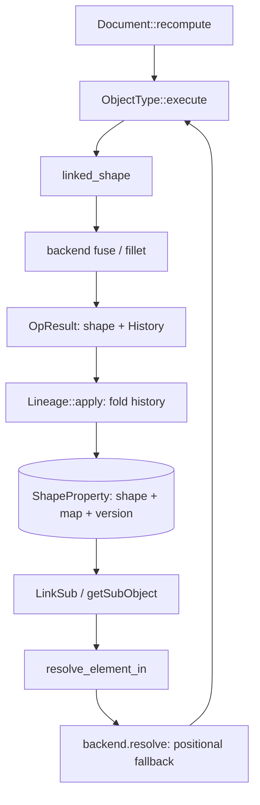

# Lineage and naming: a layer, not a geometry kernel

Status: design (2026-10-23; layering decision made explicit 2026-10-24). Refines
[`geometry-and-topology.md`](geometry-and-topology.md) §1 and §4. The vocabulary, layer,
provenance breadth, Part storage, map-first reference resolution and the exposed reverse map
landed 2026-10-23; `.FCStd` map persistence (S6b) landed 2026-10-24, and the naming
policy (S6c) remains. Companion to
[`occt-history-spike.md`](occt-history-spike.md), [`occt-integration.md`](occt-integration.md),
[`part-draft-layering.md`](part-draft-layering.md), [`architecture.md`](../architecture.md) §6,
[`conformance.md`](../workbenches/conformance.md),
[`spikes/occt-history-rs/README.md`](../../spikes/occt-history-rs/README.md), and
[`format-serializers.md`](../tasks/format-serializers.md) (the two encoders; `.FCStd` `ElementMap`
persistence is still a follow-up there).

The observation that started this note: **topological naming is not inherently a geometric kernel
problem.** Today's tree entangles the Part workbench (where parametric history lives), OCCT (which
reports provenance), and the FCStd format (which persists a map). The short answer: **right about
ownership, wrong if read as independence**. OCCT never names anything; every name is assigned by a
mapper outside the kernel, and that mapper depends entirely on provenance the kernel reports. A
separate layer can own identity, policy, versioning and persistence — and should — while the kernel
supplies raw `Modified`/`Generated`/`IsDeleted`. Naming needs **four** things, and only one is
geometry. The layer and its Part consumer have since landed (§7 records the slices); §0 states the
ownership decision in the form that should outlive the implementation.

---

## 0. The layering decision (2026-10-24)

The owner's question — why TNP, links and `.FCStd` seem to live in FreeCAD's Part workbench, and
whether a separate lineage/naming kernel should own them — is answered by separating **where
provenance is produced** from **where identity and persistence live**. The decision:

| Layer | Owns | Does not own |
| --- | --- | --- |
| `ferrocad_lineage` | The payload-generic vocabulary and rules: `ElementRef<T>`, `ElementId`, `OperandId`, `Provenance`, `History<T>`, `ElementMap<T>`, `ReverseMap`, `Lineage<T>`, `MapVersion`, `NamePolicy`. | Any geometry type, construction, document object, property or file format. It has no workspace dependencies. |
| `ferrocad_geom` | The same vocabulary re-exported over `Shape`, plus the `GeometryBackend` seam that produces `OpResult { shape, history }`. | Name syntax, collision policy or persistence. |
| `ferrocad_part` | The stored `ShapeProperty` (a shape **plus** its `Lineage` and `MapVersion`) and the resolution policy in `resolve_element_in`. | Producing provenance or inventing names; it folds what the backend reported. |
| `ferrocad_py` / `ferrocad_part_py` | Frontends: the Python object/property surface, the composition root that installs the kernel, and the code that consumes resolution (`getSubObject`, link sub-elements). | The naming or persistence rules themselves. |

This is not a kernel concern because **the kernel never names anything**. OCCT reports
`Modified`/`Generated`/`IsDeleted` between opaque sub-shape handles; those relations are the raw
material, and turning them into `Face3` — and deciding what happens when `Face3` is retired — is a
document-level policy. Names are meaningful only relative to a document object, and a policy that
depends on the document cannot live in a library that does not know what a document is.

The kernel still owns what only it can know:

- the **provenance relations** for one operation, over every operand and every element kind;
- element identity across a rebuild (`IsSame`/`IsPartner`) and the unchanged elements that appear
  in neither relation list;
- kernel policy that changes the relation set (non-destructive mode, auto-fuzzy, refinement).

Treating Part as a "frontend for all parametric modelling" is the right reading of FreeCAD's layout:
Part is where features, their `ShapeProperty` and the edit history live, so it is where resolution
must be *applied*. It consumes the lineage layer; it is not the lineage layer.

### 0.1 The rule: preserved or invalid, never retargeted

A stored name is resolved in this order (`ferrocad_part::resolve_element_in`):

1. If the name is in the forward map, it resolves to the mapped sub-shape. The map outranks the
   name's ordinal, which may denote a different element after an insert or delete.
2. If the shape has no lineage (empty map), positional resolution is the only thing that can be
   known, so the backend resolves `Edge1` as its first edge.
3. If the shape has a non-empty lineage and the name is absent, the name is **retired**: the
   reference fails (`ResolveElementError::Retired`) rather than falling back positionally.

The third rule is the invariant: a stale reference makes its feature invalid; it never silently
dresses a different face. Resolution only reads the map — it never binds, retires or renames — so
loading or resolving a document cannot change its meaning. The fold itself has the matching property:
`ElementMap::apply` inserts only when a name is absent, so an existing name is never rebound.

### 0.2 Current measured state

The reverse map now carries real data and is exposed to Python. The two compound-cut cases in
upstream `TopoShapeTest.py` measure **12** and **30** reverse-map keys; upstream asserts **20** and
**47**. The difference is the naming/alias policy (the extra names a boolean emits), not missing
provenance or fabricated entries. `ElementMapVersion`/`ElementMapSize` stay empty until the upstream
sizes can be reproduced, because the other guards assert exact sizes (52/58/26/10/9/24 depending on
the case).

So the open item is **S6c**: understand upstream's naming form and close 12→20 / 30→47.
The map is already persisted in both formats (S6b: the `PartShapeN.lineage` sidecar). This is
a policy question, which is exactly why it belongs to the lineage layer rather than the
kernel. See [`../TODO-23-10-2026.md`](../TODO-23-10-2026.md) §P1.

---

## 1. The decomposition

| Concern | Question | Nodes / edges | Owner | Status |
| --- | --- | --- | --- | --- |
| Object-graph sort | In what order do features execute? | Document objects / links, expressions | `ferrocad_core` | **Built** (`recompute_order`) |
| Sub-shape lineage | Which face/edge does a stored name mean after a rebuild? | Elements / provenance relations | `ferrocad_lineage` | **Partial**: S1–S6b are in (map-first Part resolution, the exposed reverse map, and `.FCStd` sidecar persistence); the name policy (S6c) remains |
| Geometry construction | Inputs + parameters → shape | Solids, surfaces, algorithms | `ferrocad_occt` | **Built** for primitives, booleans, dress-ups |

The earlier note said naming "needs a geometry kernel, OCCT shape history, and a persistent element
map" — true as a dependency list, misleading as ownership. Refined:

> Naming is a **shape-lineage** problem. The kernel supplies *provenance*; the lineage layer assigns
> *identity*, *names*, *versions* and *collisions*; the document and formats persist *references* and
> *maps*. The kernel is necessary, not sufficient, and no naming policy lives in it.

A kernel with no history cannot be rescued by a better mapper; a mapper that is not separate cannot
be tested without a kernel; and `Face6` is a document fact, meaningless outside its object.

What the kernel owes, verified in [`occt-history-spike.md`](occt-history-spike.md): OCCT reports
relations, never names; whole-solid queries are useless (`Deleted=1`) so lineage exists only at
sub-shape level; there are **three** cases per input — modified, generated, and *unchanged* (absent
from both lists, not deleted, still present) — so a two-case model drops elements; and auto-fuzzy and
non-destructive mode are kernel policy. Element identity across a rebuild (`IsSame`/`IsPartner`) is
a kernel question, not an inference from a name table.

---

## 2. What exists today, measured

| Stage | Code | State |
| --- | --- | --- |
| Provenance | `ferrocad_occt/src/backend.rs` `build_history`; `include/fc_history.hxx` | **Both operands** and faces/edges/vertices, each with `OperandId`, kind and ordinal. The *names* remain positional (`FaceN` from the operand's own enumeration); the backend still invents them. |
| Vocabulary and fold | `crates/ferrocad_lineage`; re-exported by `ferrocad_geom` | Payload-generic, no workspace dependencies, unit-tested with `T = String` and with `Shape`. `Lineage`, `ReverseMap`, `MapVersion` and `NamePolicy` are the production types. |
| Document and property | `ferrocad_part/src/{containers,dress_up,shape_property}.rs` | `ShapeProperty` stores the shape **plus** its `Lineage` in a versioned native envelope; boolean containers fold `OpResult.history`; `resolve_element_in` reads the map before falling back. |
| Python | `ferrocad_part_py` | `ElementReverseMap` returns `{output: [inputs]}` from the stored reverse map. `ElementMap`/`ElementMapVersion` stay empty until S6c can reproduce upstream's sizes. |

`build_history` enumerates both operands' elements, asks the operation for
`Modified`/`Generated`/`IsDeleted`, maps each output into the **result's** element map, and emits
`(input_ref, output_ref)` pairs named from their own positional enumeration. The identity side table
(`provenance`) is sorted canonically, so the order OCCT reported relations in cannot change how a
history compares. Two judgments there are policy, not mechanics: an element that both maps and is
reported deleted is treated as *not* deleted, and outputs outside the result's enumeration are
dropped, so generated elements outside that set never reach `History`. Fillet and chamfer differ:
they resolve the *stored* edge names first, then report what each selected edge generated — so Part
already handles one stored and one positional convention.

`ElementMap::apply` inserts only if the name is absent (`entry(...).or_insert_with(...)`). "First
output wins" holds for a fresh map, and an existing name is **never retargeted** on a later
`apply` — the invariant behind "preserved or invalid, never moved". Deleting an input removes its
name. Both are tested in `ferrocad_lineage`; the types are not `serde`, because the native document
format persists them through `ShapeProperty`'s explicit envelope rather than through a derive.

### 2.1 The upstream contract we are opting out of

`../freecad-upstream/src/Mod/Part/parttests/TopoShapeTest.py` is the naming contract. Every assert on
an *operation result* is guarded by `if shape.ElementMapVersion != "":`; only the fresh-box
assertions (empty map, size 0, `Content`) are unconditional. The asserted sizes are exact:

| Shape | Test | `ElementMapSize` |
| --- | --- | ---: |
| Compound of two boxes | `testTopoShapeElementMap` | 52 |
| Fuse (`Refine` false and true) | `testPartFuse` | 58 |
| `makeShell(box.Faces)` / `makeSolid(box.Shells[0])` | `testAppPartMakeShell` / `testAppPartMakeSolid` | 26 |
| `makeLoft(Wires[0:2])` / `makeShellFromWires` | `testAppPartMakeLoft` / `testAppPartMakeShellFromWires` | 24 |
| `makeFace(box.Faces[0], "FaceMakerCheese")` | `testAppPartMakeFace` | 10 |
| `makeFilledFace(box.Faces[3].Edges)` | `testAppPartmakeFilledFace` | 9 |

`assertKeysInMap` (L36) only checks that names **exist**; the `Common` and `Cut` tests use it on
`ElementReverseMap` with friendly names (`Edge1`…`Edge12`, `Face1`…`Face6`, `Vertex1`…`Vertex8`). Two
numbers matter: **26 for a box shell/solid is exactly 6 faces + 12 edges + 8 vertices**, one entry
per sub-shape; **58 for the fused L is not** — the test's own comment gives 8F + 12V + 18E = 38. So
`ElementMapSize` counts **map entries**, not topology, and a boolean result carries extra names
(aliases or encoded tokens) beyond one per element. Which entries are missing is §0.2's open policy
question. Our facade still returns `ElementMapVersion == ""`, `ElementMapSize == 0`,
`ElementMap == {}`, `Content == "<ElementMap/>\n"` and `Hasher is None`: the *fresh box* assertions
exactly, so every guarded naming assertion is skipped. `ElementReverseMap` is no longer empty — it
returns the stored reverse map, which is why the two compound-cut cases now fail on a real but short
count (12/30 vs 20/47) instead of on 0. `mapSubElement` remains a documented no-op. We are not
failing the naming tests; we are skipping them until the sizes can be reproduced.

---

## 3. The layer

### 3.1 Name and placement

**`ferrocad_lineage`.** `ferrocad_naming` names the output and invites the crate to own syntax,
selection translation and eventually UI. `lineage` names the input — the provenance DAG — which is
the thing with invariants, and it matches the vocabulary already used here. "Kernel" is defensible,
but this repository already uses *kernel* for OCCT; call it a **layer**, a leaf **below**
`ferrocad_geom`:

```text
ferrocad_lineage -> (no workspace deps)   [history, reverse map, policy, version]
ferrocad_geom    -> ferrocad_lineage, ferrocad_types, ferrocad_curves
ferrocad_occt    -> ferrocad_geom
ferrocad_part    -> ferrocad_core, ferrocad_geom, ferrocad_curves, ferrocad_types
ferrocad_part_py -> ferrocad_part, ferrocad_geom, ferrocad_occt, ferrocad_py
```

`ferrocad_part` reaches the vocabulary through the `ferrocad_geom` re-export rather than a second
direct dependency, so the payload-generic types have exactly one source. `ferrocad_py` (the core
object/document bindings) and `ferrocad_part_py` (the Part module and kernel composition root) are
frontends: they expose the Python surface and call resolution, but they hold no naming rule.

This is stronger than "it must not construct geometry": the layer is **unable** to name a `Shape`.
The map is generic over an opaque payload `T`, so `ferrocad_geom` instantiates it with `Shape`; core
never learns of it, and the algorithm runs in tests with `T = String` (the geom tests already use
`Shape::new("out-m")`). A lineage crate above `ferrocad_geom` would be easier and strictly worse.

### 3.2 Core types

Keep `ElementName = String` initially; a newtype would spend the compatibility budget on a guess
before the upstream encoding is readable. One `History<T>` is an operation's edge set; a `Lineage<T>`
is the per-shape accumulation.

```rust
pub struct ElementRef<T> { pub shape: T, pub name: String }
pub struct OperandId(u16);                        // A = 0, B = 1
pub struct ElementId { operand: OperandId, kind: String, ordinal: usize }

pub struct History<T> {                           // what one operation reports
    pub generated: Vec<(ElementRef<T>, ElementRef<T>)>,
    pub modified:  Vec<(ElementRef<T>, ElementRef<T>)>,
    pub deleted:   Vec<ElementRef<T>>,
    pub provenance: Vec<Provenance>,              // ElementId + relation + output name
}
pub struct ElementMap<T> { /* name -> T */ }
pub struct ReverseMap { /* output name -> [input names] */ }
pub struct Lineage<T> { map: ElementMap<T>, reverse: ReverseMap, version: MapVersion }
pub struct MapVersion { encoding: u16, policy: String, kernel: Option<String> }
pub trait NamePolicy {
    fn name(&self, kind: &str, ordinal: usize, input: Option<&str>) -> String;
    fn split(&self, stem: &str, count: usize) -> Vec<String>; // one input -> many outputs
}
```

`ElementKind` stays in `ferrocad_geom`; the caller passes its prefix (`Face`, `Edge`), so lineage
never names a geometry type.

### 3.3 Invariants

| Invariant | Statement | Why | How tested |
| --- | --- | --- | --- |
| Determinism | Same inputs + history + policy ⇒ byte-identical map | No churn across rebuilds | Apply twice to fresh maps, compare bytes |
| Stability | A name means the same logical element if inputs are unchanged | The point of TNP | Golden histories from the spike |
| No silent rebinding | If lineage cannot justify a name, retire it — never point it elsewhere | A wrong face is worse than a missing one | Split cases |
| Deletion | A deleted input's name is retired, and resolution reports why | Stale references must fail, not drift | Deleted-name test |
| Completeness | Every output element is named; every input has one of the four relations | Unnamed output is unreferenceable | Compare against `elements()` per kind |
| No-loss ambiguity | One input → many outputs is a set; every produced output is recorded in the reverse map even when the forward map keeps only the first | A name cannot denote a set, but the relation must not be lost | Reverse-map split cases |
| Version honesty | A mismatch invalidates rather than guesses | Old files must not resolve through new rules | Round-trip with a bumped version |

### 3.4 What it must not know

No `GeometryBackend`, boolean, fillet, tessellation, tolerance or `TopoDS`; no document objects,
properties, recompute order or Python names; no selection (pick → name needs renderer primitive ids
and belongs to the translation layer in [`geometry-and-topology.md`](geometry-and-topology.md) §9,
which *consumes* `ReverseMap`); and no persistence *format*. It may *read* topology through a narrow
trait (`elements`, `same`) to check completeness; reading is not constructing.

---

## 4. The kernel boundary

The line is simple: **the kernel reports relations between opaque sub-shape handles; lineage turns
them into names**, and a string must never cross the FFI boundary.

| Item | Owner | Today | Required |
| --- | --- | --- | --- |
| `Modified` / `Generated` | OCCT → backend | Bridged (`fc_history.hxx`), both operands, faces/edges/vertices | All operations, not only booleans |
| `IsDeleted` | OCCT → backend | Suppressed when the element also maps | Report raw; lineage decides |
| Unchanged | OCCT (by absence) | Not represented | Derived by lineage from "in output, in neither list" |
| Input identity | backend | `ElementId`: operand + kind + 1-based ordinal | Keep identity distinct from the name |
| Operation identity | Part / lineage | Absent | Kind + parameters (to re-derive and version) |
| Name syntax (`Face1`) | lineage | Positional, invented in the backend | Never in the backend; lineage owns stored names |
| Collision / retire / version / persistence | lineage + format | Resolution in `resolve_element_in`; version in the native envelope; raw BREP in `.FCStd` | Policy; composite version; shape + map together |

The remaining boundary smell is that the adapter still assigns the positional names (`FaceN`) that
history outputs carry, and `elements()` returns labels that look like stable names. They are
kind + ordinal in `ElementId`; the *spelling* is a lineage policy. The boundary also runs the other
way: lineage must demand
"non-destructive booleans and scaled auto-fuzzy, or this map is not reproducible"
([`occt-history-spike.md`](occt-history-spike.md) §2).

---

## 5. How Part consumes it

Part document objects are the frontend that records parametric history; they should not also name.



| Step | Landed design | Still open |
| --- | --- | --- |
| `execute` | Boolean containers keep `OpResult.history` and fold it into `Lineage`; primitives start with an empty lineage. | Provenance for every operation, not only booleans and dress-ups. |
| Stored reference | `LinkSub`/dress-up names stay plain strings; resolution consults the shape's lineage first (`resolve_element_in`). | L5 landed: `ferrocad_py` validates the sub-element name through the shape's `resolve_element_name` hook. |
| Result | `ShapeProperty { shape, lineage, version }`, persisted as a versioned native envelope. | The `.FCStd` sidecar (S6b) writes the same envelope beside the raw BREP. |
| Python surface | `ElementReverseMap` returns the stored reverse map. | `ElementMap`/`ElementMapVersion` until upstream's sizes are reproduced. |

The document does not learn naming: `recompute` already orders features and `execute` already has
inputs and result, so the new steps are only "keep the history" and "store the map beside the shape".
`ShapeProperty` is the storage owner; `ferrocad_py`/`ferrocad_part_py` are frontends that call
resolution but own no rule. `LinkSub` names stay plain strings, so reference *persistence* is
unchanged — only resolution does. This fixes an asymmetry for free: a `Part::Fillet` with `Edge1`
used to resolve positionally, so an inserted edge silently moved the fillet; with a map, a retired
name fails loudly — which `store` already turns into an invalid feature.

---

## 6. How the formats interact

The two serializers are **parallel and independent** ([`format-serializers.md`](../tasks/format-serializers.md)).
The native format (`.ferrocad`, with `.fe2o3`/`.fe203` aliases) is FerroCAD's own and may evolve
freely; `.FCStd` is the conformance-tracked import/export path and must stay upstream-compatible.
Neither is defined in terms of the other, so a native format change cannot invalidate a conformance
claim.

| Surface | Native (`.ferrocad`, `.fe2o3`) | `.FCStd` |
| --- | --- | --- |
| Shape payload | `ShapeProperty::save` writes a versioned `FCSHPROP` envelope: raw BREP + `MapVersion` + forward map + reverse map. | `ShapeProperty::fcstd_members` writes raw BREP as `PartShapeN.brp`; the element does not wrap it. |
| Lineage | Persisted inside the envelope; legacy raw BREP with no prefix still loads as an empty lineage. | **Persisted additively (S6b).** `PartShapeN.lineage` carries the same envelope and is referenced from `<Part>` by a `FerroCADSidecar` attribute upstream ignores; the reader prefers it and falls back to the raw `file` member. Upstream's own `ElementMap` form is still unreadable here (§8). |
| Contract | Ours; versioned and free to change, with a migration. | Upstream's; every change is measured by the conformance harness. |

The rule for `.FCStd` lineage persistence: **raw `.brp` stays raw; any lineage metadata is
additive**. Never put the native envelope inside `PartShapeN.brp` — an upstream reader must still see
a BREP file. S6b implements the first option: a sidecar member (`PartShapeN.lineage`) referenced by a
`FerroCADSidecar` attribute on `<Part>`, which an upstream reader ignores, so it still loads the
shape. An upstream-compatible `ElementMap` element remains the alternative form and is still open
(§8).

Both encoders persist **shape + forward map + version**, and the reverse map as well: it cannot be
derived from the forward map, whose values carry no name. The version axes — encoding, policy and
kernel provenance — live in `MapVersion`; a mismatch invalidates the map rather than guessing.
`TopoShapeExpansion.cpp` pins the OCCT component to `0x070200` on purpose, so a kernel upgrade does
not invalidate saved maps. The other upstream components (`OpCodes::Version`,
`ComplexGeoData::getElementMapVersion()`) live in `src/App` and cannot be read here; the spike recorded
the composite as `OpCodes::Version . <occt-hex> .` plus `"5"`, so treat the current value as
**unverified**. Version separately the map encoding, the naming policy, the provenance assumptions,
and the stored references (which should record the map version they were written against, or be
marked unresolved on mismatch).

The unresolved `.FCStd` interop choice is adopting upstream's keys verbatim or translating;
compatibility argues for adoption, and the encoding cannot be read here (§8).

---

## 7. Migration path

Separate the types without changing behaviour, make the map real, then widen provenance. Only S3
turns the upstream map assertions on; S4 then changes their values.

| Step | Change | Breaking | Acceptance |
| --- | --- | --- | --- |
| S1 | Add `ferrocad_lineage` generic over `T`; replace the geom `History`/`ElementRef`/`ElementMap` definitions with type aliases over the generic ones (`pub type History = ferrocad_lineage::History<Shape>`, …). Keep the same field names and types so every literal compiles. | **No** | `cargo test -p ferrocad_geom -p ferrocad_occt` unchanged; no call site edited; geom still has no OCCT dependency |
| S2 | Add the lineage trait, `Lineage<T>`, `MapVersion`, and a `NamePolicy` whose default is today's behaviour. Add determinism and round-trip tests with `T = String`. | No | New unit tests; behaviour identical |
| S3 | Stop discarding history in Part; store `Lineage` in `ShapeProperty` behind a versioned blob; return the real version/size; fix "no silent rebinding" and "no-loss ambiguity". | **Yes, semantically** | Upstream map assertions become real; conformance re-measured |
| S4 | Backend emits kind + ordinal + operand id; lineage names them. Extend to both operands and edges/vertices; forward raw `IsDeleted`. | No (internal) | Golden histories from the spike |
| S5 | Resolve stored references through the map first, positional fallback only when no map exists; make `mapSubElement` real. | Behavioural for stale refs | Insert-an-early-face test: preserved or invalid, never moved |
| S6 | Serialize maps in both formats; `.FCStd` element-map form once §8 is answered. | Format | Round-trip in both encoders; old blob still loads |

**S6b landed 2026-10-24** for the persistence half: `ExtensionData::fcstd_sidecar` lets a
module write metadata beside its upstream-compatible payload, `ShapeProperty` writes its envelope
to `PartShapeN.lineage` (referenced by `FerroCADSidecar`), and the reader prefers it with a raw
fallback. **S6c** remains: upstream's naming/alias policy and the 12/30 → 20/47 sizes.

**S1 landed 2026-10-23**: `crates/ferrocad_lineage` carries the three types with 7
unit tests (`T = String`), `ferrocad_geom` re-exports them as aliases over `Shape`, and
no call site or conformance number changed. **S2 landed the same day**: `Lineage<T>`,
`ReverseMap`, `MapVersion` and an object-safe `NamePolicy` with `DefaultNamePolicy`
reproducing today's positional names; 19 tests, deterministic and idempotent, still with
no Part consumer. **S4 landed the same day** (ahead of S3): `History<T>` carries a
payload-free `Provenance` list, and the OCCT backend now enumerates **both operands** and
faces/edges/vertices, recording `OperandId`, kind and ordinal. Names stay positional and
`ElementMapVersion` is untouched; the fuse/cut golden histories assert the counts and
determinism. **S3 landed after it**: `ShapeProperty` persists a versioned lineage
envelope (magic + version + BREP + forward/reverse maps), legacy raw BREP still loads,
and the boolean containers fold the backend history. The Python-visible
`ElementMap`/`ElementMapVersion` remain empty — flipping those waits for S6c, when the
names and sizes can be reproduced. **S5 landed next**: Part resolves stored sub-element
names through the shape's lineage first (`resolve_element_in`), falls back positionally
only when the shape has no lineage, and reports a name absent from a non-empty map as
retired rather than silently moving it.

S1 and S2 were deliberately boring: move types, add a policy. Until S3 the empty-map behaviour (`""`, `0`,
`<ElementMap/>`) stays exactly as it is — honest about having no map rather than faking a `Face1`
entry, because a provisional map would stop the guards skipping and start asserting numbers we cannot
reproduce yet. `docs/architecture.md` §1 and `docs/tasks/p2-architecture.md` call `ferrocad_geom` the
seam owning `History`/`ElementMap`; S1 keeps that true by re-export.

---

## 8. Open questions

- **Exact upstream name compatibility.** We know the Python contract but not the key encoding:
  `src/App/ElementMap.h`, `ElementMap.cpp` and `ComplexGeoData` are outside the checkout. Adopt the
  keys verbatim (best `.FCStd` interop), translate, or diverge?
- **What are the missing entries?** The compound cuts currently produce 12 and 30 reverse-map keys
  where upstream asserts 20 and 47; the fused L's `ElementMapSize` is 58 while its topology has 38
  elements. Aliases, encoded tokens and retained input names are all plausible. Measure against a
  real upstream build before freezing the policy; the gate is exact, so do not guess (§0.2).
- **Per-operation or per-document naming?** The evidence points to per-shape maps (`TopoShape` owns
  one, `PropertyPartShape` persists it), with a document-level override hinted at by
  `DocumentObject::getElementMapVersion` (a `todo!()` in `ferrocad_gen`). Recommendation: maps are
  **per shape** (portable, composed along the chain); *policy and version* are document-level, since
  a per-document identity counter would make maps order-dependent.
- **Retire or repair?** Decided: retire. A deleted reference fails rather than being remapped through
  a surviving ancestor; repair would need topology queries and a policy for choosing among candidates.
- **Do unchanged elements get entries?** They are invisible in the history, yet the 26-entry shell
  suggests every sub-shape is named — completeness would then require naming unmentioned outputs,
  from `elements()`, not history.
- **Kernel pinning and settings.** Copy `0x070200` so upgrades do not invalidate maps, or record the
  real version and re-derive? If `FCBRepAlgoAPI_*` changes the map, version the backend too.

## 9. Premises, checked

| Premise (2026-10-23) | Verdict |
| --- | --- |
| "Topological naming is not inherently a geometry kernel problem." | **Right about ownership** (OCCT reports relations, never names). **Wrong about independence** (no history, no naming). |
| "A separate lineage/naming kernel." | Yes, as a **layer** below `ferrocad_geom`: `ferrocad_lineage`, generic over the payload, no construction. |
| "The tree entangles Part, kernel and format." | Confirmed: produced in `ferrocad_occt`, folded in `ferrocad_geom`, discarded in `ferrocad_part`, stored as bytes in `ShapeProperty`, exposed empty in `ferrocad_part_py`. |
| "Naming needs a kernel, history and a map." | Dependency-correct; refine to *provenance + identity/policy/version + persistence + references*. |
| "There is a separate lineage/naming kernel" (2026-10-24) | Correct as a **layering** statement (§0): `ferrocad_lineage` owns identity, naming and persistence; Part applies the policy. It is a layer, not a second geometry kernel. |
