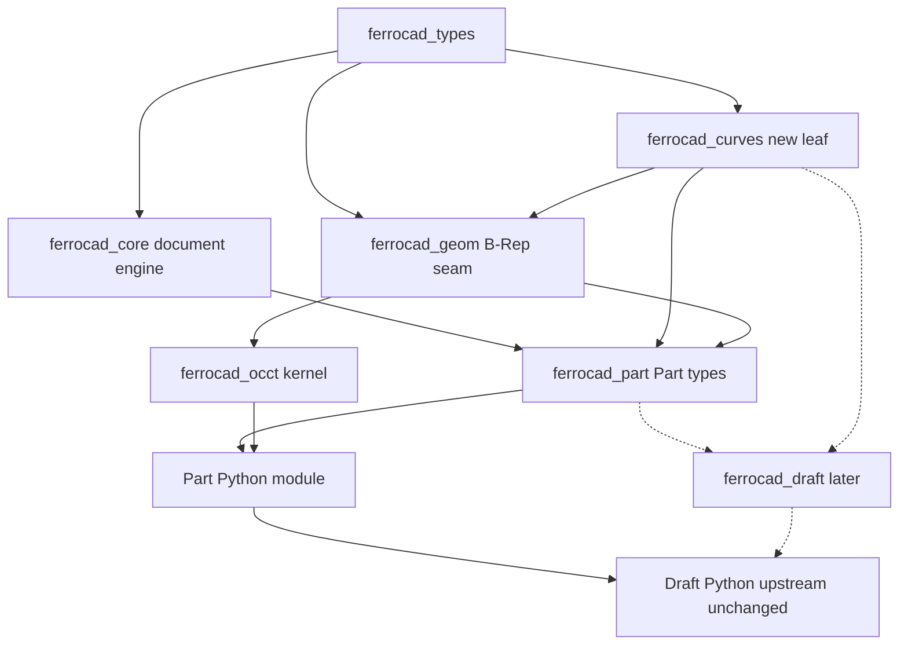

# Part, Draft, and the 2D seam

Status: design (2026-10-21).

This note settles how **Part**, **Draft**, **Sketcher** and **BIM** layer against each
other in FerroCAD. It starts from the observation that "Part and Draft look circular"
and asks whether Draft should be independent of Part, inside Part, or whether the
right move is to split Part semantically in Rust and recombine the halves in the
Python facades.

The short answer: Part is not one library. It is an analytic-curve library and a
B-Rep library shipped in one module because FreeCAD's `Part` module binds
OpenCASCADE's two families (`Geom_*` and `TopoDS_*`) into one Python namespace.
Draft uses the analytic half for its algorithms and the B-Rep half as the shape
representation it stores. The circularity is not real; the entanglement is. The
recommendation is a new leaf crate for analytic curves, no change of meaning for the
B-Rep seam, and a `Part` facade that exposes both halves exactly as upstream does.

No code was written for this note and no tests or `cargo` commands were run. Every
count below is a static measurement against `freecad-upstream` at `33adf61` (the
sparse checkout of `src/Mod/{Test,Part,Draft,BIM}` plus `src/Ext`). Method and
caveats are in [§10](#10-what-i-could-not-verify-and-how-the-numbers-were-taken).

Companion to [`geometry-and-topology.md`](geometry-and-topology.md) (the seam and the
naming problem), [`topology-selection.md`](topology-selection.md) (the implemented
`Shape`/`ElementRef` vocabulary), [`occt-integration.md`](occt-integration.md) (the
kernel behind the seam), [`architecture.md`](architecture.md) §6 (the dependency
rules), [`repackaging.md`](repackaging.md) and
[`edition-publishing.md`](edition-publishing.md) (which editions link Part),
[`toy-workbench.md`](toy-workbench.md) (a workbench with no geometry at all), and
[`gizmo-manipulators.md`](gizmo-manipulators.md) (the presentation seam a Draft
grip would use).

---

## 1. Verdict

1. **Part and Draft are not circular.** Draft imports Part and calls it; Part
   imports Draft in exactly one test file,
   `src/Mod/Part/parttests/TestPartMirror.py:34`. That is a test fixture, not an
   architecture edge.
2. **Part is two things.** `Part.LineSegment`, `Part.Circle`, `Part.Arc`,
   `Part.Ellipse`, `Part.BSplineCurve` and friends are `Part::Geom*` classes that
   derive from `Base::Persistence`, not from `TopoDS`. In upstream they are declared
   in `src/Mod/Part/App/Geometry.h` (`Geometry` at :86, `toShape()` pure virtual at
   :94, `GeomLineSegment` at :882, `GeomCircle` at :588, `GeomArcOfCircle` at :620).
   The only thing that connects them to the kernel is `toShape()`.
3. **Draft's Part usage is mostly analytic.** Of 735 `Part.*` references across 42
   distinct names, 294 (40%) are analytic curve/geometry names and 353 (48%) are
   B-Rep shapes. But the B-Rep references are mostly *containers*: Draft reads
   `edge.Curve` 251 times and calls `.toShape()` 109 times, i.e. it does analytic
   math and converts back. The algorithms are curve algorithms.
4. **"Draft independent of Part" breaks the document.** Draft's objects *are*
   `Part::Part2DObjectPython` objects (9 `addObject` sites), carry a
   `Part::PropertyPartShape` (`draftobjects/wpproxy.py:48`), and persist their
   geometry as BREP through Part's property. A Part-free Draft is a new document
   format and a new base object type, not a dependency removal.
5. **"Draft inside Part" misplaces a document layer inside a geometry layer.** Draft
   objects are peers of `Part::Feature`, not members of the Part module. Upstream
   models the relation by deriving from a Part base object type, not by living in
   `Part`. The correct Rust edge is `ferrocad_draft -> ferrocad_part`.
6. **Recommended: split semantically, recombine in the facade.** Add a leaf
   `ferrocad_curves` (analytic curves, wire assembly, no OCCT, no `Shape`); keep
   `ferrocad_geom` as the B-Rep seam; let `ferrocad_part` own both halves as the
   *document* layer. `import Part` exposes curves and shapes together, exactly as
   upstream. `import Draft` stays upstream Python, unchanged, in `mods/Draft`.
   There is no parent crate, because a parent cannot remove an edge that is real.

---

## 2. What the code actually says

### 2.1 Draft's `Part.*` surface

All 42 distinct names in `src/Mod/Draft`, grouped by what they are in upstream Part.
Counts are textual references, not call sites (a name in a docstring counts; three
files mention `Part.LineSegment` only in a docstring, see §2.2).

| Group | Distinct | References | Names (count) |
| --- | ---: | ---: | --- |
| **Analytic curve/geometry** | 16 | 294 | `LineSegment` 93, `Circle` 43, `Arc` 34, `makePolygon` 25, `makeLine` 22, `makeCircle` 15, `Ellipse` 14, `BSplineCurve` 12, `BezierCurve` 11, `Line` 10, `ArcOfCircle` 9, `ArcOfEllipse` 2, `Hyperbola` 1, `Parabola` 1, `Plane` 1, `Point` 1 |
| **B-Rep shape/construction** | 21 | 353 | `Wire` 87, `Face` 56, `Shape` 56, `Edge` 53, `Compound` 24, `makeCompound` 24, `getShape` 12, `Vertex` 10, `makeFace` 8, `Shapes` 3, `makePlane` 3, `makeShell` 3, `makeSolid` 3, `makeWireString` 3, `Edges` 2, `Arcs` 1, `Shell` 1, `TopoShapeEdge` 1, `makeBox` 1, `removeSplitter` 1, `shapes` 1 |
| **Error type** | 1 | 58 | `OCCError` 58 |
| **Wire ordering** | 2 | 28 | `__sortEdges__` 22, `sortEdges` 6 |
| **Other** | 2 | 2 | `OCC_VERSION` 1, `show` 1 |
| **Total** | **42** | **735** | |

The same measurement restricted to `draftgeoutils`, the package that does the
geometry work: 251 references, 120 analytic (48%), 98 B-Rep, 17 `OCCError`, 15 edge
ordering. So the "geometry package" is almost half analytic by reference count and
100% analytic in intent.

### 2.2 Is `import Part` load-bearing for `import Draft`?

Yes, but for a narrower reason than it looks. Classifying all **244** `.py` files in
`src/Mod/Draft` by how they reach Part:

| Relationship to Part | Files | Note |
| --- | ---: | --- |
| Plain `import Part` executed at module import | 15 | 5 at the Draft root, 2 in `draftmake`, 1 in `draftobjects`, 2 in `draftguitools`, 5 in `drafttests` |
| `Part = lz.LazyLoader("Part", globals(), "Part")` | 25 | 15 in `draftgeoutils`, 5 in `draftfunctions`, 2 in `draftobjects`, 1 each root/`draftmake`/`draftviewproviders` |
| `import Part` only inside a function | 35 | deferred to call time |
| `Part.` only in a docstring | 3 | `draftmake/make_line.py`, `draftobjects/layer.py`, `draftfunctions/scale.py` |
| No Part reference at all | 166 | |

A static import closure of `Draft.py` under `FreeCAD.GuiUp == 0` reaches **92**
modules. Three of them import Part at module scope:

- `draftmake/make_circle.py:36`
- `draftmake/make_arc_3points.py:36`
- `draftobjects/shapestring.py:38`

No `Part.<attribute>` expression is evaluated at import time anywhere in Draft: a
scan of decorators, default arguments and class bodies across all 244 files finds
**0** such accesses. There is also no module-level `Part.x` in the closure. So
`import Draft` needs `Part` to be *an importable module*, not to provide any name
yet. The first real name it needs is `Part.LineSegment` (93 references) when a
constructor runs.

Two consequences that matter for the plan:

- **`draftgeoutils` is import-time Part-free but not Part-free.** Its 15 lazy
  loaders (`draftgeoutils/general.py:41`, `draftgeoutils/wires.py:45`,
  `WorkingPlane.py:54`) defer the import, not the dependency. Every function in the
  package still calls `Part.*` when invoked.
- **A "Part-free subset of Draft" is not a thing you can ship.** 23 of 31
  `draftmake` modules never *reference the `Part` module* (no `Part.`, no
  `import Part`), but only three of them (`make_layer`, `make_text`, `make_wpproxy`)
  create no `Part::*` object at all. The other 20 still call
  `addObject("Part::Part2DObjectPython", …)` or
  `addObject("Part::FeaturePython", …)`: `make_rectangle.py:83`, `make_polygon.py:73`,
  `make_circle.py:117`, `make_ellipse.py:71`, `make_fillet.py:125`,
  `make_shape2dview.py:61`, `make_shapestring.py:57`, `make_clone.py:124`,
  `draftmake/__init__.py:47`, plus the array/hatch/clone/block family. They are
  importable without Part and unusable without it.

### 2.3 The other direction is one test file

A search for `import Draft`, `from Draft` and `import draft` in all of
`src/Mod/Part` returns exactly one hit:

```
src/Mod/Part/parttests/TestPartMirror.py:34:import Draft
```

Part has 50 `.py` files and 17 test files under `parttests/`. So the "circular
dependency" is: Draft's runtime depends on Part; Part's *conformance run* depends on
Draft because one test uses it. That matters for scheduling (the Part conformance
suite cannot run before Draft is importable), but it is not a layering cycle.

### 2.4 Qt coupling inside Draft

Counts are files in each package; "Qt" means a `PySide`/`PyQt`/`QtCore`/`QtGui`/
`QtWidgets` textual reference. "Part" means a file containing an `import Part`
statement at any indentation.

| Package | Files | Qt-coupled | Files with `import Part` |
| --- | ---: | ---: | ---: |
| `draftgeoutils` | 18 | 0 | 0 (15 lazy loaders) |
| `draftfunctions` | 20 | 0 | 3 |
| `draftmake` | 31 | 1 | 6 |
| `draftutils` | 12 | 9 | 1 |
| `draftobjects` | 28 | 24 | 16 |
| `draftviewproviders` | 23 | 11 | 0 |
| `draftguitools` | 66 | 58 | 15 |
| `drafttaskpanels` | 7 | 7 | 0 |
| Draft root (`*.py`) | 17 | 7 | 4 |

The "Qt-free core" is real but narrower than it sounds. `draftgeoutils` and
`draftfunctions` import no Qt. `draftobjects` is mostly Qt-coupled at *import* time
because 24 of 28 modules do `from PySide.QtCore import QT_TRANSLATE_NOOP` for
translation strings, even when `GuiUp` is false. The `draftutils` 9 includes
`__init__.py`, which mentions Qt only in its docstring; the brief's 8/12 is the same
measurement excluding it.

That is why a headless `import Draft` is not Qt-free in practice: `Draft.py:175`
imports `draftviewproviders.view_base` **unguarded**, and `view_base.py:40-41`
imports `PySide.QtCore` and `PySide.QtGui`. `draftutils/translate.py:38-39` also
imports `PySide.QtWidgets`. In the 92-module headless closure, 28 files import
`PySide.QtCore` at module scope, one imports `QtGui`, one imports `QtWidgets`.

Names actually evaluated at import time by those modules are small:
`QtCore.QCoreApplication.translate` (`translate.py:41`),
`QtCore.QT_TRANSLATE_NOOP` (`translate.py:145`), the directly imported
`QT_TRANSLATE_NOOP` symbol, and the module objects themselves.
`QtWidgets.QApplication.UnicodeUTF8` is read in a `try/except AttributeError`, so a
shim does not need it.

### 2.5 BIM

Measured over all **227** `.py` files under `src/Mod/BIM`, using a strict line-start
`import X` / `from X import` pattern:

| Dependency | Files | Share |
| --- | ---: | ---: |
| `Draft` (strict import) | 81 | 36% |
| `Draft` (either import form, anywhere on a line) | 83 | 37% |
| mentions `Draft.` | 92 | 41% |
| `Part` (strict import) | 64 | 28% |
| `PySide` (strict import) | 86 | 38% |
| mentions `ifcopenshell` | 28 | 12% |
| imports `ifcopenshell` | 21 | 9% |

The figures quoted in the brief were 87 Draft / 88 PySide. I could not reproduce 87
with any of the import patterns I tried: strict is 81, either import form is 83,
adding `DraftGui`/`DraftVecUtils` is 90, mentioning `Draft.` is 92, and any `Draft*`
import name is 96. I use the strict counts and flag the discrepancy rather than
reconcile it silently.

What BIM uses Draft for is broader than geometry: 46 distinct `Draft.*` names, 494
references. Top uses are `getType` 191, `make_line` 38, `autogroup` 32,
`make_rectangle` 27, `get_group_contents` 25, `make_wire` 24. Only some of those are
geometry; `getType`, `autogroup` and `get_group_contents` are model/container
utilities.

### 2.6 How Draft works: curves in, curves out

Measured in `src/Mod/Draft`:

| Pattern | Count |
| --- | ---: |
| `.Curve` reads (get the analytic curve of an edge) | 251 |
| `.toShape()` calls (turn a curve into a B-Rep edge) | 109 |
| files using `Part.<curve>(…).toShape()` | 21 |

A representative loop (`draftgeoutils/general.py:144-267`) dispatches on
`isinstance(edge.Curve, (Part.LineSegment, Part.Line))`, then
`isinstance(…, Part.Circle)`, `Part.BSplineCurve`, `Part.BezierCurve`,
`Part.Ellipse`. That is a 2D analytic geometry engine whose objects happen to be
reachable through `Edge.Curve`.

---

## 3. What Part gives Draft that is not 3D B-Rep

### 3.1 The analytic half has no topology in it

The upstream class hierarchy is unambiguous:

| Python name | C++ class | Base | File |
| --- | --- | --- | --- |
| `Part.LineSegment` | `Part::GeomLineSegment` | `GeomTrimmedCurve` | `Part/App/Geometry.h:882` |
| `Part.Circle` | `Part::GeomCircle` | `GeomConic` | `Part/App/Geometry.h:588` |
| `Part.ArcOfCircle` | `Part::GeomArcOfCircle` | `GeomArcOfConic` | `Part/App/Geometry.h:620` |
| `Part.BSplineCurve` | `Part::GeomBSplineCurve` | `GeomBoundedCurve` | `Part/App/Geometry.h:317` |

`Geometry` derives from `Base::Persistence` (`Geometry.h:86`) and declares
`virtual TopoDS_Shape toShape() const = 0` (`Geometry.h:94`). There is no `TopoDS`
member in the analytic classes; `toShape()` is the *only* bridge. A line segment is
two vectors. A circle is a centre, an axis and a radius. An arc is a circle plus a
parameter interval. None of that needs a kernel, and none of it is 3D-specific:
Draft's curves lie in a work plane, which is still a 3D curve parameterised in 3D.

### 3.2 The B-Rep half is a *container*, not the algorithm

`Wire` 87, `Edge` 53 and `Face` 56 dominate the B-Rep counts, but Draft's use is
"take the `Edge`s of a wire, read each `Edge.Curve`, do math, append
`Part.LineSegment(…).toShape()`". The topological object carries endpoints and a
reference to its curve; it does not supply the math.

`Part.sortEdges` is the one genuinely topological algorithm in the surface
(`__sortEdges__` sorts a flat list by coincident endpoints; `sortEdges` clusters the
result, `Part/App/AppPartPy.cpp:739-755`). It needs only edge endpoints, and Draft
already contains a disabled pure-Python implementation of the same algorithm
(`draftgeoutils/sort_edges.py:44-130`, which raises `DeprecationWarning` before its
body). That is evidence the algorithm does not need the kernel, only endpoints.

`Part.OCCError` (58 references) is the exception type thrown by the kernel. Upstream
creates it as a Python exception class (`Part/App/AppPart.cpp:266`), and 24 Draft
files reference it (some in `except`, some imported by name in `SVGPath.py`). A
neutral curve layer needs its own error type, and the `Part` facade must alias or map
it.

### 3.3 Why it happened

OpenCASCADE separates `Geom_*` (analytic geometry) from `TopoDS_*` (topology), but
FreeCAD's Part module binds both into one Python namespace: `Part/App/AppPart.cpp`
registers `Shape`, `Vertex`, `Edge`, `Wire`, `Face`, `Shell`, `Solid`, `Compound` and
then `Line`, `LineSegment`, `Point`, `Conic`, `Circle`, `Ellipse`, `Arc`,
`ArcOfCircle`, `BezierCurve`, `BSplineCurve` in the same `partModule` (`:307-328`).
The module boundary follows the C++ library's boundary, not a design decision. Draft
needed curves, Part was the only module that linked OCCT, so `Part.LineSegment`
became a Draft dependency by availability.

There is a second historical trace: the analytic types are *persisted* under their
Part names. In a real `.FCStd` from the Part test suite
(`src/Mod/Part/parttests/TestTangentMode3-0.21.FCStd`) I measured 47
`type="Part::GeomLineSegment"` and 30 `type="Part::GeomArcOfCircle"` entries, inside
4 `Part::PropertyGeometryList` entries on 4 `Sketcher::SketchObject` objects, plus 13
`Part::PropertyPartShape` entries backed by 13 separate `PartShapeN.brp` members.
Curves and shapes are both Part's, in the file format as well as in the API.

---

## 4. The three options

### Option A — Draft independent of Part

What "independent" would have to mean, and what breaks:

| Requirement | Evidence | Breakage |
| --- | --- | --- |
| Draft objects must not be Part objects | 9 sites call `addObject("Part::Part2DObjectPython", …)` (`make_circle.py:117`, `make_polygon.py:73`, `make_rectangle.py:83`, `make_ellipse.py:71`, `make_fillet.py:125`, `make_shape2dview.py:61`, `make_shapestring.py:57`, `make_clone.py:124`, `draftmake/__init__.py:47`). `Part::Part2DObject` derives `Part::Feature` (`Part/App/Part2DObject.h:54`). | Needs a new base object type with the same properties. Existing documents say `Part::Part2DObjectPython`; they become unknown types. |
| `obj.Shape` must not be a Part property | `obj.Shape = shape` in `draftobjects/wire.py:142` and `draftobjects/circle.py:96`; `wpproxy.py:48` explicitly adds `Part::PropertyPartShape`. | A second shape property type. The shape property is what carries BREP persistence; Draft would need its own encoding or a neutral blob. |
| `.FCStd` must stay readable | 13 `Part::PropertyPartShape` entries + 13 `PartShapeN.brp` members in one Part test file. | Either read Part's property without linking Part (impossible at the Python level) or migrate the format. |
| Scripts and macros must keep working | `obj.Shape.exportStep`, `Part.show(obj.Shape)`, `isinstance(obj.Shape, Part.Shape)` are the documented surface. | Every macro that treats a Draft result as a Part shape breaks. |
| BIM must keep working | 857 `Part.*` references; `ArchComponent.py:407` constructs `Part.Shape(obj.Base.Shape)`; `ArchSketchObject.py:33` type-checks `(Part.LineSegment, Part.Circle, Part.ArcOfCircle, Part.Ellipse)` at import. | BIM is a Part consumer independently of Draft; removing Draft's Part edge does not help BIM. |
| Draft tests must keep working | 5 test files import Part at top (`test_draftgeomutils.py:29`, `test_modification.py:38`, `test_trimex_gui.py:20`, `test_svg.py:43`, `draft_test_objects.py:51`); `draft_test_objects.py:105` calls `Part.makePolygon`. | The upstream suite stops importing. |

"Independent" therefore means: a new object base type, a new shape property, a new
persistence encoding, and a fork of the test suite. It does not mean dropping an
import. **Rejected.**

A note on PartDesign: it is not in the sparse checkout, so there is no line to quote.
The shared surface is still visible from Part's own code: `Part2DObject.h:54` makes
`Part::Part2DObject` a `Part::Feature`, and
`src/Mod/Part/App/FeatureExtrusion.cpp:303` tests
`docobj->isDerivedFrom<Part::Part2DObject>()` before extruding a profile. A sketch and
a Draft object are instances of the same base; removing Part from Draft would not
remove it from the extrusion feature that PartDesign drives.

### Option B — Draft inside Part

This would put a 244-file, mostly Qt-coupled, document-object workbench inside a
two-module Rust crate (`ferrocad_part`: `dress_up.rs`, `shape_property.rs`, `lib.rs`)
whose whole job is to own `Part::Feature`, `Part::PropertyPartShape` and the
dress-up features.

Why it misplaces the layer:

- **Object identity is a peer relation.** `Draft::Wire`, `Draft::Array`,
  `Draft::Dimension` are document types *alongside* `Part::Feature`. Upstream does
  not put Draft inside Part: it creates a `Part::Part2DObjectPython` object and
  attaches a Python proxy to it (`draftobjects/base.py`, and every `make_*` in
  §2.2). The Rust equivalent is a registered `ObjectType` in `ferrocad_draft` plus a
  dependency on `ferrocad_part`, not a new module inside `ferrocad_part`.
- **Blast radius.** `docs/architecture.md` §6 and
  [`edition-publishing.md`](edition-publishing.md) keep Part out of the base app.
  Putting Draft inside Part means every Part user (PartDesign, BIM, a box-only
  edition) links Draft's object types, arrays, DXF/SVG importers and Qt shims.
- **The Python cannot move anyway.** `cargo xtask mods` already fetches upstream
  Draft as loose Python (`crates/xtask/src/main.rs:40`, `DEFAULT_MODS = &["Draft"]`)
  into `mods/Draft`. "Draft inside Part" would mean Part's Python module owns a
  `mods/` tree, which is exactly what the module-hook design avoids
  (`docs/architecture.md` §9: the shell names no workbench).

**Rejected.** Correct edge: `ferrocad_draft -> ferrocad_part`.

### Option C — Layered composition

Recommended. Two moves, neither of which is a "parent project":

1. **Split Part internally** into analytic curves (a leaf) and B-Rep (the existing
   seam), with `ferrocad_part` as the document layer that recombines them.
2. **Keep Draft above Part** as a document workbench, and keep upstream Draft's
   Python unchanged.

A "parent project" that depends on both Part and Draft would be a *composition
root* (like `ferrocad_parametric` or the `mods/` tree), not a layer. It cannot
remove the Draft → Part edge, because Draft genuinely needs Part's object base and
shape property. The split has to happen *inside* Part, not above it.

| Question | A. Draft independent | B. Draft inside Part | C. Layered |
| --- | --- | --- | --- |
| Who owns the analytic curves? | Draft | Part (still) | `ferrocad_curves` |
| Who owns the B-Rep shape? | Draft (new type) | Part | `ferrocad_geom` / `ferrocad_occt` |
| `obj.Shape` remains `Part::PropertyPartShape`? | No | Yes | Yes |
| Upstream `.FCStd` readable? | No | Yes | Yes |
| Upstream Draft Python unchanged? | No | No | Yes |
| Every Part user links Draft? | No | **Yes** | No |
| New dependency edges | many | one giant | one leaf crate + one seam edge |

---

## 5. The recommended layering

### 5.1 Where does the analytic layer go?

Three candidate homes. The question is not "which compiles", it is "what does each
crate mean afterwards".

| Candidate | Today's meaning | What adding curves does | Cost if wrong |
| --- | --- | --- | --- |
| `ferrocad_geom` | "the kernel-neutral **B-Rep seam**": `Shape`, `History`, `ElementMap`, `GeometryBackend` (1110 lines, one `lib.rs`) | Widens a crate that `ferrocad_stage`, `ferrocad_viewport`, `ferrocad_gpui`, `ferrocad_toy`, `ferrocad_part` and `ferrocad_occt` all depend on. The name says "B-Rep"; the docs say "kernel-independent vocabulary". Those two statements would have to be reconciled. | Low-to-medium: one new module and one new edge; removing it later is mechanical but is a published-API change. |
| **new `ferrocad_curves`** | does not exist | A leaf over `ferrocad_types`: analytic curves, wire assembly, tolerances, no `Shape`, no OCCT, no document. | Low: a new internal crate; a rename or a re-home is a mechanical import change across at most four crates. |
| `ferrocad_types` | base values (`Vector3`, `Matrix4`, `Rotation`, `Placement`, `Quantity`); every crate in the workspace depends on it | Turns a value crate into an algebra crate. Compile-time and API blast radius is the whole workspace. | High: every crate rebuilds for every curve change, and "types" stops being a stable leaf. |

**Recommendation: a new leaf crate `ferrocad_curves`, not `ferrocad_planar`.**

The name matters. Upstream's curves are 3D-parameterised: `GeomCircle` has an axis
and a placement, and Draft's working plane maps a local `(u, v)` frame into world
space. "Planar" describes how Draft *uses* the curves, not what the curves are. A
`ferrocad_planar` crate would either be misnamed immediately or force a second crate
as soon as a 3D analytic curve is needed (a helix, a 3D arc, a profile on a tilted
plane).

The working-plane frame already exists on the presentation side as
`ferrocad_stage::workplane::Workplane` (origin, `u`, `v`, `n`, `WorkplaneKind`). A
Draft-side frame should reuse or move that type rather than grow a second
implementation in `ferrocad_curves`. That is a separate decision and is **not** part
of M0-M3.

### 5.2 What each crate owns after the split

| Crate | Owns | Explicitly does not own |
| --- | --- | --- |
| `ferrocad_types` | values: `Vector3`, `Placement`, `Matrix4`, `Quantity` | curves, topology, documents |
| **`ferrocad_curves`** (new) | `Vector2`, `Line`, `LineSegment`, `Circle`, `Arc`, `Ellipse`, `BSpline`, `Bezier`, the `EdgeCurve` enum, `Wire` as an ordered edge list, `polygon`, `sort_edges`, tolerance constants, curve intersection/offset primitives as needed | `Shape`, `TopoDS`, BREP I/O, documents, Qt |
| `ferrocad_geom` | the B-Rep seam, unchanged in role: `Shape`, `History`, `ElementRef`, `ElementMap`, `Tessellation`, `GeometryBackend` | curve algebra |
| `ferrocad_occt` | kernel implementation; `Geom_*` construction; `BRepBuilderAPI_MakeEdge/MakeWire/MakeFace`; `ShapeFix`; `BRep_Tool::Curve` for `Edge.Curve`; error mapping | document types, Python |
| `ferrocad_part` | `Part::Feature`, `Part::PropertyPartShape`, `Part::Fillet`/`Chamfer`; re-exports `ferrocad_curves` so a Part consumer gets both halves from one crate | Python, Qt, and Draft's object types |
| `ferrocad_draft` (later) | `Draft::*` object types and the shape-building functions Draft needs from Rust; depends on `ferrocad_part` + `ferrocad_curves` | OCCT by name, a solver, Qt |
| `ferrocad_part_py` | module `Part`: Python classes for curves and shapes, the converter hook, `OCCError` | document format decisions |

The one seam change I recommend is **one method and one edge**: `ferrocad_geom`
gains `make_edge(&EdgeCurve) -> Result<Shape, GeomError>` (and `make_wire`,
`make_face` when Draft needs them), which means `ferrocad_geom -> ferrocad_curves`.
Everything downstream (`ferrocad_occt`, `ferrocad_part`) already depends on
`ferrocad_geom`; `ferrocad_curves` depends only on `ferrocad_types`, so this cannot
cycle.

The fallback, if the seam must stay literally B-Rep-only: put the conversion in
`ferrocad_occt` as an inherent method and call it from `ferrocad_part_py`, which is
already the composition root and already names OCCT. That works for M0-M2 and keeps
`ferrocad_geom` untouched, but it means every future workbench's *composition root*
must name OCCT to build a shape from a curve, and a Rust-side Draft crate could not
build shapes without naming the kernel. **Prefer the seam method; treat this as the
escape hatch.**

### 5.3 Dependency rules, after

```
ferrocad_types     -> (crates.io only)                       [leaf]
ferrocad_curves    -> ferrocad_types                         [NEW leaf: analytic geometry]
ferrocad_geom      -> ferrocad_types, ferrocad_curves        [seam; one conversion method]
ferrocad_occt      -> ferrocad_geom, ferrocad_curves,
                      ferrocad_types, opencascade-sys         [kernel]
ferrocad_core      -> ferrocad_types                         [unchanged: no curves, no kernel]
ferrocad_part      -> ferrocad_core, ferrocad_geom,
                      ferrocad_curves, ferrocad_types         [document + combined Part]
ferrocad_part_py   -> ferrocad_part, ferrocad_occt,
                      ferrocad_py, pyo3                       [module `Part`]
ferrocad_draft     -> ferrocad_part, ferrocad_curves,
                      ferrocad_types                          [later; never occt]
```

Things this deliberately forbids:

- `ferrocad_core -> ferrocad_curves`: core stays geometry-free. A curve is geometry.
- `ferrocad_draft -> ferrocad_occt`: Draft goes through Part. If Draft ever needs a
  kernel operation Part does not expose, the fix is a Part method, not a Draft ->
  OCCT edge.
- `ferrocad_curves -> ferrocad_geom`: the leaf must not learn about `Shape`, or the
  two crates become mutually dependent.

### 5.4 The picture



Dashed edges are future work. The solid `curves --> geom` edge is the single seam
change recommended in §5.2; if it is deferred, the conversion lives in
`ferrocad_occt` and `ferrocad_part_py` temporarily, and the rest of the diagram is
unchanged.

### 5.5 Cost of being wrong

| If we are wrong about | Consequence | Reversibility |
| --- | --- | --- |
| Curves belong in `ferrocad_geom` rather than a new crate | One extra dependency edge on a widely shared crate; the seam's "B-Rep" description becomes inaccurate | Mechanical: move a module, update imports in `geom`, `occt`, `part`, `part_py`. Minor version bump. |
| Curves belong in `ferrocad_types` | `types` grows algebra; every crate in the workspace pays for every change to it | Mechanical but wide: the blast radius is the whole workspace, so do it once, not twice. This is why it is the worst of the three. |
| Curves belong in `ferrocad_part` | Draft and BIM depend on Part for curves, which is the coupling this note exists to remove; headless Draft tests would need the Part crate | Cheap to move out later, but it defeats the point now. |
| The crate should be `ferrocad_planar` | Misnamed as soon as a 3D analytic curve appears; a second crate follows | A rename across four crates; annoying, not architectural. |
| `EdgeCurve` should be an enum, not a trait object | A closed enum is simpler and serialisable, but adding a curve type is a breaking change to `ferrocad_curves` | Small: non-exhaustive enum plus a constructor. Prefer the enum. |

The asymmetry to remember: **a new leaf crate is cheap; a new edge into
`ferrocad_occt` is not.** Every design choice above keeps the kernel at the bottom.

---

## 6. Facade recombination

### 6.1 What `import Part` must be

Upstream's contract is one module with both halves, and the halves are *different
kinds of thing*:

- `Part.LineSegment(p1, p2)` returns a curve, not a shape. It is not
  `isinstance(…, Part.Shape)`; `.toShape()` produces the edge
  (`AppPart.cpp:307-328` registers both families in `partModule`).
- `Part.Edge.Curve` returns the analytic object (`BRep_Tool::Curve` under the hood).
  Draft reads it 251 times and dispatches on its type.
- `Part.OCCError` is a Python exception class (`AppPart.cpp:266`).
- `Part.sortEdges` / `Part.__sortEdges__` are module functions over edges
  (`AppPartPy.cpp:739-755`).
- The persisted type names are `Part::GeomLineSegment`, `Part::GeomArcOfCircle`,
  … (measured in a real `.FCStd`, §3.3), so our curve types must register those
  names for document round-trip.

Therefore the facade must not collapse curves into `Shape`. A `Part.LineSegment`
backed by `ferrocad_geom::Shape` would make
`isinstance(edge.Curve, Part.LineSegment)` and
`isinstance(edge, Part.Edge)` (both used in `draftgeoutils/general.py:144-176`)
indistinguishable.

### 6.2 Backing types

| Python name | Rust type | Created by | `toShape()` / conversion |
| --- | --- | --- | --- |
| `Part.LineSegment` | `ferrocad_curves::LineSegment { start: Vector3, end: Vector3 }` | `ferrocad_part_py` pyclass | `OcctBackend`: `BRepBuilderAPI_MakeEdge(gp_Pnt, gp_Pnt)` |
| `Part.Line` | `ferrocad_curves::Line { origin, direction }` | same | `Geom_Line` -> `BRepBuilderAPI_MakeEdge`; `GeomCurve::toShape()` uses the curve's first/last parameter (`Geometry.cpp:737-742`) |
| `Part.Circle` | `ferrocad_curves::Circle { center: Vector3, axis: Vector3, radius: f64 }` | same | `Geom_Circle` -> `BRepBuilderAPI_MakeEdge` |
| `Part.Arc` | `ferrocad_curves::Arc { circle: Circle, start_param: f64, end_param: f64 }`; the 3-point constructor solves the circumcircle. Persisted as `Part::GeomTrimmedCurve` | same | `Geom_TrimmedCurve` built by `GC_MakeArcOfCircle`, then `MakeEdge` |
| `Part.ArcOfCircle` | the same Rust `Arc` value, exposed as a second Python class. Persisted as `Part::GeomArcOfCircle`. Upstream's Python classes are siblings, not parent/child: `Arc(TrimmedCurve)` and `ArcOfCircle(ArcOfConic)` | same | `Geom_ArcOfCircle` (a `Geom_ArcOfConic`) -> `MakeEdge` |
| `Part.Ellipse`, `Part.BSplineCurve`, `Part.BezierCurve` | `ferrocad_curves::{Ellipse, BSpline, Bezier}` | same | `Geom_Ellipse` / `Geom_BSplineCurve` / `Geom_BezierCurve` |
| `Part.Plane`, `Part.Point` | `ferrocad_curves::{Plane, Point}` | same | `Geom_Plane` / `Geom_Point` |
| `Part.Shape` | `ferrocad_geom::Shape` (erased handle, the existing `PartShape`) | `ferrocad_part` / backend | identity |
| `Part.Edge`, `Part.Wire`, `Part.Face`, `Part.Vertex`, `Part.Solid`, `Part.Shell`, `Part.Compound` | the same `ferrocad_geom::Shape`, wrapped in a *distinct Python class* chosen from `ElementKind` | `ferrocad_part_py` | identity |
| `Part.Wire(edges)` | backend `make_wire(&[Shape]) -> Shape` | `ferrocad_part` | `BRepBuilderAPI_MakeWire` + `ShapeFix_Wire` |
| `Part.makePolygon(points)` | `ferrocad_curves::Wire::polygon(points)` -> `make_wire` | `ferrocad_part_py` | `BRepBuilderAPI_MakePolygon` / `MakeWire` |
| `Part.makeLine(p1, p2)` | `ferrocad_curves::LineSegment` -> `make_edge` | `ferrocad_part_py` | as above |
| `Part.makeCircle(...)` | `ferrocad_curves::Circle` -> `make_edge` | `ferrocad_part_py` | as above |
| `Part.sortEdges` / `__sortEdges__` | `ferrocad_curves::sort_edges(&[EdgeCurve])` | `ferrocad_curves` | for B-Rep edges, convert via `curve_of` first |
| `Part.OCCError` | Python exception created by `create_exception!`, mapped from `GeomError` | `ferrocad_part_py` | n/a |
| `Part.getShape(obj, sub, …)` | facade over `ShapeProperty` + `GeometryBackend::resolve` | `ferrocad_part_py` | existing |
| `Part::Part2DObjectPython`, `Part::FeaturePython` | `ObjectType` registrations in `ferrocad_core::object_registry` | `ferrocad_part` | n/a |
| `Part::GeomLineSegment`, `Part::GeomTrimmedCurve`, `Part::GeomArcOfCircle`, … | type-registry names reported by the curve pyclasses | `ferrocad_curves` / `ferrocad_part_py` | for `.FCStd` compatibility |

Two gaps in today's code that this table exposes:

1. **`PartShape` has no kind.** `crates/ferrocad_part_py/src/lib.rs` exposes one
   `#[pyclass] PartShape` wrapping `Mutex<Option<Shape>>`. Upstream has distinct
   Python classes and Draft uses `isinstance`. Either `PartShape` records an
   `ElementKind` when created, or `GeometryBackend` gains
   `fn kind(&self, shape: &Shape) -> ElementKind`. The former is cheaper and needs
   no trait change; the latter is more robust for shapes returned by operations.
2. **There is no `curve_of`.** `ferrocad_geom::GeometryBackend` has `resolve`,
   `tessellate`, `place`, `save_shape`/`load_shape`, but no way to get an
   `EdgeCurve` back from an edge. Without it, `Part.Edge.Curve` cannot be
   implemented, and Draft's 251 `.Curve` reads fail. Add
   `fn curve_of(&self, edge: &Shape) -> Option<EdgeCurve>` (implemented in
   `ferrocad_occt` with `BRep_Tool::Curve`, matching `Geom_Line`/`Geom_Circle`/
   `Geom_Ellipse`/`Geom_BSplineCurve`/`Geom_BezierCurve`). This is as load-bearing
   as the forward conversion.

One registry caveat: `ferrocad_core::object_registry::ObjectType` has no
inheritance (it composes `default_properties` and `execute`), while upstream models
these as scripted subclasses: `Part2DObjectPython` is
`App::FeaturePythonT<Part2DObject>` over `Part::Part2DObject` (which derives
`Part::Feature`), and `Part::FeaturePython` is the scripted subclass of
`Part::Feature` (`Part2DObject.h:54,108`; `PartFeature.cpp:2123`). The Rust
registration must therefore duplicate the base properties (Shape, Placement) and add
the attachment ones, rather than derive. Type checks such as
`obj.isDerivedFrom("Sketcher::SketchObject")` (used by `draftobjects/wire.py:137`)
need the registry to grow a base-type relation or the Python facade to answer from a
kind tag; they cannot be answered by `ObjectType` as it stands. That is a small core
gap worth naming, not a blocker for M0-M2.

### 6.3 Where the conversion happens

Forward (`curve -> TopoDS_Edge`) and backward (`TopoDS_Edge -> curve`) both happen
in **`ferrocad_occt`**, behind the `GeometryBackend` methods above. Not in
`ferrocad_part` (which must stay kernel-agnostic), not in Python.

A note on Python class identity: upstream has `Arc(TrimmedCurve)` and
`ArcOfCircle(ArcOfConic)` as siblings, and Draft's `isinstance` dispatch
(`draftgeoutils/general.py:144-267`) depends on the exact classes. Sharing one Rust
`Arc` value is fine; exposing it as one Python class is not.

`Part.LineSegment(...).toShape()` on the Python side is therefore: pyclass ->
`ferrocad_curves::LineSegment` -> `backend.make_edge(&EdgeCurve::LineSegment(..))`
-> `Shape` -> `PartShape` (kind `Edge`). The pyclass never sees a `TopoDS_Edge`.

### 6.4 Where the Python lives

| Module | Source | Mechanism |
| --- | --- | --- |
| `Part` | `ferrocad_part_py` | built-in module in the same image as `FreeCAD`; `pyo3::append_to_inittab!`; one process-wide core (`docs/occt-integration.md` §6) |
| `Draft` | upstream `src/Mod/Draft`, unchanged | `cargo xtask mods` fetches it into `mods/Draft` (`crates/xtask/src/main.rs:40`); `Init.py` adds import types; no Rust facade |
| `PySide.QtCore/QtGui/QtWidgets` | shim | `QT_TRANSLATE_NOOP`, `QCoreApplication.translate`, module objects; `QtWidgets.QApplication.UnicodeUTF8` optional |
| `lazy_loader` | shim or vendored 30-line `LazyLoader` | `Part = lz.LazyLoader("Part", globals(), "Part")` in 25 files |
| `freecad.deprecation` | upstream `src/Ext/freecad/deprecation.py` | already in the sparse checkout; `deprecated(...)` decorators run at import |

The recombination is therefore not a new Rust module. It is: **Part is one Python
module built from two Rust layers; Draft is upstream Python on top of it.** That is
exactly what upstream does, and it keeps the 244-file Draft tree out of the Rust
build.

---

## 7. Sketcher symmetry

The user's framing was "2D solver + 2D geometry vs 3D solver + 3D geometry, so split
semantically and recombine in the facades". Half of that is right.

**What is right:** solver and geometry are different concerns. A solver crate should
not own curve types, and a geometry crate should not know about constraints. That is
the same reasoning as §5 and it holds.

**What is wrong:** it is not a Draft-vs-Sketcher symmetry. Draft and Sketcher *share*
the geometry and differ in whether there is a solver. Measured:

- A real `.FCStd` stores 47 `Part::GeomLineSegment` and 30 `Part::GeomArcOfCircle`
  entries inside `Part::PropertyGeometryList` on `Sketcher::SketchObject` objects
  (§3.3). Sketch geometry is Part curve geometry.
- `ArchSketchObject.py:33` (BIM mirroring the Sketcher contract) accepts
  `supported_geometry = (Part.LineSegment, Part.Circle, Part.ArcOfCircle,
  Part.Ellipse)` and calls `.toShape()` on each.
- `Part::Part2DObject` is the shared document base (`Part2DObject.h:54`); Draft uses
  its scripted subclass `Part::Part2DObjectPython` at 9 `addObject` sites. Draft and
  Sketcher are siblings under that base, not opposites.

So the layering is: **geometry (shared) -> 2D object base (shared) -> {Draft objects,
Sketcher objects}**, with the solver belonging only to the Sketcher branch.

Concretely:

| Concern | Owner |
| --- | --- |
| `LineSegment`, `Circle`, `Arc`, `BSpline`, `Bezier`, `Wire` | `ferrocad_curves` |
| The 2D object base (`Shape` + `Placement` + attachment) | `ferrocad_part` (`Part::Part2DObject`) |
| Free construction/editing, arrays, annotations, import/export | `ferrocad_draft` (Rust objects later; Python now) |
| Constraint graph, solver, `Sketcher::SketchObject`, `Sketcher::PropertyConstraintList` | a future `ferrocad_sketcher` |
| 3D assembly constraints / placement solving | not this crate; shares only `ferrocad_types::Placement` |

What belongs to Draft: **nothing constraint-related**. Draft does contain one
function-local `import Sketcher` (`draftmake/make_sketch.py:92`, creating a
`Sketcher::SketchObject` at :151) and several `isDerivedFrom("Sketcher::SketchObject")`
checks, but those are conversions and type tests, not a solver. Keep them as Python
call-time references.

Do **not** invent a shared `ferrocad_solver` abstraction now. There is one solver in
scope (Sketcher's), and the 3D one is not designed. The justified shared piece is
`ferrocad_curves`, which is needed by Draft today.

---

## 8. BIM

**Is BIM a consumer of Draft? Yes.** 81 of 227 files import Draft, 92 mention
`Draft.`, and the usage is 46 distinct names / 494 references. The top uses are
`getType` (191), `make_line` (38), `autogroup` (32), `make_rectangle` (27),
`get_group_contents` (25), `make_wire` (24). Three of those are model utilities, not
geometry.

**Does BIM use Part as a shape representation? Yes.** 39 distinct `Part.*` names,
857 references: `LineSegment` 138 (more than all of Draft's 93), `Face` 130,
`makePolygon` 85, `Shape` 73, `makeCompound` 71. The code is explicit:
`ArchComponent.py:407` does `base_shape = Part.Shape(obj.Base.Shape)` and later
`obj.Shape = final_shape`; `importers/importIFC.py:1055` does
`obj.Shape = Part.makeCompound(...)`.

**Is IfcOpenShell the geometry core? No.** 28 files mention it, 21 import it. It is
the IFC schema reader/writer and an IFC geometry extractor:
`importers/importIFC.py:466` calls `geom.create_shape(settings, product)` and line
477 wraps the result in `Part.Shape()`. `nativeifc/ifc_geometry.py` contains no Part
references at all; it manages property sets and attributes. So the split is:
IfcOpenShell reads/writes IFC; Part is the in-document shape. They are not
alternatives.

Implications for `ferrocad_draft`'s public surface:

- It is an API contract, not a workbench's private helper set. Changing
  `Draft.make_line` or `Draft.getType` breaks BIM, and `Draft.getType` alone is 191
  references.
- Most of that contract is pure Python over `TypeId` and document links
  (`getType`, `autogroup`, `get_group_contents`, the `DraftObject` /
  `ViewProviderDraft` classes). It should stay Python. The Rust crate only needs to
  back what Python cannot: the `Draft::*` object types and the shape construction
  calls.
- BIM's own Part usage is larger than its Draft usage by reference count. Any plan
  that makes Draft "the 2D layer" must not move Part's shape representation out from
  under BIM.

---

## 9. Slice plan M0-M5

Ordering principle: make the upstream Python load first, then make geometry real,
then make documents real, then widen. Each slice names the upstream test files it
unblocks. "Unblocks" means the file imports and its cases run against the harness;
pass counts are not predicted here.

There is no `--draft` group in `tools/conformance.py` today (the options are
`--root`, `--files`, `--list`, `--part`, at `tools/conformance.py:207-211`). **M0
includes adding one**, using the same in-process image as the Part group
(`crates/ferrocad_part_py/tests/part_conformance.rs` is the template).

| Slice | Goal | Work | Unblocks (measured test methods) | Risk |
| --- | --- | --- | --- | --- |
| **M0** | `import Draft` succeeds headless, no OCCT | Add `ferrocad_curves` skeleton (types + unit tests); add an importable `Part` module (no name is read at import; the curves arrive in M1); shim `PySide.QtCore/QtGui/QtWidgets`, `lazy_loader`, `freecad.deprecation`; add `--draft` to the harness | `Draft.py` (92-module closure) with `GuiUp=0`; `drafttests.test_base` (0); `test_grid_settings` (5) may pass early because it imports neither Draft nor Part (it does need the Qt shim for `draftutils.params`) | The shims quietly acquire UI semantics; keep them name-only |
| **M1** | Curves are real and convert to edges | `Part.LineSegment`, `Line`, `Circle`, `Arc`/`ArcOfCircle`, `Ellipse`, `Point`, `makeLine`, `makeCircle`, `makePolygon`, `OCCError`; `make_edge`/`curve_of` in `ferrocad_occt`; `Part.Edge` with `Vertexes` and `Curve` | `test_draftgeomutils` (10) | `Edge.Curve` round-trip is the hard part; without `curve_of` the suite cannot run |
| **M2** | Draft objects are real document objects | `Part::Part2DObjectPython` and `Part::FeaturePython` object types with `Shape`, `Placement`, `AttachmentSupport`/`MapMode`; distinct Python classes per `ElementKind`; `Wire`, `Face`, `makeFace`, `makeWire`, `Compound`, `makeCompound` | `test_creation` (26), `test_array` (1) | `Part::Part2DObject` needs attachment semantics; defer `AttachEngine` modes to the modes Draft actually sets |
| **M3** | The modification layer | Wire assembly and ordering (`__sortEdges__`, `sortEdges`), offset/trim/extend/join/split/upgrade/downgrade/scale/mirror, `getShape`, `removeSplitter` | `test_modification` (33) | Largest slice; `draftfunctions` is where B-Rep and analytic code mix most |
| **M4** | Import/export and the remaining non-GUI surface | `importDXF`, `importSVG`, `importOCA`, `importAirfoilDAT`, `importDWG`; `draftmake.make_sketch` (the one place Draft creates a `Sketcher::SketchObject`) | `test_import` (4), `test_svg` (7), `test_dxf` (2), `test_oca` (2), `test_airfoildat` (2), `test_dwg` (2) | File-format parsers are largely independent of the layering; they can slip without blocking BIM. `test_import_tools` (3) is GUI-adjacent (it imports `draftguitools`), so it is not in this slice |
| **M5** | BIM on top, and the edition story | `import Arch` headless; the `Draft` surface BIM uses (`getType`, `autogroup`, `get_group_contents`, `make_line`, `make_rectangle`, `make_wire`); package Draft+Part into the Parametric edition | `src/Mod/BIM` loads (41 `bimtests` files exist; only a headless subset will run) | BIM is 227 files and 86 import PySide; expect GUI-only tests to stay red |

Counts of test methods (measured by `^\s+def test`): 138 across 19 `.py` files in
`drafttests` (including one in `__init__.py`), of which 94 are in files with no
obvious GUI import (a heuristic; see §10).
The slice totals above are the non-GUI files that map to the Part/Draft seam, not
the whole suite.

What M0 does **not** need:

- OCCT. `import Draft` touches no `Part` attribute at import time (§2.2).
- `Part.Wire`, `Part.Face`, `Part.makePolygon`. Those are M1/M2.
- A Rust `ferrocad_draft` crate. The first three slices are Python on the existing
  `Part` facade plus `ferrocad_curves`.
- A parent crate. M5 composes through the edition (`ferrocad_parametric`), as
  `docs/edition-publishing.md` already describes.

---

## 10. What I could not verify, and how the numbers were taken

**Not verified:**

- **Sketcher source.** `src/Mod/Sketcher` is outside the sparse checkout. I verified
  Sketcher's contract indirectly from `Part/App/Part2DObject.h:54`, from a real
  `.FCStd` in `parttests`, and from `src/Mod/BIM/ArchSketchObject.py:33`. Do not
  quote this note as a reading of Sketcher's code.
- **Runtime behaviour.** Nothing was executed. All counts are static text/AST
  scans. The headless import closure is a static approximation of Python's import
  semantics: it resolves `from X import` and `import X` against the Draft tree,
  skips `if App.GuiUp:` branches, and ignores dynamic imports (`importlib`,
  `__import__`). It does not model `try/except ImportError` as success.
- **Pass counts.** The conformance harness is a measurement, not an assertion; no
  upstream Draft test was run.
- **BIM's 87/88 figures.** My strict counts are 81 Draft and 86 PySide; see §2.5.
- **`.FCStd` shape semantics beyond the fixture.** I inspected
  `TestTangentMode3-0.21.FCStd` only. I did not open a Draft-produced file (none is
  in the sparse checkout); the Draft-persistence inference is from the property
  type Draft itself adds (`wpproxy.py:48`) and from `PropertyTopoShape.h:45`.

**How the numbers were taken.** All paths are relative to the pinned checkout:

- `Part.*` name counts: regex `\bPart\.([A-Za-z_][A-Za-z0-9_]*)` over every `.py`
  under `src/Mod/Draft`, then grouped by hand into analytic / B-Rep / error /
  ordering. Docstring mentions count.
- Import classification: Python `ast`, separating imports in `Module.body` (and
  top-level `if`/`try`) from imports inside functions and classes; lazy loaders
  detected by `lz.LazyLoader("Part", …)`. A multi-name import counts as a Part
  import: `importOCA.py:46` is `import FreeCAD, os, Part, DraftVecUtils,
  DraftGeomUtils`, which a naive `^import Part` grep misses. That is why the count
  is 15, not the 14 a line-oriented `grep` finds.
- Qt coupling: textual scan for `PySide|PyQt|QtCore|QtGui|QtWidgets` per package.
- BIM dependency counts: strict line-start
  `^[ \t]*(import X\b|from X[\w.]* import)`; `ifcopenshell` counted both as a
  mention and as an import.
- Test methods: `^\s+def test`.
- `.FCStd`: `unzip -p Document.xml` and `unzip -l` on
  `src/Mod/Part/parttests/TestTangentMode3-0.21.FCStd`.
- Crates: `wc -l` and file listings under `crates/`, plus `docs/architecture.md` §6
  for the intended edges.

Upstream revision: `33adf618dcebfb167795a219175e7dbb18f7a353`.
