# Creation loadout: the action-bar split-pill, tool strip and topology-anchored authoring

Status: design (2026-11-13). Companion to
[`creation-pill-loadout.md`](creation-pill-loadout.md) (the Add/Modify seam: the context
lock, the shared scope and the code each hand has to respect), [`visual-language.md`](visual-language.md)
(tokens, strokes, `HoverReport`), [`transform-ux.md`](transform-ux.md) (loadout slots, the
unfocused fields, the `Esc` cascade) and [`gizmo-manipulators.md`](gizmo-manipulators.md)
(`ManipulatorFrame`, planar face normals, edge polylines).

This note specifies the **Add hand**: how the static `Create Box` button in the centre
bar became a create dock of one pill per category, how its five-category hierarchy
expands, how the pills sit in the **bottom row right after the Modify hand's bar**, and
how an armed tool anchors new geometry onto a **workplane, body, face or edge** under the
pointer.

---

## 0. Direction: one loadout system, two hands

The desktop shell separates commands along one primary axis: **modifying what is already
there** versus **adding something new**.

- **The Modify hand** (bottom-left loadout bar):
  `[ 1 Move │ 2 Push/Pull │ 3 Fillet │ 0 Inspect ]`. Selection-tied. It governs what a
  hover or click targets on existing geometry and which manipulator is hosted
  (`TransformGizmo`, `PushPullStem`, `DressUpScrubber`). Slot 3 is one hand with two
  dress-ups: it reads `3 Fillet` until pressed again, which toggles it to `3 Chamfer` (and
  the mode is what the scrubber's commit — and the document's `Part::Fillet` /
  `Part::Chamfer` — follows). Slot 1 has the same shape for `Move`/`Rotate`.
- **The Add hand** (bottom row, right after the Modify bar): the **create dock**, one pill
  per category. Authoring-tied. It governs what new shape is created and how its placement
  frame snaps to the scene, body, face or edge under the pointer.
- **The globals** (left edge, a vertical pill): `Undo`, `Redo`, `Fit` and Search. They are
  not a hand: they never change with the selection or the edition, and they are the one
  row that is not about geometry.

```text
Left edge (globals)        Bottom row (Modify hand, then Add hand)
[ Undo  ]                  [ 1 ✥ Move │ 2 ↕ Push/Pull │ 3 ↱ Fillet │ 0 ⬚ Inspect ]
[ Redo  ]                  [ 5 ⊕ Sketch: Rectangle ▾ │ 6 ⊕ Solid: Box ▾ │ 7 ⊕ Surface: Loft ▾ ]
[ Fit   ]
[───────]
[ 🔍 Search (Ctrl+K) ]
```

### 0.1 The create dock and its flyout

The Add hand is the **continuation of the Modify loadout**, in the same row: the bar's four
slots, then one pill per category.

```text
[ 1 Move │ 2 Push/Pull │ 3 Fillet │ 0 Inspect ][ 5 ⊕ Sketch: Rectangle ▾ │ 6 ⊕ Solid: Box ▾ │ 7 ⊕ Surface: Loft ▾ ]
```

- **One pill per category.** `Sketch`, `Solid`, `Surface`, `Text`, `Mesh` — in the
  design's order, and a category with no registered tool is not a pill, so an edition's
  strip is only as wide as its workbenches. Each pill reads
  `<key> ⊕ <Category>: <Tool> ▾`.
- **The pill is a loadout slot, not a menu.** It names the tool its category was left on,
  and its left half is the *slot*: the same gesture as its key. The key leads, muted, in
  front of the `⊕` (`5 Sketch: Rectangle`), exactly as the Modify bar leads with
  `1 Move`, because the two hands are **one digit space**: `0`–`3` equip the Modify hand's
  slots and `5`–`9` are the Add hand's pills, in strip order. `4` is deliberately
  unbound — it is the one digit between the two runs, left to whatever owns the canvas.
- **A press selects; the next press steps.** `5` selects the Sketch pill with the tool it
  currently holds and arms it — the pill lights with the accent, the way the Modify bar
  lights its hand. `5` again **steps the pill to the next tool of that category** and arms
  that, wrapping round; a tool the selection cannot use is stepped over, so the key always
  moves. That is the slot-with-variants shape Slot 1 has for `1` Move ⇄ Rotate, applied to
  a category's tools. The key never opens a menu: browsing a list is what the slot exists
  to save, and the flyout is one caret away.
- **The flyout** (`▾` on a pill) shows one **category at a time** behind a segmented header
  bar (`Sketch | Solid | Surface | …`). The list used to be one flat column mixing drawing
  tools, primitives and profile features. The caret reads `^` while that pill's flyout is
  open, so the row says which list is showing.
- **Hold `Shift` to peek.** While `Shift` is free, holding it shows the equipped pill's
  flyout and releasing it gives the flyout back — the keyboard's hover over the slot, the
  list without the click. A tool that is **drawing** does not stand down: a two-click
  tool publishes no fields, so `Shift` is spare and hopping to another pill mid-session is
  the point of a loadout. It does stand down wherever `Shift` already means something: an
  armed gizmo (plane drag), a pending or open transform or a tool with a numeric row
  (`Shift`+`Tab`), a focused field (a capital), and a modal, the wheel or the settings
  card. A flyout the user opened with the caret is never adopted, so letting go never
  closes a menu somebody asked for. The peek rides the platform's **modifier** transition
  (`on_modifiers_changed`) rather than a key press: a modifier key emits no key event of
  its own — a Wayland session sends none at all — so a key-up hook would work on some
  desktops and silently not on others.
- **Nothing placed, no completion row.** Equipping a tool is quiet: the canvas shows the
  hover ghost of what the first click would make (for a two-click tool, the anchor marker
  in the placement plane) and **no row at all**. The completion row — `Rectangle ·
  1 point · click the opposite corner · ✗ ✓` — is a response to a click, and appears
  directly above the hands' bar in the bottom-left column. A parameter tool is the one
  exception, because its fields *are* the pending value: there is nothing to place until
  they are set. The tool stays armed throughout; `Esc` and another pill are the way out
  of one that has placed nothing.
- **The list is numbered.** Its rows carry `1`–`8` in a column of their own (separate
  from the gate's requirement hint, which a disabled row shows in the same menu), and
  pressing a number while the flyout is open picks that row into its pill: the same
  bind-and-run a click does. The panel owns the digits while it is open — `5` is the
  fifth row there and the Sketch pill otherwise — so a key never means two things at
  once.
- **Per-category memory.** Picking a tool binds it to its category's pill *and* runs it.
  Clicking a **tab** only points that category's pill at the tool the category remembers,
  so the pill behind the flyout already names what the next click would run.
- **The strip is permanent, and the globals are not part of it.** There is no
  `⊕ Create Dock` toggle: a loadout that can be folded away is not a loadout, and the six
  keys that address it would then address nothing. The globals dock holds `Undo`, `Redo`,
  `Fit` and Search and nothing else, so it never changes width with an edition.
- **Activating a tool adds a row; it does not replace anything.** Once the tool has begun —
  a click has placed a point, or its fields are its input — its **completion row**
  (`[ ⬡ Box │ W 20.00 L 20.00 H 20.00 mm │ ✗ │ ✓ ]`) is drawn in the bottom-left column,
  directly **above the two hands' bar**. Arming alone adds nothing: an armed tool that has
  placed nothing shows only its hover ghost on the canvas (for a drawing tool, the plane
  marker that says where the first click will land), so nothing ever looks like a dialog
  nobody opened. The loadout, the create dock and the globals stay in place, and the
  canvas keeps its rectangle.
- **The wheel loads the same pills.** `Create ▸` in the radial menu holds the same
  categories and tools; committing one performs the same two actions a row click does —
  bind the tool to its category's pill, then run it (which arms it at the pointer).

Both hands obey the same four invariants:

1. **Explicit slot hierarchy.** Neither hand guesses a tool from a raw click; the user
   equips a slot or arms a tool explicitly.
2. **One topological vocabulary.** Both hands read the same `SelectionRef` (`Body`,
   `Face`, `Edge`) and build their frames with `ManipulatorFrame` (`origin + orthonormal
   basis`).
3. **Zero concurrent limbo.** A pending modification (`Δ ≠ 0`) locks out creation until
   it is finished (`✓`/`Enter`) or rolled back (`✗`/`Esc`). Conversely, an `ARMED`
   creation tool suspends the Modify hand's gizmos and manipulators and adds the tool's
   own pill over the bottom of the canvas.
4. **Numbers never jump.** Every numeric input is 11–12 px tabular monospace in a
   screen-anchored bar, unfocused by default so the canvas keeps the keyboard until `Tab`
   or a digit is pressed.

The seam itself — who wins, what the shared scope is, and which companion sentence
changes — is [`creation-pill-loadout.md`](creation-pill-loadout.md); this note owns the
Add hand's chrome, inventory and slices.

---

## 1. Chrome anchor and the five-category hierarchy

**Superseded by §0.1 and §9** for the chrome: this section records the first slice, when
one memory split-pill lived inside the centre bar. The hierarchy it describes (five
categories, a gate per tool, a flyout that grows upward) is unchanged; the *anchor* is now
one pill per category in the bottom row, right after the Modify bar.

The creation pill lived inside the **centre action bar** between `Fit` and
`Search (Ctrl+K)`, replacing the static `⊕ Create Box` button with a two-part **memory
split-pill**:

```text
[ Undo   Redo   Fit │ ⊕ Box ▾ │ 🔍 Search (Ctrl+K) ]
                      └──┬──┘└┬┘
           Fast-path verb┘    └─ Category expansion caret
```

- **Left segment (`⊕ <LastTool>`, default `⊕ Box`).** One-click fast path: arms the
  displayed tool without opening the category tier. Whenever a tool from the hierarchy is
  armed, this segment updates its glyph and label so the next click repeats that tool.
  The memory is session state, not a preference.
- **Right segment (`▾` caret, 1 px `ui::CHROME_LINE` divider).** A click, or a hover
  within `HOVER_RADIUS` (12 px), opens the two-tier creation flyout directly above the
  action bar:

```text
                  ┌────────────────────────────────────────────────────────────┐
   Tool row ────► │ ⬡ Box   ◯ Cylinder   △ Cone   ◎ Sphere │ ⊞ Prism   ↻ Rev   │  (ui::WHEEL_GLASS)
                  ├────────────────────────────────────────────────────────────┤
Category row ───► │  ✎ Sketch    [ ⬡ Solid ]    ≋ Surface    T Text    ◫ Mesh  │  (ui::CHROME_ACTIVE)
                  └────────────────────────────────────────────────────────────┘
                  [ Undo   Redo   Fit │ ⊕ Box ▴ │ 🔍 Search (Ctrl+K) ]
```

The flyout stacks 6 px above the bar with the same `ui::WHEEL_GLASS` body and
`ui::DOCK_BORDER` hairline; one `ui::CHROME_LINE` divider separates the tool row from the
category row. The active category is the `ui::CHROME_ACTIVE` pair, exactly like the
equipped loadout slot.

### The five categories

| Slot | Category | Standalone tools (no pre-selection) | Selection / profile-gated tools |
| --- | --- | --- | --- |
| **1** | **Sketch** | `Rectangle`, `Circle`, `Arc`, `Polyline`, `Line`, `Point` | `Project Edge`, `Offset Wire` |
| **2** | **Solid** | `Box`, `Cylinder`, `Cone`, `Sphere`, `Torus` | `Prism (Extrude)`, `Revolution`, `Loft`, `Sweep`, `Boolean` |
| **3** | **Surface** | `Plane Patch`, `Ruled Surface` | `Face from Wire`, `Offset Surface`, `Blend` |
| **4** | **Text** | `3D Text`, `Engrave Label` | `Text on Face`, `Text along Edge` |
| **5** | **Mesh** | `Mesh Box`, `Mesh Sphere` | `Mesh from Shape`, `Decimate` |

Within a category's tool row, standalone primitives sit on the left and
selection-gated features sit to the right of a 1 px `ui::CHROME_LINE` divider.

The inventory is **edition data**, not shell policy: `Contributions` today registers tools
by id only, so the slice adds a `CreationTool` descriptor (next section) and the shell
renders whatever the edition contributes. The shell must not name a workbench, and the toy
edition's `Toy_MakeSlab` is expressible as the `Box`-like tool if the toy wants the pill.

---

## 2. State machine and the completion row

```mermaid
stateDiagram-v2
    [*] --> Idle
    Idle --> Hover: pointer within 12 px of the pill
    Hover --> Idle: leave
    Hover --> Expanded: caret click, or hover-expand
    Hover --> Armed: fast-path click
    Expanded --> Idle: outside press / Esc
    Expanded --> Armed: an enabled tool is picked
    Armed --> Armed: the anchor is placed; the drag handle is live
    Armed --> Armed: Esc drops the anchor, stays armed
    Armed --> Idle: Esc with no anchor (restore the dock)
    Armed --> PillHold: Enter / ✓ / second click (one transaction)
    PillHold --> Armed: pick a tool (rapid repeat)
    PillHold --> Expanded: caret again
    PillHold --> Idle: pointer leaves / Esc / timeout
```



### State alignment with the two companion machines

1. **`IDLE` corresponds to `ArmedIdle`.** The create dock rests as one pill per category in
   the bottom row, and the Modify hand rests in its equipped slot (`1`–`3`, `0`) just to its
   left.
2. **`ARMED` adds the completion row, above the hands.** A tool that has placed nothing
   adds nothing at all; the first click (or, for a parameter tool, the field row) brings
   the row in above the hands' bar:

   ```text
   [ Undo ]   [ ⬡ Box · Face6 (+N) │ W  20.00   L  20.00   H  20.00 mm │ ✗ │ ✓ ]
   [ Redo ]   [ 1 Move │ 2 Push/Pull │ 3 Fillet │ 0 Inspect ][ 5 ⊕ Sketch: Rectangle ▾ │ 6 ⊕ Solid: Box ▾ ]
   [ Fit  ]
   [──────]
   [ 🔍 Search (Ctrl+K) ]
   ```

   The `✗`/`✓` pair is the pending half. Before the row exists the only sign of the armed
   tool is the hover ghost — for a two-click tool the anchor marker in the placement
   plane — so pressing a pill equips a slot instead of opening a dialog.

   The row is a row in the bottom-left column, not a floating HUD: the numbers stay in one
   fixed tabular pill (`visual-language.md` §0.4), the column's rows grow upward, and the
   canvas rectangle never moves. The loadout the
   session was started from stays in hand — the same reason the Modify bar keeps its slots
   while a move is pending.
   Entering `ARMED` hides and un-offers the hosted `GizmoSet` and the workbench
   manipulators (`PushPullStem`, `DressUpScrubber`), and suppresses hover-to-arm
   (`set_gizmo_idle_scale`) and the right-click radial until the tool leaves `ARMED`.
   `Shell::start_tool` already does the gizmo/manipulator half.
3. **`PILL_HOLD` is not `SESSION_HOLD`.** In `visual-language.md` §5, `SESSION_HOLD` is an
   **uncommitted** transform (`Δ ≠ 0`) holding the context lock with `✗ │ ✓` live. After a
   creation commit the shape is already written; there is no delta. The post-commit linger
   is therefore `PILL_HOLD`, and it must gate no action — it is presentation for rapid
   repeated creation.

---

## 3. Topology-anchored authoring: create on WP, Body, Face or Edge

Just as the Modify hand uses the topology under the pointer to choose between a body
triad, a face stem and an edge arc, an `ARMED` creation tool uses the topology under the
pointer to orient its `ManipulatorFrame` (`ferrocad_stage::gizmo::ManipulatorFrame`) and
its 3-D ghost preview.

### 3.1 Live placement frame (`TargetHost`)

As the pointer moves while a spatial tool (`Box`, `Cylinder`, `Sketch`, `3D Text`, …) is
`ARMED`, the viewport resolves the pick and the snap candidates into one of three
placement frames:

| Hovered target | Placement `ManipulatorFrame` | Tool-strip badge | Stage cue |
| --- | --- | --- | --- |
| **Empty space / grid** | `origin` = grid/workplane snap; `basis` = the active workplane `(u, v, n)` (`WP: XY` by default) | `· WP: XY` | Snap aurora (`AURORA_COLOR`, `#38BDF8` @ 0.85) + translucent ghost on the workplane |
| **Planar face** (`Face6`) | `origin` = snapped point on the face (`Centre`, `Vertex`, or the ray hit); `basis` = face tangents `(u, v)` + outward normal `+N`, from the same tessellation normal solver as `PushPullStem` (`gizmo-manipulators.md` §9.1) | `· Face6 (+N)` | Hovered face gets `HIGHLIGHT_TINT` (12 % cyan); the ghost sits flush and extrudes along `+N` |
| **Edge** (`Edge3`) | `origin` = `Vertex`, `EdgeMid`, or the nearest point on `ShapeItem::edge_polyline`; `basis` = the edge tangent `t` + a camera-aligned normal | `· Edge3` | Edge highlights in `HOVER_RIM`; the ghost aligns its datum axis or sweep path to the edge |

- **Additive vs subtractive (`⊕ Add ▾` / `⊖ Cut`).** When a solid primitive (`Box`,
  `Cylinder`) is anchored to an existing **face**, the strip exposes a mode segment
  (`⊕ Add` in `ui::PUSH_PULL_COLOR` `#F59E0B`, `⊖ Cut` in `ui::SUBTRACT_COLOR` `#EF4444`).
  Choosing `⊖ Cut`, or driving the height negative into the host body (`-N`), turns the
  ghost `SUBTRACT_COLOR` and commits a boolean cut against the host in one transaction.
  This is the `PushPullStem` transaction shape already implemented by the parametric
  edition's `_push_pull`: positive distance → `Part::Fuse`, negative → `Part::Cut`, with
  the intermediate extrusion hidden. The box-on-face tool reuses that hook rather than
  adding a second boolean path.
- **Locking the host frame.** The first canvas click anchors the placement frame at that
  point, face or edge and leaves the tool in a **pending preview**: the user can scrub the
  height/radius handle on stage or `Tab` through `W / L / H`, then `Enter`/`✓` (or a second
  click) to finish immediately.

### 3.2 Enablement gates for profile-consuming tools

Tools that consume existing topology (`Prism`, `Revolution`, `Loft`, `Sweep`,
`Face from Wire`) evaluate enablement against the actual `SelectionRef`, not the Modify
hand's `SelectFilter` preset:

```rust
pub struct CreationTool {
    pub id: &'static str,
    pub label: &'static str,
    pub category: CreationCategory,
    pub gate: TopologyGate,
    /// The shape the edition's interaction hook will build.
    pub commits: ShapeKind,
}

pub enum TopologyGate {
    /// Always enabled; places on WP, a hovered face (+N), or a hovered edge.
    SpatialHost,
    /// Enabled iff the selection matches the required kind and arity.
    RequiresSelection { kind: ElementKind, min_arity: usize, max_arity: Option<usize> },
}
```

- **Why the selection, not the filter.** When the Modify hand is parked in Slot 2
  (`Push/Pull`), its default filter is `Face` (`tool-loadout.md` §2.1). If `Prism` checked
  `SelectFilter != Face`, Slot 2 being equipped would disable `Prism` even with a valid
  sketch selected in the tree. Checking the selected entity's kind keeps the two hands
  independent. The brief's `TargetKind` is `ElementKind` here; the shell derives it from
  the element prefix (`Face6` → `Face`), and a sketch/profile is resolved by the edition to
  its `Wire`.
- **A whole-object selection counts as one reference.** `SelectionRef::whole` has no
  elements, so `min_arity` counts references (2 for `Loft`/`Sweep`, 1 otherwise), not
  element names.
- **Disabled feedback.** An unsatisfied gate renders the tool in `ui::INACTIVE_STRUCTURAL`
  (see §5; the token is new) and refuses to arm it. Hovering writes the exact requirement
  to the status bar: `5 object(s) · Prism requires a selected Sketch or closed Wire`.

---

## 4. Commit contract, context lock and keyboard routing

### 4.1 Mutual exclusion with pending transforms

Per [`creation-pill-loadout.md`](creation-pill-loadout.md) §1 and
`gizmo-manipulators.md` §7 (A4), no context switch silently commits or drops an
uncommitted edit:

1. **Transform pending (`Δ ≠ 0`) → creation locked.** While the Modify hand has an
   uncommitted Move, Rotate, Push/Pull or Fillet step, the create dock dims to 45 %
   alongside the loadout bar (`visual-language.md` §1.5) and a click is
   consumed with:
   `Pending <verb> — apply (✓ / Enter) or cancel (✗ / Esc) before starting a tool`.
   The globals dock dims with the same `blocked` flag.
2. **Creation `ARMED`, no anchor placed → the switch is free.** If the user armed `Box`
   but has not placed an anchor (`in_progress_preview == false`), clicking another
   creation tool or pressing `1`–`3`/`0` cancels the armed tool cleanly; no transaction
   exists to lose. Today a slot key only changes the parked hand (`rearm_selection`
   returns early while a tool is active), so this is a slice requirement, not a shipped
   behaviour.
3. **Creation `ARMED`, anchor placed → the context is locked.** Once the base point is on
   the canvas (the ghost waits at a fixed anchor for `✓`/`Enter` or a second click),
   switching slots or tools is refused with the same prompt until commit or `✗`/`Esc`.
   The `Tool` context currently allows `SwitchHand`/`SwitchScope`; the slice adds the
   anchored case to the gate so this refusal is enforced in one place.

### 4.2 Unfocused fields and type-ahead numerics

The tool strip's dimension fields (`W`, `L`, `H`, `R`) follow the keyboard contract of
`move_fields_bar` (`transform-ux.md` §3.1):

- **Open unfocused.** Arming a tool leaves keyboard focus on the viewport.
- **`Tab` / `Shift+Tab`** focuses the first dimension field (`W` or `R`) with its text
  selected, and cycles.
- **A digit, `-` or `.`** typed while the canvas has focus focuses the primary field and
  starts replacing its value. (Digits `0`–`3` keep equipping loadout slots only while no
  field is focused, exactly as the Move form does.)
- **`Enter` / `✓`** commits. With an anchor on the canvas, it commits at that anchor; with
  no anchor, it commits at the active workplane origin (`[0, 0, 0]`) with the typed
  dimensions, preserving the zero-mouse fast path of the old `Create Box` button.
- The values live on the tool, not in the strip: `ToolStatus` carries
  `fields: Vec<ToolField { id, label, value, unit, step, min, max }>` and the host writes
  back through `Tool::set_field`. **Built 2026-11-15** — the strip is one tabular-monospace
  row inside the tool strip, the field text is the tool's own value, and the Box tool is
  the canonical case (`W/L/H`, 20 mm each).

### 4.3 Unified `Esc` cascade

`Esc` always closes the innermost transient state first (`transform-ux.md` §3.1):

| State when `Esc` is pressed | Result |
| --- | --- |
| **1. `ARMED` with a placed anchor** (preview dirty) | Drops the anchor and returns to `ARMED`; the ghost follows the pointer again. No undo step. |
| **2. `ARMED` unanchored, or `EXPANDED`** | Cancels the tool, restores the default centre bar (`IDLE`), and re-offers the Modify hand's gizmo/manipulator on the current selection. |
| 3. Creation `IDLE`, Modify pending (`Δ ≠ 0`) | Rolls the pending Move / Rotate / Push-Pull / Fillet (or Chamfer) step back to its pre-drag datum. |
| **4. Both hands clean, selection non-empty** | Clears the selection (hiding the triad and the docked coordinate row). |

---

## 5. Tokens and visual rules

The pill and the strip introduce **zero local hex constants**. Everything binds
`ferrocad_theme::ui` (packed sRGB for gpui) or `ferrocad_theme::draw` (linear RGBA for the
renderer):

| Surface / element | Token (`ferrocad_theme`) | Value | Notes |
| --- | --- | --- | --- |
| Compact pill & tool strip bg | `ui::DOCK_BG` | `#16181D` @ 0.90 | Same as the idle action bar and the loadout bar |
| Outer border | `ui::DOCK_BORDER` | `#FFFFFF1F` (12 %) | 1 px perimeter |
| Internal dividers | `ui::CHROME_LINE` | `#FFFFFF14` | `⊕ Box │ ▾`, `✗ │ ✓`, segment rules |
| Expanded flyout | `ui::WHEEL_GLASS` | `rgba(15, 18, 24, 0.75)` | 6 px above the bar, `DOCK_BORDER` hairline |
| Active category & `✓` | `ui::CHROME_ACTIVE` over `ui::CHROME_ACTIVE_BG` | `#67D7FF` on `#1B2B38` @ 0.33 | The equipped-slot highlight pair |
| Hover bloom (12 px) | `ui::HOVER_RIM` | `#48E5FF` | Category/tool glyphs and `✓` hover ink |
| Disabled tool | `ui::INACTIVE_STRUCTURAL` | `#94A3B8` | **New token**: `ferrocad_theme::ui` has only `MUTED` (`#8B919A`) today; the stage's `INACTIVE_COLOR` is this value |
| Dimension fields | `ui::WHEEL_GLASS` bg, `ui::CHROME_LINE` rest, `ui::ACTIVE_ACCENT` (`#38BDF8`) focus | — | 11–12 px tabular `"monospace"`; no caret when blurred |
| Additive / subtractive | `ui::PUSH_PULL_COLOR` / `ui::SUBTRACT_COLOR` | `#F59E0B` / `#EF4444` | Face-hosted `+N` extrude vs `-N` pocket; also the `✗` hover ink |
| 3-D ghost preview | `draw::GLASS_TOP` / `draw::GLASS_SHADE` on `BLENDED_DEPTH` | 35 % alpha (new constant) | Display-only, unpickable, no ghost pass; wire in `draw::EDGE_FRONT` (`HIGHLIGHT_TINT` is the 12 % face wash, not a wire ink) |

Two deltas from the current tool strip: its **Finish** is filled `ACCENT` (`#2F4A6D`) with
`FG` ink, not the `CHROME_ACTIVE_BG`/`CHROME_ACTIVE` pair; and its **Cancel** is neutral
(`PANEL`/`PANEL_ALT`), not a subtract hover. The creation strip adopts the Move finish
pill's accents so both hands read as one language.

---

## 6. Viewport hit priority and `HoverReport`

### 6.1 Hit priority

`gizmo-manipulators.md` §14 defines the viewport pick order:
`navigation cube → workbench manipulators → gizmo → tool → scene`.

Because an `ARMED` creation tool suspends the hosted manipulators and the `GizmoSet` (§2),
no handle or stem can steal a click, and the effective chain becomes:

```text
navigation cube ──► armed creation tool (snap + TargetHost) ──► scene
```

`Shell::start_tool` already clears the manipulators and the gizmo set, so the tool is
already first behind the cube; no new tier is needed. Orbit, pan and zoom are unaffected:
camera movement never collapses the expanded pill or aborts an armed tool.

### 6.2 Pass-through indication

`visual-language.md` §6 defines `HoverReport`; today the only emitted value is
`"navicube"` (a gizmo or manipulator grab target suppresses both fields instead of
reporting a name).

- When the flyout is `EXPANDED`, a click in the 6 px gap between the flyout and the bar, or
  in non-interactive padding, passes through to the canvas, collapses the flyout to
  `IDLE`, and reports `through: Some("creation_pill")` →
  `clicked through: creation_pill → Slab`.
- The flyout is gpui chrome, so the **shell** supplies that value; the viewport never sees
  it. Keep `HoverReport` a neutral viewport type and add a shell-side chrome-through field
  (decision in [`creation-pill-loadout.md`](creation-pill-loadout.md) §6.4).
- While `ARMED`, hovering a face or edge populates `HoverReport.target` (`Face6`,
  `Edge3`); the strip's target badge reads it, so the status line and the badge cannot
  drift (`armed: Box on Face6 (+N)`).

---

## 7. Non-goals

- **No modal dialogs for primitive creation.** Dimensions are entered inline in the tool
  strip, never in a centred `380 px` modal blocker (`visual-language.md` §1.5).
- **No duplicate `Create Box` button.** The split pill *is* the fast path; a static button
  is not kept beside it. The registry command may remain for Search/menu, but it is not a
  dock row.
- **No document/view utilities in the creation pill.** `Undo`, `Redo`, `Fit` and `Search`
  stay siblings in the idle bar, not categories inside the pill.
- **No per-tick boolean kernel recompute.** The armed preview is a display-only
  translucent stage mesh. `Part::Fuse`/`Part::Cut` runs once at commit.

---

## 8. Slice plan and acceptance

| Slice | Deliverable | Acceptance |
| --- | --- | --- |
| **C1 — Split pill & flyout** | Replace the static `Create Box` dock row with `[ ⊕ <LastTool> ▾ ]`; two-tier `EXPANDED` flyout (five categories + tool row); `TopologyGate` evaluation and the status-bar disabled reason | Clicking `⊕ Box` arms `Box` in one click; `▾` opens the categories; with no face selected, a face-only tool is `INACTIVE_STRUCTURAL` and its row carries the requirement; a gap click reports `through: "creation_pill"`. **Landed 2026-11-15:** one split control in the action dock (left arm = the remembered `creation` command, `▾` = the flyout grouped by `FerroCAD_Category`), `FerroCAD_Gate` evaluated against the selection, `INACTIVE_STRUCTURAL`, `PILL_HOLD`, and the pass-through note. The flyout is one grouped column, not the two-tier hierarchy |
| **C2 — In-place tool strip & keyboard** | Swap the bar to the strip when `ARMED`; unfocused `W/L/H`; `Tab`/digit entry; `Enter`/`✓` at the anchor or the WP origin; `Esc` cascade | **Landed 2026-11-15:** arming `Box` replaces the dock in place with `[ Box │ W 20.00 L 20.00 H 20.00 mm │ ✗ │ ✓ ]`; `Tab` focuses `W`, a digit replaces it, the tool's preview resizes, and `Enter` creates the box at the placement origin in one undo step; the inner `Esc` drops the field, the outer one cancels the tool. `ToolStatus` is no longer text-only |
| **C3 — Pending lock & gizmo suspension** | Dim `⊕ Box ▾` to 45 % and refuse clicks while a transform or manipulator is pending; suspend the `GizmoSet` and manipulators while `ARMED` | **Landed 2026-11-15 for the dock and the hand column:** `action_dock(blocked)` dims to 45 % and drops clicks while a transform or manipulator is pending, `loadout_bar` dims while a tool is armed, `start_tool` refuses under a pending move, and `SwitchScope` is refused while a gated tool is armed. A pending `⊕ Box` click leaves `ΔX = 10` intact |
| **C4 — Topology host (WP / Face / Edge)** | `TargetHost` frame solver reusing the planar face normal (`+N`) and the edge polyline; 3-D ghost via `Tool::items()`; `⊕ Add` / `⊖ Cut` boolean commit on a face | Hovering planar `Face6` aligns the ghost's `+Z` to the face normal; a click places the anchor; `✓` in Add mode fuses the box to the body in one transaction; Cut mode pockets it. **The frame solver, the ghost and the face-hosted commit landed 2026-11-15** (`HoverTarget`, `CreationHost`, `_imprint`); the Add/Cut half waits on a primitive tool (C1/C2) |

C1 needs the `CreationTool` descriptors from the edition; C2–C4 are shell/stage work
against the existing `Tool` and `InteractionCommit::creating` paths. The theme gains the
`INACTIVE_STRUCTURAL` token; the renderer gains only the ghost constant.

---

## 9. What the tree already does

- `Tool`, `ToolStatus` (label, point count, hint), `Tool::finish() ->
  Option<InteractionCommit>` with `creates: true`, and the shell's two surfaces: the hands'
  row at the bottom-left and the tool's **completion row** above it, which only exists once
  `chrome::tool_has_begun` (a point placed, or a field tool).
- `Tool::completed()` — the **self-finishing** seam, defaulted to `false`. A tool that
  needs no more input (the two-click rectangle, circle and polygon, the three-click arc)
  says so, and the viewport finishes it on the event that completed it instead of waiting
  for `Enter`; the commit still travels the `Enter` path, so there is one route, not two.
  A polyline keeps the default (its length is the user's call). `ferrocad_simplecad`'s
  `SimpleCAD_Rectangle`/`_Circle`/`_Polygon`/`_Arc` are the tools that use it.
- `ferrocad_stage::frame::DragFrame` — the plane a creation drag names (the axis least
  aligned with it is the normal), with the ring/polygon/arc sampling the round tools
  preview with. `rectangle_corners` uses the same `drag_axes`, so "the plane the user drew
  in" has one definition and no tool needs active-workplane state to preview honestly.
- **`App_Delete` has a sub-element half.** The shell's edit command offers a selection that
  names `FaceN`/`EdgeN` to `FerroCAD.register_delete_provider` before falling back to its
  own whole-object delete, which is what keeps a kernel-free build unchanged. The Part
  workbench answers by removing the faces/edges and re-sewing the body in one transaction
  (`Part_HealFaces` is the same path refusing an open result), so the `Delete`/`Backspace`
  verb the Modify hand names is real for geometry, not only for objects.
- **Declared element handles** carry the one-scalar verbs the compiled manipulators refuse:
  `ferrocad_simplecad` publishes `simplecad_element` (`offset`, `elongate`, `rotate`) for a
  **curved** face and for a **faceless** item's circular edge — never a planar face
  (`PushPullStem`) or a body's edge (`DressUpScrubber`), so one pick has exactly one
  handle, and the value lives in the docked row the declarative path already builds.
- **The selection-verb table.** `SimpleCAD_Shell`/`Draft`/`FillHole`/`RemoveRounds`/`Unwrap`/
  `Loft`/`Sweep`/`Union`/`Intersect`/`Slice`/`Subdivide`/`Cleanup`/`Heal` are one table in
  the edition: a **gate** over the selection (the cheap half of `command_state`'s
  `REQUIREMENTS`: object count, element kind), the reference package's **pure** function
  (never the worker-dispatching `surfaces.operations`), and **one** transaction. A refusal is
  a status sentence and writes nothing; each verb has a documented default number, which
  `Activated(value)` overrides until the C2 `ToolField` strip can carry it.
- **The globals dock is the contract.** `dock` = the globals only (`Undo`, `Redo`, `Fit`)
  plus Search, in a **vertical pill on the canvas' left edge** (`chrome::globals_dock`),
  and nothing else. The Add hand's pills are in the bottom row, one per
  `FerroCAD_Category` in the design's order (`Sketch`, `Solid`, `Surface`, `Text`, `Mesh`),
  permanently and right after the Modify bar; a pill's `▾` opens its category's flyout,
  whose rows are that category's `creation` commands. An
  unannotated command (or an unknown `FerroCAD_Surface`) falls back to the **palette**, so
  a mod cannot overflow the dock; the shell test asserts the globals-only dock, the pills'
  presence beside the loadout bar, and the flyout opening.
- **One session, one owner.** Arming a tool (or a pending manipulator) dims the hand
  column to 45 % and drops its clicks; the dock dims the same way while a transform or
  manipulator is pending. The armed tool's row is **added above** the create dock
  (`chrome::tool_pill`: label / numbers or point count / hint / `✗` / `✓`), so the dock and
  the loadout stay put while a session runs.
- A tool's first left press on a planar face binds the session workplane (sticky;
  `Tool::picks_workplane` opts a plane-picking tool out). **The hover preview frame is in**
  (C4, 2026-11-15): `ferrocad_stage::HoverTarget` resolves the pointer into the face's
  frame, the edge's direction, or the active workplane — from the snapped point, so the
  ghost and the press agree — and hands it to the armed tool through the defaulted
  `Tool::hover`. A tool that binds a **face** draws in that face's plane
  (`DragFrame::in_plane`, `rectangle_corners_in`) and carries the body as a
  `CreationHost` on its commit; the shell resolves the entity to a document name and the
  script imprints the profile into the face (`draw_profile`/`draw_arc`, one transaction,
  no new object). The ghost itself is a third fixed item slot, `ShadedWithEdges` at
  `GHOST_SURFACE_ALPHA` (0.35) with `with_blended_surface()` and `selectable(false)`.
- The parametric edition's `_push_pull` already commits `Part::Fuse`/`Part::Cut` with a
  hidden intermediate extrusion, so the face-hosted Add/Cut mode has a working hook.
- The `GizmoSet`/manipulator suspension, the radial suppression and the hover-to-arm
  suppression on `start_tool` are built.
- **The tool strip's fields (C2, 2026-11-15).** `ToolStatus::fields` + `Tool::set_field`
  drive one tabular-monospace row inside the strip; the Box tool publishes `W/L/H`, `Tab`
  cycles them, a digit replaces the focused value, `Backspace` edits it, `Enter`/`✓`
  commits and the inner `Esc` gives the keyboard back. `ferrocad_viewport::set_tool_field`
  is the write path, so the preview and the row cannot disagree.
- **The gate is data.** A creation command declares `FerroCAD_Gate: "<kind>:<min>[:<max>]"`
  (`CommandInfo::topology_gate`); the chrome evaluates it against the selection (never the
  Modify hand's slot), a disabled row is painted in `ui::INACTIVE_STRUCTURAL` with the
  requirement as its hint, and the pill's arm reports the requirement on a click.
- **`PILL_HOLD`** is a shell linger (`pill_hold`, 1.2 s) set by a creating commit: it
  accents the pill and gates nothing — it is not an `InteractionContext`, unlike
  `SESSION_HOLD`.
- Missing: the two-tier flyout (the categories are one grouped column with dividers),
  the Box's **`⊕ Add` / `⊖ Cut`** mode (the tool places a new body; fusing it into a hovered
  face is the next slice), and the other primitive tools (`Cylinder`, `Cone`, `Sphere`).
