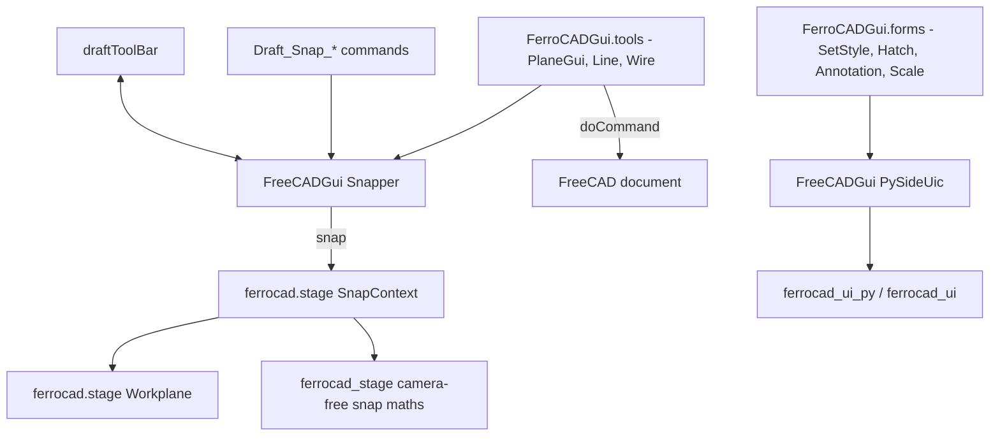
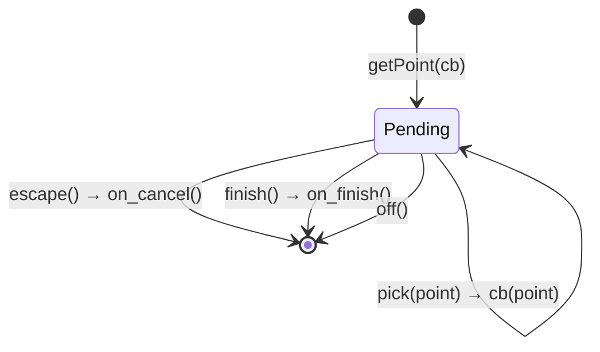

# Native Draft tools (Q4/Q5)

Status: reference (2026-10-24). Companion to
[`qt-strategy.md`](qt-strategy.md) §4.2/§5 (the design),
[`../../project/record/tasks/qt-reduction.md`](../../project/record/tasks/qt-reduction.md) Q4/Q5 (the execution plan),
[`../viewport/stage.md`](../viewport/stage.md) (the native stage), and
[`actions-and-tools.md`](actions-and-tools.md) (the command model). The round that built
it is logged in
[`../../project/record/2026-10-24-q4-q5-draft-tools.md`](../../project/record/2026-10-24-q4-q5-draft-tools.md).

These tools are **native FerroCAD code**, not upstream Draft scripts. They keep the
upstream *names* (`FreeCADGui.Snapper`, `draftToolBar`, `PlaneGui`, `Draft_Line`, …) so a
macro written for FreeCAD ports, but the behaviour is implemented over `ferrocad_stage`
and the headless form proxy. Nothing on this path imports Qt.

## 1. The call path



The Python layer holds **state and policy**; the geometry-free snap maths stays in
`ferrocad_stage`, and the shared source of truth for a workplane is one
`ferrocad.stage.Workplane` value.

## 2. `FreeCADGui.Snapper`

The module-level singleton is `FreeCADGui.Snapper` (the same object as
`FreeCADGui.draft.Snapper`).

### Modes

| Draft mode | Native | `SnapKind` |
| --- | --- | --- |
| `Grid` | yes | `Grid` |
| `Endpoint` | yes | `Vertex` |
| `Vertex` | yes | `Vertex` |
| `Midpoint` | yes | `EdgeMid` |
| `Center` | yes | `Centre` |
| `Origin` | yes | `Origin` |
| `Extension`, `Parallel`, `Perpendicular`, `Intersection`, `Angle`, `Special`, `Dimensions`, `Ortho`, `Lock` | **no** — enabling raises `NotImplementedError` | — |

`Snapper.mask` is the live list of enabled mode names; `active_snaps()` returns it,
`supported_modes()`/`unsupported_modes()` report the split, `setMode(name, on)` /
`toggle_snap(name)` change one, and `isEnabled()` reports the global switch.

### The snap control

The modes and the global switch are ordinary commands on the **`snap`** surface, which
the shell renders as a `Snap` split button beside `Grid`/`Axes`/`WP` in the viewport's
top-left pill:

| Command | Resources | Role |
| --- | --- | --- |
| `Draft_Snap_Lock` | `FerroCAD_Surface: "snap"` | the label: flips `isEnabled()`; the mode mask survives a lock |
| `Draft_Snap_Grid`, `…_Endpoint`, `…_Midpoint`, `…_Center`, `…_Origin`, `…_Vertex` | `FerroCAD_Surface: "snap"`, `FerroCAD_Parent: "Draft_Snap_Lock"`, `FerroCAD_Short: "<mode>"` | the caret's checklist |

Declaring the parent is what keeps the modes out of the action dock: the dock renders
only commands whose surface is `dock`, so the bottom pill stays selection verbs plus
`Search`. `FerroCAD_Short` lets the popover show `Grid` where `Snap Grid` would repeat
the control's name; the palette still searches the full `MenuText`. The modes are
**state** rows (they declare `Checkable`), so clicking one leaves the popover open and
a mask can be set in one visit; the dot follows `IsChecked`, and the menu closes on an
outside click, `Esc` or the caret. A provider radio row behaves the same way.

### State and snapping

| Member | Meaning |
| --- | --- |
| `affinity` | Feature tolerance in **world units** (default `1.0`) |
| `setEnabled(on)` / `toggleEnabled()` | the global switch (the `Snap` label); leaves `mask` untouched |
| `grid` / `setGrid(on)` / `toggleGrid()` | the workplane grid snap |
| `workplane` / `setWorkplane(wp)` | the active `ferrocad.stage.Workplane` |
| `context` / `snap_context` | the `ferrocad.stage.SnapContext` built from the above |
| `snap(point, candidates=None)` | resolve a world point → `(x, y, z)`; stores `snapInfo` |
| `snapInfo` | the last `ferrocad.stage.Snap` (`point`, `kind`, `local`, `major`) |
| `setAngle(deg)` | rotate the snap grid about the workplane normal |
| `constrain(axis_or_point)` / `unconstrain()` | axis/point constraint applied by `draftToolBar.validatePoint` |
| `setSelectMode(on)` | hide snapping while selecting |

`snap(point, candidates)` filters candidates by the modes in `mask`, then calls
`SnapContext.snap_point(point, candidates, affinity)`:

1. a candidate within `affinity` wins (ties go to the earlier candidate);
2. otherwise the point is projected onto the workplane and its local `(u, v)` rounded
   to the minor step; a node that is also a major intersection reports `major=True`;
3. a zero minor step returns the projected point as `SnapKind.Point`.

```python
import FreeCADGui
import ferrocad_stage as stage  # the app also installs it as `ferrocad.stage`

snapper = FreeCADGui.Snapper
snapper.setGrid(True)
snapper.snap((12.4, 7.6, 0.0))            # -> (12.0, 8.0, 0.0) on the default 1 mm grid

wp = stage.Workplane((10, 0, 5), (1, 1, 0), (-1, 1, 0))
snapper.setWorkplane(wp)
snapper.snap(wp.point(3.0, 4.0))          # -> the same point (f32 precision), kind "Grid"
```

### Point sessions

`getPoint(callback, *args, on_cancel=None, on_finish=None)` registers **one** async
request and returns immediately. A second request replaces the first (reported on
stderr); it never stacks.



The headless driver seam is `FreeCADGui.draft`:

| Call | Effect |
| --- | --- |
| `draft.pick(point)` | snap `point`, take the pending request, invoke `callback(snapped, *args)` once |
| `draft.escape()` | drop the pending request and call `Snapper.off()` (which runs `on_cancel`) |
| `draft.finish()` | take the pending request and run `on_finish` (Enter), without picking |

A tool registers `on_cancel=self.escape` and `on_finish=self.finish`, so the same
cancel/finish path serves a mouse-driven shell and a scripted test. Real viewport
clicks are not routed into these three calls yet (see §7).

## 3. `FreeCADGui.draftToolBar`

The task-panel adapter. The fields Draft's `gui_base_original` reads and writes exist
with their upstream names:

| Member | Behaviour |
| --- | --- |
| `sourceCmd` | the active tool; set by the tool, cleared by `offUi`/`escape` |
| `ui` | the adapter itself (upstream's `self.ui`) |
| `Activated()` / `Deactivated()` / `offUi()` | manage `sourceCmd` and `isTaskOn` |
| `escape()` | end snapping and finish the source command |
| `validatePoint(point)` | apply the current constraint and return the point |
| `makeFaceMode` | `True` by default, read by the line/wire commit |
| `mouse`, `isConstructionMode`, `autogroup`, `globalMode`, `wplabel`, `textValue`, `continueCmd`, `loadedPreferences`, `tray`, `taskUi` | panel state; `setAutoGroup` is live, the rest are placeholders |

`setStyleButton()` raises `NotImplementedError`: there is no Qt style widget, and
pretending otherwise would hide the gap.

## 4. `PlaneGui` (`FerroCADGui.tools`)

`FreeCADGui.PlaneGui` is the native working plane. It owns one
`ferrocad.stage.Workplane`.

| Member | Effect |
| --- | --- |
| `get_working_plane()` / `set_working_plane(wp)` | read/replace the frame |
| `get_placement()` | a `FreeCAD.Placement` (origin + rotation with +Z = the normal); the round trip back to a `Workplane` is exact to 1e-9 |
| `align_to_face(origin, normal)` / `align_to_view(direction)` | set the frame |
| `reset()` | back to the world plane |
| `_update_grid()` | returns the `{"view": {"grid_minor": …, "grid_major": …}}` request |
| `update_gui()` | records the `wplabel`-style label for the status channel; no Qt icon |
| `set_to_view()` | returns `{"view": {"workplane": "view"}}` |

Module helpers: `get_working_plane(update=True)`, `set_working_plane(wp)`,
`reroute_upstream_working_plane()`.

## 5. `Draft_Line` and `Draft_Wire`

Registered by importing `FerroCADGui.tools` (an existing registration is left alone;
`register_commands(replace=True)` overwrites it). The tool is a `Creator`:

1. `Activated()` starts a session: `draftToolBar.sourceCmd = tool`, `PlaneGui` is read,
   a first `InputHint` is shown, and `Snapper.getPoint` is armed.
2. Each `draft.pick(point)` appends a node, updates the hint, and re-arms.
3. `draft.finish()` (Enter) with at least two nodes queues
   `Draft.make_line(...)` / `Draft.make_wire(...)` through
   `QtCore.QTimer.singleShot(0, …)` and `FreeCADGui.doCommand`; the document gains one
   `Part::Feature`.
4. `draft.escape()` ends the session with no document change.

```python
import FreeCAD, FreeCADGui
import FerroCADGui.tools  # registers Draft_Line / Draft_Wire

doc = FreeCAD.newDocument("ToolDemo")
FreeCADGui.runCommand("Draft_Line")
FreeCADGui.draft.pick((0.0, 0.0, 0.0))
FreeCADGui.draft.pick((10.0, 0.0, 0.0))
FreeCADGui.draft.finish()
assert len(doc.Objects) == 1
```

The commit goes through `FerroCADGui.tools.make_line` / `make_wire`, which is also
installed on `Draft` when that module lacks them. The upstream `gui_lines` path is
**not** used; `tools.upstream_report()` explains why (see §7).

### The native polyline and its pad (P4 SK4/SK5)

The scripting route above is the Qt-tools facade. The **parametric edition** has a
second, native route that does not go through `python/Draft` at all:

1. `ferrocad_parametric` adds the stage's `PolylineTool` to its `Contributions` under
   the id `polyline`; the app script registers `Part_Polyline`, whose `Activated()` returns
   `{"tool": "polyline"}`. (It is not named `Draft_Wire`: that id belongs to the
   scripting facade in `python/FerroCADGui/tools.py` above, and both modules can be
   imported into one interpreter.)
2. The tool places snapped points on the active workplane (that binding is the stage's
   `SnapContext`; the tool itself only keeps world-space points). Enter finishes it.
3. `finish()` emits a **creating** commit — `polyline` / `create`, with the points as
   flat `x, y, z` values and an empty object name. A creating commit is the one path
   where the workbench makes the object instead of editing one.
4. The edition's `interaction` hook builds, in one named transaction:
   * a `Part::FeaturePython` **wire** with `Points` (`App::PropertyFloatList`),
     `Closed` (default `True`: a pad needs a profile) and `Thickness`
     (`App::PropertyLength`, the extrusion height); its proxy `execute` rebuilds the
     wire from the points;
   * a `Part::Extrusion` whose `Base` is that wire, `Solid = True`, `DirMode =
     "Custom"`, and `Dir` the profile's own plane normal (the first three non-collinear
     points, so a profile on a tilted plane extrudes perpendicular to itself).

The wire is hidden once the pad exists; editing `Points`/`Closed` rebuilds it and the
linked extrusion follows on the next recompute. An extrusion the kernel refuses does
not lose the drawing: the invalid pad is removed and the wire remains. Acceptance:
`crates/ferrocad_parametric/tests/polyline_round_trip.rs` (four snapped clicks on a
tilted plane, every vertex to f32, one undo removes both objects, and an edited
profile moves the pad).

**Viewport routing (2026-10-27).** `Creator.Activated` asks the shell for
`python:draft` (`FreeCADGui._request_tool`); the command payload carries that id and
the shell starts `ferrocad_shell.tool_bridge("draft")` as a native
`ferrocad_stage.Tool`. A left click arrives with the resolved snap point and calls
`draft.pick`; `Esc`/`Enter` reach `draft.escape`/`draft.finish` through
`ferrocad_shell.tool_command("draft", …)`. The `Draft_Line`/`Draft_Wire` commands are
registered by importing `FerroCADGui.tools` (the edition opts in).

### The sketch-backed profile and its dimension (P4 SK6)

`PolylineTool` is generic: it collects snapped points and commits them. The edition
therefore encodes intent in the commit's **id**, not in the tool. `TaggedPolyline` wraps
the tool and rewrites `commit.manipulator` on `finish()`, so one state machine backs two
commands:

| Command | Tool id | The finished drawing becomes |
| --- | --- | --- |
| `Part_Polyline` | `polyline` | a parametric `Part::FeaturePython` wire + its pad (§ above) |
| `Sketch_Polyline` | `sketch_polyline` | a `Sketcher::SketchObject` + its pad |

`Sketch_Polyline`'s creating hook is the parametric route into the sketcher
(contract: [`sketch-constraints.md`](sketch-constraints.md#the-creation-path-and-the-dimension-command)):

1. the points are world-space (they were snapped on the active workplane); the first
   three non-collinear points give the plane `(origin, x, y, z)`, and every point is
   projected onto it as a local `(u, v)`;
2. the sketch's `Placement` is `Placement(origin, Rotation(x, y, z, "ZXY"))`, so a
   profile drawn **on a face stays on that face**, and the autoconstraints' "horizontal"
   means horizontal *in the sketch*;
3. one `Part.LineSegment` per edge (the profile is closed if the user did not close it),
   then the sketcher's own two-phase pair — `detectMissingPointOnPointConstraints(tol)` /
   `makeMissingPointOnPointCoincident(True)`, `detectMissingVerticalHorizontalConstraints(tol)`
   / `makeMissingVerticalHorizontal(True)` — then `solve()`;
4. a `Part::Extrusion` linked to the sketch in the **same named transaction**,
   `DirMode = "Custom"`, `Dir` the plane normal, `Solid = True`, length
   `DEFAULT_WIRE_THICKNESS` (10 mm).

A closed four-point profile comes out at **10 constraints** (4 shared corners, **2 origin
pairs** — the autodetector stages the origin coincidence for *both* segments meeting at
point 1 — and 2 `Horizontal` + 2 `Vertical`), `solve() == 2`, and
`RedundantConstraints == [6]`: the second origin pair is redundant *in rank*, not in
intent. The sketch is hidden and the pad visible; a pad the kernel refuses is removed and
the sketch kept.

`Sketch_Dimension` dimensions the selected sketch edge **at the value it already has**, so
adding it moves nothing:

| Selected edge | The constraint |
| --- | --- |
| a `Part::GeomCircle` | `Sketcher.Constraint("Radius", i, value)` |
| anything else | `("Distance", i, 1, i, 2, value)` — endpoint to endpoint |

`setDatum(index, value)` then resizes the profile, and the linked pad follows on the next
recompute. Acceptance: `crates/ferrocad_parametric/tests/sketch_pad_round_trip.rs` — four
snapped clicks on the plane `x = 5`, the counts above, the datum landing at index `10`,
`setDatum(10, 20.0)` taking the pad's `YLength` from 10 to 20, and two undos (the
dimension, then the sketch and pad together).

**The grips.** A selected sketch also publishes one **plane handle** per vertex — a
`DeclarativeKind::Plane` declaration from the edition's `manipulator_specs` provider, not
a compiled manipulator — so a vertex can be dragged inside the sketch's own plane. Its
commit is `sketch_drag`/`drag` and the edit is `SketchObject.drag`, so every hard
constraint still holds. The frame, the `VertexN` → geometry mapping and the preview
boundary are in
[`sketch-constraints.md`](sketch-constraints.md#the-vertex-grips); the end-to-end path is
`crates/ferrocad_parametric/tests/sketch_drag_round_trip.rs`.

## 6. The Q5 forms (`FerroCADGui.forms`)

| Command | Form | Accept path |
| --- | --- | --- |
| `Draft_SetStyle` | `TaskPanel_SetStyle.ui` | writes the style parameters to the Draft `ParamGet`; presets round-trip under `StylePresets` |
| `Draft_Hatch` | `dialogHatch.ui` | writes the hatch preferences and applies `File`/`Pattern`/`Scale`/`Rotation`/`Translate` to a supported selection |
| `Draft_AnnotationStyleEditor` | `dialog_AnnotationStyleEditor.ui` | writes the annotation parameters and saves a named style in `Doc.Meta` |
| `Draft_Scale` | local `TaskPanel_Scale.ui` | writes the scale factors and applies `ScaleVector`/`Scale` to a supported selection |

Every command returns a `_payload`-compatible dialog spec (`title`, `fields`,
`accept`, `cancel`, `on_accept`). For a script or a test, drive the form directly:

```python
from FerroCADGui import forms

panel = forms.open_panel("Draft_SetStyle")
panel.apply({"textheight": 4.0})
panel.accept()            # commits; panel.reject() writes nothing
```

`fields()`/`values()` are JSON-ready; `apply()` rejects unknown names. The SetStyle
controller adds `presets()`, `save_preset(name)`, `delete_preset(name)`,
`load_preset(name)`, `select_preset(name)`; the annotation editor adds `styles()`,
`style_names()`, `select_style(name)`, `save_style(name)`; the hatch panel adds
`patterns()`.

## 7. What is not there yet

- **The upstream `gui_lines` route.** Still blocked by `SoEvent` picking, preview
  shapes and the `python/Draft` shim's missing `make_line`/`make_wire`; the headless
  `ViewObject` style properties are now present. `tools.upstream_report()` records the
  blockers.
- **Annotation fonts and live annotation updates.** SetStyle's shape subset
  (`LineColor`, `LineWidth`, `PointColor`, `PointSize`, `DrawStyle`, `ShapeColor`,
  `Transparency`, `DisplayMode`) now applies to the selection; the annotation-only
  fields persist as Draft defaults because the headless `ViewObject` has no font/text
  properties.
- **The nine Draft-only snap modes.** They toggle without raising; `mode_note()` and
  `snap_status()` report which are passthrough (`Near`, `WorkingPlane`) and which need
  a live cursor or an extension solver. The snap point is never invented.

## 8. Verifying it

```sh
# The whole Python suite (the stage-dependent tests skip when the extension is absent)
PYTHONPATH=python python3 -m pytest tests -q

# The focused suites
PYTHONPATH=python python3 -m pytest tests/test_draft_snapper.py tests/test_draft_tools.py tests/test_draft_forms.py -q

# The stage bindings (embedded Python acceptance suite + Rust units)
cargo test -q -p ferrocad_stage -p ferrocad_stage_py --offline

# The line/wire suite against the real Part kernel (a standalone pytest run has no Part)
cargo test -q -p ferrocad_part_py --test draft_tools --offline

# The native polyline → wire → extrusion path, through the edition's own hook
cargo test -p ferrocad_parametric --no-default-features --test polyline_round_trip

# The sketch-backed path: polyline → constrained sketch → dimension → pad
cargo test -p ferrocad_parametric --no-default-features --test sketch_pad_round_trip
```

The standalone pytest run uses a documented `Part.makePolygon` stub for the creation
tests; the in-process Rust test is the one that proves the real kernel path.

## 9. File map

| File | Role |
| --- | --- |
| `crates/ferrocad_stage/src/interaction/snap.rs` | `SnapContext::snap_point` (camera-free) |
| `crates/ferrocad_stage_py/src/{snap,workplane}.rs` | the `ferrocad.stage` spatial reference |
| `python/FreeCADGui/draft.py` | `Snapper`, `draftToolBar`, hints, sessions, snap commands |
| `python/FreeCADGui/__init__.py` | the headless window and `doCommand`/`addModule` |
| `python/FerroCADGui/tools.py` | `PlaneGui`, `Draft_Line`, `Draft_Wire` |
| `python/FerroCADGui/forms.py` | the four Q5 form controllers and commands |
| `python/FerroCADGui/Resources/ui/TaskPanel_Scale.ui` | the converted scale form |
| `tests/test_draft_snapper.py`, `tests/test_draft_tools.py`, `tests/test_draft_forms.py` | the acceptance suites |
| `crates/ferrocad_part_py/tests/draft_tools.rs` | the same tool suite with the real Part kernel |

## 10. Draft conformance (`drafttests/test_modification.py` and the import group)

Status: measured 2026-11-16 against upstream `33adf61`. The harness runs upstream's
Draft unchanged (its package roots precede `python/`, so `import Draft` is the real
workbench):

```sh
python3 tools/conformance.py --root ../freecad-upstream --draft --files test_modification
```

| Run | pass | fail | error | skip |
| --- | --- | --- | --- | --- |
| before M3 | 17 | 0 | 16 | 0 |
| before the M4 import round | 22 | 1 | 10 | 0 |
| after the M4 import round | 31 | 0 | 2 | 0 |
| after the TechDraw page stub | **32** | **0** | **1** | 0 |

The M4 import round closed the last failure: `Quantity.__eq__` now coerces a bare
number, the same comparison upstream's `Quantity` provides, so
`test_offset_rectangle_with_face`'s `obj.Length == 12` holds. Eight of the ten
errors were closed by the shared Part image (see the hand-offs below). The two that
remained needed modules outside this workbench; the TechDraw one is now a document
stub, so only `Sketcher` is left.

### What the layer now provides (`crates/ferrocad_py`)

- **Editor modes.** `DocumentObject.getEditorMode(name)` returns the flags stored by
  `setEditorMode`, which now writes the property's status bits (`ReadOnly`,
  `Hidden`, `NoRecompute`) instead of only firing the observer. Both upstream forms
  are accepted: the legacy int (`0` default, `1` ReadOnly, `2` Hidden, `3` both) and
  a name sequence (`["ReadOnly", "Hidden"]`). `Draft/draftutils/utils.py:957` reads
  `getEditorMode("Placement")` for move/rotate/scale.
- **Placement.** `Placement.isIdentity()` and the mutating `Placement.move(vector)`
  (writing back through a document property). `Draft.move`/`rotate`/`scale` branch
  on both.
- **Matrix.** `Matrix(otherMatrix)` and `Matrix(placement)` copy construction, and
  `Matrix.multiply(vector)` (matrix × vector returns a `Vector`), both used by
  `Draft.scale._get_scaled_matrix` and `DraftVecUtils`.
- **Quantities.** `App::PropertyVectorDistance` now builds a `Vector` property
  (Draft wire `Start`/`End`), and a `Quantity` accepts a plain number in `+`/`-`,
  `abs()`, rich comparisons, `__eq__`, and `isEqual(other, tol=0)`. That is what
  `unittest.assertAlmostEqual(obj.Length, 8.0, delta=…)` and
  `obj.Length == 12` (`test_modification.py:197`) need.
- **Install paths.** `FreeCAD.getHomePath()` reports the root owning `Mod/`, derived
  from the loaded workbench (`<home>/Mod/Draft/__init__.py`), so Draft's resource
  lookups resolve. `drafttests/test_dxf.py:54` joins it with its DXF fixture.
- **SVG projection shim.** `TechDraw.projectToSVG` exists and answers `""` ("no
  projection available"): FerroCAD has no hidden-line-removal projector, and
  Draft's exporter already falls back to its own edge/arc path on an empty
  snippet (`draftfunctions/svgshapes.py:149`). The three SVG regression tests
  patch it (`drafttests/test_svg.py:174`), which used to fail at the patch itself.
- **Strict `addObject`.** An id that is neither a registered behaviour nor a known
  base/Python-feature type now raises `ValueError: Unknown C++ type '<id>'`, as
  upstream does. `Part::Prism` used to fabricate a bare `DocumentObject` with
  neither `Placement` nor `Shape`; it is a real registered type now (which is why
  the old "unknown type" assertion for `Part::Prism` in `tests/test_base_surface.py`
  no longer holds and belongs to the Part track). Genuinely unknown ids still fail.

`tools/conformance.py`'s `DRAFT_FILES` now also runs `test_creation`, `test_array`,
`test_dwg`, `test_oca`, `test_svg`, `test_modification` and `test_draftgeomutils`, all of
which are green:

| `--draft` module | pass | fail | error | skip |
| --- | --- | --- | --- | --- |
| `test_base` (helper module) | 0 | 0 | 0 | 0 |
| `test_grid_settings` | 5 | 0 | 0 | 0 |
| `test_pivy` | 2 | 0 | 0 | 0 |
| `test_airfoildat` | 2 | 0 | 0 | 0 |
| `test_import` | 4 | 0 | 0 | 0 |
| `test_creation` | 26 | 0 | 0 | 0 |
| `test_array` | 1 | 0 | 0 | 0 |
| `test_dwg` | 2 | 0 | 0 | 0 |
| `test_oca` | 2 | 0 | 0 | 0 |
| `test_modification` | 33 | 0 | 0 | 0 |
| `test_svg` | 6 | 0 | 0 | 1 |
| `test_draftgeomutils` | 10 | 0 | 0 | 0 |
| **whole group** | **93** | **0** | **0** | **1** |

The one skip is honest: `test_get_svg_from_arch_space_with_zero_vector` says the BIM
module is not installed, which it is not. `test_modification` became a gate member when
the sketch constraint model landed (P4 SK1-lite/SK3): `Draft.make_sketch` builds a
`Sketcher::SketchObject`, adds geometry and constraints, detects the missing coincident
and vertical relations, solves and `Draft.draftify`s the result back. The model and its
limits are in [`sketch-constraints.md`](sketch-constraints.md). `test_dxf` and
`test_import_tools` still stay out, because each carries an out-of-scope error (below).

Neighbouring modules measured with `--files` (the rest of the headless Draft
suite). "Before" is the pre-round image, "after" is this round's:

| module | before (p/f/e/s) | after (p/f/e/s) | what moved |
| --- | --- | --- | --- |
| `test_svg` | 3/0/3/1 | 6/0/0/1 | `Part.OCC_VERSION` and the conic parameter ranges landed; the exporter takes its own edge/arc path |
| `test_dxf` | 1/0/1/0 | 1/0/1/0 | blocker moved from `getHomePath` to `Import.readDXF` |
| `test_draftgeomutils` | 0/0/10/0 | 10/0/0/0 | the wrapper (`Shape.copy`), wire-order and vertex-order work landed; the four extension-math failures are gone |
| `test_modification` | 22/1/10/0 | 33/0/0/0 | quantity equality, the Part wrapper/Prism work, the TechDraw page stub, and the sketch constraint model behind `make_sketch` |
| `test_import_tools` | 2/0/1/0 | 2/0/1/0 | GUI `UserInput.KeyShift` |
| `test_import_gui` | 3/0/1/0 | 3/0/1/0 | GUI, out of scope |
| `test_trimex_gui` | load error | load error | GUI `KeyShift`, out of scope |

`test_trimex` (non-GUI) defines no test cases in this checkout.

### Remaining blockers (named hand-offs)

| Test(s) | Blocker | Owner |
| --- | --- | --- |
| `test_dxf.test_read_dxf_Issue24314` | The test now reaches `import Import` at `importDXF.py:2915`; the blocker is the object model the importer is contracted to produce. `DxfDraftPostProcessor` reads `Part::Line`/`Part::Circle`/`Part::Vertex` intermediates, `App::FeaturePython` placeholders with `DxfEntityType`, block `Part::Compound`s under `_BlockDefinitions`, and Draft layer groups — none of which FerroCAD registers. A three-object Python stub would measure the stub, not DXF support, so `Import.readDXF` is **out of surface** (recorded in the backlog). | Import workbench (deliberate gap) |
| `test_import_tools.test_import_gui_draftedit`, `test_import_gui.test_import_gui_draft_tools` | `draftguitools.gui_tool_utils` reads `Gui.UserInput.KeyShift` at import (`gui_tool_utils.py:67`); our `FreeCADGui` exposes no `UserInput`. | GUI |

Closed this round: `test_draft_to_sketch` (`Draft.make_sketch`/`draftify` over the new sketch
constraint model), `test_draft_to_techdraw` (the `DrawPage`/`DrawSVGTemplate`/`DrawViewDraft`
document types, `DocumentObject.addView`, and `OutList` as every outbound link) and
the whole `test_draftgeomutils` module (`Shape.copy` keeps its subclass; the vertex and
wire order follow `WireExplorer`/`TopExp`). The earlier round closed the `test_svg`
regressions (`Part.OCC_VERSION` is parsed from the OCCT headers at build time;
`Circle`/`Ellipse` report `FirstParameter`/`LastParameter`).

Part-kernel progress notes: the `Part::Feature.Shape` getter returns the topology
subclass (`Part.Wire`/`Part.Face`/…), `Part::Prism` is a real registered object, and
`Shape.fix()`/`Wire.OrderedEdges` are present, which is why `test_modification`
reaches 32/0/1.
