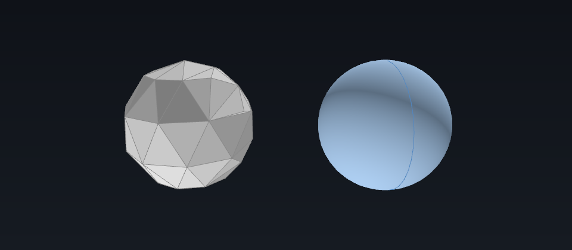
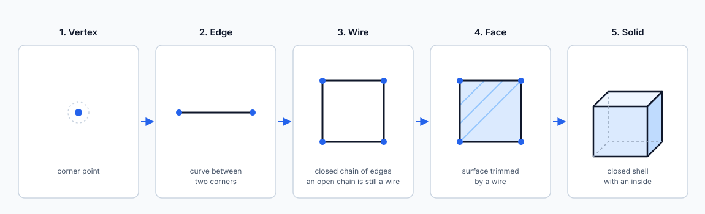

# Chapter 1: The DNA of 3D geometry (vectors vs. bitmaps in 3D)

The easiest way to understand 3D CAD geometry is to compare it with 2D graphic design.
In the 2D world we divide images into **vector graphics** (Illustrator, SVG) and
**raster/bitmap graphics** (Photoshop, JPEG). 3D software has the same divide.

| 2D design concept | 3D CAD equivalent | What it actually does | When you zoom in |
| --- | --- | --- | --- |
| **Primitives (circle, rectangle)** | **Analytic primitives (box, cylinder, sphere)** | Stores the shape as parameters (centre and radius, axis and radius), not as triangles. | No pixels to reveal: the surface is defined by a formula. |
| **Vector paths (lines, arcs, Béziers)** | **Curves and surfaces (3D Béziers, NURBS surfaces)** | Freeform geometry from control points; NURBS adds weights and knots, so each span can be read as a rational Bézier segment. | No pixels to reveal; smoothness is set by degree and knot structure. |
| **Compound paths and clipping masks** | **B-Rep (boundary representation)** | Trims unbounded surfaces along boundary curves, then joins the pieces into a shell; a closed shell bounds a solid. | No pixels to reveal; edges stay closed within the stored tolerance. |
| **Raster image (JPEG, PNG)** | **Polygon mesh (STL / OBJ / 3MF)** | Discards the math, baking the shape into a rigid network of flat triangles. | Faceting appears; a round hole becomes flat facets. |
| **Canvas preview** | **Viewport preview (tessellation)** | Temporarily triangulates the modelled shape so the GPU can draw it. | Faceting appears only in the preview; more triangles smooth it and the model is untouched. |

*A ball, two ways. Both halves are the same `Part.makeSphere(10)`. Left: tessellated
coarsely (80 triangles), stored as a `Mesh.Mesh`, with every edge drawn — changing the
diameter means moving vertices. Right: kept as B-Rep and meshed finely for display
only, with smooth per-vertex normals; the blue curve is its seam edge, the only
drawable edge of the single B-Rep face. The figure is rendered from real geometry by
[`tools/generate_general_figures.py`](../../tools/generate_general_figures.py), not
redrawn by hand.*

### 1.1 Mathematical surfaces: from cylinders to NURBS

To build shapes without a pixel grid, CAD software does not place thousands of tiny
dots. It uses formulas — the same idea as vector paths, in three dimensions:

- **Analytic shapes (the everyday primitives).** Most mechanical parts are made of
  simple formulas: flat planes, cylinders, cones and spheres. Just as an SVG stores a
  circle as a centre point and a radius ($x^2 + y^2 = r^2$), CAD stores a cylinder as an
  axis and a radius. In OCCT these are described by classes such as `gp_Cylinder`,
  `gp_Plane` and `Geom_CylindricalSurface`.
- **NURBS (the freeform splines).** For organic shapes such as car bodies or ergonomic
  handles, CAD uses **NURBS** (non-uniform rational B-splines). A NURBS curve can be
  read as a chain of rational Bézier segments, so it is a freeform curve like a Bézier,
  with weights and knots added. The weights let it represent a conic (a circle, an
  ellipse) as a conic rather than as a polynomial approximation. Bézier curves and NURBS
  curves exist in 2D and 3D; the 3D surface is the case used here. OCCT names them
  `Geom_BSplineCurve` and `Geom_BSplineSurface`, and the Part workbench exposes them
  through the `Part.BSplineCurve` and `Part.BSplineSurface` classes.
- **No pixel grid.** Because the shape is stored as control data rather than a grid,
  zooming in does not reveal pixels. How smooth it *looks* is a question for the
  display mesh, not for the model.

A surface on its own is still just a zero-thickness, untrimmed sheet. It does not
know what a "solid object" is, or where a hole was drilled through it. That is the job
of the next layer.

### 1.2 B-Rep: the tailor's sewing pattern

**B-Rep (boundary representation)** turns raw mathematical sheets into a shell or a
solid part. Think of making a tailored suit:

1. **Geometry (the fabric).** The raw mathematical surfaces: planes, cylinders, NURBS
   sheets.
2. **Trimming and topology (the scissors and stitching).** The kernel draws boundary
   curves on each surface to cut out the intended shape — for example a circular hole in
   a flat sheet — and keeps a strict structural ledger of how the pieces connect:

   - **Vertices** are corner points.
   - **Edges** are seam lines; each edge sits on a curve, and some are *seam edges*
     where a closed surface (such as a cylinder) is sewn to itself.
   - **Wires** are chains of edges. A closed wire is the boundary of a face; an open
     wire is a chain with two loose ends, as in most sketches. OCCT will construct a
     face from an open wire, but the result is invalid (`isValid()` is false) and
     cannot be part of a solid.
   - **Faces** are trimmed patches of surface.
   - **Shells** are sets of faces joined along their edges. A closed shell bounds a
     **solid**.

3. **Tolerances (the seam allowance).** Where two curved surfaces meet, the
   intersection is rarely expressible in clean numbers. B-Rep therefore stores a
   microscopic tolerance on every edge and vertex, so the kernel can agree that the
   surfaces are sealed without demanding an impossible exactness. "Watertight" means
   "closed within the stated tolerance", not "mathematically identical".

*One level at a time: points join into edges, edges into a closed wire, the wire trims a
face, and a closed shell of faces bounds a solid. A shape does not have to reach the
top — an open sketch is a wire, and a surface patch is a face. Only a closed wire bounds
a valid face: OCCT will build a face from an open wire, but it is marked invalid and
cannot join a solid.*

In FreeCAD, the Part workbench is the B-Rep side of this story. `Part::TopoShape` wraps
an OCCT `TopoDS_Shape`, and Python sees it as `Part.Shape` with `.Faces`, `.Edges`,
`.Wires`, `.Shells` and `.Solids`. Not every `Shape` is a solid: a sketch is a wire, a
surface patch is a face, and an imported sheet is a shell.

Because B-Rep keeps the surface definitions and the boundaries rather than a triangle
list, formats such as **STEP (.stp)** are the usual exchange format for CNC machining
and mechanical engineering. The representation is B-Rep; STEP is one file format that
can carry it.

A useful test of what B-Rep buys you: a hole is stored as *a cylindrical face of radius
5 mm, trimmed by circular edges*, not as a ring of triangles. That is why you can select
the hole later, change it to 6 mm, and measure it for a drawing. A mesh would only
contain the triangles that were left after the hole was cut.

### 1.3 Polygon meshes: the 3D bitmap

A **mesh** abandons mathematical formulas entirely. It approximates a 3D shape with a
dense web of flat polygons, usually triangles.

- **The faceted reality.** In a mesh — an **STL** or **OBJ** file, for example — a
  cylinder is not a curve. It is dozens of flat facets arranged in a ring. Zoom in
  closely and you see the breaks between them.
- **Zero intelligence.** A mesh has no concept of "features". A cylindrical hole in an
  STL file is not a hole with a diameter you can edit; it is an empty space surrounded
  by hundreds of anonymous triangles.

That is the trade: a mesh is simple and universal, and it forgets why the shape looks
the way it does. It has amnesia about features, not just about curves.

### 1.4 Terms you will see

- **CAD kernel (Open CASCADE / OCCT).** The math engine underneath FreeCAD. Extruding a
  pad, drilling a hole or rounding an edge is a kernel operation; the kernel returns
  new topology, not a picture.
- **NURBS.** Non-uniform rational B-splines: piecewise rational curves and surfaces
  defined by control points, weights and knots; each span can be read as a rational
  Bézier segment. `Geom_BSplineCurve` and `Geom_BSplineSurface` carry them; the weights
  let a NURBS represent a circle or an ellipse as a conic, not as a polynomial
  approximation.
- **B-Rep (carried by `STEP` files).** The surface-based representation used while
  designing. Because the shape keeps its surfaces and boundaries, features remain
  editable and measurable. The representation is B-Rep; STEP is one file format that
  can carry it.
- **Topology.** The anatomy of a B-Rep shape: **vertices** (corner points), **edges**
  (curves between corners), **wires** (chains of edges, open or closed; only a closed
  wire bounds a valid face), **faces** (surface patches trimmed by a wire), **shells**
  (faces joined along edges) and **solids** (closed shells with an inside and an
  outside).
- **Mesh (`STL` / `OBJ` files).** The triangle representation used for 3D printing,
  exchange and display. A round hole becomes dozens of flat triangle walls, and its
  diameter is no longer a parameter you can edit.
- **Tessellation.** The temporary mesh a viewport makes from a surface-based shape so
  the GPU can draw it. It is a preview, not a conversion of the model.

### 1.5 The same picture in standard terminology

For readers who want the usual terms, without the analogies:

- **B-Rep** is a set of trimmed parametric surfaces plus topology — vertices, edges,
  wires, faces, shells, solids — with a tolerance per element. The surfaces are defined
  analytically and the coordinates are floating point; shared boundaries are identified
  within tolerance, so "watertight" means closed within tolerance.
- **NURBS** is a piecewise rational B-spline: degree, knots, control points and
  weights; each span can be read as a rational Bézier segment. The weights let it
  represent a conic (a circle, an ellipse) as a conic rather than as a polynomial
  approximation. Between knots the continuity is `C^(p−m)`, where `p` is the degree and
  `m` the knot multiplicity; saying a surface is "smooth" is a claim about that
  continuity, not about infinite differentiability.
- **A mesh** is a piecewise-linear approximation: vertices and triangles, optionally
  with per-vertex normals, and no surface formula behind them.
- **Tessellation** is a per-face triangulation bounded by a linear chord deflection and
  an angular deflection. It approximates the surface for display; it does not replace
  it.
