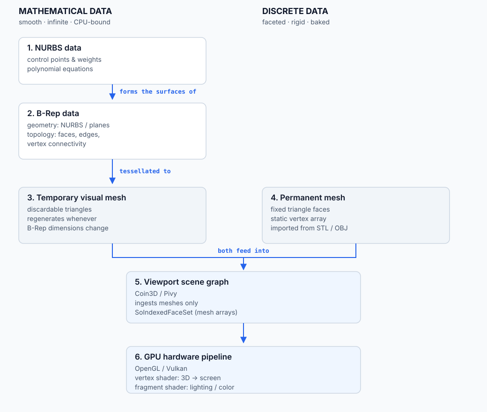

# Chapter 2: The great translation (workbenches, viewports and GPUs)

Here is the fundamental limitation of modern computer hardware: **graphics cards cannot
read or draw B-Rep or mathematical surfaces directly.**

Low-level graphics APIs such as **OpenGL** and **Vulkan** are built to do one thing at
blistering speed: process millions of flat triangles in parallel. To display a
mathematical CAD model, the software must translate it on the fly. That translation is
called **tessellation**.

### 2.1 The data pipeline

*The translation from mathematical geometry to triangles, and the two routes into the viewport.*

### 2.2 How FreeCAD workbenches differ

- **Part / Part Design (the vector workflow).** Stores true B-Rep math through OCCT.
  Every time you modify a dimension, FreeCAD recalculates the shape, asks OCCT to
  tessellate it into a **temporary visual mesh**, and hands that mesh to **Coin3D**,
  the Open Inventor viewport engine, which Python reaches through **Pivy**. The
  triangles are a cache: change the model and they are thrown away and rebuilt.
- **Mesh workbench (the bitmap workflow).** Holds a **permanent mesh**. Because the
  data is already made of triangles, FreeCAD skips the mathematical kernel and passes
  the triangles straight to Coin3D. Editing the mesh edits those triangles; there is
  no underlying formula to regenerate them from.

This is the practical consequence of Chapter 1. The Part workbench keeps the recipe and
derives the triangles; the Mesh workbench *is* the triangles.

### 2.3 Down to the silicon: shaders

Once Coin3D organises the triangles into scene-graph nodes, it copies the coordinates
into buffers in graphics-card memory (**vertex buffer objects**) and sends them to
OpenGL/Vulkan. FreeCAD's Part view provider emits nodes such as `SoBrepFaceSet` (an
`SoIndexedFaceSet` with per-face material and selection ranges); the Mesh workbench
emits its own mesh nodes.

Two small GPU programs then take over:

1. **The vertex shader** runs on every triangle corner and calculates where it sits in
   2D screen space for the current camera.
2. **The fragment shader** colours the pixels between those corners.

Why does a tessellated cylinder not look like a blocky disco ball? Because the
tessellator records a **surface normal** at each vertex — the true perpendicular of the
mathematical surface, not of the flat triangle. FreeCAD's C++ `TopoShape::tessellate`
returns points, normals and facets together (the Python `Shape.tessellate` returns only
points and facets), and those normals become Coin3D normal nodes. The fragment shader
interpolates them across the triangle, so the lighting varies as if the surface were
still curved. The geometry is faceted; the *shading* is smooth. The illusion fails at
the silhouette and at the edges, which is why increasing the display quality adds
triangles rather than changing the model.

The model is never replaced by the mesh. Tessellation is a view of the model, produced
on demand and thrown away on the next recompute.
