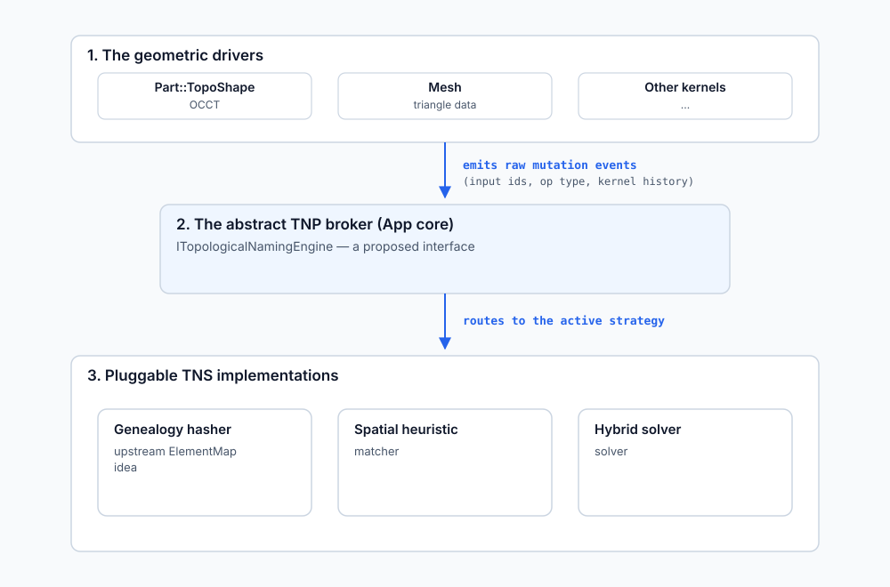

# Chapter 4: Advanced CAD architecture — decoupling the TNS

There is no mathematically perfect solution to the topological naming problem; every
algorithm is a heuristic mitigation. Coupling the naming ledger directly inside
`Part::TopoShape` therefore limits architectural flexibility.

For CAD architects who want to externalize the TNS into a **pluggable,
engine-agnostic subsystem**, the in-object ledger can be refactored into an
event-driven broker pattern:

*The broker pattern: geometry emits history; the naming strategy is a plug-in.*

This is a design pattern, not the current FreeCAD API. Its three pillars are:

1. **A pure abstract interface.** Strip string hashing and genealogy resolution out of
   `Part`. Define an abstract contract in the core application layer
   (`TrackOperation()`, `ResolveElement()`, `GetStableUUID()`).
2. **Dumb geometric wrappers and event broadcasting.** `Part::TopoShape` remains a
   wrapper for OCCT geometry. When a Boolean or extrude operation occurs, `Part`
   translates OCCT's `BRepTools_History` (generated, modified and deleted shapes) into
   a generic mutation struct and emits it to the broker.
3. **Externalized graph storage.** Instead of mutating fields inside `TopoShape`, the
   active TNS implementation maintains an external directed acyclic graph (DAG) of
   element lineage. That lets developers benchmark competing TNP strategies side by
   side, preserve backward compatibility with legacy files, or swap CAD kernels.
