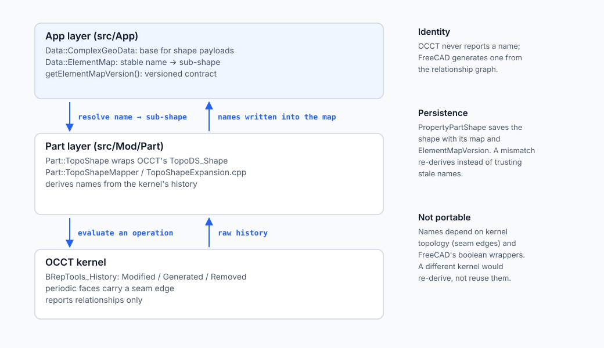

# Chapter 4: How FreeCAD organizes geometry under the hood

Every workbench in FreeCAD needs stable geometry names. **Part Design** needs them so
fillets stay put, **TechDraw** needs them so 2D dimensions do not detach when the 3D
model updates, and **Assembly** needs them so joints stay mated. The names are therefore
not a Part Design detail; they are shared infrastructure.

### 4.1 The two-layer architecture (`App` versus `Part`)

FreeCAD splits the job into two layers, and the split is the interesting part:

1. **The base application layer.** `Data::ComplexGeoData`, in `src/App`, is the base
   class for a shape payload. It owns the **element map** (`Data::ElementMap`, defined
   in `src/App/ElementMap.h`) and the versioned naming contract
   (`getElementMapVersion`). The map is a dictionary from a stable name to a sub-shape.
   Any payload can use it: `Part::TopoShape` for B-Rep and `Mesh::MeshObject` for
   triangles both derive from `ComplexGeoData`, and both can carry a map.
2. **The kernel wrapper.** `Part::TopoShape` is FreeCAD's C++ wrapper around OCCT's
   `TopoDS_Shape`. It is the only layer that knows about OCCT. When a boolean,
   extrusion or fillet finishes, `TopoShape` inspects the kernel's raw history, folds it
   through `Part::TopoShapeMapper` (`TopoShapeExpansion.cpp`), and writes the resulting
   names into the element map that `ComplexGeoData` owns. `PropertyPartShape` then
   persists the shape together with its map and `ElementMapVersion`.

*The base layer stores and versions names; the kernel wrapper derives them. OCCT never reports a name.*

That is why workbenches that never touch B-Rep can still talk about element names, and
why the naming policy can change without every workbench being rewritten.

### 4.2 Why you cannot simply "swap CAD kernels"

Newcomers often ask: *why not separate the history system completely from OCCT so
FreeCAD could plug in a different kernel?*

Because the names are derived from a kernel's habits, and different kernels do not have
the same habits. OCCT represents a full cylindrical face as a **periodic surface with a
seam edge** — the same edge appears twice in the face's wire, like the seam of a
rolled-up sheet of paper. Another kernel may represent the same cylinder without a seam,
or as two half-cylinders. The resulting topology, and therefore every `Generated`,
`Modified` and `Removed` relationship, differs.

Three concrete consequences:

- **History vocabularies are not standardised.** `BRepTools_History` is an OCCT shape;
  there is no cross-kernel equivalent to plug it into.
- **FreeCAD's own naming already depends on OCCT behaviour.** The `FCBRepAlgoAPI_*`
  wrappers exist because stock OCCT booleans produce history that names poorly; the
  naming rules are tuned to the wrappers' behaviour.
- **Saved files carry the names.** A `.FCStd` file stores strings such as `Face6` or
  `;FUSE;…` that were generated under OCCT's topology. Loading the file into a different
  kernel would require re-deriving those references under different geometry, which is
  the naming problem again, at a larger scale.

This is not unique to FreeCAD. Mainstream parametric CAD keeps its feature history tied
to the kernel that evaluates it; the history is a record of that kernel's operations,
not a neutral interchange format. The neutral interchange formats are the *results* —
STEP, IGES, STL — which carry geometry without the parametric recipe.

### 4.3 The open question

Recognising this boundary is what makes the FerroCAD layering honest. FerroCAD has
moved the naming *vocabulary* into a kernel-independent crate (`ferrocad_lineage`) and
put the kernel behind a trait (`ferrocad_geom::GeometryBackend`), as Chapter 5
describes. That is a real separation of storage and types.

It does **not** prove that naming is portable across kernels. Nobody has run a second
kernel through FerroCAD's lineage layer, and the OCCT backend deliberately mirrors
OCCT's own history behaviour. Whether a pluggable naming *engine* — or a genuinely
kernel-neutral naming scheme — is achievable is an open research problem, recorded in
[`tns-decoupling.md`](../project/research/tns-decoupling.md) rather than presented here
as a design.
