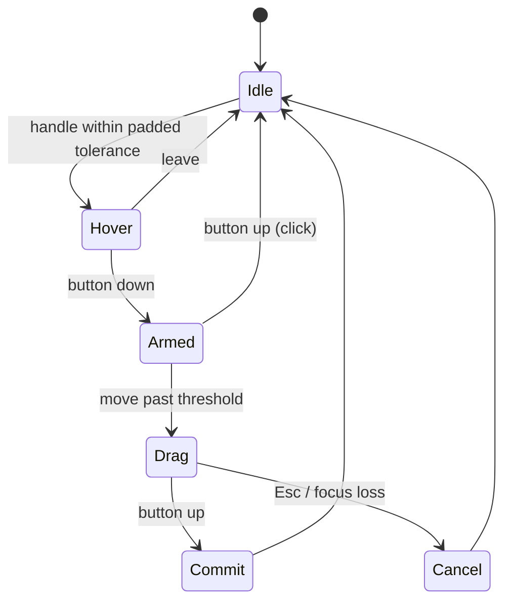

# Gizmo manipulator suite — design

Status: **T1 (Spatial Transactor math), T2 (analytic screen-space hit-testing), T3
(modifiers, typed values and the readout) and T4 (visual language and ribbons) built
(2026-10-20), the F0 topology prerequisite is complete (F0.1–F0.6), and F1 (the edge
dress-up arc) is built: selection, tangent chains, the parametric
`Part::Fillet`/`Part::Chamfer` features, and the arc scrubber that drives them.**

Companions: [`stage.md`](stage.md) (the stage gizmo), [`geometry-and-topology.md`](geometry-and-topology.md)
(the `ElementRef`/`ElementMap` seam), [`occt-integration.md`](occt-integration.md) (the
kernel), and [`navicube-gpui-design.md`](navicube-gpui-design.md) (the overlay visual
language this suite shares).

## 0. Direction

Manipulators are **context-driven, transient micro-manipulators**, not modal global
tools: the selection chooses which one materialises on the topology, it inherits the
selection's anchor and frame, and it disappears when the selection changes. Empty space
inside the manipulator stays transparent to pointer events.

The suite is layered on `ferrocad_stage::gizmo`:

```text
Selection ──► ManipulatorKind ──► TransformGizmo / PushPull / FilletArc / DraftArc
                    │                    │
                    │                    └── ManipulatorFrame (origin + orthonormal basis)
                    └── shared: constraint solvers, hit-test padding, GizmoValue, readout
```

Only the **Spatial Transactor** (the transform triad) is buildable today: it has no
kernel dependency, it already has a working handle set and drag/commit events, and its
mathematics is reused by every later manipulator. Fillet/chamfer/draft wait on sub-shape
selection and topology traversal (Slice **F0**).

## 1. Frame and anchor

`ferrocad_stage::gizmo::ManipulatorFrame` is the manipulator's pose:

```rust
pub struct ManipulatorFrame {
    pub origin: Vector3,          // world-space anchor
    pub basis: [Vector3; 3],      // world directions of local X, Y, Z
}
```

- `world(origin)` gives the global triad; `from_rotation(origin, rotation)` takes the
  **columns** of the rotation matrix, so an object/selection frame is exact.
- The basis is orthonormal and right-handed. The frame is captured at press time and a
  `set_frame` during a drag cancels the drag rather than reinterpreting its press point.
- Anchoring policy (host-side, T2):
  - a body or component: the **bounding-box centre** in world space;
  - a multi-face selection: the **area-weighted centroid** of the selected sub-shapes;
  - a single flat face / sketch region: the Push-Pull stem starts at the region centroid
    with its `+N` basis along the face normal.

## 2. Axis constraint and degeneracy

For a pointer ray `p + t·d` and an axis `o + s·a`, the closest-point parameter is

```text
r  = p − o
b  = d·a
dd = d·r
ee = a·r
s  = (ee − b·dd) / (1 − b²)
```

That is `closest_axis_parameter`. It is ill-conditioned as `|b| → 1` (the stem points
at the eye): the denominator `1 − b²` collapses and one pixel of pointer motion maps to
an unbounded world delta.

The solver therefore switches to a **screen-space fallback** when `|b| > 0.97`:

```text
start = project(origin)
tip   = project(origin + a·scale)
len   = |tip − start|
Δs    = dot(pointer − press, normalize(tip − start)) · scale / len
```

- `scale` is the same screen-invariant world radius the triad is drawn with, so
  `scale / len` is world units per device pixel along the stem.
- If `len < 1 px` the axis projects to a point and is disabled for that frame; a drag on
  it cannot be started. This is the "sub-pixel dimming" rule (the visual dim is T4).
- Both paths are stored in `DragStart::Axis` (`screen: Option<ScreenAxis>`), so
  `drag_to` does not need to re-decide: the press-time frame is frozen.

Tests: `a_view_aligned_axis_falls_back_to_screen_space`,
`an_axis_pointing_at_the_camera_is_disabled`.

## 3. Plane constraint and Shift ambiguity

The plane handle freezes the pointer's ray–plane hit at press:

```text
t = (origin − p)·n / (d·n)
hit = p + t·d
```

If the plane is edge-on (`|d·n| < ε`), the hit is undefined. `plane_point` falls back to
a **view-facing plane** through the origin (normal = the camera forward), and the
resulting delta is projected onto the constrained plane:

```text
Δ = (hit − press) − n·((hit − press)·n)
```

The component along `n` is not representable by the plane; that is the expected
behaviour of a plane seen edge-on. The fallback keeps the in-plane component usable
instead of failing the press.

**Shift resolution (T3).** `GizmoModifiers.shift` is carried by the event path but the
solver does not yet reinterpret an axis press. The rule to implement: `Shift` on an axis
stem selects the plane spanned by that axis and the screen-horizontal, matching the
visible glass quad nearest the pointer. This must be one explicit rule so Shift and the
visible quad can never disagree.

Tests: `an_edge_on_plane_still_drags_in_its_plane`.

## 4. Ring constraint and angular detents

The ring angle is measured in the ring basis:

```text
hit = ray ∩ plane(origin, axis)
v   = normalize(hit − origin − axis·((hit − origin)·axis))
θ   = atan2(v·up, v·right)
```

`ring_angle_with_fallback` uses the same view-facing fallback as the plane when the ring
is edge-on; `angle_at` is the pure angle helper.

The accumulated delta is `wrap_pi(θ − θ_press)` and is then passed through
`ring_detent(raw, free)`:

- **default:** snap to **15°** detents relative to the press orientation:
  `round(raw / 15°) · 15°`;
- **Ctrl:** free rotation (`GizmoModifiers.ctrl`);
- the raw delta is unwrapped into `(-π, π]`, so a drag across ±π does not jump.

The detents are **relative**, so grabbing an already-rotated body does not jump to the
world grid on the first frame. `TransformGizmo::drag_to_with_modifiers` is the host entry
point; `drag_to` uses the default (snapped) modifiers until T3 threads the keyboard state
through gpui.

Tests: `ring_detents_are_relative_and_ctrl_frees_them`,
`a_ring_drag_rotates_about_the_axis`.

## 5. Snapping and numeric readout

The solver returns matrices plus a typed [`GizmoValue`] alongside them:

```rust
enum GizmoConstraint { Axis(Axis), Plane(Normal), Ring(Axis) }
enum GizmoValue {
    Linear  { axis: GizmoAxis, raw: f64, applied: f64 },
    Planar  { raw: Vector3, applied: Vector3 },
    Angular { axis: GizmoAxis, raw_deg: f64, applied_deg: f64 },
}
```

`GizmoDragEvent` and `GizmoCommitEvent` carry `constraint` and `value`. The gpui tag is
projected at the handle tip (axis), the plane anchor, or the pointer (ring) and uses a
monospace/tabular face: `ΔX +24.5 mm`, `ΔθZ +15.0°`, or `ΔX … ΔY …` for a plane. It is a
text layer over the image (like the navicube labels), so it never steals pointer events.

Linear grid snapping reuses `InventorViewport::snap_grid`: `set_gizmo`/`set_snap_grid`
pass the step to `TransformGizmo::set_linear_snap`, and the transform uses the **applied**
(snapped) value while `raw` stays available for diagnostics. Rotation detents are
likewise applied to the transform, and `GizmoValue::Angular` reports both raw and applied
degrees.

## 6. Analytic hit-testing and occlusion

The gizmo uses an **analytic screen-space** hit test; the rasterised `gizmo_queue` is only
for drawing. This is what allows padding without invisible pick geometry:

- **Axes:** project the pick segment (`0.18·scale` … `scale`) and measure point-to-segment
  distance. The inner 18% is excluded so the shared centre is not claimed by all three
  stems.
- **Planes:** project the quad; the interior is grabbable, and the rim gets the padding.
- **Rings:** a face-on ring is tested in 3D — intersect the ray with the ring plane and
  require the hit radius to be within the pixel slop of `scale`. An edge-on ring projects
  to a line through the centre, so its screen-space fallback excludes the inner
  `0.18·projected_radius`; the centre is therefore never “on” an edge-on ring.
- **Padding:** `HIT_TOLERANCE_PIXELS = 2` + `HIT_PADDING_PIXELS = 10` (12 px total).
- **Priority:** axis > plane > ring, then nearest stroke, then front-most depth.
- **Pass-through:** the interior is not in the pick set, so a click through it reaches the
  tool/scene exactly as `InventorViewport::handle_pointer` already does when no handle is
  hit. `InventorViewport::gizmo_handle_at` now delegates to `TransformGizmo::hit`.

Do **not** implement padding as invisible pick geometry: that would consume clicks meant
for background features and break pass-through. The analytic test consumes the event only
when the pointer is within the padded distance of a handle.

Tests: `the_triad_interior_passes_through`, `an_axis_is_pickable_along_its_stem`,
`the_grab_padding_reaches_past_the_stroke`, `a_point_beyond_the_padding_passes_through`,
`a_plane_quad_is_pickable_in_its_interior`, `a_ring_is_pickable_on_its_arc`,
`an_axis_wins_over_an_overlapping_ring`, `hidden_handles_are_not_picked`,
`the_hit_does_not_need_a_preceding_update`, `a_local_frame_hit_follows_the_basis`, and
`the_gizmo_interior_falls_through_to_the_scene` (viewport).

## 7. Lifecycle and modifiers



- `Shift` — plane override: `begin_drag_with_modifiers` turns an axis press into a drag
  in the plane spanned by that stem and the screen-horizontal.
- `Ctrl` (or the platform's secondary modifier) — free rotation (15° detents are the
  default).
- `Esc` — cancel the drag and restore the pre-drag preview.
- `Tab` / a digit — focus the numeric tag for exact entry (still deferred; the tag is
  read-only in T3).
- The viewport receives modifiers through `handle_pointer_with_modifiers`,
  `handle_button_with_modifiers` and `drag_move_with_modifiers`; the old methods delegate
  with no modifiers. The root element is focusable (`track_focus` + `focusable`) and the
  mouse-down handler focuses it, so `on_key_down` receives the Esc key.

## 8. Visual tokens and the 1.5 px stroke

| Element | Token |
| --- | --- |
| Active axis / ring | `#38BDF8` |
| Inactive axis / ring | `#94A3B8` |
| Glass plane fill | `rgba(56, 189, 248, 0.10)` |
| Push-pull stem | `#F59E0B` |
| Subtractive preview | `#EF4444` |
| Hover glass | cyan @ 0.28 |

The tokens are stored **linear** (the renderer targets `Rgba8UnormSrgb`); the hex column
is the intended sRGB look.

**Ribbon renderer.** `Topology::Lines` is a 1 px pipeline with no width uniform, so the
shared [`ferrocad_graphics::screen_ribbon`] utility builds a quad around a segment in the
plane perpendicular to the view direction. The navicube's `edge_glow` and the gizmo's
axes/rings both use it. The gizmo derives its half-width from the screen-invariant scale
(`STROKE_PIXELS * 0.5 * scale / DEFAULT_PIXELS`), so the stroke is 1.5 device pixels at
the gizmo's depth. A true wide-line pipeline remains a separate renderer slice.

The visual pass replaces the RGB axis colours with cyan/slate, trims the arrowhead to a
micro-chevron (two ribbon arms), and makes the plane quad a glass fill with a 1 px rim.
Interior transparency is a hit-test rule, not a visual one: the glass quad is visible but
only its padded outline/area is pickable.

## 9. Slice plan

| Slice | Deliverable | State |
| --- | --- | --- |
| **T1 — solver backbone** | `ManipulatorFrame`, view-aligned axis fallback, edge-on plane/ring fallbacks, relative 15° detents, `GizmoModifiers`, unit tests | ✅ built |
| **T2 — analytic hit test** | projected segment/quad/polyline tests, 2 + 10 px tolerance, priority, pass-through tests | ✅ built |
| **T3 — modifiers and readout** | gpui modifier/key plumbing, `GizmoValue` on the event, projected numeric tag, Esc cancel, linear grid snapping | ✅ built |
| **T4 — visual language** | cyan/slate tokens, micro-chevrons, glass planes, shared 1.5 px ribbon | ✅ built |
| **F0 — topology prerequisite** | pixel → `ElementRef` selection (faces/edges), tangent-chain traversal, `chamfer` in `GeometryBackend`, parametric feature objects | ✅ built (F0.1–F0.6) |
| **F1 — edge dress-up arc** | `DressUpScrubber`: camera-facing arc over the selected edge, screen-space hit test, radial scrub with snap/bounds, typed readout, viewport commit | ✅ built |

## 10. T1 as built (2026-10-20)

`ferrocad_stage::gizmo`:

- `ManipulatorFrame { origin, basis }` with `world`, `from_rotation`, `axis`,
  `plane_axes`, `plane_normal`. `TransformGizmo` now owns a frame; `frame`/`set_frame`
  are public, `origin`/`set_origin` operate on it, and a frame change cancels an active
  drag. The handle geometry and the drag math both use the frame, so a local frame is a
  drop-in for the world triad.
- `begin_drag` selects the **screen-space axis** path when `|d·a| > 0.97`. It stores the
  press device position, the projected direction and world-per-pixel in `ScreenAxis`; a
  stem that projects to under 1 px is rejected. `drag_to` consumes the stored path.
- `plane_point` falls back to the view-facing plane on an edge-on constraint, and the
  plane delta is projected onto the constrained normal.
- `ring_angle_with_fallback` uses the same view-facing fallback; `ring_detent` applies
  relative 15° detents (or free rotation).
- `GizmoModifiers { shift, ctrl }` and `drag_to_with_modifiers` were added. `drag_to`
  keeps its old signature and uses the default (snapped) modifiers, so
  `ferrocad_stage_py` and `ferrocad_viewport` compile unchanged.

Verification: `cargo test -p ferrocad_stage --lib` — 35 tests, including the seven new T1
tests listed above (frame mapping, local-frame drag, view-aligned fallback, point-at-eye
disable, edge-on plane, detents/free rotation, frame-change cancel).

## 11. T2 as built (2026-10-20)

`ferrocad_stage::gizmo`:

- `TransformGizmo::hit(camera, device)` projects the axis stems, plane quads and ring
  geometry and applies the 12 px grab slop. It is mode-aware (`GizmoMode::shows`), so a
  hidden handle can never win a pick.
- Axis stems are pickable from `0.18·scale` to the tip; a stem that projects to under a
  pixel is skipped. Plane quads are grabbable inside and around the rim. Rings use the 3D
  plane/radius test when face-on and a screen polyline (with the inner exclusion) when
  edge-on.
- Priority is axis > plane > ring; within a class the nearest stroke wins, then the
  front-most handle. Ties keep the earlier `GizmoHandle` in `ALL` order, so the choice is
  deterministic.
- `screen_scale` is now recomputed from the camera on every call, so a pointer event that
  arrives before the next frame still hits the geometry at the current distance.

`ferrocad_viewport`:

- `InventorViewport::gizmo_handle_at` delegates to `TransformGizmo::hit`; the
  `gizmo_queue` remains the draw path only. Hover and press therefore share one hit test.

Verification: `cargo test -p ferrocad_stage --lib` — 45 tests (10 new T2 cases);
`cargo test -p ferrocad_viewport --lib` — 82 tests (including
`the_gizmo_interior_falls_through_to_the_scene`).

## 12. T3 as built (2026-10-20)

`ferrocad_stage::gizmo`:

- `GizmoAxis`, `GizmoConstraint` and `GizmoValue` (`Linear`/`Planar`/`Angular`) are on both
  `GizmoDragEvent` and `GizmoCommitEvent`. `GizmoValue::readout()` formats the tag with
  millimetres/degrees by default.
- `begin_drag_with_modifiers` resolves `Shift` on an axis into a plane drag (the plane
  spanned by the stem and the screen-horizontal, with a screen-vertical fallback).
- `drag_to_with_modifiers` applies `Ctrl` to the ring detents and the linear grid to axis
  and plane drags via `set_linear_snap`. The transform uses the **applied** value; `raw`
  is retained in the event.
- `cancel_drag` aborts a gesture without committing; `readout_anchor` reports the device
  anchor for axis/plane tags (rings follow the pointer).

`ferrocad_viewport`:

- `handle_pointer_with_modifiers`, `handle_button_with_modifiers` and
  `drag_move_with_modifiers` thread the gpui `Modifiers` (Shift/Ctrl) into the gizmo; the
  old methods delegate with none.
- The viewport root is focusable (lazily created `FocusHandle`), focuses on mouse-down,
  and handles `Esc` by cancelling the drag and clearing the preview.
- The drag readout is rendered as a small monospace pill over the image; `gizmo_value()`
  exposes the typed value for tests/hosts.
- `set_snap_grid`/`set_gizmo` pass the grid step to the gizmo.

Verification: `cargo test -p ferrocad_stage --lib` — 52 tests (7 new T3 cases);
`cargo test -p ferrocad_viewport --lib` — 86 tests (4 new: Esc, readout lifecycle,
Shift planarity, modifier mapping). The Python binding exposes `readout` on both event
classes.

## 13. T4 as built (2026-10-20)

`ferrocad_graphics::ribbon`:

- `screen_ribbon(a, b, half_width, view_forward)` returns a four-corner quad in the plane
  perpendicular to the view, or `None` when the segment is view-parallel. It is the
  shared primitive behind the navicube glow and the gizmo strokes.
- The navicube's `Piece::edge_glow` now delegates to it (same view-space quad, no
  duplicated width math).

`ferrocad_stage::gizmo`:

- Tokens `ACTIVE_COLOR` (`#38BDF8`), `INACTIVE_COLOR` (`#94A3B8`), `GLASS_COLOR`,
  `GLASS_HIGHLIGHT`, `PUSH_PULL_COLOR` and `SUBTRACT_COLOR`, stored linear.
- Axes are a 1.5 px shaft ribbon plus a V-shaped micro-chevron; rings are a 1.5 px
  ribbon loop. Planes are a translucent glass quad with a 1 px rim. `new_handle` changed
  accordingly: axes/rings are `Shaded`, planes are `ShadedWithEdges`.
- The gizmo rebuilds when the camera view changes (the ribbons depend on the view
  direction), as well as when the scale/origin/mode change.
- A hovered handle uses the active cyan; the rest stay slate. Hovering a plane raises the
  glass fill and turns its rim cyan.

Verification: `cargo test -p ferrocad_graphics --lib` — 20 tests (3 new ribbon cases);
`cargo test -p ferrocad_stage --lib` — 55 tests (3 new visual cases: ribbon draw modes,
active/inactive tokens and the 1.5 px width); the viewport's 86 tests and the Python
binding remain green.

## 14. F1 as built (2026-10-20) — the edge dress-up arc

`ferrocad_stage::dress_up`:

- **Modes and values.** `DressUpMode::{Fillet, Chamfer}`; `DressUpValue::{Fillet{radius},
  Chamfer{first, second}}` with `primary()` and `readout()` — `R 3.50 mm`,
  `2.00 × 1.00 mm` (asymmetric chamfer), `2.00 mm` (symmetric).
- **Geometry.** `DressUpScrubber::new(target_id, mode, edge, points)` takes the edge's
  world polyline (`ShapeItem::edge_polyline("Edge3")` resolves the selection name to its
  ordered points; the anchor is the middle segment's midpoint). The arc lies in the **camera-facing plane** through the anchor, spanned by the
  edge's projected direction `u` and the in-plane perpendicular `n = forward × u`; it runs
  from `anchor + r·u` through `anchor + r·n` to `anchor − r·u`. Because `r` **is** the
  fillet radius, the drawing is a true dimension: growing the radius grows the arc. A
  1.5 px ribbon (32 segments) and the radius tick `anchor → apex` share the T4 tokens.
- **Degeneracy.** An edge projecting under 4 px (seen end-on, or behind the eye) falls
  back to a stable screen-horizontal, so the arc keeps a usable orientation and stays
  scrubbable; a polyline with fewer than two points still gets an arc (and no hit).
- **Hit test.** Analytic screen distance to the arc polyline and the tick, within the
  shared `HIT_SLOP` (2 px stroke + 10 px padding). The area between the edge and the arc
  is **not** part of the target, so a click there reaches the scene.
- **Scrub.** The value changes by the pointer's **radial travel** from the press
  (`Δpx · scale_for(camera, anchor, 1)`), never by an absolute projection, so grabbing the
  arc anywhere does not jump. The result is snapped (`step`) and clamped
  (`min ≥ MIN_RADIUS`, optional `max`); `cancel_drag` restores the press value;
  `update(camera)` rebuilds only when the view or the value changed.
- **Readout.** `readout_anchor(camera)` projects the apex; the viewport renders the pill
  as a plain gpui text layer (no hitbox).

`ferrocad_viewport`:

- `with_dress_up_scrubber` / `set_dress_up_scrubber` / `dress_up_scrubber(_mut)`,
  `last_dress_up_commit` / `take_dress_up_commit`, `cancel_dress_up_drag`.
- Priority is **navigation cube → dress-up arc → gizmo → tool → scene**. A press on the
  arc starts a scrub (no orbit, no selection); a press anywhere else falls through. The
  stroke is drawn as a depth-off overlay, hover recolours it cyan, and the pill is always
  shown for the selected edge. `Esc` cancels a scrub before a gizmo drag.
- The host writes the commit to a feature: `Radius` (or `Distance`/`Distance2`) then a
  recompute — the F0.6 features rebuild `Shape` from there. The mapping from a
  selection to a scrubber is `ferrocad_stage::Stage::scrubber_for` (the viewport owns
  the stage); the host only maps entity → object and calls the document through the
  `DressUpDocument` trait, implemented over the app's module hooks (architecture §9).
  Part registers `display_mesh`/`dress_up` in `python/ferrocad_parametric`, so the
  shell names no workbench.

Verification: `ferrocad_stage` 75 tests (11 new dress-up cases: readout strings, anchor,
arc sizing, stroke-only hit test, outward scrub, step snap, cancel, rebuild-on-change,
hover tokens, degenerate and view-aligned edges; 3 `Stage::scrubber_for` cases; plus 2
`ShapeItem::edge_polyline` cases); `ferrocad_viewport` 98 tests (5 new: commit,
pass-through, hover/draw, cancel, priority over the gizmo); `ferrocad_gpui` 5 host tests
(`ferrocad_gpui::dress_up`: sync/entity map, mode, chamfer commit, commit forwarding,
unknown entity); `ferrocad_part_py`'s
`the_shell_helpers_tessellate_and_dress_up_a_document_shape` covers the Python half
through the edition script (hooks registered → tessellate with names → `dress_up` → base
hidden, feature displayed, reused).

## 15. Deferred and why

- **Push-Pull** needs a sketch-region / face selection and a solid/sketch model to preview
  an additive boss or subtractive pocket. The interaction is a 1D constraint plus a
  volume preview; it can reuse T1's axis solver once the context exists.
- **Fillet/Chamfer** is end-to-end: `GeometryBackend::{fillet, chamfer}`, `tangent_chain`,
  click selection, the parametric features, the `DressUpScrubber`, and the host wiring
  (`ferrocad_gpui::dress_up`: stage sync, edge selection → scrubber, commit →
  `Part::Fillet` → recompute → re-sync). What remains is **type-ahead numerics** (digits
  targeting the pill), an **`Alt` asymmetric split** (two distance handles), and a
  chrome control to choose fillet vs chamfer (the host supports both; the UI picks
  fillet).
- **Draft** additionally needs a wall-face selection, a pull direction and an angular
  offset operation; its protractor arc is a ring-like scrub (T1) with a degree readout
  (T3).

## 16. Non-goals

- No modal tool modes: the manipulator is chosen by the selection.
- No per-frame allocation in the solver; the frame and press state are captured once.
- No depth buffer for the triad: it draws as an overlay, and pass-through is handled by
  the analytic hit test rather than by occluding geometry.
- No wide-line pipeline in T1–T4; use the ribbon path until a renderer slice adds one.
