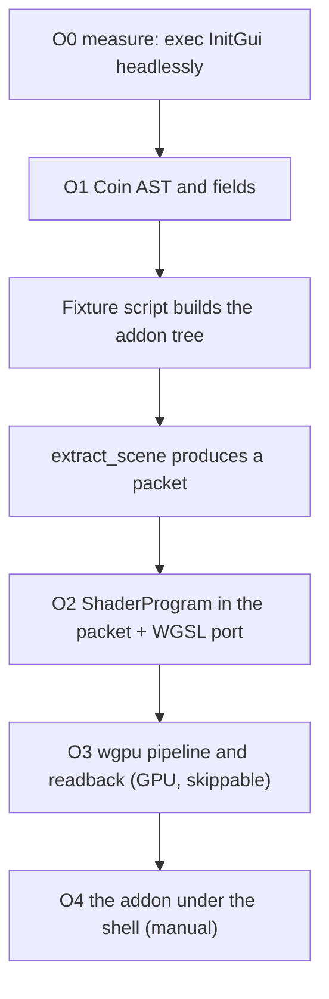

# Bring-up by grid overlay: what a third-party Coin/GLSL addon can prove

Status: design (2026-10-21).

Purpose: decide whether `freecad-grid-overlay` is a good **minimum workbench
bring-up** for FerroCAD, and whether its Coin/GLSL grid can be adapted to
`ferrocad_inventor` / `ferrocad_stage`. The user's framing — *"we already did some
grid work, so externalizing it to a workbench to prove feature parity (ability to
author shaders) could be interesting"* — is the thing this note tests. The short
answer is that the addon is **not a workbench**, its grid **cannot run as authored**
on wgpu, and what it can prove is narrower and more useful than "feature parity":
that an external Mod's Coin tree extracts and that FerroCAD can run a caller-supplied
WGSL program. The document decides that with costs, and says what it cannot prove.

Companion to [`axis-origin-grid.md`](axis-origin-grid.md) (the spatial reference
model, G0–G5 as built), [`inventor-plan.md`](inventor-plan.md) (the emulation roadmap
and §8's extraction caveat), [`stage.md`](stage.md) (the declarative producer),
[`qt-strategy.md`](qt-strategy.md) (the split plane this addon tests badly), and
[`visual-language.md`](visual-language.md) (the tokens its defaults contradict).

**Method.** Static reading only. No test, cargo command, addon run, GPU, or display
was used. Measured numbers come from `wc`, `grep`, `find`, `du`, `git` and
`Cargo.lock`; everything else is marked *est.* The addon is at
`../grid-overlay`, revision `25bbbe0` (2026-10-19, branch `main`), cloned `--depth 1`
from `https://github.com/makzumi/freecad-grid-overlay`; the git project is at
`13552db`. The upstream sparse checkout referenced by other notes (`33adf61`) has no
`src/Gui`, so no FreeCAD C++ was read.

---

## 1. Verdict

| Question | Answer |
| --- | --- |
| Is it a workbench bring-up? | **No.** It contains no `Workbench` class, no `Gui.addWorkbench`, no workbench activation, no menu/toolbar append. `package.xml` itself calls it a *"global toolbar command"*. It is a **Mod-folder addon with one command**. |
| Is it a good Coin/shaders fixture? | **Yes, as a fixture** — 14 Coin classes, 2 shader stages, an `SoMFNode` reference, a source path and a float array, in 594 non-blank, non-`#` Python lines. |
| Can the grid be adapted? | **The technique, yes; the code, no.** The math (ray/plane, `fwidth` LOD, coverage, shadows) ports; GLSL 1.20 compatibility does not, and its fixed-function built-ins do not exist in WGSL. |
| Should it be first Qt target? | **No.** Six of its 16 Qt names are new or outside the split-plane shim, and it subclasses `QDialog` and calls `exec` — the two things the shim is designed not to do. |
| Recommendation | **D → C, hybrid.** Measure and extract first (O0–O2, headless), add **WGSL** shader authoring with the ported shader as the acceptance test (O3), and treat "the addon runs" as a manual O4. Reject A. Defer B. |

The cost of being wrong is asymmetric: D's first slice (O0–O1) is *est.* 1–2
engineer-days and the full fixture *est.* 5–7.5, and it is useful even if every later
stage is cancelled; A costs *est.* 18–28 engineer-days before the first pixel plus a
GLSL frontend, and still cannot deliver "as authored"; C costs *est.* 11–14
engineer-days and, if wrong, leaves one shader path with one user. Section 6 states
this per option.

---

## 2. What the addon actually is (measured)

| Measure | Value | Source |
| --- | ---: | --- |
| Repository size | **2.7 MB** | `du -sh` |
| Tracked files (excluding `.git`) | **10** | `find` |
| Of which `Resources/Media/demo.png` | **1,236,291 B** | `ls -la` |
| `InitGui.py` | **717 lines** (594 non-blank, non-`#`) | `wc`, `grep -cv '^\s*(#\|$)'` |
| `Init.py` | **1 line** | `wc` |
| `Resources/grid.vert.glsl` | **23 lines** (16 non-blank, non-`//`) | `wc`, `grep -cv '^\s*(//\|$)'` |
| `Resources/grid.frag.glsl` | **125 lines** (93 non-blank, non-`//`) | `wc`, `grep -cv '^\s*(//\|$)'` |
| `.ui` files | **0** | `find` |
| Distinct Qt names | **16** | `grep -o` |
| Distinct Coin classes | **14** | `grep -o` |
| Imports of `Part` / `Draft` / `Sketcher` | **0** | `grep` |
| Addon revision | `25bbbe0`, 2026-10-19 | `git log -1` |
| Declared package version | 1.1.0, `freecadmin 26.0` | `package.xml` |

The 14 Coin classes are `SoCoordinate3`, `SoDepthBuffer`, `SoFaceSet`,
`SoFragmentShader`, `SoLightModel`, `SoMaterial`, `SoPickStyle`, `SoSeparator`,
`SoShaderParameter1f`, `SoShaderParameter3f`, `SoShaderParameterArray1f`,
`SoShaderProgram`, `SoSwitch`, `SoVertexShader`. The 16 Qt names are `Qt`,
`QSettings`, `QTimer` (`QtCore`); `QColor`, `QIcon` (`QtGui`); `QCheckBox`,
`QColorDialog`, `QDialog`, `QDialogButtonBox`, `QDoubleSpinBox`, `QFormLayout`,
`QMdiArea`, `QPushButton`, `QSlider`, `QToolBar`, `QVBoxLayout` (`QtWidgets`).

### 2.1 README claims versus code

| README claim (line) | What the code does |
| --- | --- |
| "a **Grid Overlay** toolbar button … persists across workbenches" (26–27) | True in effect, but not through the workbench system: it creates a private `QToolBar` on `Gui.getMainWindow()` (`InitGui.py:690-713`). There is no `Workbench` and no `appendToolbar`. |
| "tracks open documents and attaches to the active 3D view, including **views opened after startup**" (28–29) | Only per **document**: `items` is keyed by `doc.Name` (`:473`, `:515`, `:528`) and `ensure_grid` returns early when the name exists (`:515`). A second 3D view of the same document is never attached. |
| "The grid … regenerates from the viewport's visible area as you navigate" (58) | False for a shader grid: nothing regenerates. The fragment shader evaluates each pixel; the only CPU work is the shadow slots. |
| "There is no per-frame Python work: no camera sensor, no polling timer" (8–9) | True. Timers are the 150 ms shadow debounce (`:475-478`) and the 10 × 200 ms attach retry (`:519-520`). |
| "Depth-safe — … writes disabled" (24–25) | Implemented as `SoDepthBuffer().set("write FALSE")` (`:182-194`). `set()` does not exist in our facade. |
| "FreeCAD 26.x or 27.x" (63) | A warning only (`:76-82`); nothing enforces it. |
| "shadow updates … debounced by 150 ms" (59) | True (`:475-478`, `:550-552`). |

### 2.2 It is not a workbench

`grep` for `Workbench|addWorkbench|appendToolbar|appendMenu|activateWorkbench` in
`InitGui.py` returns nothing. `Init.py` is a one-line docstring. The module body
registers one command (`Gui.addCommand("GridOverlay_Settings", …)`, `:687`), builds a
toolbar (`:690-713`), constructs a `GridManager` (`:619`) and attaches immediately if
a document is already open (`:715-717`). FreeCAD's `Gui.addDocumentObserver` is the
only workbench-adjacent API it uses, and it is guarded (`:479-482`).

Consequence: this fixture can prove **addon loading, command registration, a Coin
tree, a shader and a settings dialog**. It cannot prove *workbench* parity — activation,
per-workbench toolbars, workbench switching, or `Workbench` lifecycle.

What a *minimum workbench* bring-up would exercise, and whether this addon does:

| Minimum-workbench surface | Addon | Where |
| --- | --- | --- |
| `Workbench` subclass, `Gui.addWorkbench`, activation | **no** | absent |
| `appendToolbar` / `appendMenu` on activation | **no** | a private global `QToolBar` (`:690-713`) |
| A command with `IsActive`/`IsChecked` | partly | `IsActive` returns `True` unconditionally (`:678-679`); no `IsChecked` |
| A task panel or dialog | yes (dialog) | hand-built `SettingsDialog` (`:624-671`), not a docked task panel |
| A `ViewProvider` / document object type | **no** | none registered |
| A viewport overlay in the live graph | yes | `getSceneGraph().addChild` (`:224`, `:298`) |
| A preference page | **no** | `QSettings` only (`:61`) |

So as a *workbench* bring-up it touches three of seven rows, one of them partially.
As a *shader and Coin* fixture it exercises the two things that are hardest to fake:
the live overlay tree and the shader/dialog surface. Those are different exercises,
and the slices in §10 are arranged for the second.

---

## 3. Architecture, in FerroCAD terms

### 3.1 Registration

| Step | Addon | FerroCAD surface | State |
| --- | --- | --- | --- |
| Non-GUI hook | `Init.py` (1 line) | module import | n/a |
| GUI hook | `InitGui.py` module body | `import FreeCADGui` | first wall: `Gui.getMainWindow` (`:474`) |
| Command | `:687` | `FreeCADGui.addCommand` (`python/FreeCADGui/__init__.py:69-80`) | ✅ present |
| Toolbar | `:690-713` | shell consumes `_command_list` (`:152-169`) | ✗ no `QToolBar`/`QAction` |
| Settings | `QSettings` (`:61`, `:146-167`) | `App.ParamGet("…/Preferences/View")` | ✗ no `QSettings`; two stores |
| Activation | `Activated` opens a modal (`:680-684`) | `runCommand` returns a payload (`:94-103`) | ✗ `exec` is synchronous |

The import ladder is worth stating precisely, because O0 measures it: `_load_qt()`
(`:23-47`) is called at module scope (`:50`), then `QSettings` (`:61`), then
`GridManager()` (`:619`) whose first statement is `Gui.getMainWindow()` (`:474`).
Everything after that is guarded. With PySide present and no Qt stub, line 474 is
the first hard failure; without PySide, line 50 is.

The settings dialog is hand-built — there is no `.ui`: a `QDialog` subclass
(`:625-652`) with a `QFormLayout` and six controls (`enabled`, `shadow_enabled`, a
`QSlider` for shadow opacity, a `QDoubleSpinBox` for spacing, a `QSlider` for
opacity, a colour button that opens `QColorDialog` at `:657-660`), an Apply/Cancel
`QDialogButtonBox`, and `apply()` (`:662-671`) which writes the six keys and calls
`manager.refresh()`. `Activated` (`:680-684`) runs it as a modal `exec`.

### 3.2 Attachment: per document, into the **live** scene graph

```python
# ShaderGrid.__init__, InitGui.py:222-299
self.sg = view.getSceneGraph()          # :224  live viewer root
...
self.sg.addChild(self.root)             # :298  mutates the running view
```

`GridManager._view()` (`:497-508`) resolves `Gui.ActiveDocument.ActiveView`, falling
back to `Gui.activeDocument().activeView()`, and rejects anything without
`getSceneGraph`. `ensure_grid` retries ten times at 200 ms when the view is not ready
(`:518-520`), then attaches one `ShaderGrid` per document name.

This is the opposite of FerroCAD's path: `ferrocad_inventor_py::extract_scene` deep
copies a Python-built tree into a `Scene` (`crates/ferrocad_inventor_py/src/lib.rs:320-328`),
and `SoGroup.addChild` **clones** the child into the parent (`:77-83`). The addon is
therefore written against pointer semantics *twice*: a live root, and `SoMFNode`
fields that keep the parameter nodes it later mutates. Section 7 treats this
separately from shaders.

### 3.3 What it observes and what it re-renders

| Hook | Registration | Fires | Effect |
| --- | --- | --- | --- |
| `Gui.addDocumentObserver(self)` | `:480` | created / activated / deleted document; changed / deleted object | `ensure_grid`, remove, or schedule a shadow (`:563-584`) |
| `App.addDocumentObserver(_AppObserver)` | `:485` | `slotRecomputedDocument` (`:465-466`) | schedule a shadow |
| `QMdiArea.subWindowActivated` | `:490-492` | a pane becomes active | `ensure_grid` (which no-ops for an existing document) |
| `QTimer(150 ms)` | `:475-478` | trailing debounce | `update_shadow` (`:554-560`) |

`slotChangedObject` reacts only to `Visibility` and `Placement` (`:578-581`);
`slotDeletedObject` schedules unconditionally (`:583-584`); `update_shadow` only
updates the **active** document's grid (`:556`), so a background document's shadow
goes stale. Geometry changes arrive through `slotRecomputedDocument`, not the object
slot.

What is actually re-rendered is **nothing geometric**: the tree is built once. On a
setting change it updates uniform fields (`apply_settings`, `:301-308`) and a
`SoSwitch` (`:446-449`). On a shadow update it rewrites an `SoMFFloat` array of
64 × 5 floats (`:418-444`). The 4-vertex quad never changes. That is the addon's
real design claim, and it is correct: **zero per-frame CPU geometry**.

### 3.4 The shadow half is a Part/document feature

`_footprints` (`:338-412`) reads `App.ActiveDocument.Objects`, skips objects without
a `Shape`, skips `Part::Datum`, skips features inside a `PartDesign::Body`, walks
`getParentGeoFeatureGroup`/`getParentGroup` for visibility (`:313-336`), uses
`shape.hashCode()` + `getGlobalPlacement()` as a cache key, `countElement("Face")`,
and `BoundBox`. None of that is shader work, and all of it needs a real document,
`Part` shapes and topological data. **Only the grid is a fair shader test.** A
"shadow parity" claim would be a claim about the document model, not about shaders.

---

## 4. The Coin surface: verified, classified

### 4.1 Present vs missing

| Class | Role in the addon | In `ferrocad_inventor(_py)` | Class of work |
| --- | --- | --- | --- |
| `SoSeparator` | container, isolation | ✅ `SoSeparator` (`lib.rs:96-106`) | — |
| `SoSwitch` | on/off | ✅ `SoSwitch` (`lib.rs:108-136`) | — |
| `SoCoordinate3` | 4 corners | ✅ (`fields.rs:388-397`) | — |
| `SoMaterial` | transparency flag | ✅ (`fields.rs:446-455`) | — |
| `SoPickStyle` | `UNPICKABLE` | ❌ class; only `NodeKind::PickId` (`node.rs:67-71`) | state, design decision |
| `SoDepthBuffer` | test on, write off | ❌ | state, renderer |
| `SoLightModel` | `BASE_COLOR` | ❌ | state, renderer (moot under a program) |
| `SoFaceSet` | the 4-vertex quad | ❌ (only `SoIndexedFaceSet`) | shape, compiler |
| `SoVertexShader` | stage + source path | ❌ | value/field |
| `SoFragmentShader` | stage + source path + params | ❌ | value/field |
| `SoShaderProgram` | links the stages | ❌ | value/field |
| `SoShaderParameter1f` | `name`, `value` | ❌ | value/field, trivial |
| `SoShaderParameter3f` | `name`, `value` (vec3) | ❌ | value/field, trivial |
| `SoShaderParameterArray1f` | `name`, `value` (float array) | ❌ | value/field + new `SoMFFloat` |

**Correction to the brief:** `SoPickStyle` is *not* present as a class in our crates.
The only trace is the `NodeKind::PickId` role and a doc comment that calls it "the
`SoFCSelection`/`SoPickStyle` role". There is no Python class, no `UNPICKABLE`
constant, and nothing at `python/`. The nine confirmed missing classes are the other
ones; `SoPickStyle` makes a tenth class-shaped gap, and it is the one whose
*semantics* FerroCAD already solves differently (the grid lives in its own
`grid_queue`, never pickable — `inventor_view.rs:2699-2711`).

### 4.2 Classification

**Value/field nodes** (`SoShaderProgram`, both stages, three parameter classes) need
an AST shape, fields, and a PyO3 surface. They do **not** need the renderer. They are
the cheap half.

| Item | Specific shape the addon needs | Notes |
| --- | --- | --- |
| `SoVertexShader` / `SoFragmentShader` | `sourceProgram` (a **file path**, `:229`/`:231`), `parameter` (an **`SoMFNode`** of parameter nodes, `:264`) | `sourceProgram` is a path in Coin; a path is environment-dependent and untestable headlessly without a base directory. Our choice of inline source is a design decision (option C, "The source question"). |
| `SoShaderProgram` | `shaderObject` (`SoMFNode`, `:267-268`) | Node references, i.e. Coin pointer semantics. See §7.2. |
| `SoShaderParameter1f` | `name` (`SoSFString`), `value` (`SoSFFloat`) | Trivial. |
| `SoShaderParameter3f` | `name`, `value` (`SoSFVec3f`) | Trivial. |
| `SoShaderParameterArray1f` | `name`, `value` (**`SoMFFloat`**) | We have `SoMFVec3f`/`SoMFColor`/`SoMFInt32`, not `SoMFFloat`. `_set_mf_floats` also calls `setNum` (`:207`), which **does not exist**; our `setValues` is `(offset, values)`, not Coin's `(start, num, values)` (`fields.rs:350-353`). |

**State nodes** (`SoDepthBuffer`, `SoLightModel`, `SoPickStyle`) need the compiler's
state accumulator (`crates/ferrocad_inventor/src/state.rs`) and, for two of them,
wgpu pipeline state. `SoFaceSet` needs the compiler's geometry path.

| Item | What it needs | Renderer work | Verdict |
| --- | --- | --- | --- |
| `SoDepthBuffer` | `test`, `write`, `function`; a `StateSnapshot` field; a **third** pipeline variant (blend + test `Less` + **no write**) | Yes. Today only `(write, Less)` opaque and `(no write, Always)` overlay exist (`pipeline.rs:77-125`). | **Design decision** — and `set("write FALSE")` needs a field-string parser we do not have. |
| `SoLightModel` | a state bit; if a program is bound, the shader owns shading | Only if used without a program | **Design decision**; under C it is accept-and-ignore. |
| `SoPickStyle` | a pickability bit, or a compiler rule that writes `PickId(0)` for the subtree | **Yes, if `PickId(0)` is the mechanism**: the pass writes `pick + 1`, so `PickId(0)` is still a hit (`pick.wgsl:58-60`). A real skip is needed. | **Design decision**; our grid already avoids picking structurally. |
| `SoFaceSet` | `numVertices` (`SoMFInt32`) + **non-indexed polygon** consumption + triangulation | No new pipeline, but the compiler only consumes index *triples* (`compile.rs:213-218`). A fan is fine for this quad; a correct n-gon wants the Phase 3 triangulator. | **Compiler work**, 1.5–2.5 d *est.* for a correct path. |

**Trivial:** the two scalar/vector parameter classes. **Small but shapeful:** the
program and stage nodes. **Renderer work:** `SoDepthBuffer`; optionally `SoLightModel`.
**Design decision:** `SoPickStyle` (implement vs. already-solved), `SoLightModel`
(implement vs. ignore under a program), and the string `set()` API.

### 4.3 The compatibility surface beyond the class count

The addon also depends on these, none of which exist:

| Use | Line | Needs |
| --- | --- | --- |
| `coin.SoPickStyle.UNPICKABLE` | `:173` | class constant |
| `coin.SoLightModel.BASE_COLOR` | `:175` | class constant |
| `sep.renderCulling = coin.SoSeparator.OFF` | `:284` | an instance attribute + constant; semantically a no-op for us (no culling), but the assignment must not raise |
| `program.shaderObject.set1Value(...)` | `:267` | `SoMFNode` |
| `fragment.parameter.setValues(0, n, params)` | `:264` | `SoMFNode` + Coin's 3-arg `setValues` |
| `self.root.whichChild = -3` | `:297` | see below |
| `self.sg.removeChild(self.root)` | `:453` | `removeChild` (absent; `SoGroup` has only `addChild`/`getNumChildren`/`__len__`, `lib.rs:75-94`) |
| `node.set("write FALSE")` | `:189` | a field-string parser |
| `field.setNum(n)` | `:207` | `setNum` on every `SoMField` |

**The switch sentinel is wrong.** The addon uses `-3` for `SO_SWITCH_ALL`
(Coin's value; the comment at `:297` says so). FerroCAD defines
`SO_SWITCH_ALL = -2` (`crates/ferrocad_inventor/src/node.rs:22-25`), and
`compile` treats **any** negative other than `-2` as "draw nothing" (`compile.rs:126-131`).
So the addon's grid root would be silently hidden even after all classes exist.
Fixing the constant to Coin's `-1/-2/-3` is a one-line change with a test, but it is
a *behaviour* change to a documented constant and belongs in the fixture slice.

---

## 5. The GLSL problem, honestly

### 5.1 What the shader is

`#version 120`, compatibility profile, fixed-function built-ins. It draws a
full-screen quad whose world-space corner rays are intersected with `z = 0` per pixel
(`grid.vert.glsl:17-23`), then evaluates two axis grids with decade LOD and
`fwidth` (`grid.frag.glsl:35-49`), axis lines (`:51-55`), a grazing-angle fade
(`:79`), 64 elliptical "shadows" (`:95-114`), and writes `gl_FragDepth`
(`:120-124`). It is a good shader. It is also the least portable kind of GLSL there
is.

### 5.2 `naga` cannot consume it — verified, not guessed

| Check | Result | Evidence |
| --- | --- | --- |
| `naga` in the tree | **29.0.4** | `Cargo.lock:3854-3857` |
| Direct `naga` dependency | **none** | no `Cargo.toml` in the workspace names it |
| `glsl-in` compiled? | **No.** `wgpu = "29"` uses default features; `glsl = ["naga/glsl-in"]` is opt-in. `pp-rs` is **absent from `Cargo.lock`**, so the frontend is not even built. | `wgpu-29.0.4/Cargo.toml` features; `Cargo.lock` |
| Accepted `#version` | **440, 450, 460 only**; anything else → `InvalidVersion` | `naga-29.0.4/src/front/glsl/parser.rs:267` |
| Accepted profile | **`core` only**; `es` → `InvalidProfile` | same file, `:293` |
| `gl_Vertex`, `gl_ModelViewMatrix`, `gl_ProjectionMatrixInverse`, `gl_ModelViewProjectionMatrix`, `gl_FragColor` | **Absent.** A `grep` over the whole naga source finds none of them. The builtin table is Vulkan-style (`gl_VertexIndex`, `gl_InstanceIndex`, …). | `src/front/glsl/variables.rs:130-240` |
| `fwidth` | **Supported** (`Derivate(Width, …)`) | `src/front/glsl/builtins.rs:553-598` |
| `gl_FragDepth` | **Supported** (as a builtin output) | `variables.rs:166-176` |

So the answer is plain: **`naga`'s GLSL frontend cannot consume this shader, and
neither can any version of it that only re-labels the header.** `#version 120` is
rejected outright; `#version 300 es` is rejected on version *and* profile; and a
`#version 450 core` rewrite still has no `gl_Vertex` or `gl_ModelViewMatrix` because
those do not exist in core GLSL. The shader would have to declare its own attributes
and uniforms and compute the same things — i.e. it would already be a rewrite, in
GLSL, with the GLSL frontend not even compiled in.

**Consequence for option C's GLSL-ES3→WGSL idea: do not offer it.** It would mean
enabling a non-default wgpu feature, shipping a second shader language, accepting
only core GLSL ≥440 (not ES3), and still rewriting this shader. The honest offer is
**WGSL only**.

### 5.3 What ports and what does not

| Feature | GLSL 1.20 construct | WGSL | Portable? |
| --- | --- | --- | --- |
| per-pixel ray | `gl_ProjectionMatrixInverse`, `gl_ModelViewMatrixInverse` (`vert:12-14`) | add `inv_view_proj` to `Globals` | **math yes, built-ins no** |
| corner selection | `sign(gl_Vertex.xy)` (`vert:19`) | `sign(input.position.xy)` | yes |
| clip override | `gl_Position = vec4(ndc, 0, 1)` | `@builtin(position)` | yes |
| decade LOD | `fwidth`, `log`, `pow`, `floor`, `mix` (`frag:35-49`) | identical | yes |
| line coverage | `fract`, `clamp`, `smoothstep` | identical | yes |
| grazing fade | `smoothstep` (`frag:79`) | identical | yes |
| perspective test | `gl_ProjectionMatrix[2][3] != 0` (`frag:63`) | a uniform flag (`u32`) or derived from the far point | **needs a decision** |
| discard | `discard` (`frag:83, 116`) | `discard` | yes |
| output colour | `gl_FragColor` (`frag:120`) | `@location(0)` | yes, renamed |
| output depth | `gl_FragDepth = clamp(...)` (`frag:124`) | `@builtin(frag_depth)` | yes, renamed |
| shadow array | `uniform float shadow_data[320]` (`frag:12`) | **cannot** be `array<f32, 320>` in a uniform (stride must be 16); use `array<vec4<f32>, 80>` with manual unpacking, or a storage buffer | **re-packed** |

### 5.4 The rewrite estimate

The GLSL is 148 source lines (109 non-blank, non-`//`). A direct WGSL rewrite is *est.*
**150–200 lines**, split roughly: uniform block 12, vertex stage 18, helpers 55,
main 60, output struct 8. The extra work is not line count, it is four decisions:
`inv_view_proj` in `Globals`, the perspective flag, the shadow-array packing, and
`frag_depth`. *Est.* 1–1.5 engineer-days for the port plus 0.5 for the plumbing,
excluding the node family and the pipeline path.

A WGSL port must also **adopt our tokens**, or it will not match the visual language
(§8.3): the shader hardcodes axis colours `(0.80, 0.20, 0.20)` and `(0.40, 0.70, 0.20)`
(`frag:21-22`), whereas the tokens are `#F87171` / `#4ADE80`, linear
`[0.939, 0.165, 0.165]` / `[0.069, 0.730, 0.216]` (`axis-origin-grid.md` §3.1,
`grid.rs:37-41`). Its default ink is `#808080` at 0.65; ours is `#94A3B8` at 0.15
(`grid.rs:33-35`). At that point it is "the addon's technique", not "the addon".

---

## 6. Options, with costs

Costs are **estimates** in engineer-days for a slice-sized change in this codebase,
excluding review. They are not measurements.

### A. As-is emulation

Add the ten classes, a live `getSceneGraph()` handle, `renderCulling`, `set()`,
`setNum`, `removeChild`, the `-3` sentinel, **and a GLSL 1.20 compatibility path**.

| Piece | Est. | Comment |
| --- | ---: | --- |
| Value/field nodes + `SoMFFloat` | 3.5–5 | §4.2 |
| `SoFaceSet` + triangulation | 1.5–2.5 | a fan suffices for the quad; a correct n-gon does not |
| `SoDepthBuffer` + state + pipeline variant + `set()` | 1.5–2.5 | |
| `SoLightModel` + `SoPickStyle` | 1–1.5 | or accept-and-ignore |
| Live scene graph (arena or shared cells) | 5–10 | §7; this is the named prerequisite in `inventor-plan.md` |
| Renderer program path (same as C) | 5–6.5 | pipeline cache, bind group, `frag_depth`, depth/blend variant, no-pick |
| **Total before a pixel** | **18–28** | **plus a GLSL frontend that is a project, not a slice** |

**Verdict: reject.** A's only advantage over C is source compatibility, and source
compatibility is the exact component that cannot be delivered: naga rejects the
version and the built-ins (§5.2). wgpu *can* accept GLSL — `ShaderSource::Glsl`
exists behind the opt-in `glsl` feature — but only through that same naga frontend,
so enabling it buys nothing for this shader. A therefore degenerates into C plus a
compatibility tax that still ends in a rewritten shader. *Cost of being wrong:* the
GLSL frontend is an open-ended project and the live-graph migration is pulled in for
one 148-line shader.

### B. Native grid technique (shader grid in `ferrocad_wgpu` / `ferrocad_stage`)

Port the *idea*: a per-pixel infinite plane grid as a dedicated packet/pipeline,
keeping the addon out of the loop.

| Buys | Loses |
| --- | --- |
| True infinity (no regeneration on pan/zoom) | The one-batch contract: a shader grid cannot be a plain `Points`/`Lines` packet; it needs a program/pipeline special case (option C provides one anyway) |
| Smooth decade blending instead of a hard level drop (`effective_steps` promotes a decade below 4 px, `grid.rs:139-154`) | **Dots**: ours is a 10 mm dot field + 100 mm lines (`grid.rs:183-235`); the shader draws lines only. Enabling it changes the visual language. |
| Anti-aliased lines at any angle; no CPU vertex work | Workplane/datum/face grids, bounded extents, the 25 % world dim, and the G3 hover bloom are all CPU producers today; a shader must re-implement each in the fragment stage |
| One draw for the ground | `snap_to_geometry` stays CPU and workplane-aware, but the *visible* LOD must match `effective_steps` or the snap nodes stop coinciding with visible lines |
| A place to hang contact shadows | Contact shadows need the document's bounds — the `_footprints` half of the addon — i.e. Part/TopoShape, not a shader |

**Verdict: defer, and separate it from bring-up.** It is a *visual upgrade* with a
real design cost: `axis-origin-grid.md` §9 explicitly lists **"No infinite shader
grid"** and **"No second renderer"** as non-goals, and B reverses both. *Est.*
5–8 engineer-days including GPU readback tests. *Cost of being wrong:* two grid
models and a split spatial reference, for a look that G0–G5 already approximated.
It is not a bring-up because it exercises no Python, no Coin and no addon.

### C. Shader-authoring capability

A `ShaderProgram` node family in `ferrocad_inventor` plus a WGSL pipeline path in
`ferrocad_wgpu`; the addon's shader **rewritten in WGSL** is the acceptance test.

| Piece | Est. | Comment |
| --- | ---: | --- |
| Value-semantics program/stage/parameter nodes + `SoMFFloat` | 3–4 | no `SoMFNode` aliasing (§7.2) |
| `StateSnapshot.program: Option<Arc<ShaderProgram>>` + compiler capture | 1–1.5 | touches `ferrocad_graphics`, so re-run the pick layout |
| Renderer: pipeline cache keyed by program, per-program bind group (group 2), depth/blend variant, `frag_depth` | 3–4 | plus `pickable: false` (§13, risk 4) |
| `Globals` gains `inv_view_proj` (+ perspective flag) | 1 | every pipeline shares the block |
| WGSL port of the addon shader + tokens | 1.5 | §5.4 |
| Validation + tests (`naga` parse/validate on CPU; GPU readback skippable) | 1.5–2 | naga is already in the registry, offline-buildable |
| **Total** | **11–14** | |

**The source question.** Three candidates:

| Supply | For | Against | Recommendation |
| --- | --- | --- | --- |
| Inline field (`source`) | deterministic, headless, no path/base-dir problem, survives save/restore | not Coin's `sourceProgram` semantics | **yes**, authoritative |
| File (`sourceProgram`) | lets the addon run with a two-line change, and matches Coin | environment-dependent, a Mod can point anywhere, tests need fixtures | **compatibility only**, resolved relative to the addon dir with an explicit failure |
| A new `ferrocad_stage` API | attractive for modern workbenches | no consumer exists; the stage has no node model, so it would be a second authoring surface | **no**, until a stage consumer exists |

**GLSL:** not offered (§5.2). The node family lives in `ferrocad_inventor`; `ferrocad_stage` has no node model, so it participates only if a program packet (a `ShaderItem`, or a `StateSnapshot` field a stage can set) is added — deferred until a stage consumer exists. **Verdict: recommend, as stage 2.**

### D. Conformance fixture only

Import and build the tree headlessly, assert extraction, never render. This is C's
first half (AST + fields + `FaceSet`), with the state nodes recorded but not applied.

| Piece | Est. |
| --- | ---: |
| Ten classes, fields, `SoMFFloat`, `setNum`, `set()`, `removeChild`, sentinel fix | 4–6 |
| A fixture script that reproduces the addon's tree (e.g. `mods/GridOverlay/fixture.py`) | 0.5 |
| Extraction assertions (shape, counts, source hashes) | 0.5–1 |
| **Total** | **5–7.5** |

**Verdict: recommend, as stage 1.** It is the cheapest way to turn the question into
a number, and it is the same work C needs.

### Comparison

| | A. as-is | B. native grid | C. authoring | D. fixture |
| --- | --- | --- | --- | --- |
| Proves | the addon runs | a better grid | shaders | extraction |
| Headless | no | no (GPU) | O1–O2 headless; O3 GPU | yes |
| Touches Python/Coin | yes | no | yes | yes |
| Needs live graph | **yes** | no | only for the addon's late updates | no |
| Needs GLSL frontend | **yes** | no | no | no |
| Est. | 18–28 + frontend | 5–8 | 11–14 | 5–7.5 |
| Verdict | reject | defer | recommend (2) | recommend (1) |

### Recommendation

**D then C.** Two stages, one direction:

1. **O0–O2 (D):** measure the addon headlessly, add the value/field nodes and
   `SoFaceSet`, build the tree, extract it, and validate the WGSL with `naga` on the
   CPU. No GPU, no display.
2. **O3–O4 (C):** put the program in the packet, run it in `ferrocad_wgpu`, and only
   then consider running the addon itself.

**Cost of being wrong:** with D, *est.* one to two weeks and a precise gap list; with C,
*est.* three to four weeks and a shader path with one consumer; with A, an open-ended
GLSL project for a shader we would rewrite anyway; with B, a second grid model for a
look that contradicts `axis-origin-grid.md` §9.

---

## 7. The live scene graph is a separate problem

The addon mutates the viewer's graph at runtime (`:224`, `:298`, `:453`) and mutates
fields on nodes it still holds (`:305-308`, `:424-439`, `:449`). FerroCAD extracts a
copy. These are independent failures.

### 7.1 What would be needed

| Requirement | Today | Needed for A | Needed for C |
| --- | --- | --- | --- |
| `view.getSceneGraph()` | **absent everywhere** (`grep` over `python/` and `crates/`) | yes | only O4 |
| `addChild` keeps the object live | **clones** (`lib.rs:77-83`) | yes | no, if the program is value-semantics |
| Field writes on a held child reach the drawn scene | no (the scene holds a clone) | yes | only for the addon's *late* updates |
| `removeChild` | absent | yes | no |
| A change signal → re-extract | none | yes | yes |
| Identity across extraction (for `SoMFNode` parameters) | no | yes | no, if values are copied |

### 7.2 Why re-running the extractor is necessary but not sufficient

If `getSceneGraph()` returned a host root and the viewport re-extracted after every
change, the draw would still be stale, because:

- `sg.addChild(self.root)` clones `self.root` into the host root (`lib.rs:77-83`);
- the addon then writes `self.root.whichChild`, `self.grid_color.value`,
  `self.shadow_data.value` on **its** objects;
- `fragment.parameter.setValues(..., params)` and
  `program.shaderObject.set1Value(...)` (`:264`, `:267`) are `SoMFNode` references;
  under the owned tree they would clone the parameter nodes at add time, so later
  writes are lost.

Re-extraction reads the host's clones, not the addon's objects. Making it work needs
either:

1. **the arena** — node ids, stable identity, detached fields. `inventor-plan.md`
   §7 already calls the arena "the prerequisite for faithful PyO3 identity and
   detached fields". This is the principled fix and it is not a slice for one addon.
2. **shared cells** — `Node.children` become `Rc<RefCell<..>>`/`Arc<..>` so both
   sides hold the same storage. Cheaper than an arena, but a deep change to `Node`,
   `Scene` (`Clone`), `NodeKind` and `compile`.
3. **forwarding handles** — a child proxy that stores `(parent, index)` and forwards
   field writes. For nested parameters (`grid_color` inside `program` inside `sep`)
   that is a path of handles, i.e. the arena by another name.

**Conclusion:** re-extraction on a change is *necessary* and is the right contract
("mutations are visible after the next extraction"), but it does **not** avoid the
aliasing problem. The addon's `remove()` (`:451-455`) also needs `removeChild`, which
we do not have.

### 7.3 Is it a prerequisite?

- **For A: yes.** A is "the addon runs as written", which requires a live graph.
- **For C: no**, if the program node has *value* semantics: stages carry source,
  parameters carry values, the compiler snapshots them, and a change means "set the
  value and re-extract". That is enough for O1–O3 and for a workbench that sets its
  uniforms before adding the node.
- **For the addon at O4: yes**, because it updates uniforms and `whichChild` after
  construction. The alternatives are (a) the arena/shared cells, or (b) an O4-only
  adapter that calls a re-add after each change — which the addon does not do.

This is the same caveat `inventor-plan.md` §8 records: *"the scripted callback
currently observes the pick; because the extracted scene is a copy, a callback that
recolours a node does not yet change what is rendered"*. The addon is a second,
stronger instance of it: it does not merely recolour, it toggles visibility and
rewrites uniforms.

---

## 8. Two grids: the policy

If the addon runs, two grids draw at `z = 0`. Policy:

### 8.1 One authority

**`ferrocad_stage` stays authoritative** for the spatial reference: `GridSpec`,
`GridStyle`, `Workplane`, `SnapContext`, the triad, the origin node and snapping
(`axis-origin-grid.md` §2, §7). The addon's shader grid is a **debug overlay** behind
an explicit toggle, never the default and never the snap authority.

`App_ToggleGrid` continues to own the stage ground; `App_ToggleAxisCross` continues to
own the triad. The shader grid gets its own flag, and when it is on the stage ground
is hidden (not dimmed: two coplanar line grids z-fight even with a bias).

### 8.2 What `ViewRequest` / `ViewState` gain

| Field | Type | Meaning |
| --- | --- | --- |
| `grid_overlay` | `Option<bool>` → `ViewState.grid_overlay: bool`, default `false` | debug shader grid on/off |
| `grid_alpha` | `Option<f64>` → `f64`, default from `GridStyle` | only if the stage grid is to honour the addon's opacity |
| `grid_color` | `Option<String>` → `String` | only if the stage grid is to honour the addon's colour |

The first is required; the other two are optional and only worth adding if the
settings dialog is to be *one* preference surface. `grid_radius` keeps its meaning for
the stage grid; an infinite shader grid has no radius, so the field is ignored when
`grid_overlay` is on (document it in the summary string).

Mirroring: `FreeCADGui.ViewState` gains `grid_overlay` beside `grid`, `axis_cross`,
`grid_minor`, `grid_major`, `grid_radius` (`python/FreeCADGui/__init__.py:303-321`).

### 8.3 The settings dialog on G5

The addon's defaults are measured in `DEFAULTS` (`:134-141`) and written with
`QSettings` (`:61`, `:146-167`). G5's state is `grid_minor` / `grid_major` /
`grid_radius` (`ferrocad_gpui/src/view.rs:98-109`).

| Addon setting | Default | Stage equivalent | Mapping |
| --- | ---: | --- | --- |
| `enabled` | true | — (not `ViewState.grid`; that is the *stage* grid) | `grid_overlay` |
| `opacity` | 0.65 | `GridStyle.major_alpha` = 0.15, minor = 0.35 × | new `grid_alpha` (or ignored) |
| `color` | `#808080` | `GRID_COLOR #94A3B8` (`grid.rs:33`) | new `grid_color` (or ignored) |
| `base_spacing` | 1.0 | `grid_minor` 10 mm, `grid_major` 100 mm | `minor = base`, `major = 10 × base` for the stage grid |
| `shadow_enabled` | true | **none** | no mapping; grey out |
| `shadow_opacity` | 0.30 | **none** | no mapping; grey out |

Two store problems: `QSettings("GridOverlay","GridOverlay")` is a *separate* store
from `BaseApp/Preferences/View` (which `App_ReloadGridSettings` reads,
`axis-origin-grid.md` §8). If the shim's `QSettings` is to be useful, it must be
routed to `App.ParamGet` so there is one source of truth; otherwise a user changes a
setting in one place and the other grid does not move.

Three visual-language conflicts, all measured:

- **Ink.** `#808080` at 0.65 versus `#94A3B8` at 0.15.
- **Axis hues.** `(0.80, 0.20, 0.20)` / `(0.40, 0.70, 0.20)` (`frag:21-22`) versus
  `#F87171` / `#4ADE80` (`grid.rs:37-41`).
- **Primitives.** Lines only, versus the G0–G5 dot field plus major lines. The
  shader has no dots and no workplane layers.

So a port that keeps the tokens is not the addon's look, and a port that keeps the
look violates `visual-language.md`. Decide the tokens *before* O3, not after.

---

## 9. The Qt surface: is the split plane enough?

The addon's 16 names against the shim's measured contract (`qt-strategy.md` §4.4,
which lists `QSettings`, `QToolBar`, `QAction` and `QMdiArea` as **"not in the shim —
loud by design"**):

| Name | Where | Shim status | New work |
| --- | --- | --- | --- |
| `Qt` (`HORIZONTAL`) | `:112` | enum support | no |
| `QSettings` | `:61`, `:146-167` | **explicitly out** | route to `App.ParamGet` |
| `QTimer` | `:475-478`, `:519-520`, `:552`, `:564`, `:567` | `singleShot` planned; **instance timer with `timeout` signal** is not | yes |
| `QColor` | `:303-305`, `:658-660` | value type planned | no |
| `QIcon` | `:706` | opaque path planned | no |
| `QDialog` | subclass `:625`, `exec` `:684` | `.ui` root + async modal; **subclassing and `exec_` are out** | design change |
| `QDialogButtonBox` | `:648-652` | planned (`.ui` loader) | no |
| `QCheckBox` | `:632-635` | planned | no |
| `QPushButton` | `:644-647` | planned | no |
| `QSlider` | `:636-643` | **not measured** (Draft uses none) | yes |
| `QDoubleSpinBox` | `:640` | planned | no |
| `QFormLayout` | `:631`, `:633-646` | box/grid model planned; `addRow` **not** in the measured contract | partly |
| `QVBoxLayout` | `:630` | planned | no |
| `QColorDialog` | `:658` (static `getColor`) | **explicitly out** (native picker) | yes |
| `QToolBar` | `:692-711` | **explicitly out** | yes |
| `QMdiArea` | `:490-494` | **explicitly out** | yes |

**Verdict: not a fair test.** Roughly six names are new, two are partial, and the two
biggest structural assumptions of the split plane are violated: a **`QDialog`
subclass** (Draft has none, by measurement) and **a synchronous `exec`** (the shell's
modal is asynchronous). The addon also needs `Gui.getMainWindow()` (absent), a toolbar
attached to the main window, and MDI child tracking.

If the goal were "prove the shim", this addon would push it toward option B
(emulate Qt), which is the outcome `qt-strategy.md` exists to avoid. Use it at O4 as
a *stress case*, not as the first Qt acceptance.

---

## 10. Slice plan O0–O4



### O0 — Measure, headless

**Deliverable.** A harness-owned probe (`tools/probes/grid_overlay.py`) that:

1. locates `--addon`, reads `InitGui.py`, and records the addon revision
   (`git -C <addon> rev-parse --short HEAD`, best-effort);
2. installs a **recording Qt stub** under `PySide`, `PySide2` and `PySide6` *before*
   the addon loads, so a system PySide6 cannot make the result machine-dependent;
3. ensures `FreeCAD`, `FreeCADGui` and `pivy.coin` resolve to our facade
   (`ferrocad_inventor_py::install` in the embedded host);
4. `exec`s `InitGui.py` with `__file__` and `__name__` set, timestamping each step,
   and reports the **first** uncaught exception as `InitGui.py:<line>: <type>`.

**Acceptance.** `FreeCAD.GuiUp = 0`, no display, no GPU, no Qt. The report contains
the addon revision and one of two line-accurate records, both of which are useful:
in the embedded host (`pivy` installed) it is `InitGui.py:474`
(`Gui.getMainWindow`); in the pure-Python harness without the `coin` extension it is
`missing module 'pivy'` at `InitGui.py:15`.

**Wiring.** `tools/conformance.py` gains `--grid-overlay` and `--addon PATH`; `--root`
becomes optional for this group. A `run_probe()` returns the same outcome dict
`run_file()` does, so `render()` prints it unchanged:

```python
{"file": "grid-overlay", "loaded": False,
 "reason": "InitGui.py:474: AttributeError: module 'FreeCADGui' has no attribute 'getMainWindow'"}
```

Because the pure-Python harness interpreter has no `pivy`, the line-accurate run is
supplied in-process by a Rust test that mirrors `part_conformance.rs`: set
`FERROCAD_ADDON`, `boot()` the extension, call `ferrocad_inventor_py::install`, then
run the harness. This is the same "harness + image" split `docs/conformance.md` §3
already uses for `--part`. The probe must run **once per interpreter**: `addCommand`
rejects a duplicate id (`python/FreeCADGui/__init__.py:78-79`), so a second exec in
the same process would fail at `InitGui.py:687` for the wrong reason.

**Proves:** we can measure an external Mod and name the wall. **Does not prove:**
anything runs, loads or draws.

### O1 — Coin AST and fields

**Deliverable.** The ten classes (§4.1), `SoMFFloat` with `setNum` and Coin's 3-arg
`setValues`, `SoMFNode` (value-copied), `SoFieldContainer.set()` with a two-field
parser, `removeChild`, the `-3` sentinel fix, `SoSeparator.renderCulling` as an
accepted attribute, and the `UNPICKABLE`/`BASE_COLOR` constants. `SoFaceSet` gets a
fan triangulation into the existing `Mesh` path.

**Acceptance.** A fixture script builds the addon's tree with the same calls
(`SoVertexShader` → file, params, program, coords, face, separator, switch) and
`extract_scene` yields one packet: 4 positions, 6 indices (2 triangles), the
program attached, the source SHA-256 equal to the files on disk. Toggling
`whichChild` to `-3` and to `-1` changes the packet count between 1 and 0. All
headless.

**Proves:** the field model can express a real third-party shader tree.
**Does not prove:** state semantics or rendering; `SoDepthBuffer`, `SoLightModel`
and `SoPickStyle` exist and are recorded, but their state is not applied.

### O2 — Program in the packet, WGSL port, CPU validation

**Deliverable.** `StateSnapshot.program: Option<Arc<ShaderProgram>>` (id + stage
sources + parameter values), the compiler capture, the WGSL port (vertex, fragment,
shadow array, `frag_depth`), and a `validate_wgsl` helper in `ferrocad_wgpu` using
`naga` (already at 29.0.4; add it as a **dev-dependency**, offline).

**Acceptance.** `naga::front::wgsl::parse_str` succeeds on both stages and the
validator finds the declared entry points; the packet carries the program; the
ported shader's uniform struct matches the Rust `ParamValue` writer (a round-trip
test). No GPU.

**Proves:** we can carry and validate authored shaders. **Does not prove:** they
draw.

### O3 — The renderer path

**Deliverable.** A pipeline cache keyed on the program (sources + topology + blend +
depth state + sample count + format), a per-program bind group (group 2), the
transparent depth-test/no-write variant, `inv_view_proj` in `Globals`, and
`pickable: false` for program packets so the pick pass skips the full-screen quad.

**Acceptance.** With an adapter: a readback of an empty scene shows the grid's
axis-coloured lines at the expected pixels; putting a box on the plane occludes it;
the pick buffer returns nothing over the quad. Without an adapter the test skips,
matching the existing `ferrocad_wgpu` convention.

**Proves:** the "author shaders" claim end to end. **Does not prove:** the addon
runs, or GLSL.

### O4 — The addon itself (manual)

**Deliverable.** `Gui.getMainWindow`, the Qt shim pieces of §9, `getSceneGraph` (or
the §7.2 decision), and the live-update contract.

**Acceptance.** A scripted GUI session: the command opens the dialog, toggling shows
and hides, changing the spacing moves the lines, a box move updates the shadow, a
second document gets its own grid. Not automated; recorded as a manual checklist.

**Proves:** source compatibility for *this* addon, with a rewritten shader.
**Does not prove:** GLSL, workbench activation, or the shadow path without a real
`Part` document.

### What each slice proves, in one table

| Slice | Proves | Does not prove |
| --- | --- | --- |
| O0 | the gap is measurable and line-accurate | anything loads |
| O1 | Coin/field expressiveness for a real tree | state or pixels |
| O2 | shader carrying + CPU validation | rasterisation |
| O3 | pipeline authoring, depth/blend, no-pick | the addon, or GLSL |
| O4 | source compatibility (shader rewritten) | workbench parity, GLSL, Part shadows |

---

## 11. Decisions to settle

| # | Decision | Recommendation |
| --- | --- | --- |
| 1 | Shader source form | inline `source` authoritative; `sourceProgram` as a file compatibility path |
| 2 | WGSL only, or GLSL too | **WGSL only** (§5.2); no naga GLSL, no ES3 |
| 3 | `SoPickStyle` | accept the class, implement pickability as a compiler bit only if a consumer needs it; our grid is already structurally unpickable |
| 4 | `SoLightModel` | accept; ignored while a program is bound |
| 5 | `SoDepthBuffer` | implement as a per-packet depth-write/test intent (reuse the `visual-language.md` §3 depth-mode idea) |
| 6 | Live graph | defer; C uses value semantics, A needs the arena |
| 7 | Grid authority | `ferrocad_stage`; the shader grid is a debug toggle |
| 8 | `QSettings` | route to `App.ParamGet`; one store |
| 9 | Addon in the conformance harness | `--grid-overlay` group, in-process Rust image, like `--part` |

---

## 12. What I could not verify

- **No display and no GPU run.** Nothing here is a rendering claim. O3's readback is
  a plan, not a result.
- **The addon was never executed.** All statements about it are static reading of
  `InitGui.py` and the two shaders. The import ladder in §3.1 is inferred from the
  source, not observed.
- **No upstream C++ for `SoShaderProgram`.** `freecad-upstream` is sparse
  (`src/Mod` only) and contains no GUI/Coin sources; Coin itself is not vendored. The
  field shapes (`sourceProgram`, `parameter`, `shaderObject`, `name`, `value`) come
  from the addon's usage plus the documented Coin API, not from reading Coin's headers.
  The same applies to `getSceneGraph` on `View3DInventorViewer`.
- **`naga` was read, not run.** The claims in §5.2 are from the 29.0.4 source in
  `~/.cargo/registry` (`parser.rs:267`, `:293`, `variables.rs`, `builtins.rs:553`)
  and from `Cargo.lock` / `wgpu`'s feature table. I did not compile a probe.
- **No network.** Nothing was fetched; the addon and naga copies were already local.
- **No performance measurement.** "Zero per-frame CPU" is the addon's design claim
  and is consistent with the code; it was not profiled.
- **The Qt numbers are name counts, not call-site counts.** §9 counts distinct names
  and the lines that use them, not how often each runs.

---

## 13. Risks

1. **The claim drifts.** The deliverable starts as "a third-party addon runs" and
   ends as "a shader we wrote runs". Both are useful, but they are different claims;
   say which one O3 closes. Only O4 closes the first, and only for a rewritten shader.
2. **The GLSL temptation.** Once a shader node exists, "just add GLSL" looks cheap.
   It is not: naga's frontend is not compiled, accepts only 440/450/460 core, and
   lacks every compatibility built-in this shader uses. Decide now that WGSL is the
   only input.
3. **`StateSnapshot` is a public contract.** Adding `program` (and any depth mode)
   touches `ferrocad_graphics`, the scene shader, the pick shader and every producer.
   Land it as one deliberate contract change, not as a shader-specific field.
4. **The pick pass will draw the quad.** The grid's placeholder is a real 4-vertex
   triangle pair at `±1e-6`. Unless program packets are marked non-pickable, a click
   at the origin can hit it. This is exactly what `SoPickStyle.UNPICKABLE` means, and
   our grid avoids it only because it is in `grid_queue`.
5. **Arbitrary WGSL is an availability surface.** A Mod can supply a shader that
   fails validation or is pathologically slow. Validate with naga before pipeline
   creation, cache failures, and fall back to the default material (the same
   isolation policy commands already use).
6. **Two grids, two stores, two looks.** If `QSettings` is not routed to
   `App.ParamGet`, users get two preference surfaces. If the tokens are not adopted,
   the debug grid contradicts `visual-language.md`. Both are cheap to decide now and
   expensive to unwind.
7. **The live graph is a trapdoor.** "Just add `getSceneGraph`" pulls in aliasing,
   identity and the arena — an emulation-roadmap item, not a bring-up item. C is
   designed to avoid it; A is not.
8. **Qt scope creep.** The addon needs `QToolBar`, `QMdiArea`, `QSettings`,
   `QSlider`, `QColorDialog`, a `QDialog` subclass and `exec`. Building those to pass
   one addon turns the split plane into a Qt emulator, which `qt-strategy.md`
   measured against.
9. **The addon is not a workbench.** If the team wants workbench parity, this fixture
   cannot supply it; the measured `--draft` work (`TODO-21-10-2026.md` §2) is the
   honest target, and it is a bigger one.
