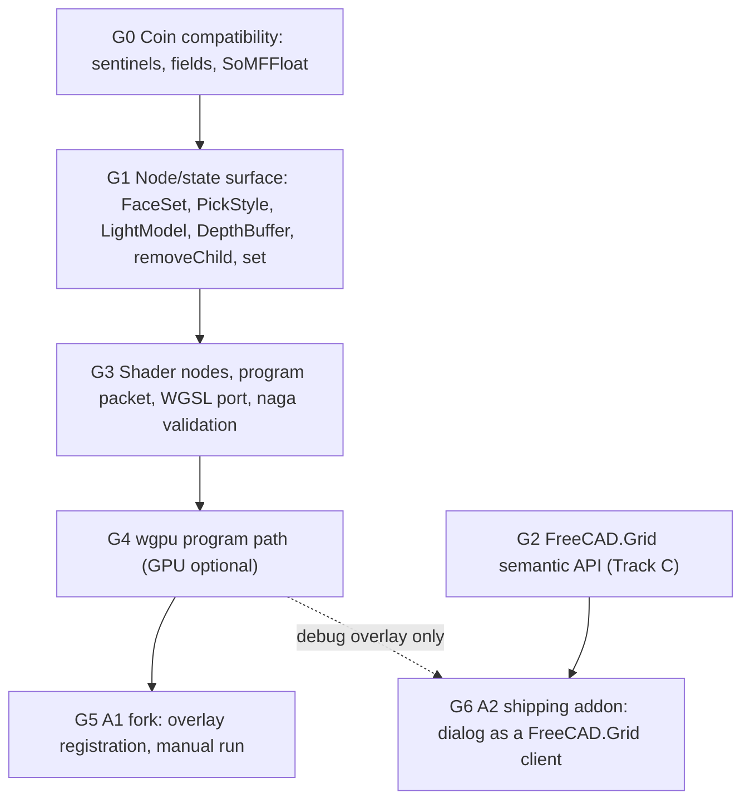
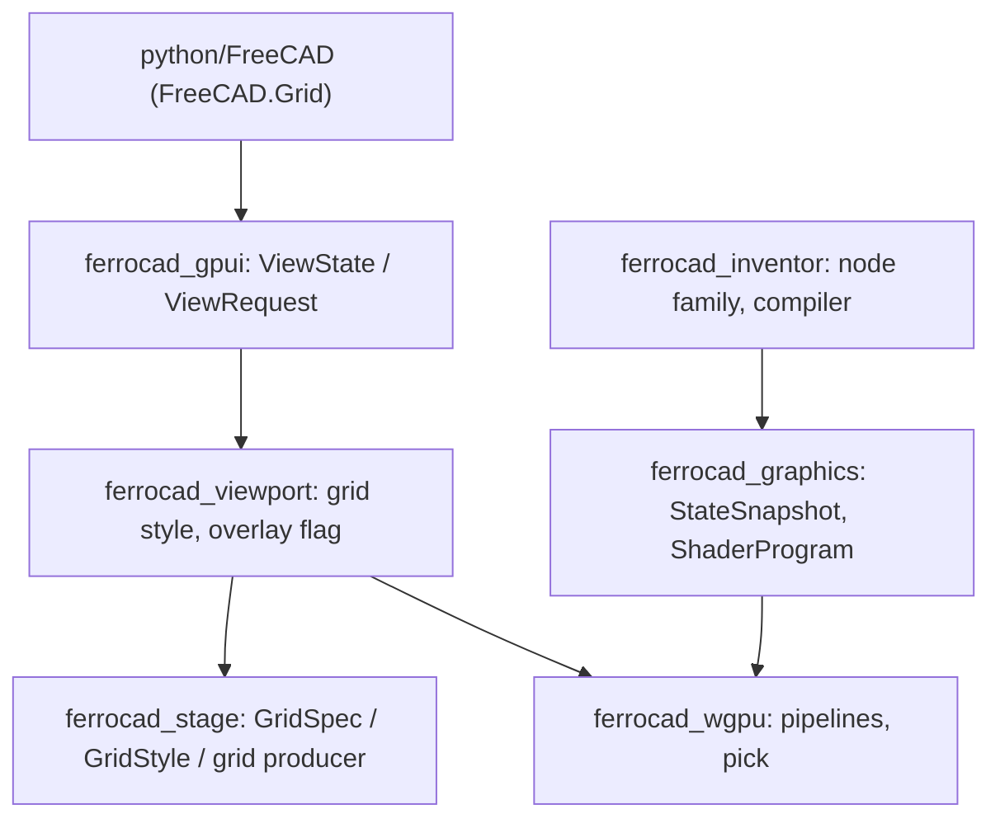

# Grid overlay: decisions and plan

Status: decision (2026-10-21).

Purpose: turn the audit in [`grid-overlay-bringup.md`](grid-overlay-bringup.md) into a
committed direction. That note answered *what the addon is*, *what it would cost* and
*what is missing*; this one answers *what we will build, in what order, and what each
step proves*. It records the three decisions as given, resolves the question decision 2
raises, and specifies the semantic grid API, the fork/WGSL track and the Coin
completeness track against the code as it stands.

Companion to [`grid-overlay-bringup.md`](grid-overlay-bringup.md) (the measurements,
option analysis, gap table and GLSL findings this note cites rather than repeats),
[`axis-origin-grid.md`](axis-origin-grid.md) (G0–G5, the grid model and §9's
non-goals), [`stage.md`](stage.md) (the declarative producer), [`qt-strategy.md`](qt-strategy.md)
(the split plane the addon tests badly) and [`visual-language.md`](visual-language.md)
(the tokens the addon's defaults contradict). Dependency rules come from
[`architecture.md`](architecture.md) §6; the command, dialog and `{"view": …}` contracts
from [`actions-and-tools.md`](actions-and-tools.md) §§3, 6, 7.

**Method.** Static reading only, like the bring-up. No test, cargo command, addon run,
GPU or display was used. Code claims cite file and line. Numbers carried over from the
bring-up are marked as measured there; new numbers are marked *est.* The addon is at
`../grid-overlay`, revision `25bbbe0`; the FerroCAD tree is `13552db` (2026-10-20).

---

## 0. Verdict

**Track C leads the product direction.** The semantic grid API (§2) is the only
deliverable whose value does not depend on the addon surviving: it gives FerroCAD a
supported way to set the grid's ink, opacity and steps, it reuses the state and producer
that already exist, and it is landable headless. **Track B is independent and lands
first in the schedule**, because its compatibility fixes are real bugs in FerroCAD's Coin
facade today (the `SO_SWITCH_ALL` sentinel hides any upstream tree that hardcodes Coin's
`-3`) and every later slice — including Track A — stands on them. **Track A proves two
different things and should be split**: A1 (the Coin tree + WGSL port) proves that a
caller-supplied shader can be carried, validated and drawn, which is the capability the
addon was chosen to test; A2 (the fork as a thin client of Track C) is the addon's
shipping form and proves that its *intent* — one command, one settings dialog, a
configurable reference grid — survives without its architecture. What no track proves is
workbench parity: the addon has no `Workbench`, and the measured target for that remains
the Draft work ([`TODO-21-10-2026.md`](TODO-21-10-2026.md) §2).

---

## 1. Decision record

| # | Decision (verbatim) | What it forces |
| --- | --- | --- |
| 1 | **Fork/modify the workbench to port to WGSL if needed.** Keep the basic functional intent intact, even if the approach changes. | A fork we control, one functional-intent definition, and an explicit list of allowed approach changes (§3). WGSL is the only shader input: naga 29.0.4 accepts `#version 440/450/460` only and its `glsl-in` feature is not compiled (measured; bring-up §5.2). |
| 2 | **Preferred design direction: introduce a semantic API to FerroCAD (an extension of the FreeCAD API) to change grid appearance**, if appearance is the only thing the overlay does. | First settle the condition. It is **not** only appearance (§1.1), so the semantic API is the *preferred home for the knobs*, not a complete replacement for the addon. |
| 3 | **Add support for the missing `So*` API and fix the compatibility bugs.** | An ordered Coin slice, led by the bugs rather than by the addon's class list (§4). Two of the fixes (`SO_SWITCH_ALL`, `setNum`/3-arg `setValues`) unblock upstream scripts that have nothing to do with this addon. |

### 1.1 Is appearance the only thing the overlay does?

No. Enumerated from `InitGui.py`, with the bring-up's line references:

| Behaviour | Where | Class | Consequence |
| --- | --- | --- | --- |
| Grid enable / disable | `:515`, `:531-537`, `:446-449` | **appearance** (it reads as "show the grid"; for the addon it also attaches/detaches) | `ViewState.grid` + a `ParamGet` key. |
| Colour | `:303-305` | **appearance** | New `ViewState.grid_color`; new `GridStyle.color` override. |
| Opacity | `:307-308` | **appearance** | New `ViewState.grid_alpha`, a multiplier over the token alphas. |
| Base spacing | `:306` | **appearance** | Existing `grid_minor`/`grid_major` (`minor = base`, `major = 10 × base`). |
| Shadow enable | `:533`, `:422` | **document-derived** | Needs object bounds; no native equivalent. Persisted key only. |
| Shadow opacity | `:424-425`, `:439` | **document-derived** | Same: meaningless without `_footprints`. |
| Per-document attach | `:473`, `:511-529`, `:542-547`, `:570-576` | **presence/attachment** | The native grid already attaches per view; an overlay tree needs a host registration (§3.2). |
| Persistence via `QSettings` | `:61`, `:146-167`, `:164-167` | **appearance (policy)** | `ParamGet("User parameter:BaseApp/Preferences/View")`; one store, not two. |
| Document observers | `:479-487`, `:550-560`, `:563-584` | **document-derived** | Only the shadow path needs them; appearance is not observable. |
| `_footprints` | `:338-412` | **document-derived** | `Shape`/`BoundBox`/visibility/`PartDesign::Body` — a document feature, not a shader feature (bring-up §3.4). |

So the condition in decision 2 is **false in two classes of behaviour**: *presence* (a
tree must get into a view) and *document-derived shadows* (bounds must be read). The
semantic API can own enable, colour, opacity, spacing and persistence; it cannot own
shadows, per-document attachment, the observers or `_footprints`. That asymmetry drives
the A1/A2 split in §3.

Two more facts bound the answer. First, `FreeCADGui` has no `ActiveDocument`,
no `getMainWindow` and no scene graph (`python/FreeCADGui/__init__.py:22-23` says so
explicitly); second, `FreeCADGui.addDocumentObserver` does not exist while
`FreeCAD.addDocumentObserver` does (`crates/ferrocad_py/src/lib.rs:4146-4159`). The
addon guards both with `try/except` (`InitGui.py:479-487`), so on FerroCAD it would
*silently* never attach on document creation. That is a Track A problem, not a Coin
one, and is listed with the other approach changes.

---

## 2. Track C — the semantic grid API

### 2.1 Name and home

**`FreeCAD.Grid`, a singleton object implemented in a private pure-Python module
(`python/FreeCAD/_grid.py`), bound lazily from `FreeCAD.__getattr__`.**

Why not `FreeCADGui.Grid`:

- `import FreeCAD` must keep working headless. `python/FreeCAD/__init__.py` already
  resolves lazily for exactly this reason (`ActiveDocument` at `:178-182`); a
  `FreeCAD.Grid` reached the same way needs no GUI import at module load and no
  circular import (`FreeCADGui/__init__.py` imports `FreeCAD` at `:30`).
- `FreeCAD.Units` is the precedent for a *semantic* submodule of the core facade: pure
  Python over Rust values, with no UI import (`python/FreeCAD/Units.py:1-23`).
- `FreeCADGui.Selection` is the precedent for a *singleton object* rather than a module
  (`python/FreeCADGui/__init__.py:258-300`). A settings object with validated
  properties fits that shape better than a bag of functions.
- `FreeCADGui.ViewState` is a **read-only mirror** pushed by the shell
  (`crates/ferrocad_gpui/src/python.rs:376-383`,
  `python/ferrocad_shell/__init__.py:407-422`). Putting the writable policy beside a
  read-only mirror would create two truths in one namespace. The writable store lives
  in `FreeCAD`; the mirror stays where it is.

Why not a new top-level module (`import ferrocad_grid`): that is the "new parallel
world" the decision forbids, and it would invent a second import path for something
that is already a FreeCAD concept.

One consequence to document in the API docstring: the public form is
`FreeCAD.Grid`, not `import FreeCAD.Grid`. `_grid` is private so no second public module
name exists.

### 2.2 Surface

Kept deliberately small. Every row maps to an existing field or states why a new one
exists.

| Member | Type | Default | Store (ParamGet `…/Preferences/View`) | Wire field | Consumed by |
| --- | --- | --- | --- | --- | --- |
| `enabled` | `bool` | `False` (the shell's default, `view.rs:113`) | `GridEnabled` | `view.grid` | world ground layer |
| `color` | `"#rrggbb"` | `"#94a3b8"` = `grid::GRID_COLOR` (`grid.rs:33`) | `GridColor` | new `view.grid_color` | `GridStyle.color` |
| `opacity` | `float` 0..1, **multiplier** | `1.0` | `GridOpacity` | new `view.grid_alpha` | `GridStyle.{minor,major}_alpha` × α |
| `spacing` | `float` mm > 0 | `10.0` | `GridMinorStep` + `GridMajorStep` (= spacing × 10) | `view.grid_minor` / `grid_major` | `GridSpec.{minor,major}` |
| `minor` | `float` mm > 0 | `10.0` | `GridMinorStep` (existing key) | same | `GridSpec.minor` |
| `major` | `float` mm ≥ minor | `100.0` | `GridMajorStep` (existing key) | same | `GridSpec.major` |
| `radius` | `float` mm, `0` = auto | `0.0` | `GridRadius` (existing key) | `view.grid_radius` | `GridSpec.radius` |
| `axis_cross` | `bool` | `True` | `GridAxisCross` (new) | `view.axis_cross` | the world triad |
| `shadows` | `bool` | `False` | `GridShadow` (new) | — | **nothing today** (see below) |
| `shadow_opacity` | `float` 0..1 | `0.30` | `GridShadowOpacity` (new) | — | **nothing today** |
| `apply()` | `→ dict` | — | — | builds `{"view": …}` | the shell, via a command |
| `snapshot()` | `→ dict` | — | — | reads `FreeCADGui.ViewState` when `GuiUp`, else the store | tests, dialogs |
| `reset()` | `None` | — | clears the group | — | tests, a "defaults" button |

What is **not** in the surface:

- `workplane` — it is a transient *action*, not a preference. `App_ActivateWorkplane`,
  `App_ClearWorkplane` and `App_ViewWorkplane` already expose it
  ([`axis-origin-grid.md`](axis-origin-grid.md) §8, G5), and `ViewState` deliberately
  holds no workplane. Adding a read/write property would mean mirroring viewport state
  up into the facade for no consumer.
- `grid_overlay` — the debug shader overlay is a shell field (§2.5), never a
  user-facing preference. Keeping it out of `FreeCAD.Grid` is what makes "the native
  grid is the product" true.

`opacity` is a **multiplier**, not an absolute alpha. The token law is
`minor_alpha = major_alpha = 0.15` for the world and `0.15 / 0.30` for a workplane
(`grid.rs:33-41`, `:114-124`), and `GridStyle.dim` already occupies the "multiplier"
role (`grid.rs:85-91`). It multiplies both styles, so the workplane's 1:2 ratio
survives. A second absolute-alpha convention would let the API contradict
[`visual-language.md`](visual-language.md) and would have to be reconciled with `dim`.
The addon's stored `opacity` (default `0.65`, `InitGui.py:134-141`) is therefore read as
a `0.65×` multiplier — a 35 % reduction of the token alpha, not "alpha 0.65" — an
explicit, documented deviation (§3.2, §3.4).

`shadows` and `shadow_opacity` are exposed **only so the addon's dialog can be a thin
client without lying about what exists**. They persist, they validate, and
`snapshot()` reports them; nothing consumes them until a shadow producer exists
(§3.5). The alternative — omitting them — would force the fork to branch on
"FerroCAD" anyway.

`spacing` is a convenience: it writes the minor step and the next decade as the major
step (`major = spacing × 10`), while `minor` and `major` read and write them
individually. That keeps the dot/line hierarchy the addon's `base_spacing` implies and
the native grid's 10:100 default. The last write wins, and `apply()` validates
`major ≥ minor` instead of silently reordering two preferences the user set separately.

### 2.3 Semantics

| Question | Answer |
| --- | --- |
| Per-document or global? | **Global.** One `ViewState` per shell (`view.rs:96-122`) and one viewport grid; a document is content, not a grid owner. The addon was per-document (`:473`, `:515`, `:528`), which is an intent change for A2 and is stated in §3.2. |
| Observable? | **Only by asking.** `apply()` returns the request; `snapshot()` reads the applied mirror. No new observer, no callback. Appearance has no document event to observe. |
| Persisted? | In `ParamGet("User parameter:BaseApp/Preferences/View")`, the same group `App_ReloadGridSettings` already reads (`python/ferrocad_shell/__init__.py:599-607`). The store is **in-memory today** (`python/FreeCAD/__init__.py:190-196`, `:332-334`); cross-session persistence is a Base/parameter-backend gap, not something this API can invent. `QSettings` is not emulated and must not be. |
| Headless behaviour | **Works and no-ops.** Every setter validates and writes the store. `apply()` returns the dict and does not throw when `FreeCAD.GuiUp == 0`; there is simply no viewport to apply it to. This is testable in `python3` with no display, which is the point. |
| Document close | Nothing. The grid is not document state; closing a document must not reset the user's ink or steps. |
| Applying | **Through a command.** The shell applies a `{"view": …}` only from a command result (`shell.rs:534-543`) and mirrors the state back (`:745-774`). A bare property write in the console changes the *desired* policy but does not repaint — the same contract as writing a FreeCAD parameter and running `App_ReloadGridSettings`. `FreeCAD.Grid.apply()` is the single builder; `View_GridSettings` (new) and `App_ReloadGridSettings` (existing) both call it. |
| Validation | Raise `ValueError` for a bad colour, a negative step, `major < minor`, or opacity outside 0..1. Silent clamping is the addon's local-dialog behaviour (`setting()`, `:146-160`); a public API should be loud, and the shell's `ViewState::apply` already validates-then-mutates (`view.rs:130-210`). |

**One shell gap must be closed for the dialog path.** `finish_dialog`
(`crates/ferrocad_gpui/src/shell.rs:655-696`) refreshes the model and the stage but does
**not** call `apply_view`, even though `CommandOutcome.view` exists
(`commands.rs:72-76`). So a command whose `on_accept` returns `{"view": …}` is silently
ignored today. G2 changes `finish_dialog` to apply `outcome.view` exactly as
`run_command` does (`shell.rs:534-543`). Without that, the addon's dialog — the one
surface A2 keeps — cannot work.

### 2.4 Where it lands in Rust

No new crate. A `ferrocad_grid` crate would duplicate the producer
(`ferrocad_stage::grid`) or the state (`ferrocad_gpui::view`) and add an edge that
[`architecture.md`](architecture.md) §6 does not allow.

| Layer | Type / function | Change | Why here |
| --- | --- | --- | --- |
| `ferrocad_stage` | `color::parse_srgb_hex(&str) -> Result<[f32; 3], String>` | **new**, pure | The tokens already live in this crate (`grid.rs:33-41`, `gizmo.rs:32-35`); one parser serves the request path and the tests. No new dependency. |
| `ferrocad_stage` | `GridStyle`, `GridSpec` | unchanged | The producer already accepts ink and alphas; nothing to add. |
| `ferrocad_gpui` | `ViewRequest.{grid_color, grid_alpha, grid_overlay}` (`Option<String>`, `Option<f64>`, `Option<bool>`) | new fields | This is the existing presentation-request contract (`view.rs:15-38`); `grid_overlay` is the debug flag the bring-up requires (its §8.2). |
| `ferrocad_gpui` | `ViewState.{grid_color, grid_alpha, grid_overlay}` | new fields | The shell already owns the applied presentation state (`view.rs:96-122`). `grid_color` stays a canonical `"#rrggbb"` string: it is the parameter spelling, it echoes in summaries, and it avoids a lossy linear→sRGB round-trip into `FreeCADGui.ViewState`. `grid_overlay` defaults to `false`. |
| `ferrocad_gpui` | `apply_view` | parse + apply + mirror | `shell.rs:739-774`; the only place state and viewport are updated together. |
| `ferrocad_gpui` | `set_view_state` | mirror the two fields | `python.rs:376-383`. |
| `ferrocad_viewport` | `InventorViewport::{set_grid_style, grid_style}`; `sync_grid` | new setters, style overrides | `sync_grid` already builds `GridStyle` locally (`inventor_view.rs:2213-2225`); the cache key includes the style (`:450-454`), so a change re-emits. |
| `ferrocad_viewport` | `set_grid_overlay(bool)` | new, debug only | §2.5. |
| `python/FreeCAD/_grid.py` | `_GridSettings` singleton | **new**, pure Python | Policy + ParamGet; the only place that knows the parameter keys. |
| `python/FreeCAD/__init__.py` | `__getattr__` → `Grid`; `__all__` | one branch | `:178-182`, `:155-167`. |
| `python/ferrocad_shell` | `View_GridSettings`; `_ReloadGridSettingsCommand` delegates | new/small | `:583-607` already reads the same group. |
| `ferrocad_stage_py` | — | **nothing** | Deliberate: stage Python is for building declarative items (`stage.md` §4, T5). Exposing `GridStyle` there would create a second authoring surface, which the bring-up already rejects for shader sources (its §6, "The source question"). |
| `ferrocad_inventor_py` | — | **nothing** | A grid is not a Coin node. |

The dependency direction stays `python/FreeCAD → ferrocad_py → ferrocad_core`, and
`ferrocad_gpui`/`ferrocad_viewport` talk to the model through the facade, never the
reverse (architecture §6's "the shell talks to the model through the FreeCAD API").
`FreeCAD.Grid` is therefore *policy above the shell*, and the shell is not asked to call
into Python to learn a colour: the colour arrives in the same `ViewRequest` as every
other presentation change.

### 2.5 Relationship to the native grid

**`ferrocad_stage` remains the one authority** for the spatial reference:
`GridSpec`, `GridStyle`, `Workplane`, `SnapContext`, the triad, the origin node and the
fade (`axis-origin-grid.md` §2, §7; bring-up §8.1). The semantic API configures that
grid. It does not introduce a second one. `grid_overlay` is the only presentation field
that exists for the shader and not for the grid.

The consequence is explicit and should be quoted in every later note:

> **If the semantic API configures `ferrocad_stage`'s grid, the shader port is a
> rendering technique, not a product feature.**

So the addon becomes two things, neither of them "the grid":

1. **A shader conformance fixture (A1).** It proves that a third-party Coin tree
   extracts, that its WGSL can be validated on the CPU and drawn on the GPU, and that
   the renderer can run a caller-supplied program without corrupting picking or depth.
   That is the capability the exercise was chosen to test (bring-up §1).
2. **An optional debug overlay.** Behind `grid_overlay` (default off), it draws the
   shader grid in a separate, unpicked queue so the technique can be compared with the
   native producer. It is never the snap authority and never the default
   (bring-up §8.1).

The shipping user-facing control is `FreeCAD.Grid` + the native grid. A user who wants
a different look changes `color`, `opacity` and `spacing`; they do not install a shader.
When `grid_overlay` is on, the native **ground** is hidden rather than dimmed: two
coplanar line grids z-fight even with a bias (bring-up §8.1). The triad stays under
`axis_cross`, so orientation is never lost.

---

## 3. Track A — fork / WGSL port (decision 1)

### 3.1 Functional intent, and what may change

Functional intent, defined so it can be tested rather than argued about:

| Intent | Definition | Evidence it is the addon's intent |
| --- | --- | --- |
| One discoverable command | A toolbar/menu entry that opens a settings surface; no workbench activation | `Gui.addCommand("GridOverlay_Settings", …)` `:687`; the toolbar is private (`:690-713`) |
| Six knobs | `enabled`, `color`, `opacity`, `base_spacing`, `shadow_enabled`, `shadow_opacity`, with the defaults in `:134-141` | `setting()` `:146-160`; dialog `:625-671` |
| A reference grid that does not cost CPU per frame | The grid is a shader over a 4-vertex placeholder; no camera sensor, no rebuild on navigation | `:222-299`, `:418-444`; bring-up §3.3 |
| One grid per open document | Keyed by document name; attach on create/activate; remove on delete | `:473`, `:511-529`, `:563-576` |
| Ground shadows from the document | Ellipses from visible solids' XY bounds, debounced 150 ms | `_footprints` `:338-412`; timer `:475-478`, `:550-560` |

Allowed approach changes (decision 1's "even if the approach changes"):

- WGSL instead of GLSL; a fixed parameter ABI instead of Coin's `SoShaderParameter`
  names (§3.4).
- An overlay **pull** registration instead of a live `getSceneGraph()` (§3.2). This is
  the largest deviation and the one that avoids the arena (bring-up §7.3).
- Re-binding parameters after a mutation instead of mutating an aliased node
  (`_rebind()`, §3.2).
- `FreeCAD.addDocumentObserver` instead of `Gui.addDocumentObserver` (the latter does
  not exist; `ferrocad_py/src/lib.rs:4146`).
- The shell's dialog spec instead of a `QDialog` subclass and `exec`
  (`actions-and-tools.md` §6).
- Native tokens instead of the addon's `#808080` at 0.65 (§2.2, §3.4) — for A2 only.

Not allowed: dropping a knob without saying so, changing the command name, or requiring
a workbench.

### 3.2 Two fork strategies

| | **A1 — keep Coin, port the shader** | **A2 — thin client of Track C** |
| --- | --- | --- |
| What runs | The addon's tree: `SoSeparator` → `SoShaderProgram` → `SoFaceSet`, extracted and drawn | No tree, no shader; a dialog writes `FreeCAD.Grid` |
| Knobs | All six, same defaults, same dialog meaning | Six (`enabled`, `color`, `opacity`, `spacing`, `shadows`, `shadow_opacity`); the two shadow knobs persist and validate but nothing draws them yet. `spacing` is the minor step and sets the major to its next decade. Defaults come from the native tokens, not the addon's `DEFAULTS` (`:134-141`) |
| Per-document | Kept (overlay registered per active document) | Replaced by the global native grid — **documented intent change** |
| Visual result | The addon's look (line-only, decade LOD at `MIN_PX = 8.0`, `frag:19`) | The native look (dots + major lines, LOD at `MINOR_PIXELS = 4.0`, `grid.rs:136`); `MIN_PX` must not be reused, or the visible LOD stops matching the snap grid |
| Live updates | Re-addition after a change; no live field aliasing | The native grid re-emits from `ViewState` |
| Depends on | G0, G1, G3, G4 | G2 (semantic API) |
| Est. | 4–6 days for the Coin surface + 1.5–2 for the port + 1.5–2 for the renderer + 1 for the fork | 1–1.5 days |
| Proves | Carry, validate and draw a caller-supplied WGSL program; the Coin authoring path reaches it | The addon's *intent* survives without its architecture |
| Leaves | A shader path with one consumer, and no product grid | Nothing to maintain in the renderer |

**Recommendation: A1 first as the proving slice, A2 as the shipping form.** The order is
deliberate. A1 validates the renderer and the Coin surface, which is the question the
addon was chosen to answer; A2 is cheap once §2 exists and is the only form we would
ship. If only one is funded, fund A2 and keep the WGSL port as a conformance fixture
(it still earns its keep as the only end-to-end test of a program packet).

**How A1 avoids the live-graph trapdoor.** The fork does *not* get
`view.getSceneGraph()`; it gets a narrow FerroCAD extension:

```text
FreeCADGui.addOverlay(root)      # extract root now; keep the Python wrapper
FreeCADGui.removeOverlay(root)   # drop it
```

The facade holds the wrapper, and the host re-extracts it on refresh through the
existing bridge (`ferrocad_gpui::python::inventor_scene` at `python.rs:493-505` calls
`ferrocad_inventor_py::extract_scene`, `lib.rs:320`). This is a *pull*, so it is immune
to the clone-on-`addChild` problem (bring-up §7.2): extraction always reads the
wrapper's current tree. Two fork changes make the values current:

1. **Re-bind after mutation.** `SoMFNode` is value-copied, so
   `fragment.parameter.setValues(0, n, params)` (`:264`) and
   `program.shaderObject.set1Value(...)` (`:267-268`) snapshot the parameter nodes.
   `apply_settings()` (`:301-308`) and `update_shadow()` (`:418-444`) gain a final
   `_rebind()` that re-runs both calls. Three lines, no arena, no identity.
2. **Re-add instead of field-write.** `set_visible()` (`:446-449`) and `remove()`
   (`:451-455`) call `removeOverlay`/`addOverlay` (or the manager re-adds on the next
   refresh). The tree is six nodes; re-extraction is trivial.

This is a genuine approach change and should be labelled as one in the fork's README. It
also means `SoMFNode` may stay **value semantics** — the decision the bring-up asked
for (its §7.3) — with no arena.

### 3.3 Upstream compatibility envelope

| Fork behaviour | FerroCAD | Upstream FreeCAD | Detection |
| --- | --- | --- | --- |
| `FreeCAD.Grid` | yes | no | `getattr(FreeCAD, "Grid", None)` |
| `FreeCADGui.addOverlay` | yes | no | same discriminator (gate the whole branch on `Grid`) |
| WGSL `source` | yes | no | not used by the legacy path |
| GLSL `sourceProgram` file | yes (read at extraction) | yes | used by the legacy path |
| Shell dialog spec | yes | no | the semantic branch returns a dict; the legacy branch builds a `QDialog` |
| `App.addDocumentObserver` | yes | yes | no change needed |

Two shapes are defensible:

1. **Feature-detect and fall back.** One file; `if getattr(App, "Grid", None) is not
   None:` selects the semantic backend, else the original Coin/GLSL backend (with the
   original `QSettings`/`QDialog`/`getSceneGraph` code). This keeps one artefact that
   runs on both. Cost: two backends, and the Coin backend cannot be exercised in
   FerroCAD CI at all (no Qt, no live graph, no GLSL 1.20) — it will rot between
   releases. Budget *est.* 0.5 day per upstream release for a manual pass against a
   real FreeCAD.
2. **Split cleanly.** The FerroCAD fork is semantic-only (A2); the upstream addon
   remains the upstream addon, unmodified. Zero dual-path maintenance, but no single
   addon that runs on both.

**Recommendation: shape 2 for the shipping addon, shape 1 only if a single artefact is a
requirement.** In both cases the discriminator is `FreeCAD.Grid`, not the presence of
`SoShaderProgram` (which upstream *also* has, so it cannot distinguish the dialect) and
not `FreeCAD.GuiUp` (which is 1 in both). Never probe private helpers such as
`FreeCADGui._run`.

### 3.4 The WGSL port

The port is a rewrite of the 148 GLSL lines (23 vertex, 125 fragment; measured) into
*est.* 150–200 WGSL lines (bring-up §5.4). The math survives: ray/plane intersection,
decade LOD, `fwidth`, coverage, grazing fade, discard, `frag_depth`
(bring-up §5.3). The fixed-function built-ins do not.

**Binding layout.** Do **not** extend `Globals`. `Globals` is per-draw and is shared
verbatim with the pick pass (`scene.wgsl:6-18`, `pick.wgsl:5-13`,
`uniforms.rs:16-34`); adding a camera inverse there would grow every packet's uniform
and couple a per-frame value to a per-draw slot. Program draws get a third group:

| Group | Binding | Block | Contents | Frequency |
| --- | --- | --- | --- | --- |
| 0 | 0 | `Globals` (existing) | `view_proj`, `model`, `color`, `pick`, `topology`, `depth_bias` | per draw |
| 1 | 0, 1 | texture + sampler (existing) | unused by the grid shader | per draw |
| 2 | 0 | `Frame` (new) | `view_proj: mat4x4<f32>`, `inv_view_proj: mat4x4<f32>`, `eye: vec4<f32>`, `flags: vec4<f32>` (160 B) | per frame |
| 2 | 1 | `Program` (new) | `grid_color: vec4<f32>`, `values: vec4<f32>` (`base_spacing`, `minor_alpha`, `major_alpha`, `shadow_opacity`), `counts: vec4<f32>` (`shadow_count`, …), `shadows: array<vec4<f32>, 80>` (1328 B) | per program |

Group 2 is added to the **shared** pipeline layout with a default zeroed bind group, so
non-program draws keep working and every draw can bind group 2 harmlessly. Group 0 is
kept even though the grid's vertex stage ignores positions: the draw loop already binds
it (`renderer.rs:461-465`), and a pipeline layout that omits it would need a special
case in the loop. `Frame.view_proj` duplicates `Globals.view_proj` on purpose: it makes
the program block self-contained and guarantees the inverse is the inverse of the same
matrix.

Shadow data is `array<vec4<f32>, 80>` (320 floats), not `array<f32, 320>`: WGSL uniform
array elements must be 16-byte aligned, so a float array cannot have a 4-byte stride. The
accessor is `shadows[o / 4][o % 4]` with `o = i * 5`; the packing stays a renderer
concern so the addon's 320-element `SoMFFloat` is unchanged. (A storage buffer would
also work; a 1,280-byte uniform is simpler and needs no extra binding permission.)

**Fixed parameter ABI — the limitation to state loudly.** Coin binds parameters *by
name* into whatever the shader declared. WGSL uniform layouts are static, so an authored
program cannot invent names. G3 fixes the block above and the compiler maps
`SoShaderParameter*` by name into it; an unknown name is an extraction error. That is
enough for this shader and for any shader written against the documented ABI. Dynamic
name→slot mapping (or source templating) is a later capability, not part of this port.

**Pipeline state.**

| Property | Value | Reason |
| --- | --- | --- |
| Topology | `TriangleList` | the 4-vertex placeholder quad |
| Culling | `None` | the vertex stage writes NDC directly, so winding is not meaningful |
| Depth compare | the packet's `DepthState` | the addon supplies `Less` through `SoDepthBuffer` (`:182-194`); a program must not silently ignore the packet's state |
| Depth write | the packet's `DepthState` (the addon supplies **`false`**) | the same node; the grid must not hide what follows |
| Blend | `ALPHA_BLENDING` | the fragment outputs straight alpha (`frag:115-120`) |
| Depth attachment | `Depth32Float`, same `sample_count` as the scene | required for `@builtin(frag_depth)` and MSAA (`pipeline.rs:100-111`) |
| Pick | **skipped** | the quad is a full-screen placeholder; a real hit at the origin is wrong (bring-up §13.4). Set `pickable: false` and skip it in both pick paths (`pick.rs:163`, `pick.wgsl:58-60`) |
| Queue | overlay/grid queue, drawn after opaque geometry | it is a transparent overlay; the addon relies on the scene's depth ordering |
| Cache key | `(program id, topology, compare, write, blend, sample_count, colour format)` | mirrors `ScenePipelines::new`'s inputs (`pipeline.rs:43-49`) |

**The four flagged decisions, plus a fifth.**

| # | Decision | Choice |
| --- | --- | --- |
| 1 | `inv_view_proj` | A new `Frame` block in group 2 (not `Globals`), carrying `view_proj`, `inv_view_proj`, `eye` and `flags`. `eye` is needed because the GLSL uses `gl_ModelViewMatrixInverse[3].xyz` for the perspective ray origin (`vert:14`, `frag:63-64`); an inverse projection matrix alone does not give it safely. |
| 2 | Perspective flag | An explicit `flags.x` computed by the host from `Projection`, **not** inferred from the matrix. The GLSL tests `gl_ProjectionMatrix[2][3] != 0` (`frag:63`); reproducing that test is fragile across the projection builders and untestable without a GPU. An explicit flag is a unit test. |
| 3 | Uniform-array packing | `array<vec4<f32>, 80>` with `o/4`, `o%4`; the 5-float stride becomes 8 bytes of padding per shadow slot. Chosen over a storage buffer for one fewer binding and no extra limit. |
| 4 | `frag_depth` | Keep it. Without `@builtin(frag_depth)` the grid cannot be pinned behind model geometry that is outside the near/far range, which is exactly what `DEPTH_BIAS` + clamp accomplish (`frag:120-124`). Cost: the fragment writes depth explicitly, so the draw cannot be treated as depth-opaque; acceptable for one quad. |
| 5 | **Clip-space convention** (not flagged in the bring-up) | WebGPU NDC z is `[0, 1]`, GL's is `[-1, 1]`. The vertex unprojection must use near `z = 0` and far `z = 1` (`vert:20-21` uses `-1/+1`), and the fragment must write `clip.z / clip.w + bias` **without** the `* 0.5 + 0.5` remap (`frag:123`). Getting this wrong shifts the reconstructed ray and the depth test. This is an inference from the WebGPU specification, not a measured result — no GPU was run. |

Two more porting details worth recording:

- **Colour space.** The render target is `Rgba8UnormSrgb` (bring-up §5.4), so numeric
  constants are decoded as linear. The addon's `#808080`/axis constants were authored
  against GL's default framebuffer; A1 treats them as sRGB tokens and converts, A2 uses
  the native linear tokens (`grid.rs:33-41`). Same numbers do not mean the same pixels.
- **Derivatives before discard.** The GLSL computes every `fwidth` before its `discard`
  (`frag:70-83`); WGSL inherits the same rule. Keep the ordering.

**Acceptance.** CPU-only, `naga` 29.0.4 already in the lockfile (`Cargo.lock:3854-3857`),
added as a **dev-dependency** of `ferrocad_wgpu` (offline):

- `naga::front::wgsl::parse_str` succeeds for both entry points.
- `naga::valid::Validator` accepts the module; `vs_main` is `Vertex`, `fs_main` is
  `Fragment`.
- The fragment result contains `BuiltIn::FragDepth`.
- The program module declares exactly `(2, 0)` and `(2, 1)`; groups 0 and 1 are
  layout-only, kept so the existing draw loop can bind them. The Rust writer's `Program`
  bytes are 1,328 and its field offsets match a `bytemuck` size/offset test.
- Optional GPU: a 256×256 readback of an empty scene shows the axis-coloured line at the
  expected pixels; a box at the origin occludes it; a pick over the quad returns nothing.
  Without an adapter the test skips, matching the existing `ferrocad_wgpu` convention.

### 3.5 Shadows

**Deferred out of the first port, and out of A2.** They are the one part of the addon
that is not a rendering problem: `_footprints` (`:338-412`) reads
`App.ActiveDocument.Objects`, skips objects without a `Shape`, skips `Part::Datum`, walks
`getParentGeoFeatureGroup`/`getParentGroup` for visibility, keys a cache on
`shape.hashCode()` + `getGlobalPlacement()`, counts faces and reads `BoundBox`. FerroCAD
has no `getParentGroup` on every object and no guaranteed `Shape` on a document object;
`Part` is still growing (`TODO-21-10-2026.md` §5). Worse for a faithful port, `ViewObject`
exists but is a permanent `None` (`ferrocad_py/src/lib.rs:1912-1916`), so `_shown()`
(`:313-336`) would reject every object before any bound is read. A "shadow parity" claim
would therefore be a claim about the document model, not the shader (bring-up §3.4).

What the port keeps anyway: the `shadow_count`/`shadow_opacity` parameters and the
80-slot block, with `shadow_count = 0`, so the shader's shadow branch is compiled and
validated. A later slice (not scheduled here) adds a `ferrocad_stage` shadow producer
that takes footprints from the display tessellation (the same source `FaceFrame` uses,
`axis-origin-grid.md` §7) and feeds the block. That keeps the shader path free of
document queries and gives the shadows a home even if A1 is cancelled.

---

## 4. Track B — Coin completeness (decision 3)

Ordered by **value to FerroCAD**, not by the addon's class list. The first group is worth
more than the addon: it fixes a documented constant, two field methods upstream scripts
assume and a parser the addon needs; the later groups exist to make this fixture real.
The slice labels are the ones used in §5; **G2 is Track C** (§2) and therefore does not
appear as a Coin slice here.

All items are verified absent today: a `grep` over `crates/` and `python/` for
`SoFaceSet|SoDepthBuffer|SoLightModel|SoShaderProgram|SoVertexShader|SoFragmentShader|SoShaderParameter|SoPickStyle|SoMFFloat|SoMFNode|setNum|removeChild|renderCulling`
returns only the doc comment at `crates/ferrocad_inventor/src/node.rs:69`.

### 4.1 G0 — compatibility corrections (do first, one day, headless)

| Item | Coin semantics | Lands in | Test (no GPU) |
| --- | --- | --- | --- |
| `SO_SWITCH_NONE` / `INHERIT` / `ALL` | `-1` / `-2` / `-3`. FerroCAD has `NONE = -1`, `ALL = -2` and no `INHERIT` (`node.rs:22-25`); `compile` treats any negative except its `ALL` as "draw nothing" (`compile.rs:126-131`) | `ferrocad_inventor::node` + `compile` | Constants are `-1/-2/-3`; a switch at `-3` draws all children; `-2` inherits the parent switch's selection; at top level `-2` behaves as `-3` |
| `SoMField.setValues(start, num, values)` | Coin's 3-arg form sets `num` values from `start`, growing the field. FerroCAD's wrapper is `(offset, values)` (`fields.rs:350-353`) | `ferrocad_inventor_py::fields` | Both arities; the 3-arg form writes exactly `num` values and grows |
| `SoMField.setNum(n)` | Resize to `n`, keep existing, fill new with the element default (0 / black) | `ferrocad_inventor_py::fields` | `setNum` grows and shrinks; values survive |
| `SoMFFloat` | `value` field for `SoShaderParameterArray1f`; no such class today (only `SoMFVec3f`/`SoMFColor`/`SoMFInt32`, `fields.rs:375-377`) | `ferrocad_inventor_py::fields` | Python round-trip incl. 320 elements |

The `INHERIT` rule (parent's selection; no parent → all) is Coin's documented behaviour;
Coin's sources are not vendored here, so it is **not verified locally**. The compile
change needs a `parent_switch` threaded through `walk_children` (`compile.rs:80-86`) —
`SoSwitch` does not isolate state, so the nearest enclosing switch is the right value.
Also **unverified**: Coin's default `whichChild`. FerroCAD defaults to child 0
(`lib.rs:116`); Coin documents `SO_SWITCH_NONE`. Verify against Coin headers before
changing it, because it silently changes what an empty switch draws.

### 4.2 G1 — node, compiler and state surface (headless)

| Item | Fields / constants | Lands in | Test |
| --- | --- | --- | --- |
| `removeChild` | Coin's `SoGroup.removeChild(SoNode*)` removes by pointer identity. We have value semantics, so: `removeChild(node)` removes the first **structurally equal** child, and `removeChild(index)` is a FerroCAD extension that is exact | `ferrocad_inventor_py::lib` (`SoGroup` today has only `addChild`/`getNumChildren`/`__len__`, `lib.rs:75-94`) | Remove the middle of three children; the index form; removing an absent node is a no-op |
| `set("name VALUE")` | Coin's `SoFieldContainer::set` accepts `"field value"` (and, in practice, `name=value`). Minimum: split on the first whitespace or `=`, look up a known field on the node kind, parse per type (`bool`, `int`, `float`, enum name, string) | `ferrocad_inventor_py` | `SoDepthBuffer().set("write FALSE")`; `set("function ALWAYS")`; unknown field raises `AttributeError`; bad value raises `ValueError` |
| `renderCulling` | `SoSFEnum` on `SoSeparator`: `OFF`, `ON`, `AUTO` (add the constants to the class). Accepted and **stored**, no effect | `ferrocad_inventor_py` (+ a field on `NodeKind::Separator`) | Property round-trip; compile still draws the subtree |
| `SoFaceSet` | `numVertices` (`SoMFInt32`), `startIndex` (`SoSFInt32`, default 0); consume `numVertices[i]` consecutive coordinates per face | `ferrocad_inventor::node` + `compile` + `_py` | 4 coords / count 4 → 6 indices; a pentagon → 9; a count < 3 is skipped; `startIndex` offsets |
| `SoPickStyle` | `style`: `SHAPE`, `BOUNDING_BOX`, `UNPICKABLE`. Only `UNPICKABLE` acts | `ferrocad_graphics::StateSnapshot` (`pickable: bool`), `ferrocad_inventor` state, `_py`, both pick paths | `UNPICKABLE` compiles to `pickable == false`; the CPU ray cast misses it (`pick.rs:163`); the GPU skip is a readback test, skipped without an adapter |
| `SoLightModel` | `model`: `BASE_COLOR`, `PHONG` | `ferrocad_inventor` state + `_py`; **no renderer effect** | Class/field round-trip and state capture |
| `SoDepthBuffer` | `test` (`SoSFBool`, true), `write` (`SoSFBool`, true), `function` (8 compare modes). Generalise [`visual-language.md`](visual-language.md) §3's `DepthMode` into `DepthState { compare, write }` | `ferrocad_graphics::StateSnapshot`, `ferrocad_inventor` state, `_py`, `ferrocad_wgpu` pipeline selection | `test FALSE` → `Always`; `write FALSE` → no depth write; a pure `PipelineKey::from(&DepthState)` unit test |

Notes on exact semantics:

- `SoDepthBuffer`'s default `function` is **not verified** (Coin's sources are not
  local). Choose `Less`, which matches the renderer today (`pipeline.rs:85`), and record
  the choice in the doc comment.
- `renderCulling`'s enum values (`OFF`/`ON`/`AUTO`) are Coin's documented names; the
  integer values are not verified. The addon only assigns the constant (`:284`), so the
  numeric value is irrelevant to it.
- `SoFaceSet` uses a **fan**, not a general triangulator. Correct for this quad and for
  convex faces; a concave face will render wrong. The bring-up already prices the
  correct path at 1.5–2.5 days (its §4.2), and no consumer needs it.
- The `StateSnapshot` fields (`pickable`, `depth`, later `program`) are **one deliberate
  contract change**, not three incidental ones (bring-up §13.3). A grep finds 10 struct
  literals across 7 files today (`ferrocad_graphics` 3 files, one each in
  `ferrocad_inventor`, `ferrocad_viewport`, `ferrocad_stage` and `ferrocad_wgpu`; test
  code included); adding `Default` (with `Matrix4::identity()`) keeps the edit
  mechanical.

### 4.3 G3, Coin half — program and shader value nodes (headless, no drawing)

| Item | Fields | Notes |
| --- | --- | --- |
| `SoVertexShader`, `SoFragmentShader` | `sourceProgram` (`SoSFString`, a file path), `parameter` (`SoMFNode`); **FerroCAD extension**: `source` (inline) | The addon sets absolute paths (`:229`, `:231`); read at extraction, error with the path if missing. Inline `source` is authoritative for new code (bring-up §6, "The source question"). |
| `SoShaderProgram` | `shaderObject` (`SoMFNode`) | Order-independent: one vertex + one fragment, error on missing/duplicate. |
| `SoShaderParameter1f`, `SoShaderParameter3f` | `name` (`SoSFString`), `value` (`SoSFFloat` / `SoSFVec3f`) | Trivial fields. |
| `SoShaderParameterArray1f` | `name`, `value` (`SoMFFloat`) | Needs G0's `SoMFFloat`. |
| `SoMFNode` | Value list of node references | **Missing from the brief's list; verified absent.** Value-copied at assignment; the fork re-binds (§3.2). |

The compiler captures the program into `StateSnapshot.program: Option<Arc<ShaderProgram>>`.
Because `StateSnapshot` lives in `ferrocad_graphics` (`state.rs:17-27`) and that crate is
a leaf, the value type must live there too — the same precedent as `Texture2`
(`graphics/geometry.rs`). `ferrocad_inventor` only builds it.

### 4.4 Not worth implementing, and why

| Item | Why not |
| --- | --- |
| `renderCulling` **semantics** (real frustum culling) | We track no bounds and draw every packet; a culling pass for a 4-vertex quad is negative value. Accept the field, store it, and honour `OFF` if culling ever lands. |
| `SoLightModel` shading | Under a program the shader owns shading; without a program the renderer has exactly one light model (`scene.wgsl:52-59`). A `BASE_COLOR` pipeline would be dead code with no consumer. |
| `SoPickStyle.BOUNDING_BOX` | Picking a box instead of a shape has no consumer; only `UNPICKABLE` earns its keep (it also fixes the program-quad pick hazard). |
| Correct n-gon triangulation for `SoFaceSet` | No upstream workbench in scope builds n-gons through it; Draft's faces arrive tessellated. A fan is honest for this fixture. |
| Arbitrary GLSL, GLSL ES3, GLSL 1.20 emulation | naga 29 rejects the version and every compatibility built-in (measured; bring-up §5.2). Reject in the plan, not in a later review. |
| Arbitrary WGSL bindings | WGSL uniform layouts are static; a fixed ABI (§3.4) is the only tractable first form. |
| A live `getSceneGraph()` / arena | The pull overlay (§3.2) removes the only consumer. The arena stays the emulation roadmap's item (`inventor-plan.md` §7), not a bring-up item. |

---

## 5. Staging





| Slice | Goal | Changes | Depends on | Acceptance (headless where possible) | Proves | Est. |
| --- | --- | --- | --- | --- | --- | --- |
| **G0** | Fix the Coin contract | Sentinels `-1/-2/-3` + `INHERIT` traversal; 3-arg `setValues`; `setNum`; `SoMFFloat`. Unit tests in `ferrocad_inventor` and the Python facade | — | `cargo test -p ferrocad_inventor` and the Python facade tests: constants, nested switch, field resize | A hardcoded third-party switch no longer draws nothing; the field API matches Coin's arities | 0.5–1 |
| **G1** | Make a real Coin tree expressible | `removeChild`, `set()` parser, `renderCulling`, `SoFaceSet`, `SoPickStyle`, `SoLightModel`, `SoDepthBuffer` + `DepthState` | G0 | Extraction assertions: 4 positions → 6 indices; `UNPICKABLE` → `pickable == false` and a CPU pick miss; depth state on the packet; `set("write FALSE")` | The compiler and state model can express the addon's tree, and "unpickable/depth-no-write" are real, not comments | 1.5–2 |
| **G2** | Ship the semantic grid API | `parse_srgb_hex`, `ViewRequest`/`ViewState` colour+alpha, viewport style setters, `FreeCAD.Grid`, `View_GridSettings`, apply `view` from a dialog callback | — (parallel with G1) | `python3`: set each property, assert `apply()` dict, defaults, validation errors, `snapshot()`; Rust: `ViewState::apply` summary and `#94a3b8 → [0.296, 0.366, 0.480]` | Appearance is a supported FreeCAD API, and it is the same state the native grid draws | 1–1.5 |
| **G3** | Carry an authored program and validate its shader | `SoMFNode` + shader nodes; `graphics::ShaderProgram`; `StateSnapshot.program`; the WGSL port; `naga` dev-dependency | G1 | Parse+validate both stages, `frag_depth` present, bindings/layout assertions, packet carries the program, source hash stable | A third-party shader tree extracts and its WGSL is structurally valid — no GPU | 1.5–2 |
| **G4** | Draw a program | Pipeline cache keyed by program + depth state + blend + sample count; group 2 `Frame`/`Program`; `pickable: false` in both pick paths; `grid_overlay` flag (hides the native ground); overlay queue draw order | G3 | Readback: grid lines at expected pixels, box occludes, pick misses; skip without an adapter | The "author shaders" claim end-to-end, with depth and picking intact | 1.5–2 |
| **G5** | Run the fork (A1) | `addOverlay`/`removeOverlay` pull registration; `_rebind()`; `App.addDocumentObserver`; shell dialog; discard `getMainWindow`/`getSceneGraph` | G4 | A scripted session: command opens the dialog, colour/spacing change redraws, delete/remove detaches, a second document gets its own overlay | The Coin path + WGSL port run under the shell without an arena | 1–1.5 |
| **G6** | Ship the addon (A2) | Semantic-only fork: same command name, six fields, `FreeCAD.Grid` in `on_accept`; one `getattr` gate if the dual-backend shape is chosen | G2 | Headless: `Activated` returns a dialog spec, `on_accept` returns the view dict; manual: the dialog changes the native grid | The addon's intent survives; it is the supported form | 0.5–1 |

Total *est.* **7.5–11 engineer-days**, excluding shadows and review. The bring-up priced
the equivalent C path at 11–14 and D at 5–7.5; the difference is that G2 (the semantic
API) is new work the earlier note did not include, while G0/G1 are the Coin surface both
of those options already needed.

**Parallelism.** G2 is independent of G0/G1 — it touches `ferrocad_gpui::view`, the
viewport and the facade, none of the Coin crates — so it can start on day 1 and run
beside G0→G1. G1→G3→G4 is a chain on the renderer. G6 needs only G2, so it can ship in
parallel with G3–G5; the dashed edge means G6 may optionally use G4's overlay for a
comparison mode, never that it requires it.

**What each slice unlocks beyond this addon.**

| Slice | Upstream code it unblocks |
| --- | --- |
| G0 | Any Coin script that hardcodes `SO_SWITCH_ALL` or uses `setNum`/3-arg `setValues`; this is the fix `TODO-21-10-2026.md` §5 already asks for before trusting an upstream scene. |
| G1 | Coin-era workbenches that build `SoFaceSet`/`SoDepthBuffer`/`SoPickStyle` overlays; scripts that carry float arrays through `SoMFFloat` no longer fall back to per-element writes. |
| G2 | Upstream Python that wants to configure the grid (Draft's `Snapper` preferences are the named target in `qt-strategy.md` §4.2) — and SimpleCAD, which needs a configurable reference grid before it can look like a CAD app. |
| G3–G4 | Any shader-based Mod, and the conformance harness's shader group. |

---

## 6. Out of scope

- **GLSL 1.20 emulation.** No GLSL frontend, no ES3, no second shader language
  (bring-up §5.2, §6.A). WGSL only.
- **A live scene graph.** No `getSceneGraph()`, no arena, no shared cells, no detached
  fields. G5 uses a pull registration; if a later addon genuinely needs mutation after
  add, that is the arena project (`inventor-plan.md` §7), decided separately.
- **General Qt emulation.** No `QToolBar`, `QMdiArea`, `QSettings`, `QSlider`,
  `QColorDialog`, `QDialog` subclass or `exec`. The addon's dialog is the shell's
  non-blocking modal (`actions-and-tools.md` §6); its preferences are `ParamGet`.
- **Preference pages.** `FreeCAD.Grid` is the API; the dialog is the UI. No
  `addPreferencePage`.
- **Other workbenches.** No Draft GUI, no `Workbench`/`addWorkbench`, no activation
  parity. The addon is still a command, and this plan does not turn it into a workbench.
- **An infinite shader grid as the product grid.** `axis-origin-grid.md` §9's
  "No infinite shader grid" and "No second renderer" still hold. The shader is a
  technique and a debug overlay.
- **Per-document grid settings.** Global by design (§2.3). Per-document overrides are
  not modelled.
- **Document-derived shadows.** Deferred (§3.5).
- **Arbitrary WGSL parameter names/bindings.** Fixed ABI (§3.4).

---

## 7. Risks and what could not be verified

1. **Track C changes the addon's meaning.** The addon attaches one grid per document;
   the native grid is global and per viewport. A2 therefore changes behaviour even
   though it keeps the command name. State it in the addon's README and in the dialog's
   tooltip; do not let a user discover it from a second document.
2. **Two grids, two stores, two looks.** If the fork keeps `QSettings`, users get two
   preference surfaces; if the port keeps `#808080` at 0.65, it contradicts
   [`visual-language.md`](visual-language.md). Both are cheap to decide now (one store =
   `ParamGet`; A2 uses tokens) and expensive to unwind (bring-up §13.6). A1 may keep the
   addon's look *because it is a fixture*, but it must be labelled that way.
3. **The semantic API's "apply" is command-scoped.** A property write from the console
   is policy, not a repaint; only a command result reaches `apply_view`
   (`shell.rs:534-543`). Document it, and fix `finish_dialog` in G2 so the dialog path
   works. A user who writes `FreeCAD.Grid.color = …` and sees nothing change has hit a
   documented contract, not a bug — but it will look like one, so the docstring must say
   "run `View_GridSettings`" explicitly.
4. **WGSL drift from the GLSL reference.** There is no pixel comparison and no GPU here.
   The port can be structurally valid and visually wrong (colour space, clip-space z,
   array packing, `fwidth` at a horizon). Mitigation: keep the GLSL files as the
   reference, record the five deviations (§3.4), and make G4's readback the first
   visual gate.
5. **Clip-space convention is an inference.** The `[0, 1]` NDC-z claim and the removal
   of the `* 0.5 + 0.5` remap come from the WebGPU specification, not from a run. If it
   is wrong, the first GPU readback will show a grid at the wrong depth or missing
   entirely; the fix is local to the vertex/fragment output.
6. **Coin defaults are unverified.** Coin's sources are not vendored and the upstream
   checkout has no `src/Gui`. `SoDepthBuffer.function`, `SoSwitch`'s default
   `whichChild`, `renderCulling`'s numeric values and `SoPickStyle`'s enum values are
   documented behaviour, not measured. Verify against Coin headers before publishing a
   compatibility claim; each is a one-line change if wrong.
7. **`removeChild` under value semantics.** Structural equality can remove the wrong
   node if two children are identical, and fails if the caller's object was mutated
   after `addChild` (the stored copy is stale). The index form is exact. The fork uses
   remove-and-re-add, which is exact; other scripts may not.
8. **`ParamGet` is in-memory.** `FreeCAD.Grid` "persists" only within the process today
   (`python/FreeCAD/__init__.py:190-196`). The addon's `QSettings` persistence claim is
   therefore not matched until the parameter backend gains a file. Do not promise
   cross-session persistence in the API docstring.
9. **Upstream drift.** The addon is pinned at `25bbbe0`; FreeCAD 26/27 is the stated
   target (`InitGui.py:76-82`); the upstream checkout keeps moving. A dual-backend fork
   has an untestable legacy path; a semantic-only fork cannot be installed upstream.
   Either accept one of those costs or maintain two artefacts.
10. **The fixed parameter ABI limits "author shaders".** A Mod can write a shader
    against the documented block, but cannot invent a new uniform name. Say "author
    shaders against the FerroCAD ABI", not "any Coin shader".
11. **No GPU, display or network was used.** No test, cargo command, addon run or shader
    compile was executed for this note. Every rendering statement is a design claim or
    a citation to a static reading (the bring-up's §12 applies unchanged).
12. **`FreeCADGui` gaps beyond Coin.** `addDocumentObserver` is absent from `Gui` (only
    `FreeCAD.addDocumentObserver` exists), `ActiveDocument`/`getMainWindow` are absent,
    and a dialog callback's `{"view": …}` is currently dropped by `finish_dialog`. These
    are shell items, not Coin items, and this plan schedules them only where a slice
    needs them (G2, G5).

---

## 8. As built (2026-10-21)

Landed in two waves; every suite below was run, not inferred.

| Slice | Status | What is in the tree |
| --- | --- | --- |
| **G0** | ✅ | Coin sentinels `-1/-2/-3` + `SO_SWITCH_INHERIT` traversal; 3-arg `setValues`; `setNum`; `removeChild`; `set("field VALUE")`; `renderCulling`; `SoFaceSet` with fan triangulation. Suites: inventor 21, inventor_py 24. |
| **G1** | ◐ | `SoPickStyle`/`SoLightModel`/`SoDepthBuffer` are expressible (AST, fields, Coin constants) but **recorded, not applied**: `StateSnapshot` has no depth/pickable field yet. Their semantics are G4. |
| **G2** | ✅ | `FreeCAD.Grid` (lazy singleton, nine properties, `apply`/`snapshot`/`reset`, loud validation, `ParamGet` store); `ViewRequest/ViewState` colour+alpha; viewport `set_grid_color`/`set_grid_alpha`; `finish_dialog` applies `outcome.view`; `View_GridSettings`. Suites: stage 89, gpui 58, viewport 120, Python 172. |
| **G3** | ✅ | `graphics::ShaderProgram` + `StateSnapshot.program`; `SoShaderProgram`/`SoVertexShader`/`SoFragmentShader`/`SoShaderParameter1f/3f/Array1f`; `SoMFFloat`, `SoMFNode`; WGSL port `crates/ferrocad_wgpu/shaders/grid_overlay.wgsl` (group 2 `Frame` 160 B + `Program` 1328 B, `vs_main`/`fs_main`, `frag_depth`, WebGPU `[0,1]` NDC z); naga CPU parse+validate. wgpu 14. |
| **G4** | ✅ | Program pipeline cache (`program.hash`, topology, depth compare/write, blend, samples, format); group 2 (`Frame` 160 B dynamic + `Program` 1328 B); `StateSnapshot.depth`/`pickable` with `SoDepthBuffer`/`SoPickStyle` applied (`SoLightModel` inert); program packets never picked; `grid_overlay` on `ViewRequest`/`ViewState` hides the world ground and draws the program queue. GPU readback ran on this machine (occlusion + no-pick). Suites: graphics 31, inventor 23, wgpu 24, stage 89, viewport 122, gpui 62. |
| **G5** | ▢ | The A1 fork running under the shell (`addOverlay`/`removeOverlay`). Not required by G6, which is the shipping form; it proves the legacy Coin path. |
| **G6** | ✅ | `mods/GridOverlay/` is a semantic-only fork: command `GridOverlay_Settings`, six-field dialog, `FreeCAD.Grid` on accept, `getattr` gate with a clean upstream message; no Qt, no Coin. 12 tests. |
| **Mod providers** | ✅ | `FreeCADGui.registerProvider/providers/activeProvider/setActiveProvider` with the choice at `User parameter:BaseApp/Preferences/Mods` → `Providers/<feature>`; `Mods_Settings` in `ferrocad_shell`; both grid mods declare `feature="grid"` (semantic priority 10, Coin 0), gate their commands and the Coin draw path on `activeProvider`, and switch through `deactivate`/`activate`. `docs/mod-providers.md`; suite `test_mod_providers` (13). |

**Provider registry (2026-10-21).** Both grid mods now declare what they provide
(`feature="grid"`) instead of silently competing. The semantic backend is the
declared default (priority 10), the Coin backend remains selectable (priority 0),
and `Mods_Settings` switches them. Registration records the manifest (a
priority takeover at registration stops the outgoing backend) and the first
switch (or the mod's own command) runs the outgoing `deactivate` and the
incoming `activate`, so only one backend draws. Switching to the Coin backend
removes the native ground (`deactivate` returns the `{"view": …}` request),
and switching back removes the Coin overlay (`manager.remove_grid()`) and
re-enables the native grid. The inactive command returns a status naming the
active backend instead of opening its dialog. Neither implementation was
removed.

**Deviations recorded.** `SoMFFloat` arrived with G3 rather than G0 (its consumer is
`SoShaderParameterArray1f`). `spacing` sets `major = spacing × 10` so the dot/line
decade survives; `snapshot()` reports the two deferred shadow knobs. `compile_with`
remains the panicking convenience for tests and the navicube, but the viewport compiles
through `compile_diagnostic`: a malformed program is dropped, the rest of the frame
renders, and `take_shader_error` lets the shell write the reason to the console. Shadows
are compiled and validated but `shadow_count` is 0 until a document-bounds producer
exists.

**Rendered check.** `cargo run -p ferrocad_gpui --example inventor_roundtrip --
--coin-overlay frame.png` builds the A1 mod's tree through `pivy.coin`, registers it with
`FreeCADGui.addOverlay`, merges the extracted overlay and renders with the same wgpu
renderer the shell uses. The frame shows the procedural grid and the two axis lines; the
cube's near faces occlude it and the far face behind the plane shows it through, which
is the expected result for a plane through the model.

**Test note.** The six affected crates pass serially (351 tests) and in parallel; a
`ferrocad_gpui` SIGSEGV reported once during G4 did not reproduce on a clean parallel
run. If it recurs, capture `coredumpctl` and the test name before changing code.
