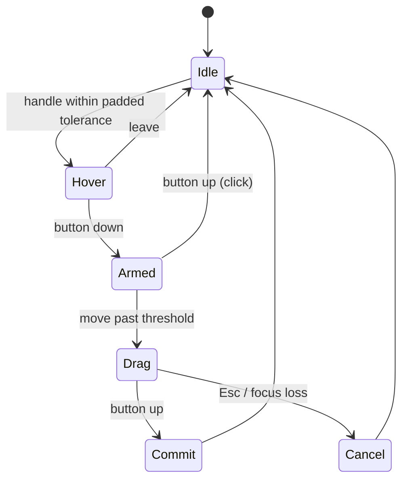

# Gizmo manipulator suite — design

Status: **T1 (Spatial Transactor math), T2 (analytic screen-space hit-testing), T3
(modifiers, typed values and the readout) and T4 (visual language and ribbons) built
(2026-10-20), the F0 topology prerequisite is complete (F0.1–F0.6), and F1 (the edge
dress-up arc) is built: selection, tangent chains, the parametric
`Part::Fillet`/`Part::Chamfer` features, and the arc scrubber that drives them.**

Companions: [`stage.md`](../viewport/stage.md) (the stage gizmo), [`geometry-and-topology.md`](../architecture/geometry-and-topology.md)
(the `ElementRef`/`ElementMap` seam), [`occt-integration.md`](../architecture/occt-integration.md) (the
kernel), and [`navicube-gpui-design.md`](navicube-gpui-design.md) (the overlay visual
language this suite shares).

## 0. Direction

Manipulators are **context-driven, transient micro-manipulators**, not modal global
tools: the selection chooses which one materialises on the topology, it inherits the
selection's anchor and frame, and it disappears when the selection changes. Empty space
inside the manipulator stays transparent to pointer events.

The suite is layered on `ferrocad_stage::gizmo`:

```text
Selection ──► ManipulatorKind ──► TransformGizmo / PushPull / FilletArc / DraftArc
                    │                    │
                    │                    └── ManipulatorFrame (origin + orthonormal basis)
                    └── shared: constraint solvers, hit-test padding, GizmoValue, readout
```

Only the **Spatial Transactor** (the transform triad) is buildable today: it has no
kernel dependency, it already has a working handle set and drag/commit events, and its
mathematics is reused by every later manipulator. Fillet/chamfer/draft wait on sub-shape
selection and topology traversal (Slice **F0**).

## 1. Frame and anchor

`ferrocad_stage::gizmo::ManipulatorFrame` is the manipulator's pose:

```rust
pub struct ManipulatorFrame {
    pub origin: Vector3,          // world-space anchor
    pub basis: [Vector3; 3],      // world directions of local X, Y, Z
}
```

- `world(origin)` gives the global triad; `from_rotation(origin, rotation)` takes the
  **columns** of the rotation matrix, so an object/selection frame is exact.
- The basis is orthonormal and right-handed. The frame is captured at press time and a
  `set_frame` during a drag cancels the drag rather than reinterpreting its press point.
- Anchoring policy (host-side, T2):
  - the triad **hugs the object's own origin**: the display provider reports the
    placement's base point (`StageMesh.origin` → `ShapeItem::anchor`), which doubles as
    an origin indicator and is the point a rotate gizmo pivots about;
  - a mesh with no declared origin falls back to its **bounding-box base corner**
    (world-aligned minimum) — a predictable datum, never the interior centroid;
  - a click does **not** move the triad: for translation the pivot does not change the
    result, and a user-chosen origin is an explicit, snapped gesture
    ([`transform-ux.md`](transform-ux.md) §3);
  - a multi-face selection has no triad until the commit fans out;
  - a Push-Pull stem is a workbench manipulator, not the triad: it starts at the face
    region's centroid with its `+N` basis along the normal.

## 2. Axis constraint and degeneracy

For a pointer ray `p + t·d` and an axis `o + s·a`, the closest-point parameter is

```text
r  = p − o
b  = d·a
dd = d·r
ee = a·r
s  = (ee − b·dd) / (1 − b²)
```

That is `closest_axis_parameter`. It is ill-conditioned as `|b| → 1` (the stem points
at the eye): the denominator `1 − b²` collapses and one pixel of pointer motion maps to
an unbounded world delta.

The solver therefore switches to a **screen-space fallback** when `|b| > 0.97`:

```text
start = project(origin)
tip   = project(origin + a·scale)
len   = |tip − start|
Δs    = dot(pointer − press, normalize(tip − start)) · scale / len
```

- `scale` is the same screen-invariant world radius the triad is drawn with, so
  `scale / len` is world units per device pixel along the stem.
- If `len < 1 px` the axis projects to a point and is disabled for that frame; a drag on
  it cannot be started. This is the "sub-pixel dimming" rule (the visual dim is T4).
- Both paths are stored in `DragStart::Axis` (`screen: Option<ScreenAxis>`), so
  `drag_to` does not need to re-decide: the press-time frame is frozen.

Tests: `a_view_aligned_axis_falls_back_to_screen_space`,
`an_axis_pointing_at_the_camera_is_disabled`.

## 3. Plane constraint and Shift ambiguity

The plane handle freezes the pointer's ray–plane hit at press:

```text
t = (origin − p)·n / (d·n)
hit = p + t·d
```

If the plane is edge-on (`|d·n| < ε`), the hit is undefined. `plane_point` falls back to
a **view-facing plane** through the origin (normal = the camera forward), and the
resulting delta is projected onto the constrained plane:

```text
Δ = (hit − press) − n·((hit − press)·n)
```

The component along `n` is not representable by the plane; that is the expected
behaviour of a plane seen edge-on. The fallback keeps the in-plane component usable
instead of failing the press.

**Shift resolution (T3).** `GizmoModifiers.shift` is carried by the event path but the
solver does not yet reinterpret an axis press. The rule to implement: `Shift` on an axis
stem selects the plane spanned by that axis and the screen-horizontal, matching the
visible glass quad nearest the pointer. This must be one explicit rule so Shift and the
visible quad can never disagree.

Tests: `an_edge_on_plane_still_drags_in_its_plane`.

## 4. Ring constraint and angular detents

The ring angle is measured in the ring basis:

```text
hit = ray ∩ plane(origin, axis)
v   = normalize(hit − origin − axis·((hit − origin)·axis))
θ   = atan2(v·up, v·right)
```

`ring_angle_with_fallback` uses the same view-facing fallback as the plane when the ring
is edge-on; `angle_at` is the pure angle helper.

The accumulated delta is `wrap_pi(θ − θ_press)` and is then passed through
`ring_detent(raw, free)`:

- **default:** snap to **15°** detents relative to the press orientation:
  `round(raw / 15°) · 15°`;
- **Ctrl:** free rotation (`GizmoModifiers.ctrl`);
- the raw delta is unwrapped into `(-π, π]`, so a drag across ±π does not jump.

The detents are **relative**, so grabbing an already-rotated body does not jump to the
world grid on the first frame. `TransformGizmo::drag_to_with_modifiers` is the host entry
point; `drag_to` uses the default (snapped) modifiers until T3 threads the keyboard state
through gpui.

Tests: `ring_detents_are_relative_and_ctrl_frees_them`,
`a_ring_drag_rotates_about_the_axis`.

## 5. Snapping and numeric readout

The solver returns matrices plus a typed [`GizmoValue`] alongside them:

```rust
enum GizmoConstraint { Axis(Axis), Plane(Normal), Ring(Axis) }
enum GizmoValue {
    Linear  { axis: GizmoAxis, raw: f64, applied: f64 },
    Planar  { raw: Vector3, applied: Vector3 },
    Angular { axis: GizmoAxis, raw_deg: f64, applied_deg: f64 },
}
```

`GizmoDragEvent` and `GizmoCommitEvent` carry `constraint` and `value`. The gpui tag is
projected at the handle tip (axis), the plane anchor, or the pointer (ring) and uses a
monospace/tabular face: `ΔX +24.5 mm`, `ΔθZ +15.0°`, or `ΔX … ΔY …` for a plane. It is a
text layer over the image (like the navicube labels), so it never steals pointer events.

Linear grid snapping reuses `InventorViewport::snap_grid`: `set_gizmo`/`set_snap_grid`
pass the step to `TransformGizmo::set_linear_snap`, and the transform uses the **applied**
(snapped) value while `raw` stays available for diagnostics. Rotation detents are
likewise applied to the transform, and `GizmoValue::Angular` reports both raw and applied
degrees.

## 6. Analytic hit-testing and occlusion

The gizmo uses an **analytic screen-space** hit test; the rasterised `gizmo_queue` is only
for drawing. This is what allows padding without invisible pick geometry:

- **Axes:** project the pick segment (`0.18·scale` … `scale`) and measure point-to-segment
  distance. The inner 18% is excluded so the shared centre is not claimed by all three
  stems.
- **Planes:** project the quad; the interior is grabbable, and the rim gets the padding.
- **Rings:** a face-on ring is tested in 3D — intersect the ray with the ring plane and
  require the hit radius to be within the pixel slop of `scale`. An edge-on ring projects
  to a line through the centre, so its screen-space fallback excludes the inner
  `0.18·projected_radius`; the centre is therefore never “on” an edge-on ring.
- **Padding:** `HIT_TOLERANCE_PIXELS = 2` + `HIT_PADDING_PIXELS = 10` (12 px total).
- **Priority:** axis > plane > ring, then nearest stroke, then front-most depth.
- **Pass-through:** the interior is not in the pick set, so a click through it reaches the
  tool/scene exactly as `InventorViewport::handle_pointer` already does when no handle is
  hit. `InventorViewport::gizmo_handle_at` now delegates to `TransformGizmo::hit`.

Do **not** implement padding as invisible pick geometry: that would consume clicks meant
for background features and break pass-through. The analytic test consumes the event only
when the pointer is within the padded distance of a handle.

Tests: `the_triad_interior_passes_through`, `an_axis_is_pickable_along_its_stem`,
`the_grab_padding_reaches_past_the_stroke`, `a_point_beyond_the_padding_passes_through`,
`a_plane_quad_is_pickable_in_its_interior`, `a_ring_is_pickable_on_its_arc`,
`an_axis_wins_over_an_overlapping_ring`, `hidden_handles_are_not_picked`,
`the_hit_does_not_need_a_preceding_update`, `a_local_frame_hit_follows_the_basis`, and
`the_gizmo_interior_falls_through_to_the_scene` (viewport).

## 7. Lifecycle and modifiers



- `Shift` — plane override: `begin_drag_with_modifiers` turns an axis press into a drag
  in the plane spanned by that stem and the screen-horizontal.
- `Ctrl` (or the platform's secondary modifier) — free rotation (15° detents are the
  default).
- `Esc` — cancel the drag and restore the pre-drag preview.
- `Tab` / a digit — focus the numeric tag for exact entry (still deferred; the tag is
  read-only in T3).
- The viewport receives modifiers through `handle_pointer_with_modifiers`,
  `handle_button_with_modifiers` and `drag_move_with_modifiers`; the old methods delegate
  with no modifiers. The root element is focusable (`track_focus` + `focusable`) and the
  mouse-down handler focuses it, so `on_key_down` receives the Esc key.

## 8. Visual tokens and the 1.5 px stroke

The token set is shared with the rest of the UI; [`visual-language.md`](visual-language.md)
is the authority, and the table below is the subset this manipulator uses.

| Element | Token |
| --- | --- |
| Active axis / ring | `#38BDF8` |
| Inactive axis / ring | `#94A3B8` |
| Glass plane fill | `rgba(56, 189, 248, 0.10)` |
| Push-pull stem | `#F59E0B` |
| Subtractive preview | `#EF4444` |
| Hover glass | cyan @ 0.28 |

The tokens are stored **linear** (the renderer targets `Rgba8UnormSrgb`); the hex column
is the intended sRGB look.

**Ribbon renderer.** `Topology::Lines` is a 1 px pipeline with no width uniform, so the
shared [`ferrocad_graphics::screen_ribbon`] utility builds a quad around a segment in the
plane perpendicular to the view direction. The navicube's `edge_glow` and the gizmo's
axes/rings both use it. The gizmo derives its half-width from the screen-invariant scale
(`STROKE_PIXELS * 0.5 * scale / DEFAULT_PIXELS`), so the stroke is 1.5 device pixels at
the gizmo's depth. A true wide-line pipeline remains a separate renderer slice.

The visual pass replaces the RGB axis colours with cyan/slate, trims the arrowhead to a
micro-chevron (two ribbon arms), and makes the plane quad a glass fill with a 1 px rim.
Interior transparency is a hit-test rule, not a visual one: the glass quad is visible but
only its padded outline/area is pickable.

## 9. Slice plan

| Slice | Deliverable | State |
| --- | --- | --- |
| **T1 — solver backbone** | `ManipulatorFrame`, view-aligned axis fallback, edge-on plane/ring fallbacks, relative 15° detents, `GizmoModifiers`, unit tests | ✅ built |
| **T2 — analytic hit test** | projected segment/quad/polyline tests, 2 + 10 px tolerance, priority, pass-through tests | ✅ built |
| **T3 — modifiers and readout** | gpui modifier/key plumbing, `GizmoValue` on the event, projected numeric tag, Esc cancel, linear grid snapping | ✅ built |
| **T4 — visual language** | cyan/slate tokens, micro-chevrons, glass planes, shared 1.5 px ribbon | ✅ built |
| **F0 — topology prerequisite** | pixel → `ElementRef` selection (faces/edges), tangent-chain traversal, `chamfer` in `GeometryBackend`, parametric feature objects | ✅ built (F0.1–F0.6) |
| **F1 — edge dress-up arc** | `DressUpScrubber`: camera-facing arc over the selected edge, screen-space hit test, radial scrub with snap/bounds, typed readout, viewport commit | ✅ built |

## 10. T1 as built (2026-10-20)

`ferrocad_stage::gizmo`:

- `ManipulatorFrame { origin, basis }` with `world`, `from_rotation`, `axis`,
  `plane_axes`, `plane_normal`. `TransformGizmo` now owns a frame; `frame`/`set_frame`
  are public, `origin`/`set_origin` operate on it, and a frame change cancels an active
  drag. The handle geometry and the drag math both use the frame, so a local frame is a
  drop-in for the world triad.
- `begin_drag` selects the **screen-space axis** path when `|d·a| > 0.97`. It stores the
  press device position, the projected direction and world-per-pixel in `ScreenAxis`; a
  stem that projects to under 1 px is rejected. `drag_to` consumes the stored path.
- `plane_point` falls back to the view-facing plane on an edge-on constraint, and the
  plane delta is projected onto the constrained normal.
- `ring_angle_with_fallback` uses the same view-facing fallback; `ring_detent` applies
  relative 15° detents (or free rotation).
- `GizmoModifiers { shift, ctrl }` and `drag_to_with_modifiers` were added. `drag_to`
  keeps its old signature and uses the default (snapped) modifiers, so
  `ferrocad_stage_py` and `ferrocad_viewport` compile unchanged.

Verification: `cargo test -p ferrocad_stage --lib` — 35 tests, including the seven new T1
tests listed above (frame mapping, local-frame drag, view-aligned fallback, point-at-eye
disable, edge-on plane, detents/free rotation, frame-change cancel).

## 11. T2 as built (2026-10-20)

`ferrocad_stage::gizmo`:

- `TransformGizmo::hit(camera, device)` projects the axis stems, plane quads and ring
  geometry and applies the 12 px grab slop. It is mode-aware (`GizmoMode::shows`), so a
  hidden handle can never win a pick.
- Axis stems are pickable from `0.18·scale` to the tip; a stem that projects to under a
  pixel is skipped. Plane quads are grabbable inside and around the rim. Rings use the 3D
  plane/radius test when face-on and a screen polyline (with the inner exclusion) when
  edge-on.
- Priority is axis > plane > ring; within a class the nearest stroke wins, then the
  front-most handle. Ties keep the earlier `GizmoHandle` in `ALL` order, so the choice is
  deterministic.
- `screen_scale` is now recomputed from the camera on every call, so a pointer event that
  arrives before the next frame still hits the geometry at the current distance.

`ferrocad_viewport`:

- `InventorViewport::gizmo_handle_at` delegates to `TransformGizmo::hit`; the
  `gizmo_queue` remains the draw path only. Hover and press therefore share one hit test.

Verification: `cargo test -p ferrocad_stage --lib` — 45 tests (10 new T2 cases);
`cargo test -p ferrocad_viewport --lib` — 82 tests (including
`the_gizmo_interior_falls_through_to_the_scene`).

## 12. T3 as built (2026-10-20)

`ferrocad_stage::gizmo`:

- `GizmoAxis`, `GizmoConstraint` and `GizmoValue` (`Linear`/`Planar`/`Angular`) are on both
  `GizmoDragEvent` and `GizmoCommitEvent`. `GizmoValue::readout()` formats the tag with
  millimetres/degrees by default.
- `begin_drag_with_modifiers` resolves `Shift` on an axis into a plane drag (the plane
  spanned by the stem and the screen-horizontal, with a screen-vertical fallback).
- `drag_to_with_modifiers` applies `Ctrl` to the ring detents and the linear grid to axis
  and plane drags via `set_linear_snap`. The transform uses the **applied** value; `raw`
  is retained in the event.
- `cancel_drag` aborts a gesture without committing; `readout_anchor` reports the device
  anchor for axis/plane tags (rings follow the pointer).

`ferrocad_viewport`:

- `handle_pointer_with_modifiers`, `handle_button_with_modifiers` and
  `drag_move_with_modifiers` thread the gpui `Modifiers` (Shift/Ctrl) into the gizmo; the
  old methods delegate with none.
- The viewport root is focusable (lazily created `FocusHandle`), focuses on mouse-down,
  and handles `Esc` by cancelling the drag and clearing the preview.
- The drag readout is rendered as a small monospace pill over the image; `gizmo_value()`
  exposes the typed value for tests/hosts.
- `set_snap_grid`/`set_gizmo` pass the grid step to the gizmo.

Verification: `cargo test -p ferrocad_stage --lib` — 52 tests (7 new T3 cases);
`cargo test -p ferrocad_viewport --lib` — 86 tests (4 new: Esc, readout lifecycle,
Shift planarity, modifier mapping). The Python binding exposes `readout` on both event
classes.

## 13. T4 as built (2026-10-20)

`ferrocad_graphics::ribbon`:

- `screen_ribbon(a, b, half_width, view_forward)` returns a four-corner quad in the plane
  perpendicular to the view, or `None` when the segment is view-parallel. It is the
  shared primitive behind the navicube glow and the gizmo strokes.
- The navicube's `Piece::edge_glow` now delegates to it (same view-space quad, no
  duplicated width math).

`ferrocad_stage::gizmo`:

- Tokens `ACTIVE_COLOR` (`#38BDF8`), `INACTIVE_COLOR` (`#94A3B8`), `GLASS_COLOR`,
  `GLASS_HIGHLIGHT`, `PUSH_PULL_COLOR` and `SUBTRACT_COLOR`, stored linear.
- Axes are a 1.5 px shaft ribbon plus a V-shaped micro-chevron; rings are a 1.5 px
  ribbon loop. Planes are a translucent glass quad with a 1 px rim. `new_handle` changed
  accordingly: axes/rings are `Shaded`, planes are `ShadedWithEdges`.
- Every handle opts into `with_blended_surface()` + `with_ghost_surface()`: the visible
  part is the normal blended ribbon (planes blend at 10 %), and the part behind a solid
  is re-emitted at `GHOST_SURFACE_ALPHA` (35 %) with a `Greater` depth test. The toy's
  `HeightGrip` uses the same pair for its stem and crossbar, with a wider dark casing
  under the 1.5 px stroke.
- The gizmo rebuilds when the camera view changes (the ribbons depend on the view
  direction), as well as when the scale/origin/mode change.
- A hovered handle uses the active cyan; the rest stay slate. Hovering a plane raises the
  glass fill and turns its rim cyan.

Verification: `cargo test -p ferrocad_graphics --lib` — 20 tests (3 new ribbon cases);
`cargo test -p ferrocad_stage --lib` — 55 tests (3 new visual cases: ribbon draw modes,
active/inactive tokens and the 1.5 px width); the viewport's 86 tests and the Python
binding remain green.

## 14. F1 as built (2026-10-20) — the edge dress-up arc

`ferrocad_part_gui` (the Part workbench's presentation crate — **not** the generic
stage, and **not** the shell; see `architecture.md` §10):

- **Modes and values.** `DressUpMode::{Fillet, Chamfer}`; `DressUpValue::{Fillet{radius},
  Chamfer{first, second}}` with `primary()` and `readout()` — `R 3.50 mm`,
  `2.00 × 1.00 mm` (asymmetric chamfer), `2.00 mm` (symmetric).
- **Geometry.** `DressUpScrubber::new(target_id, mode, edge, points)` takes the edge's
  world polyline (`ShapeItem::edge_polyline("Edge3")` resolves the selection name to its
  ordered points; the anchor is the middle segment's midpoint). The arc lies in the **camera-facing plane** through the anchor, spanned by the
  edge's projected direction `u` and the in-plane perpendicular `n = forward × u`; it runs
  from `anchor + r·u` through `anchor + r·n` to `anchor − r·u`. Because `r` **is** the
  fillet radius, the drawing is a true dimension: growing the radius grows the arc. A
  1.5 px ribbon (32 segments) and the radius tick `anchor → apex` share the T4 tokens.
- **Degeneracy.** An edge projecting under 4 px (seen end-on, or behind the eye) falls
  back to a stable screen-horizontal, so the arc keeps a usable orientation and stays
  scrubbable; a polyline with fewer than two points still gets an arc (and no hit).
- **Hit test.** Analytic screen distance to the arc polyline and the tick, within the
  shared `HIT_SLOP` (2 px stroke + 10 px padding). The area between the edge and the arc
  is **not** part of the target, so a click there reaches the scene.
- **Scrub.** The value changes by the pointer's **radial travel** from the press
  (`Δpx · scale_for(camera, anchor, 1)`), never by an absolute projection, so grabbing the
  arc anywhere does not jump. The result is snapped (`step`) and clamped
  (`min ≥ MIN_RADIUS`, optional `max`); `cancel_drag` restores the press value;
  `update(camera)` rebuilds only when the view or the value changed.
- **Readout.** `readout_anchor(camera)` projects the apex; the viewport renders the pill
  as a plain gpui text layer (no hitbox).

`ferrocad_viewport` (generic: it names no manipulator):

- `with_manipulator` / `add_manipulator` / `set_manipulators` / `remove_manipulator`,
  `manipulator(id)` / `manipulator_mut(id)`, `last_interaction_commit` /
  `take_interaction_commit`, `cancel_manipulator_drag`.
- Priority is **navigation cube → workbench manipulators (most recent first) → gizmo →
  tool → scene**. The cursor hovers only the topmost manipulator under it; a press on a
  grab target starts a drag (no orbit, no selection); a press anywhere else falls
  through. Their items are drawn as depth-off overlays (one combined queue), and the
  readout pill comes from `Manipulator::readout`/`readout_anchor`. `Esc` cancels a
  manipulator drag before a gizmo drag.
- The commit is **neutral data** (`InteractionCommit`); the shell maps its entity to a
  document object and calls the app script's `interaction` hook, which Part implements
  with `Part::Fillet`/`Part::Chamfer` (`Radius`, or `Distance`/`Distance2`, then a
  recompute — the F0.6 features rebuild `Shape` from there).
- `ferrocad_viewport` and `ferrocad_gpui` link no kernel: the manipulator is
  contributed by the edition
  (`Contributions::with_manipulator(ferrocad_part_gui::fillet_manipulator)`), and Part
  registers `display_mesh`/`interaction` in `python/ferrocad_parametric`.

Verification: `ferrocad_part_gui` 15 tests (11 dress-up cases: readout strings, anchor,
arc sizing, stroke-only hit test, outward scrub, step snap, cancel, rebuild-on-change,
hover tokens, degenerate and view-aligned edges; plus the selection → scrubber factory
and the neutral-commit round-trip); `ferrocad_stage`'s `InteractionCommit` case and 2
`ShapeItem::edge_polyline` cases; `ferrocad_viewport` 98 tests (5 manipulator cases:
commit, pass-through, hover/draw, cancel, priority over the gizmo — all with a **fake**
manipulator, proving the viewport names none); `ferrocad_gpui` 7
display/`Contributions` tests; `ferrocad_part_py`'s
`the_shell_helpers_tessellate_and_dress_up_a_document_shape` covers the Python half
through the edition script (hooks registered → tessellate with names → `interaction` →
base hidden, feature displayed, reused).

### The gizmo reaches the document (2026-10-20)

Until the toy workbench, the gizmo was built and tested but no host wired it. It is now
a **contribution** like a manipulator, and it shares the same document route:

- `Contributions::with_gizmo(factory)` — the edition decides which objects get one;
  `ferrocad_toy::move_gizmo` claims whole-object selections and places it at the item's
  own origin (the placement base point, else the bounding-box base corner). The triad
  therefore stays on the object's origin as the geometry moves; there is no shell-side
  re-anchoring.
- `ViewportEvent::Transform(GizmoCommitEvent)` — the viewport emits the drag commit on
  release (`take_gizmo_commit` is the poll form).
- `GizmoCommitEvent::to_interaction` — the commit becomes `"transform"` / `"apply"`
  with the 16 row-major matrix elements, so the app script's **existing** `interaction`
  hook receives it. There is no second document hook.
- The toy's provider composes the matrix with the object's `Placement` in one
  transaction; its end-to-end test asserts the move and its undo.
- The shell **re-arms** the current selection after every committed edit
  (`after_document_edit`, a dialog accept, a command run), so the triad and workbench
  grips sit on the new geometry. A live preview offsets them with the object through
  `Manipulator::anchor`/`set_anchor`, and the triad is **glued to the surface** even
  during its own drag: `TransformGizmo::set_display_offset` moves only the drawing
  while the interaction frame stays at the grab point (so `drag_to` cannot feed back),
  then the frame commits to the new pose on release.

Covered by `ferrocad_viewport`'s `the_gizmo_readout_tracks_the_drag_and_clears_on_release`
(take + `to_interaction`), `ferrocad_gpui`'s `a_registered_gizmo_factory_claims_its_objects`,
and `ferrocad_toy`'s `the_toy_workbench_creates_represents_manipulates_and_records`.

## 15. Deferred and why

- **Push-Pull** needs a sketch-region / face selection and a solid/sketch model to preview
  an additive boss or subtractive pocket. The interaction is a 1D constraint plus a
  volume preview; it can reuse T1's axis solver once the context exists.
- **Fillet/Chamfer** is end-to-end: `GeometryBackend::{fillet, chamfer}`, `tangent_chain`,
  click selection, the parametric features, the `Manipulator` seam and the
  `ferrocad_part_gui::DressUpScrubber`, and the host wiring
  (`Contributions` factory → viewport → neutral commit → app script's `interaction`
  hook → `Part::Fillet` → recompute → re-sync). What remains is **type-ahead numerics**
  (digits targeting the pill), an **`Alt` asymmetric split** (two distance handles), and
  a chrome control to choose fillet vs chamfer (the factory picks fillet).
- **Draft** additionally needs a wall-face selection, a pull direction and an angular
  offset operation; its protractor arc is a ring-like scrub (T1) with a degree readout
  (T3).

## 16. Non-goals

- No modal tool modes: the manipulator is chosen by the selection.
- No per-frame allocation in the solver; the frame and press state are captured once.
- No depth buffer for the triad: it draws as an overlay, and pass-through is handled by
  the analytic hit test rather than by occluding geometry.
- No wide-line pipeline in T1–T4; use the ribbon path until a renderer slice adds one.

## 17. G1 as built (2026-10-22) — the workspace gizmo style

The gizmo is now a **capability** with a declarative settings schema, like the grid and
the axis cross. G1 is the Rust half: it makes the stored style drive the native handles.

### The contract

A command or mod returns `{"view": {"gizmo": {…}}}`; every field is optional and an
omitted field keeps its current value:

| Key | Type | Applies |
| --- | --- | --- |
| `enabled` | bool | whether the handles draw and pick at all |
| `backend` | string | a **provider claim**: which backend owns the visuals |
| `active_color` / `inactive_color` | `#rgb`/`#rrggbb` | the hovered and idle handle ink |
| `outline_color` | `#rgb`/`#rrggbb` | the halo ink behind the handles (the contrast aid) |
| `size` | f64 px | the triad's screen-invariant radius |
| `width` | f64 px | the stem/ribbon stroke width |
| `halo_width` | f64 px | the outline width around a handle, clamped `0..=8`; `0` disables it |
| `hover_scale` | f64 | the hovered handle's stroke multiplier, clamped `1..=4`; `1` disables it |
| `hit_radius_px` | f64 px | the analytic grab radius, clamped `12..=48` (a 24 px target) |
| `opacity` | f32 | a multiplier over every handle's alpha, clamped `0..=1` |
| `ghost_alpha` | f32 | the occluded (`DepthMode::Greater`) pass, clamped `0..=0.5` |
| `ring_snap_deg` | f64 | the rotation detent, clamped `0..=180` and stepped to a 5° multiple; `0` is continuous |
| `show_readout` | bool | the numeric pills |

The hex spellings are **RGB-only**: the role's token alpha is preserved (the idle
inactive token keeps its `0.9`). That is why re-sending the Python defaults
(`#38bdf8` / `#94a3b8`) for a fresh state is a no-op rather than a brightening.

`GizmoStyle` (`ferrocad_stage::gizmo`) is the single value; `ViewState.gizmo` holds it,
and `Viewport::set_gizmo_style` forwards it to every hosted manipulator and to the
`TransformGizmo` — including objects hosted *after* the style was set, so a selection
armed later adopts the current workspace look without a re-send.

### The accessibility defaults (WCAG 2.2 AA)

Four knobs exist because the default triad failed the accessibility success criteria,
not as cosmetic extras. They are ordinary style fields, so a preset or the settings card
can change them, and the **view enforces the floors and ceilings** rather than trusting
the caller (`crates/ferrocad_gpui/src/view.rs`). The Python facade applies the same
rules (`python/FerroCAD/_gizmo.py`), so both views of the store agree.

| Property | Default | Criterion | Why |
| --- | --- | --- | --- |
| `outline_color` + `halo_width` | `#0f172a`, `1.5 px` | SC 1.4.11 non-text contrast (3:1) | The accent and the idle slate are close in luminance to mid-blue geometry (the toy slab). A dark halo separates a handle from it without relying on hue. |
| `hover_scale` | `1.5` | SC 1.4.1 use of colour | `#38bdf8` against `#d8dbe0` is only 1.49:1, so hover cannot be colour-only. The hovered stem and ring also widen (`width × hover_scale`). |
| `hit_radius_px` | `12.0` (24 px target) | SC 2.5.8 target size (minimum) | The analytic grab radius is floored at 12 px, so a 1.5 px stem still has a 24 × 24 px target. |
| `ghost_alpha` | `0.20`, max `0.5` | — (occlusion legibility) | Above half, an occluded handle reads as another front handle, which destroys the depth cue. The old `0.35` already leaned that way. |
| `ring_snap_deg` | `15°`, stepped to 5° | SC 2.5.7 dragging movements | An arbitrary fractional detent (the old free ring reported `49.62°`) demands micro-precision. Every stored value is a 5° multiple; `0` stays continuous for power users. |

The halo is a **separate, non-selectable pass** drawn before the handles
(`TransformGizmo::halos()`, ids `GIZMO_BASE_ID + 100 + index`). It is wider than the
handle ribbon by `halo_width` on each side and follows the hover width cue. Because it
is not selectable it adds no pick target; because it stays **native** under a shader
skin, a skin cannot remove the contrast aid (`ferrocad_viewport` emits it before the
skinned handles).

**Caveat:** the contrast figures in this table are arithmetic in sRGB, not a visual
measurement on a display. The renderer applies the tokens as-is; a future calibration
pass can tighten them, but the floors above are the contract.

### Style vs claim

`enabled`, the colours, the size, the widths, the alphas, the detent and the readout
are **style**: the host owns them and the viewport enforces them. `backend` is a
**claim**, like `view.axis.overlay`: it names the backend that says it draws the gizmo.

G1 has exactly one implementation — the native manipulators and `TransformGizmo` in
`ferrocad_viewport`, which also own hit-testing and commit routing. So the shell stores
a foreign `backend` (a later slice can honour it) but reports
`gizmo backend <id> has no implementation yet (native handles stay active)`. A
visual-only provider must never become the hit-test or commit authority; the
shader-skin slice (G2) replaces the visuals while the native manipulator stays the
event owner.

### Host gating

The viewport, not the shell, owns `enabled`. A disabled style:

- emits no manipulator or gizmo packets (the objects stay hosted);
- skips manipulator/gizmo hover, `gizmo_handle_at`, button handling and drag servicing,
  so a click or hover falls through to the scene beneath;
- stops servicing an in-flight drag without dropping its state, so re-enabling restores
  the handles and a mid-drag disable can never commit.

Because the objects stay hosted, the shell arms the native manipulator for a selection
even while the style is disabled; re-enabling from the settings card then needs no
re-selection.

### What drives it

`mods/GizmoOverlay` registers the `gizmo`/`ferrocad` provider and `FerroCAD.Gizmo`
writes the thirteen stored values, returning `FerroCAD.Gizmo.apply()` as the view request.
See [`../tasks/settings-model.md`](../tasks/settings-model.md) §S4c.

Covered by `ferrocad_stage`'s `a_style_ghost_alpha_reaches_every_handle` and
`a_custom_ghost_alpha_scales_both_ghost_packets`, `ferrocad_viewport`'s
`set_gizmo_style_reaches_a_hosted_manipulator_and_gizmo`,
`a_disabled_style_hides_and_unpicks_the_overlays` and
`hiding_the_readout_suppresses_the_pill_text`, `ferrocad_gpui`'s
`every_gizmo_visual_field_applies` / `a_bad_gizmo_field_is_rejected_atomically` /
`a_gizmo_backend_claim_is_reported_only_when_it_changes`, and
`tests/test_gizmo_settings.py`.

### G1 follow-ups

- `size`/`width`/`halo_width`/`hover_scale`/`ring_snap_deg` are baked into cached geometry,
  so a change rebuilds on the next `update`; the ghost alpha and the colours apply
  immediately.

## 18. G2 as built (2026-10-22) — the shader skin

The `ferrocad-shader` backend draws the **same geometry** with an authored shader —
the transform gizmo's handles and the workbench manipulators (the fillet arc, a height
grip) alike. It is a skin in the material sense: geometry, hit-testing, drags, commits
and the readout stay native; only the fragment stage changes.

### A geometry program (the renderer contract)

Until this slice the program ABI was placeholder-only: a packet carrying a program drew a
4-vertex full-screen quad and the shader derived everything from the sign of each corner.
That is right for the grid and axis overlays, which are screen-space effects, but it
cannot skin a mesh.

`ShaderProgram::with_geometry()` marks a program that draws **its own packet's mesh**:

- the pipeline is built with the scene vertex layout
  (`position`/`normal`/`uv`/`sub-element`/`colour`) instead of the placeholder layout,
  and with the packet's topology (so `LineList` rims work);
- the renderer uploads the packet's geometry instead of skipping it, and
  `draw_program` binds the cached mesh and draws its indexed range;
- `ProgramKey` gains the mode, because the two need different vertex state; the mode is
  part of the program fingerprint only when set, so every existing program keeps its
  cache keys byte-for-byte.

A plain program (the default, used by `mods/GridOverlayCoin` and
`mods/AxisOverlayCoin`) behaves exactly as before. Program packets still never picked
and still drawn after the scene, so they blend over a populated depth buffer.

### The skin

`mods/GizmoOverlayShader/Resources/gizmo_skin.wgsl` is a **mod resource**: the mod reads
it at import and hands the source to the registry
(`registerProvider(..., skin=<source>)`). Nothing of it is compiled into the app. The
shader reads the scene `Globals` block (group 0) and the `Frame` block (group 2) and
nothing else — no new uniform, no per-frame buffer:

- **Ink is per packet.** The native gizmo already bakes the hovered handle's colour into
  its item (`paint_for`), so the skin inherits active/inactive, the glass planes'
  10 %/28 % and the occluded ghost pass's 35 % by reading `globals.color.a` and leaving
  the alpha untouched.
- **Shading** is a half-Lambert headlight plus a grazing-angle rim; a line packet
  (degenerate normal) takes a flat fallback instead of producing NaN.
- **No text.** The readout and the labels stay native gpui overlays.

The viewport never sees a path or a mod: the shell asks the registry for the **active**
`gizmo` provider's skin (`ferrocad_shell.provider_skin` →
`FerroCADGui.providerSkin("gizmo")`) and passes the source to
`InventorViewport::set_gizmo_skin`, which builds a geometry `ShaderProgram`. Both
`rebuild_gizmo_queue` and `rebuild_manipulator_queue` then re-materialise their items
whenever a skin program is present; otherwise they emit the native items unchanged, so a
workspace-wide skin cannot leave one overlay looking native. `enabled` still wins over
both. Because the source is asked for per switch, switching back to the native provider
(the one that supplies no skin) clears it — a stale skin cannot survive a provider
change.

### Provider and claim

`mods/GizmoOverlayShader` registers `gizmo` / `ferrocad-shader`
(`"FerroCAD (shader)"`, priority 0) with the same schema and store, so the provider rows
in the header popovers and Dev Tools → Providers can switch skins without touching a
setting. Hosting is **data-driven**, not id-driven: the native id is hosted by the build,
and any other id is hosted by the skin its provider supplies. So the shell reports
`gizmo backend <id> supplied no skin (native handles stay active)` when a backend claims
visuals it did not bring. Switching the skin can never change behaviour: the analytic hit
test, drag servicing and the commit route all belong to `TransformGizmo`.

### Verification

`crates/ferrocad_gpui/examples/gizmo_skin_probe.rs` renders two offscreen frames and
reads the centre pixel back. It reads the mod's `Resources/gizmo_skin.wgsl` at runtime,
so the probe exercises the same source the mod supplies. On the software Vulkan adapter
(lavapipe) the geometry program drew its own triangle (`[205, 55, 55, 255]` from a `0.8`
red ink) and the plain program still covered the frame with the placeholder
(`[0, 255, 0, 255]`). `ferrocad_wgpu`'s naga tests validate that same mod file (the
workspace `mods/` tree is required to run them). The unit suites cover the key split, the
queue switch, the fallbacks and the native interaction guarantees; the *look* of the skin
is the probe plus a live run.

### Limits

- **G3** is what remains: a declarative manipulator ABI for Python-defined handles
  (`Manipulator::id()` is `&'static str` today).
- A supplied skin is **material data**, not behaviour. The app owns the geometry, the
  hit test and the commits, and the fixed ABI owns the built-in blocks, so a skin cannot
  add handles or change what a drag does. Adding geometry is G3's job (see §19).
- A skin is read at registration, so editing the WGSL needs a mod reload (the mod caches
  the source; re-registering re-reads it). An unreadable file registers without a skin
  and the host keeps the native material.
- The skin is a single material for every handle kind. Per-handle shader behaviour would
  need per-packet parameters, which the fixed ABI has no room for by design.

## 19. G3a as built (2026-10-22) — mod-declared handles

A mod can now add a handle without writing Rust: it declares the mesh, the optional
shader, the drag axis and the commit, and the stage hosts it as an ordinary
`Manipulator`. This is the geometry half that G2 deliberately left out.

### The route

```text
selection armed
  └─ FerroCAD.register_manipulator_provider(provider)   (called with object, element)
       └─ spec dicts            (the wire form below)
            └─ ferrocad_shell.manipulator_specs → ferrocad_gpui::manipulators
                 └─ HandleSpec → DeclarativeHandle → DeclarativeManipulator
                      └─ viewport (after the compiled manipulator)
                           └─ drag → InteractionCommit(id, action, element, [value])
                                └─ FerroCAD.register_interaction_provider
```

The **commit half is unchanged**: a declared handle commits through the same
`interaction` hook a Rust workbench uses, so a mod needs no second document path. The
only trait change is ownership: `Manipulator::id()` is `&str` and
`InteractionCommit.manipulator` is a `String`, because a declared id comes from data.

### The wire form

```json
{
  "id": "toy.bolt",
  "action": "bolt",
  "element": "Face3",
  "frame": {"origin": [0, 0, 10], "x": [1, 0, 0], "y": [0, 1, 0], "z": [0, 0, 1]},
  "kind": "axis",
  "axis": "z",
  "value": 20.0, "min": 0.0, "max": 60.0, "step": 1.0,
  "radius": 66.0,
  "size": 36.0, "decimals": 2,
  "shape": {
    "positions": [[0, 0, 0], [0.5, 0, 0], [-0.5, 0, 0], [0, 0, 1]],
    "triangles": [0, 1, 3, 0, 3, 2],
    "edges": [0, 1, 1, 3, 3, 2, 2, 0]
  },
  "program": "<optional geometry WGSL>",
  "color": "#38bdf8",
  "readout": "H {value} mm"
}
```

`kind` is `"axis"` (default) or `"ring"`. An axis drags along `axis` and commits world
units; a ring rotates about `axis` and commits **degrees** (so `value`/`min`/`max`/`step`
are degrees for it). `radius` is the ring's radius in device pixels and is ignored by an
axis handle; `size` is always the handle mesh's screen size.

Defaults: `action` = `id`; `element` absent; `target` = the selected entity (a spec may
name another); frame = identity at the origin; `kind` = `"axis"`; `axis` = `"z"`
(`"x"`/`"y"`/`"z"`, case-insensitive); `value` = 0; unbounded travel; continuous drag;
`radius` = 66 px; `size` = 40 px; `decimals` = 2; no program; the workspace style's ink;
the bare number as the readout.

Validation is atomic and names the field (`handle "toy.bolt": size must be > 0, got 0`):
non-empty id, non-empty positions, normals matching positions when present, in-range
indices, finite numbers, `size > 0`, `radius > 0`, `decimals <= 6`, `step >= 0`,
`min <= max`, a known `kind`, a parseable colour, and basis vectors normalised (a
zero-length one is an error). An empty `program` means no skin. Unknown keys are ignored
so a spec can carry its own metadata.

### Hosting rules

- **Geometry** is authored in unit space and scaled to `size` device pixels, so it stays
  constant on screen. An axis handle sits at `origin + axis·value + px·size·(x·X + y·Y +
  z·Z)`; a ring handle sits **on the ring** at `origin + radius_world·(cos θ·u + sin θ·v)`,
  with `θ = value`, `(u, v) = orthonormal_basis(axis)` and `radius_world = scale_for(camera,
  origin, radius)`. The value offset is what moves the handle; there is no implicit stem,
  so the mesh is the grab target.
- **Hit is analytic, per kind.** An axis accepts a `HIT_SLOP` band around its projected
  stem (`origin → origin + axis·value`) **and** the projected bbox of its mesh, so a wide
  handle stays grabbable where the thin stem does not pass. A ring accepts a `HIT_SLOP`
  band around the projected 32-segment circle and rejects its interior (an edge-on ring
  projects to a line; the segment distance handles that, and the interior rejection keeps
  the centre free for whatever is behind it).
- **Drag.** An axis projects the frame origin and one world unit along the axis, so the
  value follows the pointer one-for-one on screen (`value = press + dot(δ, û) /
  pixels_per_world`); an axis pointing at the camera has no screen direction and does not
  move. A ring intersects the pointer ray with the ring plane (falling back to a
  view-facing plane when it is edge-on) and accumulates the angle from the press; a
  degenerate ray declines the drag. Both then snap to `step` and clamp to `min`/`max`.
- **Ink** is `color` when given, else the workspace style's `active`/`inactive` tokens;
  the style's `opacity` and `ghost_alpha` always apply, and `enabled`/`show_readout` are
  the viewport's gates, as for native handles. The handle's own `size` wins over
  `GizmoStyle::size`, which belongs to the native triad.
- **Ordering**: the compiled manipulator is armed first, the declared handles after, and
  the viewport picks the most recently added one first. Nothing survives a selection
  change. A bad spec is logged and skipped; it never removes the compiled handle.

### Where the control lives

The **handles** are a transient tool handle, not a persistent scene helper, so they are
not a dock row: object verbs moved to the wheel
([`selection-gizmos-and-forms.md`](selection-gizmos-and-forms.md) §2), and the dock is
creation + global only (`Create Slab`, `Polyline`, `Search`). What the top-left header
owns is the **gizmo's configuration**, not its handles: a `Gizmo ▾` control sits between
`WP` and `Snap` (the same split-button shape as `Grid`/`Axes`) and opens a popover with
`Show gizmo` (the `enabled` switch), the provider rows (`FerroCAD (native)` /
`FerroCAD (shader)`), `Gizmo settings…` and `Reset to edition defaults`. That matches the
header's one meaning — *how the viewport is drawn* — without implying that a handle is
a scene helper you can toggle in an empty scene. See
[`transform-ux.md`](transform-ux.md) for the mode/pivot design behind the next handles.

- The triad **hugs the selected object's own origin** (the placement base point,
  reported by the display provider, else the bounding-box base corner) and pivots about
  it in every mode. The base edition registers
  `ferrocad_gpui::translate_gizmo`, so this exists in the shipped app. It claims **any
displayed item**, including a selection that names a sub-element (`Face1`): a Part click
is tagged by the OCCT tessellation, so it always resolves to an element, and declining
those left the Parametric edition with no triad at all while the toy's untagged mesh
showed one. The gizmo still targets the whole body; the origin doubles as an indicator.
- Choosing **`Move`** in the wheel promotes its context target and opens the floating
  `ΔX/ΔY/ΔZ` form in **deferred** mode: the keys are the gizmo's, the form's Accept is
  the single commit. The same form is the target of the planned Tab/digit escalation
  (§ *Fast escalation* in the interaction model).
- The **provider rows** (`FerroCAD (native)` / `FerroCAD (shader)`), `Gizmo settings…`
  and `Reset to edition defaults` are in the header control above, and also reachable
  from **`Search (Ctrl+K)`**, **Dev Tools**, and the `Settings/Gizmo` tree. The settings
  commands are dev-only and declare `FerroCAD_Surface: "gizmo"` (parsed as
  `Surface::Hidden`), so they never become dock or wheel rows.
- There is no dock caret to keep in sync with the selection; the header control is
  configuration, independent of what is selected.

This keeps the dock layout stable while a tool is drawing and preserves one meaning for
the header: *how the viewport is drawn*.

### What is still open (G3b)

- Handle **kinds**: `axis` and `ring` are in; a **plane** drag (two values in the frame
  plane) reuses the same vocabulary but needs its own value mapping and a two-number
  commit.
- **Shape-API input**: a spec's mesh is JSON arrays today (the same payload
  `FerroCAD.display_mesh` carries). Accepting a `ferrocad.stage.ShapeItem` (or a Part
  shape) directly is a Python-side helper, not an ABI change.
- No new ABI is needed for **compute shaders**: a declared handle is geometry plus a
  material, and a compute pass would only pay off for GPU-side deformation or picking.

Covered by `ferrocad_stage`'s declarative tests (defaults, world bake, hit, drag, snap,
clamp, degenerate axis, commit, readout, style), `ferrocad_gpui`'s spec-validation tests,
and `tests/test_manipulator_specs.py` (registry, bridge, ordering, failure isolation).
