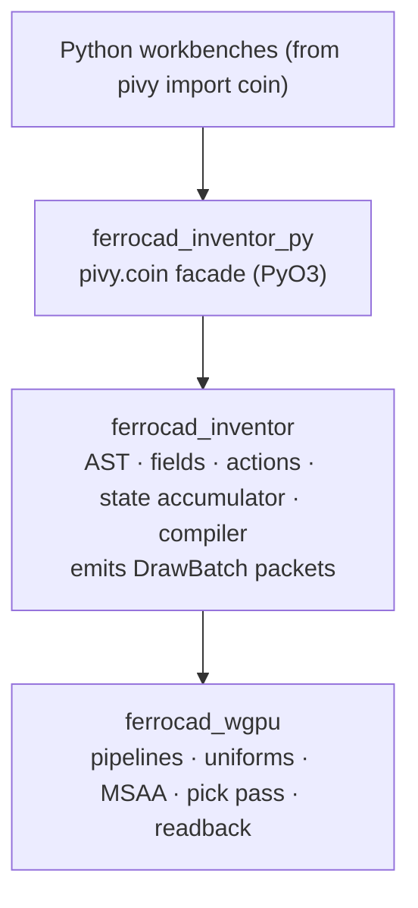

# The Inventor/Coin emulation plan

Status: **roadmap (2026-10-12)**, adapted from an earlier draft to the code as it
stands today. Companion to [`inventor-renderer.md`](inventor-renderer.md) (what is
built) and [`navicube.md`](navicube.md) (the overlay feature that builds on it).

Legend: **✅ built** · **◐ partial** · **▢ planned**.

This is the full Open-Inventor-emulation target across `ferrocad_inventor` and
`ferrocad_inventor_py`, with current status. It is a plan, not a commitment.

## 0. What changed since the draft

The draft assumed a clean slate; a vertical slice is already implemented, so the
adaptations are:

| Draft | As built | Note |
| --- | --- | --- |
| Generational arena (`NodeSlot`) + intrusive refcount | **Owned tree**: `Scene { root: Node }`, `Node { kind, children }`, `NodeKind` enum | ▢ The arena is the migration target for PyO3 identity + detached fields. |
| `glam::Mat4` / `Vec4` | `ferrocad_types::Matrix4` (f64, row-major) | Kept FreeCAD-native; converted to f32 column-major for WGSL in the renderer. |
| `DrawBatchDescriptor` with raw `vertex_data: Arc<Vec<u8>>` | `DrawPacket` with `geometry: Option<Geometry>` (`Vec<Vertex>`/`Vec<u32>`) | The renderer owns the GPU layout; the packet stays typed. |
| (not mentioned) | **CPU ray pick** ✅ (`pick`/`pick_at`), **G-buffer pick** ✅ (`ferrocad_wgpu::pick`) | Both exist; the GPU pass is preferred where a GPU is present, the CPU ray cast is the fallback. |
| (not mentioned) | `Viewport` (device size + DPR) ✅, `InventorView` (surface/image) ✅ | HiDPI + presentation seams added since the draft. |
| `ferrocad_gpui::input_bridge` | `ferrocad_viewport::inventor_view` + `scene` | Host-side glue. |

## 1. Boundaries & guarantees

**Guarantees (hold as built):**

- **`ferrocad_inventor`**: zero Python (`pyo3` forbidden) and zero GPU (`wgpu`
  forbidden) — headless, benchmarkable, fuzzable.
- **`ferrocad_inventor_py`**: owns the `pivy` / `pivy.coin` module surface and ties
  Python object lifetimes to the core.
- **`ferrocad_wgpu`**: depends on the *vocabulary* (`DrawBatch`, `Camera`,
  `Viewport`, `ImageData`, `InventorView`) but knows no node hierarchy and no
  Python — it consumes compiled packets.

## 2. Phase 1 — AST foundation, type spine, topological search

* ✅ **PyO3 class spine** via `PyClassInitializer` (`SoBase` → `SoFieldContainer` →
  `SoNode` → `SoGroup` → `SoSeparator`/`SoSwitch`, with the geometry leaves as
  `SoNode` subclasses) so `isinstance()` passes. *Built in **S1**
  (`tests/coin_boot.rs`).*
* ▢ **`HasNodeId`** extraction trait.
* ✅ **`TypeRegistry`**: `ferrocad_inventor::registry::TypeRegistry` (name → factory)
  is the core of `SoType.fromName(...).createInstance()`, and the PyO3 `SoType`
  surface (`fromName`/`createInstance`/`getName`/`isDerivedFrom`) is built (**S1**).
* ▢ **Generational arena + weakref identity cache** (`a is b` across search results).
* ▢ **`SoPath` / `SoSearchAction`**: `PathStep { node_id, child_index_in_parent }`,
  DFS, exact-type default, `SoSwitch` isolation honoring `whichChild`, `searching_all`.

**Acceptance (planned):** `tests/test_coin_phase1.py` — `isinstance`, `SoType`
factory, search index tracking through inactive switches, path-tail identity.
*Built today:* the first two are covered by `tests/coin_boot.rs` (Rust-side).

## 3. Phase 2 — fields, buffer ingestion, geometry nodes

* ▢ **Field pointer model** with RAII refcount; detached fields outlive the node.
  *Built today:* the field objects hold a strong reference to their parent node, so
  they stay live as long as the node does — the arena/RAII refcount is ▢.
* ◐ **`SoMFVec3f` / `SoMFInt32` / `SoMFColor`**: sequence protocol (`__len__`,
  `__getitem__` returning tuples, `__setitem__`, `__delitem__`, and
  `getValues`/`setValues`/`setValue`/`set1Value`/`getNum`) over the node buffer is
  built (**S2**, `tests/coin_fields.rs`). **Slicing, zero-copy `PyBuffer` ingestion
  (contiguous NumPy `f32`/`i32`) and detached-field RAII are ▢.**
* ◐ **Geometry nodes**: the core has `Coordinate3`, `Normal`, `Mesh`, `Material`
  (a colour *list*), `Transform` as plain Rust (`ferrocad_inventor::node::NodeKind`);
  the **PyO3 field objects** (`SoCoordinate3.point`, `SoNormal.vector`,
  `SoMaterial.diffuseColor`, `SoIndexedFaceSet.coordIndex`/`normalIndex`,
  `SoIndexedLineSet.coordIndex`) and `SoTransform`/`SoSwitch.whichChild` are built
  (**S2**). Negative `coordIndex` (`-1` polygon delimiters) is rejected loudly until
  Phase 3 handles it.
* ▢ **Generational dirty tracking** (`AtomicU64` per field) surfaced to the renderer
  cache. *Built today:* the renderer caches on `(MeshId, Generation)`, but the
  compiler assigns a constant `Generation(0)` — the field-driven counter is ▢.

**Acceptance (planned):** `tests/test_coin_phase2.py` — sequence ops, NumPy
zero-copy ingestion, detached-field persistence, monotonic generations.

## 4. Phase 3 — traversal state machine & packet compilation

* ✅ **State accumulator** (`ferrocad_inventor::state::State`): transform (a
  `Matrix4`), colour, depth bias, pick id, DPR, visibility.
* ✅ **Sibling leakage / isolation**: `Group`-style fields affect *following
  siblings*; `Separator` isolates its subtree and scopes coordinates
  (`ferrocad_inventor::compile`). `SoSwitch` is group-like (it inherits and leaks
  state) and honours `whichChild` — an index, `SO_SWITCH_NONE`, or `SO_SWITCH_ALL`.
* ✅ **Decoupled geometry**: index-only shape nodes pair with the active coordinate
  buffer on the traversal stack.
* ◐ **Triangulation**: the compiler flat-shades index triples (`-1`-free) into
  per-face vertices. **Newell-normalled, earcut concave N-gon triangulation and
  split-vertex unrolling are ▢.**
* ◐ **Polyline assembly**: `Topology::Lines` exists (pairs of indices); `-1`
  polyline segmentation is ▢.
* ✅ **Draw packets**: `DrawPacket { mesh_id, generation, topology,
  geometry: Option<Geometry>, state: StateSnapshot }` behind the `DrawBatch` trait
  (`ferrocad_inventor::batch`) — the `DrawBatchDescriptor` role.
* ▢ **`SoDrawStyle` wireframe override** and **polygon offset** applied.

**Acceptance (planned):** `tests/test_compiler_phase3.rs` — leakage, isolation,
shared coords → surface + wireframe batches, concave triangulation, cache reuse.
*Built today:* unit tests in `compile.rs` cover leakage/isolation and flat-shading.

## 5. Phase 4 — CAD interactivity, picking & the event bridge

* ✅ **CPU ray pick**: `ferrocad_graphics::pick` (`Ray`, `Camera::ray_through`,
  `pick`/`pick_hit`, `pick_at`/`pick_at_hit`; extracted from `ferrocad_inventor` in T4.1)
  — the `SoRayPickAction` analogue; `Hit` carries the object `PickId`, the world point,
  the surface normal and the primitive index.
* ✅ **Events**: `ferrocad_inventor::Event` (`MouseMove`/`MouseButton`/`MouseLeave`)
  + `EventListener` (`on_event(event, hit, scene)`, with the full `Hit`) →
  recompile/highlight; the host delivers device-pixel events and the viewport routes
  them (`ferrocad_viewport::InventorViewport`). **S4** adds the `SoEventCallback` node
  (found via `event_callbacks`), the `SoEvent`/`SoButtonEvent`/`SoMouseButtonEvent`/
  `SoLocation2Event` classes, and the dispatch bridge
  (`ferrocad_inventor_py::dispatch_event`; `ferrocad_gpui::python::PythonEventCallbacks`).
  **Deferred:** the global thread-local context Coin uses (ours lives on the node for
  the duration of the call) and callbacks that change what is *rendered* (the
  extracted scene is a copy).
* ✅ **G-buffer pick pass** (`ferrocad_wgpu::pick`): `Rg32Uint` `(entity_id, part_index)`
  + `Rgba32Float` `(normal, topology)` + an `R32Float` depth target, 256-byte staging
  1×1 readback, and NDC unprojection through the inverse view-projection, exposed via
  `InventorView::supports_pick`/`pick_at` and preferred by `InventorViewport` (the CPU
  ray cast is the fallback). The **`part_index`** it reports is the per-vertex
  `Vertex::part_idx`; filling it with the real (1-based) sub-shape id still depends on
  the OCCT topological-naming work, not the renderer.
* ◐ **`SoPickedPoint`** (world point, normal, `SoDetail`) and the **`SoDetail`
  classes** (`SoFaceDetail.getFaceIndex()`/`getPartIndex()`,
  `SoLineDetail.getLineIndex()`, `getPoint()`). Built in **S4** with 0-based indices;
  the **1-based sub-shape `part_index`** (topological naming) and the document-object
  reference are ▢.

**Acceptance (planned):** `tests/test_coin_phase4.py` — click dispatch,
`getPickedPoint()`, `SoFaceDetail` downcast, 1-based index, thread-local cleanup.
*Built today:* `ferrocad_inventor_py/tests/coin_events.rs` (the Rust-side equivalent)
and the host test `ferrocad_gpui::python::tests::dispatch_reaches_the_scripted_event_callback`.
`getPartIndex()` returns 0 until topological naming lands.

## 6. Name reconciliation

| Draft name | Ours |
| --- | --- |
| `NodeSlot`, arena | `Node` / `NodeKind` / `Scene` (arena ▢) |
| `DrawBatchDescriptor` | `DrawPacket` (+ `DrawBatch` trait) |
| `MeshCacheKey` | `(MeshId, Generation)` |
| `TraversalState` | `State` / `StateSnapshot` |
| `entity_id` | `PickId` |
| `part_index` | (▢ — sub-shape id; needs topological naming) |
| `glam::Mat4` | `ferrocad_types::Matrix4` |
| `ferrocad_gpui::input_bridge` | `ferrocad_viewport::inventor_view` |
| (not in draft) | `Viewport`, `InventorView`, `ImageData` |

## 7. Roadmap

| Phase | Deliverables | Target modules | Status |
| --- | --- | --- | --- |
| **1 — AST & type spine** | PyO3 class spine, `SoType`/registry, arena + weakref identity, `SoPath`/`SoSearchAction` | `ferrocad_inventor::arena`/`actions`; `ferrocad_inventor_py::classes` | ◐ (spine + registry built; arena/actions ▢) |
| **2 — fields & ingestion** | Field model, `SoMF*`, NumPy `PyBuffer`, geometry-node fields, dirty counters | `ferrocad_inventor::fields`; `ferrocad_inventor_py::fields`/`geometry` | ◐ (sequence protocol + geometry fields built; NumPy/RAII/generations ▢) |
| **3 — traversal & compile** | State accumulator, leakage/isolation, Newell+earcut triangulation, split-vertex unroll, packets | `ferrocad_inventor::compiler`/`triangulate`/`batch` | ◐ (state + flat-shaded compile done) |
| **4 — picking & events** | G-buffer pick, `SoPickedPoint`/`SoDetail`, `SoEventCallback`, dispatch bridge | `ferrocad_wgpu::picking`; `ferrocad_inventor_py::events`; `ferrocad_gpui` | ◐ (CPU pick + events + dispatch done; G-buffer/1-based index ▢) |

The ordering that unlocks the most, given what exists: **field-driven generations**
(turns the packet cache real) and the **triangulation** upgrade (real CAD meshes)
are the cheapest high-value wins; the **arena migration** is the prerequisite for
faithful PyO3 identity and detached fields; the **G-buffer pick + details** depend on
topological naming, not just the renderer.

## 8. The chosen (selective) slice path

**Principle:** the smallest end-to-end where `from pivy import coin` can build a
scene that **renders and responds to input** — reusing what is already built (the
enum tree, `compile`, the wgpu backend, the viewport, the CPU pick, events). Defer the
machinery (arena, object identity, zero-copy buffers, G-buffer) until a concrete need
forces it. So we take the *last* part of each phase first, and the heavyweight first
parts later.

| Slice | Phase | Deliverable | Defers |
| --- | --- | --- | --- |
| **S1 — facade spine** ✅ | 1 (selective) | PyO3 class hierarchy `SoBase`→`SoFieldContainer`→`SoNode`→`SoGroup`→`SoSeparator`/`SoSwitch` via `PyClassInitializer`, wrapping the existing `Node`/`NodeKind` (**owned tree, no arena**); `SoType` (`fromName`/`createInstance`/`isDerivedFrom`) over `TypeRegistry`; `SoGroup.addChild`/`getNumChildren`/`__len__`. *Built — `tests/coin_boot.rs`.* | arena, weakref identity, detached fields, `SoPath`/`SoSearchAction` |
| **S2 — geometry fields** ✅ | 2 (selective) | PyO3 field wrappers with the sequence protocol over `Vec`: `SoCoordinate3.point`, `SoNormal.vector`, `SoMaterial.diffuseColor`, `SoIndexedFaceSet.coordIndex`/`normalIndex`, `SoIndexedLineSet.coordIndex`, `SoTransform`, `SoSwitch.whichChild`; edits mutate the wrapped `NodeKind`. *Built — `tests/coin_fields.rs`.* | NumPy `PyBuffer` zero-copy, detached-field RAII, generational dirty counters, slicing, `-1` polygon delimiters |
| **S3 — scene extraction (bridge)** ✅ | 3 | A Python-built root → `Scene`/`RenderQueue` (reuse `compile`), so a `pivy.coin` tree renders in the viewport and the example. The payoff; also lets the sample cube be built from Python. *Built — `ferrocad_inventor_py::install`/`extract_scene`, `ferrocad_gpui::python::inventor_scene`; `tests/coin_scene.rs` + the host test.* | Newell/earcut triangulation, split-vertex unroll, `-1` delimiters, `SoDrawStyle` |
| **S4 — events + pick** ✅ | 4 (selective) | `SoEvent`/`SoButtonEvent`/`SoMouseButtonEvent`/`SoLocation2Event` classes; an `SoEventCallback` node in the AST (found via `ferrocad_inventor::event_callbacks`); dispatch bridging host pointer events → `pick_hit` → `SoPickedPoint` (world point + normal) + `SoFaceDetail`/`SoLineDetail`; `event_cb.getPickedPoint()`/`getEvent()`. *Built — `tests/coin_events.rs` + the host `dispatch` test; the `InventorViewport` routes moves and button down/up.* | G-buffer pass, 1-based sub-shape `part_index` (needs topological naming), global thread-local context, callbacks that change the rendered scene |

**Ordering:** S1 → S2 → S3 → S4. S1 is the biggest new work (the PyO3 spine);
S3 is small (wiring); S4 reuses the built CPU pick and event path.

**Note on the owned tree:** `SoGroup.addChild` *copies* the child node into the
parent's `children` (there is no arena yet), so a field set *before* `addChild` is
captured but a later in-place edit does not reach the parent's copy. S3 reads the
extracted tree, so a "build, then add, then render" script is unaffected; live
mutation of an added child needs the arena (▢).

**Milestone:** a Python script that builds a scene with `from pivy import coin`,
opens it in the app, and hovers/clicks it (highlight via `SoEventCallback`) — the
same behaviour the Rust sample scene shows today, but scripted from Python.
*Reached by **S3 + S4**: `ferrocad_gpui::python::inventor_scene` runs the `pivy.coin`
scene script (which also registers an `SoEventCallback`), `extract_scene` copies it,
the host dispatches each pick through the callbacks
(`ferrocad_gpui::python::PythonEventCallbacks` → `dispatch_event`), and the
viewport/example render it (`cargo run -p ferrocad_gpui --example inventor_roundtrip
-- --headless frame.png` → `ferrocad: SoEventCallback picked … face N`).*

**Caveat:** the scripted callback currently *observes* the pick; because the
extracted scene is a copy, a callback that recolours a node does not yet change what
is rendered (the Rust `HoverHighlight` still does the visual highlight). Closing that
loop needs the arena (or re-extraction after dispatch).

**Note:** the demo scene is currently a script string owned by the shell library
(`INVENTOR_SCENE_SCRIPT`), the Rust twin of `scene::sample_scene`; moving it to the
app's entry module (and having `FreeCADGui` own scene-layer init) is the follow-up
noted in the M5/M6 direction.
