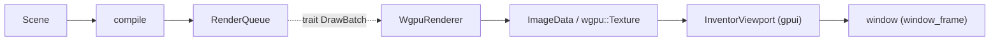

# The Inventor renderer: scene core, wgpu backend, and the gpui viewport

Status: milestone record (2026-10-12). Companion to
[`rewrite-strategy.md`](rewrite-strategy.md) (pillars 3–4), the
[`coin-bridge-reuse-assessment.md`](coin-bridge-reuse-assessment.md) evidence, and
[`architecture.md`](architecture.md) (dependency rules).

This note records the first working slice of the **Coin/Inventor replacement**:
a renderer-agnostic scene core, a wgpu backend that draws it, offscreen readback,
and a gpui viewport wired into the app shell — exercised end to end by an example.

## 1. Pieces and ownership

| Crate | Role | Depends on |
| --- | --- | --- |
| `ferrocad_inventor` | The **scene core**: node AST, traversal/state accumulator, mesh compiler, picking, events, viewport/DPI. Renderer-agnostic. A **leaf** above `ferrocad_types`. | `ferrocad_types` |
| `ferrocad_wgpu` | The **backend**: consumes compiled batches, WGSL pipelines, dynamic uniforms, MSAA, offscreen target, readback. | `ferrocad_inventor`, `ferrocad_types`, `wgpu`, `bytemuck` |
| `ferrocad_inventor_py` | The **`pivy.coin` facade** (PyO3): scaffolding for the Python `coin` namespace over `ferrocad_inventor`. | `ferrocad_inventor`, `pyo3` |
| `ferrocad_gpui` | The **host/glue**: `InventorViewport` (element + interaction loop), `scene` (sample scene), the shell wiring. | `ferrocad_inventor`, `ferrocad_wgpu`, `ferrocad_types`, `bite-gpui`, `pyo3` |

The split follows the assessment's seam: the glossary of scene semantics stays in
`ferrocad_inventor`; the graphics API stays behind a trait; the host owns the
window, the scale factor and the event loop.

## 2. The batch boundary

`ferrocad_inventor::DrawBatch` is the trait a backend consumes; `DrawPacket` is
the concrete packet the compiler emits. A packet carries:

- `mesh_id` + `generation` — the renderer keys its upload cache on the pair, so a
  stable scene uploads once and reuses;
- `topology` (`Triangles`/`Lines`/`Points`);
- `geometry: Option<Geometry>` — **present only on a cache miss**;
- a `StateSnapshot` — `world_transform` (a `Matrix4`), `color`, `depth_bias`, `id`
  (the `PickId`).

Keeping the boundary a trait (not a struct) is what lets a future D3D/Metal
backend sit behind it without touching the node model or compiler.

## 3. Picking and events

- **Picking** is a CPU ray cast (`ferrocad_inventor::pick`): unproject a device
  position through the camera (`Camera::ray_through`, using a local 4×4 inverse)
  and intersect Möller–Trumbore against the world-space triangles. This is the
  `SoRayPickAction` analogue and needs no GPU. A g-buffer pick in `ferrocad_wgpu`
  remains the stub for later.
- **Events** are `ferrocad_inventor::Event` (`MouseMove`/`MouseLeave`) delivered to
  an `EventListener` — the `SoEventCallback` analogue. The listener may edit the
  scene and reports whether it did; the viewport recompiles when it did. Hover
  highlight is implemented exactly this way (recolour the object's `Material`).

## 4. HiDPI: everything is physical pixels

The contract, matching FreeCAD (see the assessment and `InputDevice`/
`View3DInventorViewer::toQPoint`):

- **Device positions are bottom-left origin** (Coin); **logical positions are
  top-left origin** (Qt/gpui); conversions flip Y.
- `ferrocad_inventor::Viewport` holds the **device** size + `device_pixel_ratio`
  and provides `to_device`/`to_logical` (the FreeCAD `toDevicePixelPosition`/
  `toQPoint` pair). Screen-space nodes read `State.device_pixel_ratio` (the
  `SoDevicePixelRatioElement` analogue).
- **Conversion lives only at the host** (the gpui boundary). Everything below —
  the renderer, the camera, the pick buffer, and the `pivy.coin` facade — speaks
  device pixels. The facade performs **no** conversion; it exposes physical event
  positions to Python, exactly as pivy does under FreeCAD (verified: workbench
  code such as `Sketcher`'s `viewport_to_qpoint` divides by the ratio to reach a
  Qt logical point).
- The render target is sized in physical pixels; MSAA (4× by default) resolves
  into the single-sampled target that is read back or shared.

## 5. What is implemented vs not

**Implemented**

- Node AST (`Separator`/`Switch`/`Coordinate3`/`Material`/`Transform`/`Mesh`),
  Coin-style field scoping (fields affect following siblings; `Separator`
  isolates), flat-shaded mesh compilation to packets.
- `SoType`-style registry scaffolding (`TypeRegistry`).
- wgpu renderer: triangle pipeline with depth, dynamic-offset uniforms, 4× MSAA,
  offscreen target, RGBA readback, mesh upload cache.
- CPU ray picking; event/listener dispatch; `Viewport`/DPI primitives.
- gpui `InventorViewport`: image path (readback → `RenderImage` → `img`), pointer
  events → pick → listener → recompile, `with_listener`.
- Wired into the app shell: `Shell::enable_viewport` (best-effort, needs a GPU)
  shows the sample scene in the 3D pane; the `inventor_roundtrip` example renders
  both windowed and headless (`--headless out.png`).

**Not implemented**

- The g-buffer pick pass (`ferrocad_wgpu::pick` is a stub); line/point and
  transparent pipelines; overlays and multi-viewport rendering (needed for the
  NaviCube and other screen-space decoration).
- The `pivy.coin` facade (only scaffolding exists: a minimal `SoSeparator`).
- Real document geometry: the MVP engine is geometry-free, so the viewport draws
  the sample scene until the kernel and workbench `ViewProvider`s produce scene
  nodes.
- Layout-driven sizing: the target is a fixed size stretched into the pane.

## 6. Verification

- `cargo test -p ferrocad_inventor` — compiler, scoping, registry, `Viewport`
  conversions, ray pick, event/listener.
- `cargo test -p ferrocad_wgpu` — offscreen render + readback (skips without a GPU).
- `cargo test -p ferrocad_gpui --lib` — viewport wiring, `RenderImage` swizzle,
  pointer→pick→listener, and a headless shell paint that attaches the viewport
  when a GPU exists.
- `cargo run -p ferrocad_gpui --example inventor_roundtrip -- --headless out.png`
  — `pick at centre -> Some(PickId(0))`, writes the (highlighted) frame.

## 7. Next

1. **Layout-driven sizing**: an `Element` that reads its bounds ×
   `window.scale_factor()` to size the target and place the camera, making hover
   coordinates exact in a docked pane (and removing the fixed-size stretch).
2. **Overlays / multi-viewport** in `ferrocad_wgpu` (corner viewport + scissor +
   its own camera) — the prerequisite for the NaviCube.
3. **The g-buffer pick** and line/point pipelines.
4. **Grow the `pivy.coin` facade** and the `TypeRegistry` toward the ~63
   registered node/kit classes and the `SoType.fromName` surface the workbenches
   use.
