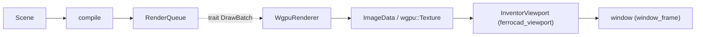

# The Inventor renderer: scene core, wgpu backend, and the gpui viewport

Status: milestone record (2026-10-12). Companion to
[`rewrite-strategy.md`](rewrite-strategy.md) (pillars 3–4), the
[`coin-bridge-reuse-assessment.md`](coin-bridge-reuse-assessment.md) evidence, and
[`architecture.md`](architecture.md) (dependency rules).

This note records the first working slice of the **Coin/Inventor replacement**:
a renderer-agnostic scene core, a wgpu backend that draws it, offscreen readback,
and a gpui viewport wired into the app shell — exercised end to end by an example.

## 1. Pieces and ownership

| Crate | Role | Depends on |
| --- | --- | --- |
| `ferrocad_graphics` | The **neutral draw contract, camera/viewport and CPU picking** (T4.1: extracted from `ferrocad_inventor`). A **leaf** above `ferrocad_types`. | `ferrocad_types` |
| `ferrocad_inventor` | The **scene core**: node AST, traversal/state accumulator, mesh compiler, events. Renderer-agnostic; re-exports `ferrocad_graphics`. | `ferrocad_graphics`, `ferrocad_types` |
| `ferrocad_stage` | The **modern declarative presentation**: `ShapeItem`s, tools and a `TransformGizmo` compiled straight to `ferrocad_graphics` (no scene graph). | `ferrocad_graphics`, `ferrocad_types` |
| `ferrocad_wgpu` | The **backend**: consumes `ferrocad_graphics` batches, WGSL pipelines, dynamic uniforms, MSAA, offscreen target, readback; implements `InventorView`. | `ferrocad_graphics`, `ferrocad_inventor` (seam), `ferrocad_types`, `wgpu`, `bytemuck` |
| `ferrocad_inventor_py` | The **`pivy.coin` facade** (PyO3): the class spine, type registry, geometry field objects, and the `install`/`extract_scene` bridge (slices S1–S3). | `ferrocad_inventor`, `ferrocad_types`, `pyo3` |
| `ferrocad_stage_py` | The **`ferrocad.stage` facade** (PyO3): the modern stack in Python (`ShapeItem`/`Stage`/`Tool`/`TransformGizmo`, hits/events). | `ferrocad_stage`, `ferrocad_graphics`, `ferrocad_types`, `pyo3` |
| `ferrocad_viewport` | The **gpui viewport**: `InventorViewport` (element + interaction loop), the navigation cube (`navicube`), the hosted stage, and `scene` (the Rust sample). No wgpu, no Python. | `ferrocad_graphics`, `ferrocad_inventor`, `ferrocad_stage`, `ferrocad_types`, `bite-gpui` |
| `ferrocad_gpui` | The **host/glue**: the window and shell wiring, `python::inventor_scene` (the `pivy.coin` scene builder), mounting the viewport. | `ferrocad_viewport`, `ferrocad_inventor`, `ferrocad_inventor_py`, `ferrocad_wgpu`, `ferrocad_types`, `bite-gpui`, `pyo3` |

The split follows the assessment's seam: the glossary of scene semantics stays in
`ferrocad_inventor`; the graphics API stays behind a trait; the host owns the
window, the scale factor and the event loop.

## 2. The batch boundary

`ferrocad_inventor::DrawBatch` is the trait a backend consumes; `DrawPacket` is
the concrete packet the compiler emits. A packet carries:

- `mesh_id` + `generation` — the renderer keys its upload cache on the pair, so a
  stable scene uploads once and reuses. The compiler's `generation` is a **content
  fingerprint** of the geometry, because `mesh_id` is positional: a producer that
  reorders or omits packets (the depth-sorted navigation-cube overlay) would otherwise
  hand a new mesh an old upload;
- `topology` (`Triangles`/`Lines`/`Points`);
- `geometry: Option<Geometry>` — **present only on a cache miss**;
- a `StateSnapshot` — `world_transform` (a `Matrix4`), `color`, `depth_bias`,
  `texture` (an optional `Texture2`), `id` (the `PickId`). `depth_bias` is applied in
  the vertex shader (`clip.z -= bias * clip.w`), so a coplanar overlay such as the
  stage selection highlight wins the depth test against the surface it marks.

Keeping the boundary a trait (not a struct) is what lets a future D3D/Metal
backend sit behind it without touching the node model or compiler.

Compilation returns `(RenderQueue, Directives)`: the [`Directives`] are a neutral,
semantic channel the renderer ignores and the viewport consumes (see
[`directives.md`](directives.md)).

## 3. Picking and events

- **Picking** — two paths with the same `Hit` vocabulary:
  - the **CPU ray cast** (`ferrocad_graphics::pick`): unproject a device position
    through the camera (`Camera::ray_through`, using a local 4×4 inverse) and intersect
    Möller–Trumbore against the world-space triangles. This is the `SoRayPickAction`
    analogue and needs no GPU. `pick_hit`/`pick_at_hit` return a
    [`Hit`](../crates/ferrocad_graphics/src/pick.rs) (object id, world point, surface
    normal, sub-element `part`, and the primitive `element`) — what
    `SoPickedPoint`/`SoFaceDetail` expose to Python. Line picking is screen-space when
    a camera is available.
  - the **hardware G-buffer pass** (`ferrocad_wgpu::pick`, T4 sub-slice 4): the scene
    view is re-drawn into offscreen single-sampled targets (`Rg32Uint`
    `[entity_id, part_idx]`, `Rgba32Float` `[normal, topology]`, `R32Float` depth), and a
    1×1 texel is read back and unprojected — the exact rasterised pixel, O(1). It knows
    the sub-element `part`, not the primitive ordinal (`Hit::element` is `None`).
  The `InventorView` seam carries both: `supports_pick()` (default `false`) selects
  whether the backend's `pick_at` is used or the CPU ray cast. `InventorViewport::pick`
  also consults a ready [`Presenter`](gpu-interop-assessment.md) first: its
  `supports_pick`/`pick_at` make the window-device G-buffer authoritative, so an empty
  hit does not run a second pass. Hover, button events and tool dispatch all use that
  one pick. The paths agree on the object id and `part`.
- **Events** are `ferrocad_inventor::Event` (`MouseMove`/`MouseButton`/`MouseLeave`)
  delivered to an `EventListener` (`on_event(event, hit, scene, directives)`) — the
  `SoEventCallback` analogue. The listener may edit the scene and report whether it
  did; the viewport recompiles when it did. Hover highlight is implemented exactly
  this way (recolour the object's `Material`). **Scripted** callbacks are the other
  half (S4): an `SoEventCallback` node sits in the AST, the compiler lifts it into a
  `Directive::EventCallback` beside the draw queue, and
  `ferrocad_inventor_py::dispatch_event` delivers the event and pick to the registered
  Python callables (`event_cb.getEvent()`/`getPickedPoint()`).

## 4. HiDPI: everything is physical pixels

The contract, matching FreeCAD (see the assessment and `InputDevice`/
`View3DInventorViewer::toQPoint`):

- **Device positions are bottom-left origin** (Coin); **logical positions are
  top-left origin** (Qt/gpui); conversions flip Y.
- `ferrocad_inventor::Viewport` holds the **device** size + `device_pixel_ratio`
  and provides `to_device`/`to_logical` (the FreeCAD `toDevicePixelPosition`/
  `toQPoint` pair). Screen-space nodes read `State.device_pixel_ratio` (the
  `SoDevicePixelRatioElement` analogue).
- **Conversion lives only at the host** (the gpui boundary). Everything below —
  the renderer, the camera, the pick buffer, and the `pivy.coin` facade — speaks
  device pixels. The facade performs **no** conversion; it exposes physical event
  positions to Python, exactly as pivy does under FreeCAD (verified: workbench
  code such as `Sketcher`'s `viewport_to_qpoint` divides by the ratio to reach a
  Qt logical point).
- **The host converts window → element → device.** gpui reports a pointer position
  **relative to the window** (`MouseMoveEvent.position` is documented "on the window";
  the platform layer divides the physical position by the scale factor, so it is
  **logical** pixels). `InventorViewport` subtracts its own window-space origin —
  captured each frame at prepaint via `on_children_prepainted` — to get a
  **viewport-local** logical point before `Viewport::to_device` yields device pixels.
  Every `handle_pointer`/`handle_button` caller passes viewport-local coordinates.
- **The render target follows the element.** The target is sized in physical pixels;
  MSAA (4× by default) resolves into the single-sampled target that is read back or
  shared. `InventorViewport` keeps it — and the camera's [`Viewport`], and the
  navigation-cube overlay — at the element's physical size: at prepaint it records the
  element bounds, and at the next frame it calls `InventorView::resize` and sets
  `Camera.viewport` from `bounds × window.scale_factor` (requesting one more frame so
  the change lands).
- **The projection follows the aspect.** `Camera` stores its [`Projection`] as
  *parameters* — `Perspective { fov_y, near, far }`, `Orthographic { extent, near, far }`,
  or an explicit `Matrix` escape hatch — and rebuilds the matrix from the viewport aspect
  on demand (`Camera::projection_matrix`). So resizing a pane no longer stretches the
  scene. Clip depth is in the backend's `[0, 1]` (the sample's old baked perspective used
  the GL-style `[-1, 1]`, which mis-clipped near geometry).

## 5. What is implemented vs not

**Implemented**

- Node AST (`Separator`/`Switch`/`Coordinate3`/`Normal`/`Material`/`Transform`/`Mesh`),
  Coin-style field scoping (fields affect following siblings; `Separator`
  isolates; `SoSwitch` is group-like and honours `whichChild`), flat-shaded mesh
  compilation to packets.
- `SoType`-style registry (`TypeRegistry`) and the `pivy.coin` facade: the PyO3
  class spine (`isinstance`), `SoType.fromName(...).createInstance()`, and the
  geometry field objects (`SoCoordinate3.point`, `SoMaterial.diffuseColor`, …).
- The **scene bridge** (S3): `ferrocad_inventor_py::install` registers `pivy.coin`
  in the embedded interpreter; a `from pivy import coin` script builds a tree that
  `extract_scene` copies into a `Scene` — the same `compile` path the Rust sample
  uses.
- The **event bridge** (S4): the `SoEvent`/`SoButtonEvent`/`SoMouseButtonEvent`/
  `SoLocation2Event` classes, `SoPickedPoint`/`SoDetail`/`SoFaceDetail`/`SoLineDetail`,
  and the `SoEventCallback` node; the host routes pointer moves and button down/up
  through `python::PythonEventCallbacks` → `dispatch_event`.
- wgpu renderer: triangle pipeline with depth, dynamic-offset uniforms, 4× MSAA,
  offscreen target, RGBA readback, mesh upload cache. The **surface pipeline carries a
  slope/constant depth bias** (so a coplanar shaded-with-edges wireframe wins the depth
  test), and the mesh cache is keyed by `(view, mesh_id)`, **evicting the previous
  generation** (T4.2–T4.3) instead of accumulating. The view slot keeps independent
  queues apart: the scene, the gizmo, the tool overlay and each navigation cube all
  number their meshes from zero, and one frame draws several of them.
- CPU ray picking; event/listener dispatch; `Viewport`/DPI primitives; the render
  target tracking the element's physical size (`InventorView::resize`) and an
  aspect-aware camera [`Projection`].
- **Viewport navigation**: a left-button drag on the scene (or a middle-button drag)
  orbits the camera around its pivot once past the click threshold, and the wheel
  zooms by scaling the eye distance. The navigation cube's own drag/snap keeps
  priority. Pointer positions are made surface-local the same way
  `gpui_interop::surface_input` does it, and gpui's drag keeps delivering a gesture's
  moves after the pointer leaves the viewport.
- **Hardware G-buffer picking** (`ferrocad_wgpu::pick`): `WgpuRenderer::pick_at` renders
  the `[entity_id, part_idx]` / `[normal, topology]` / depth targets and reads one texel
  back, unprojecting the world point via the inverse view-projection. Exposed through
  `InventorView::supports_pick`/`pick_at`, preferred by `InventorViewport` with the CPU
  ray cast as fallback.
- `ferrocad_viewport::InventorViewport` (gpui): image path (readback → `RenderImage`
  → `img`), pointer events → pick → listener → recompile, `with_listener`.
- Wired into the app shell: `Shell::enable_viewport` (best-effort, needs a GPU)
  shows a scene built from a `pivy.coin` script (`python::inventor_scene`, with the
  Rust `scene::sample_scene` as fallback); the `inventor_roundtrip` example renders
  both windowed and headless (`--headless out.png`).
- **Overlays / multi-view** (the navigation cube, `docs/navicube.md`):
  `ferrocad_inventor::ViewSpec` + `InventorView::draw_frame`,
  `WgpuRenderer::render_views` (per-view `set_viewport`/`set_scissor_rect`, an overlay
  pipeline with depth off and alpha blending), `ferrocad_viewport::navicube` (the
  cube model, the inventor/stage producers and their overlay camera), and `NaviCube` +
  `InventorViewport::with_navicube` (placement, camera mirroring, hover, click-snap,
  drag-orbit, the animated snap). The cube carries baked face labels and a fixed
  `Home` button (N4b; see [`navicube.md`](navicube.md)).
- **Line and point pipelines**, routed by `Topology` (scene and overlay variants), so
  `Topology::Lines`/`Points` packets draw correctly; **line (segment) picking**
  (`Hit` carries its `Topology`, its sub-element `part`, and the primitive `element`
  when the CPU ray cast resolves one; the facade builds a `SoLineDetail` for a line
  hit). Line picking is screen-space when a camera is available (2 px), so it does not
  depend on model scale. The navigation cube's edges are lines and its corners small
  cubes.
- A **texture path** (`SoTexture2` analogue): `NodeKind::Texture2` +
  `TextureCoordinate2`, a vertex `uv`, `State.texture` (an `Arc<Texture2>`, RGBA8 with
  a stable id), and a wgpu bind group (group 1) sampling the shape texture (a 1×1
  white default when absent). The navigation cube's face **labels** and **Home**
  button bake glyphs into `Texture2`s.

**Not implemented**

- The g-buffer pick pass is no longer a stub (T4 sub-slice 4 landed; see §3); what
  remains is a **transparent** (order-independent) pipeline and a **text/glyph-run**
  node (labels exist, but as baked textures, not text nodes).
- The `pivy.coin` facade is deliberately narrow: no arena/object identity, no
  `SoPath`/`SoSearchAction`, no NumPy zero-copy or generational dirty counters, and
  no `-1` polygon delimiters (see [`inventor-plan.md`](inventor-plan.md) §8).
- Real document geometry: the MVP engine is geometry-free, so the viewport draws
  the sample scene until the kernel and workbench `ViewProvider`s produce scene
  nodes.
- Layout-driven sizing: the target is a fixed size stretched into the pane.

## 6. Verification

- `cargo test -p ferrocad_inventor` — compiler, scoping, registry, `Viewport`
  conversions, ray pick, event/listener.
- `cargo test -p ferrocad_wgpu` — offscreen render + readback (skips without a GPU).
- `cargo test -p ferrocad_inventor_py` — the facade spine, `SoType`, the field
  objects, the S3 scene-extraction bridge, and the S4 event/dispatch surface
  (`tests/coin_boot.rs`, `coin_fields.rs`, `coin_scene.rs`, `coin_events.rs`).
- `cargo test -p ferrocad_gpui --lib` — viewport wiring, `RenderImage` swizzle,
  pointer→pick→listener, the `pivy.coin` scene builder, the scripted
  `SoEventCallback` dispatch, and a headless shell paint that attaches the viewport
  when a GPU exists.
- `cargo run -p ferrocad_gpui --example inventor_roundtrip -- --headless out.png`
  — `pick at centre -> Some(PickId(0))`, writes the (highlighted) frame.

## 7. Next

The full Open-Inventor-emulation roadmap (four phases — AST/type spine, fields,
traversal/compile, picking/events — adapted to the code as it stands) is in
[`inventor-plan.md`](inventor-plan.md). In short:

1. **Layout-driven sizing**: an `Element` that reads its bounds ×
   `window.scale_factor()` to size the target and place the camera, making hover
   coordinates exact in a docked pane (and removing the fixed-size stretch).
2. **Navigation-cube polish** (N4b, remaining): a context menu and the arrow buttons
   (see [`navicube.md`](navicube.md)). The pieces, the overlay pass, drag-orbit, the
   animated snap, translucent away-facing faces, baked face labels and the `Home`
   button are built. Separating the cube's model from its producer — so the modern
   `ferrocad_stage` stack can build it too — is specified in
   [`navicube-spec.md`](navicube-spec.md) and planned in [`navicube-plan.md`](navicube-plan.md).
3. **Line/point pipeline polish** and **feature snapping** from the G-buffer
   `part_idx` (the pick pass now supplies the sub-element index).
4. **Grow the `pivy.coin` facade** and the `TypeRegistry` toward the ~63
   registered node/kit classes and the `SoType.fromName` surface the workbenches
   use. S1–S4 cover the class spine, the geometry fields, the scene-extraction
   bridge, and the event/pick surface; the arena (object identity, detached fields),
   triangulation, field-driven generations, and the g-buffer pick are the next
   depth items.
