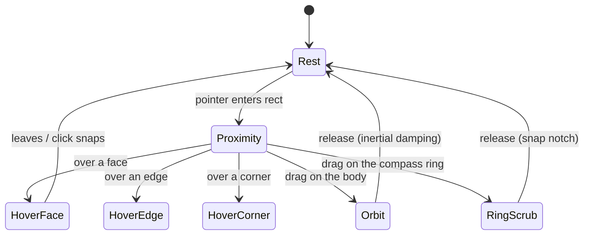

# GPUI-native NaviCube — design and implementation plan

Status: **D1–D5 built (2026-10-20); WA1–WA9 visual and input passes built (2026-10-20)**.
Product direction: **Concept A, the precision wireframe gyro-cube**. Companion to
[`navicube-spec.md`](navicube-spec.md) (the behavioural spec) and
[`navicube.md`](navicube.md) (as built). This note maps the visual/interaction brief onto
the current renderer and viewport so the work can be sliced.

## 0. Why the current cube feels out of place

- **Opaque block, dead airspace.** The 96×96 overlay rect swallows every pointer event,
  even when the cursor is over empty space between the cube and its Home button.
- **Painted faces compete with the model.** Opaque, lit face quads and full-face stamped
  letters are the heaviest thing in the viewport; they read like a toy die, not an
  instrument.
- **Corner targets are invisible until too late.** 26 pick targets on a small solid
  box, with no hover affordance beyond recolouring the whole facet.
- **Legacy tokens.** Line weights, glyphs and highlights do not share the viewport's
  dark, thin, vector-sharp visual language.

The redesign keeps the 26-target taxonomy and the camera-snap behaviour; it replaces
the *presentation* and the *hit-testing surface*.

## 1. Direction: Concept A — Precision Wireframe Gyro-Cube

```text
rest:        faint frosted-glass hull, 1px edges, whisper-quiet labels
proximity:   edges/labels wake to full brightness
hover face:  soft cyan facet fill + bright outline + label emphasis
hover edge:  that chamfer glows; 45° axial preview
hover corner:corner bead glows; isometric preview
orbit:       free arcball around the body + compass-ring yaw scrub
controls:    PERSP/ORTHO pill, Home, angle readout
```

Concept B (rings only) is kept as a fallback if the cube proves too busy, but it loses
the direct face/edge/corner targets; the brief's recommendation and our existing model
both favour A.

## 2. Mapping to the current architecture

| Design element | Current mechanism | Change |
| --- | --- | --- |
| Glass facets | overlay triangle pass, alpha blend | **square** faces (watertight chamfered cube), directionally lit glass; no opaque fill |
| 1px vector edges | `Topology::Lines`, 1px line pipeline | twelve **bevel quads** with twin long lines + corner-triangle outlines; front @ 0.62, back @ 0.10 |
| Labels | baked glyph textures | face letters are **filled 3D triangle glyphs** in the face plane (WA7); `N/E/S/W` are **gpui text** at projected ground-ring anchors |
| Hover bloom | theme role → colour | cyan square/triangle fill + outline, edge ribbon (no post-process bloom) |
| 26 targets | `PickId` per piece | keep; square faces, bevel quads, triangular corners |
| Pass-through negative space | viewport-wide `handle_pointer`/`handle_button` | only cube pieces and the ring consume; otherwise fall through to the scene |
| Compass ring | none | **3D turntable** on the ground plane (`y = −0.5`), projected as an ellipse by the view rotation |
| PERSP/ORTHO | `Camera::projection` | add a projection toggle that preserves framing; compact gpui pill below the gizmo |
| Angle readout | none | derive azimuth/elevation from `Camera.view`; gpui text |
| Roll chevrons | none | **removed from the 3D overlay (WA6)**; the chrome pill's `◀`/`▶` arrows now **yaw** ±90° (WA9) |

The renderer already supports what the rest state needs: alpha-blended overlays,
`Lines`, per-packet colour and alpha, and RGBA textures multiplied into colour. It does
**not** support wide lines or a glow pass, so "bloom" is approximated by a bright
outline/fill rather than a post-process blur.

## 3. Visual tokens

Nominal values; the theme owns them (see `navicube/theme.rs`). Shader colours are
**linear** RGB; the hex column is the intended sRGB look.

| Token | Rest | Proximity | Hover |
| --- | --- | --- | --- |
| Edge line (front) | `#D6E0F0` @ 0.62 | `#E6F0FF` @ 0.9 | `#67D7FF` @ 1.0 |
| Edge line (back) | `#8C99AD` @ 0.10 | same | hover wins |
| Bevel quad | `#DCEBFF` @ 0.45 | `#EDF5FF` @ 0.6 | `#48E5FF` @ 0.6 |
| Face fill (lit) | `#D8E6FA` @ ~0.42 (top) | same | stays crisp; cyan outline |
| Face fill (mid) | `#96A8C0` @ ~0.38 | same | stays crisp |
| Face fill (shade) | `#1E2634` @ ~0.36 | same | stays crisp |
| Back facet | dark slate @ 0.06 | same | — |
| Face glyph | filled `#EBF2FC` @ 0.8 | `#FAFDFF` @ 0.95 | white |
| Corner triangle | glass fill + outline | same | cyan fill + cyan outline |
| Neighbour bevel | — | — | cyan @ 0.2 fill, cyan outline |
| Hover glow (bevel ribbon) | — | — | cyan @ 0.22 |
| Turntable floor | `#141820` @ 0.72 (linear) | same | same |
| Rim band | `#96B9D2` @ 0.35 | `#ADCBE3` @ 0.45 | `#67D7FF` @ 0.55 |
| Rim loops | `#A8B3C7` @ 0.70 | `#C0CFE0` @ 0.9 | `#67D7FF` @ 0.95 |

Labels: the face letters are **filled 3D triangle glyphs** lying in the face plane (WA7),
so they foreshorten with the facet and stay bold; only the compass `N/E/S/W` letters are
gpui text, anchored **inside** the turntable track. Both share the application font/colour
language and are anti-aliased, replacing the earlier baked 5×7 atlas.

Face fills are **directionally lit** (WA6, strengthened in WA7): an upper-left studio light
`L = normalize(−0.45, 0.8, 0.55)` drives a smoothstepped ramp from dark slate (unlit) to
silver (lit), so the three visible facets read as a solid glass block against a mid-grey
viewport without relying on the wireframe alone.

## 4. Geometry and draw order

- Keep the 26-piece taxonomy and ids (`Piece::ALL`). The body is the watertight
  **24-vertex chamfered cube**: six **square** faces (`FACE_HALF 0.38` in the ±0.5 plane),
  twelve **bevel quads** (the machined strips with twin lines) and eight equilateral
  **corner triangles**. Every edge is shared exactly; nothing protrudes past the silhouette.
- For each face emit a **square** carrying the face `PickId`; a hovered face adds its
  four-edge outline but keeps its directional fill. The resting wireframe is owned by the
  bevels and corner triangles, so no square edge is drawn twice.
- Each bevel emits its quad (surface first, four outline edges second) and, on hover, a
  glow ribbon; the quad's twin long edges are the two squares' shared in-plane lines.
  Each corner emits its triangle (surface first, three outline edges second); the surface
  is cyan only on hover, and a hovered corner lights its three incident bevels as
  neighbours. There are no octahedral beads, pick beads or halos.
- **Back-facing pieces are culled**, not drawn dimmed: faces with `n_view.z < 0`, and
  bevels/corners whose adjacent faces all point away, are not emitted at all. The cube is
  convex, so the visible pieces never overlap and the overlay reads solid.
- Draw order: the **far half** of the turntable (floor disc, far rim band/loops, far
  marker), then the visible cube pieces back-to-front, then the **near half** of the rim.
  The overlay has depth off, so this is what puts the disc under the cube and the near rim
  in front without ever over-painting the body. The far half fades to 20% alpha.
- Face letters are **filled triangle quads** in the face plane (inset `0.002` along the
  normal, scale `0.38`, stroke `0.06`), emitted as `Triangles` packets under the face's
  pick id; only visible faces draw them. The compass letters remain **gpui text**
  projected onto the image (see §7.11), never inside the 3D shader, so they stay crisp.
- The overlay rect stays **square** (the overlay camera is square; a non-square rect
  would stretch the cube). Built layout:
  - cube `100 × 100` logical px (its largest projected extent), with an overlay box of
    ≈`148 × 148` derived from the turntable layout; ortho half-extent `1.28`;
  - the turntable is a dark floor disc plus a rim band at `y = −0.5`
    (`1.15..1.22`), with the `N/E/S/W` anchors **inside** the track at `0.96`, so at
    elevation 0 it flattens into the cube's base line and opens into a foreshortened
    ellipse as the camera tilts;
  - the cube is **centred** in a `CHROME_WIDTH = 248` logical column whose outer edge
    carries the margin; the chrome bar is a **gpui overlay** below that column
    (`248 × 26`), not part of the 3D scene.

## 5. Interaction model



- **Proximity** is a whole-widget state (not a piece): edges and labels brighten as the
  cursor enters the rect; the negative space does not consume the event.
- **Hover** is the piece under the pointer (`Piece`, via `NaviCube::hit`); snapshots may
  preview the target orientation (later: ghost the camera/frustum cone).
- **Click** snaps to face/edge/corner as today, animated.
- **Drag on the body** orbits (existing `drag_view`, horizon-preserving). Add velocity +
  damping for the "inertial" feel after release.
- **Compass ring**: hit-test the ground-plane circle by projecting the pointer onto
  `y = −0.5` in cube space; map the pointer's in-plane angle to a **world-Y** yaw
  (preserves elevation), with magnetic detents at 0/90/180/270°. An edge-on ring has no
  unique intersection, so scrubbing needs a tilted view.
- **Pass-through**: in `InventorViewport::handle_button`, if the point is inside the
  navicube rect but `cube.hit(device)` is `None` (and not on the ring), continue
  to the scene (pick/tool/orbit) instead of returning early. Hover behaves the same way.
- **Yaw**: no longer a 3D target. The chrome pill's `◀`/`▶` buttons yaw the view ±90°
  about the vertical axis (WA9), so the turntable and readout stay consistent. A press
  inside the pill's logical rect is reserved.
- **Hover preview**: the hovered piece grows a translucent wireframe cone pointing from
  its direction toward the cube centre, previewing the camera direction the click snaps
  to. The cone carries the piece's pick id, so picking through it is the same target.

## 6. Projection toggle

**Built as `Camera::{toggle_projection, set_projection, zoom_projection,
 eye_distance, is_orthographic}`** (D4). The camera orbits the world origin, so the pivot
is `eye_distance` from the eye:

- Perspective → Orthographic: `extent = eye_distance · tan(fov_y / 2)`, preserving the
  apparent size at the pivot. (No stored fov is needed.)
- Orthographic → Perspective: `fov_y = 2·atan(extent / eye_distance)`, restoring the same
  field of view.
- Orthographic **zoom** scales `extent` (the eye distance does not change the image), while
  perspective zoom keeps scaling the eye distance.
- `InventorViewport::set_orthographic` / `toggle_projection` mutate the camera and
  recompile; `set_projection` takes an explicit projection.

The chrome bar is a gpui element pinned beside the navicube (anchored to
`NaviCubeConfig.corner`): `[PERSP | ORTHO]`, Home, and an `AZ 045° EL 032°` readout. It
is outside the 3D overlay, so it gets real typography and hit-testing; the viewport's
pointer/scroll/drag handlers reserve its logical rect and ignore events there.

## 7. Slice plan

| Slice | Deliverable | Touches |
| --- | --- | --- |
| **D1 — rest/proximity wireframe** ✅ | low-alpha facets, one 1px wireframe, transparent-background labels, proximity brightening, negative-space pass-through | `navicube/model.rs`, `navicube/{inventor,stage}.rs`, `navicube/theme.rs`, `inventor_view.rs`, `ferrocad_inventor::compile`, `ferrocad_wgpu::renderer` |
| **D2 — hover targets** ✅ | cyan facet/edge/corner hover, edge ribbon + corner halo (no wide lines), label emphasis, enlarged invisible corner pick target | `navicube/{theme,model,inventor}.rs` |
| **D3 — compass ring** ✅ | ring, N/E/S/W, ticks, yaw scrub, snap notches | `navicube/{model,inventor,theme,view}.rs`, `navicube.rs`, `inventor_view.rs` |
| **D4 — chrome** ✅ | PERSP/ORTHO bar, Home, angle readout, framing-preserving projection toggle, inertial orbit | `inventor_view.rs`, `ferrocad_graphics::Camera`, `navicube/{model,inventor,stage,theme,conformance}.rs` |
| **D5 — extras** ✅ | roll chevrons, hover frustum/cone preview (optional glyph-run labels deferred) | `navicube/{model,inventor,stage,view,conformance}.rs`, `navicube.rs`, `inventor_view.rs` |

D1 is the visual reset and the highest-value step. D2 makes the hit targets legible.
D3/D4 make it an instrument rather than a widget. D5 is polish.

### 7.1 D1 as built (2026-10-20)

- **One wireframe.** The twelve edge pieces are the cube's outline; resting faces no
  longer emit their own inset rectangle (that doubled every edge). A *hovered* face
  gets an inner outline inside its facet, which is where D2's emphasis lands.
- **Glass facets.** Faces and away faces keep their pick quads with a 0.025–0.05
  alpha dark tint. The model behind stays fully visible.
- **Beads, not cubes.** Corners are small octahedra (radius `0.075`); the old 8-vertex
  translucent cubes composited into a muddy blob.
- **Labels.** Light-on-transparent 64² glyph textures (cell 4) on the face quad; alphas
  0.55 / 0.9 / 1.0. Away faces emit no label.
- **Proximity** wakes edges and labels whenever the pointer is anywhere in the gizmo
  rect; hover still recolours the piece.
- **Pass-through.** `handle_pointer`/`handle_button` only short-circuit when a piece or
  Home was hit; negative space continues to the gizmo, tool and scene.
- **Depth cue.** A face is away when its normal points away; an edge when *both* adjacent
  faces are away; a corner when all three are. Only geometry the cube hides dims.
- **Two renderer bugs found by the redesign.** (1) The compiler stamped every packet
  `Generation(0)` while mesh ids are positional, so a queue whose packet order/count
  changed reused stale geometry (the hover artifact). The generation is now a content
  fingerprint. (2) Every queue numbers meshes from zero, and the renderer shared one
  upload cache across views, so the navigation cube overwrote the main scene's mesh 0.
  The cache is now keyed `(view, mesh_id)`.

### 7.2 D2 as built (2026-10-20)

- **Face hover** — cyan facet fill @ 0.16, an inner cyan outline inside the facet, and a
  white label (0.55 → 1.0).
- **Edge hover** — the 1px line goes cyan @ 1.0 and gets a translucent screen-space
  **ribbon** behind it (the renderer has no wide lines). The ribbon is built in view
  space and mapped back through the cube's inverse rotation, so it stays ~2px wide at
  any orientation; degenerate (view-aligned) edges simply skip it.
- **Corner hover** — the octahedral bead goes cyan and grows a translucent **halo**
  (radius 0.14 vs the bead's 0.075).
- **Pick targets** — every corner also emits an invisible octahedron of radius 0.115,
  after the visible bead. The CPU pick sees it, so a corner is acquirable ~5px from its
  centre while the bead stays light; a regression test clicks 4px outside the bead.
- **Capability gap.** The stage producer still draws the corner bead and the 1px line
  and recolours them, but has no ribbon/halo/pick-target (like labels, these are
  inventor-producer appearances). Conformance still compares the first packet per id.

### 7.3 D4 as built (2026-10-20)

- **Home leaves the overlay.** `NaviTarget::Home`, `HOME_PICK_ID`, `home_quad` and the
  Home quad/label packets are gone; the cube is 26 pieces (ids 1..=26). The theme loses
  its `Home`/`HomeHighlighted` roles and `home` colour. `home_orientation()` stays for the
  chrome's Home.
- **Chrome bar.** `InventorViewport::render` adds an absolutely positioned gpui bar next
  to the gizmo rect (anchored from the cube's **painted logical rect**, see §7.5): a
  `[PERSP | ORTHO]` segmented toggle, `Home`, and a live `AZ {:03.0}° EL {:02.0}°`
  readout. It is 164×52 logical px (WA5 later made it a single 216×26 row),
  uses the shell's panel palette, `occlude()`s the pointer and is excluded from the
  viewport's own pointer/scroll/drag handling, so it cannot orbit or pick the scene.
- **Framing-preserving projection.** `Camera::{toggle_projection,set_projection,
  zoom_projection,eye_distance,is_orthographic}`. Perspective → orthographic sets
  `extent = eye_distance · tan(fov/2)`; the inverse restores the fov. Orthographic zoom
  scales the extent; perspective zoom keeps using the eye distance.
- **Angles.** `camera_angles` reports the eye's bearing from the pivot with the engine's
  **Y-up** convention (azimuth in XZ from +X, elevation from +Y), so the sample view reads
  `AZ 045° EL 032°`.
- **Inertial orbit.** Drag deltas feed a smoothed velocity (logical px/s). If the pointer
  is still moving at release (>120 px/s, sampled within 150 ms) the camera glides with
  `e^(−dt/0.18 s)` damping until 12 px/s; a press, a zoom or a snap stops it. The render
  loop requests frames while it runs.
- **Not done here.** The bar is a two-line capsule rather than the concept's 132 px pill.

### 7.4 D3 as built (2026-10-20)

- **Layout.** The widget is `132×132` logical with an ortho half-extent of `1.3`, so the
  cube's corner radius (0.866) maps to ~44 px and the ring at `1.02` (~52 px) sits just
  outside it. The gpui bar follows the cube's painted logical rect, 6 px below it.
- **Ring.** *(Superseded by WA1/WA2: the ring is now a ground-plane turntable and its
  letters are gpui text.)* A 64-segment circle with a 30° tick fan (longer at the
  cardinals), fixed `N/E/S/W` glyph labels at radius `1.18`, and a filled diamond
  **heading marker** at the camera's azimuth. Emitted by the inventor producer after the
  cube as one line packet (pick id 27), four label packets and one triangle packet.
- **Compass semantics.** The rose is screen-fixed: E = azimuth 0 (+X), N = 90 (+Z, the
  default front view), W = 180, S = 270 — consistent with the Y-up `AZ` readout.
  `compass_angle` derives the marker from the view rotation, so the controller carries no
  extra state.
- **Scrub.** `NaviCube::{ring_hit, ring_angle}` test an annulus in device pixels (pieces
  win inside their pick targets, so a corner click is never stolen). A press starts a
  ring drag; `drag_move` applies `navicube::yaw_view` by the pointer angle delta, a
  view-space yaw that leaves the horizon level. On release, a heading within 10° of a
  90° detent animates onto it (180 ms); otherwise the view stays where it was.
- **Theme.** `ring` / `ring_proximity` / `ring_highlighted`; the labels reuse the label
  ink. The ring is an inventor-producer capability (the stage producer has none).
- **Not done.** The 45° axial and roll chevrons were deferred here; both landed in D5
  (§7.6).

### 7.5 HiDPI: logical chrome vs device overlay (2026-10-20)

- **Two coordinate spaces.** The 3D viewport, its picking and the navicube overlay work in
  **device** pixels (`round(logical × dpr)`); every gpui element (the chrome bar, its text
  and hitboxes) is laid out in **logical** pixels. The bridge is
  `Viewport::{to_device,to_logical}` plus `NaviCube::logical_rect()`.
- **The cube rounds to whole device pixels.** `corner_rect` computes
  `size_px = round(overlay_size(cube_size) × dpr)` and `margin_px = round(config.margin × dpr)`. Its
  painted logical width is therefore `size_px / dpr`, which differs from the ideal box by
  up to `1/dpr` at fractional ratios (e.g. at 1.1× a 100px cube's 178.98px box paints 197
  device px = 179.09 logical px).
- **One source of truth.** `chrome_bar_rect(&NaviCube)` derives the bar's logical rect from
  `NaviCube::logical_rect()` — never from `NaviCubeConfig` — and is used for **both** the
  bar's absolute `left`/`top` in `navicube_chrome` and `chrome_contains`'s pointer
  reservation. The bar shares the cube's outer edge (right for a right-hand corner) and
  sits `CHROME_GAP = 6` logical px beyond it, toward the viewport centre. Painting and
  input can no longer disagree by a device-pixel rounding step.
- **Same-frame sizing.** `render` runs `sync_size` first, so the cube (and thus the bar)
  is positioned from the viewport applied on that tick; the bar no longer depends on the
  previous prepaint's `last_bounds`, so it exists on the first frame (at the bootstrap
  size) instead of appearing a frame late.
- **Tests.** `the_rect_and_its_logical_extent_follow_the_device_pixel_ratio` (1.0, 1.1,
  1.25, 1.5, 2.0), `the_chrome_tracks_the_cubes_device_rounded_rect` and
  `a_press_on_the_chrome_is_reserved_at_two_x` pin the conversion.

### 7.6 D5 as built (2026-10-20)

> **Superseded by WA6/WA9:** the roll chevrons and `ROLL_*` constants were removed; the
> chrome pill's `◀`/`▶` buttons are now **yaw** controls (WA9), not roll. The hover
> preview cone was removed in WA7.

- **Roll chevrons.** Two filled arrowheads at the ring's diagonals — counter-clockwise at
  135°, clockwise at 45°, radius `1.12` (the diagonal gaps are the only cardinals without
  a compass label). They are screen-fixed (outside the rotating subtree) and use the ring
  colour tokens: the hovered one is `ring_highlighted`, the other
  `ring_color(proximity, ring)`. Pick id `28` (`ROLL_PICK_ID`) is outside the piece set.
- **Hit-testing and input order.** `NaviCube::roll_hit` converts the device point to cube
  space and accepts a radial band of ±0.13 around `1.12` within ±0.26 rad of a diagonal,
  so the chevrons win over the ring's scrub band where they overlap. Input resolves
  **pieces → chevrons → ring → cube orbit → scene**, and the chevron owns the press.
- **Animated roll.** *(WA9: the pill's turn controls are now yaw. A press starts
  `SnapAnimation::to(yaw_view(...), 220 ms)`, a quarter turn about the world vertical
  `+Y`; `YawDirection::angle()` = ±π/2. `yaw_view` preserves the elevation and the eye
  distance, so the turntable stays horizontal.)* A chevron press used to start
  `SnapAnimation::to(roll_view(...), 220 ms)`, a quarter turn about the screen normal.
- **Hover preview.** A hovered face/edge/corner grows a translucent wireframe **cone** from
  its direction toward the cube centre (`APEX 0.98`, base `0.34` with radius `0.15`, twelve
  segments and four spokes). It is emitted after every piece inside the rotating subtree,
  so it overlays the glass and turns with the body. Its pick id is the piece's own, so a
  pick through the cone resolves to the same snap target; the alpha is
  `edge_highlighted × 0.6`.
- **Both producers.** The inventor producer adds `roll_node` to the fixed root and the cone
  to the rotating subtree; the stage producer keeps two chevron items plus one preview
  item per piece (so entity ids stay stable) and emits the hovered cone with the cube's
  rotation. Cross-producer conformance now also checks the chevrons and the preview.
- **Tests.** *(All removed with the chevrons/cone; the surviving turn control is
  `a_chrome_yaw_starts_a_quarter_turn`.)* `the_roll_chevrons_sit_on_the_ring_diagonals`,
  `the_chevrons_hit_by_angle_and_clear_the_ring`,
  `the_preview_cone_points_outward_from_the_piece`,
  `roll_view_turns_the_image_a_quarter_turn_and_keeps_the_eye`,
  `the_roll_chevrons_hit_at_the_ring_diagonals`,
  `hovering_a_chevron_lights_it_and_not_the_ring`,
  `a_chevron_click_starts_a_quarter_turn_roll`,
  `both_producers_draw_the_chevrons_and_the_hover_preview`.
- **Still deferred.** Glyph-run labels: the overlay has no text-run node, so the baked
  5×7 atlas stays until the renderer grows one.

### 7.7 WA1–WA5 visual pass (2026-10-20)

- **WA1 — 3D compass turntable.** The ring moved from a screen-fixed circle in the
  overlay plane to a **ground-plane** circle at `y = RING_Y = −0.5`, radius `1.02`, inside
  the rotating subtree (first node, behind the glass). It is projected by the same view
  rotation as the cube: flat at EL 0, an ellipse at higher elevation. The heading marker
  lies in the plane. `NaviCube::{ring_hit, ring_angle}` now project the pointer onto the
  plane and test in-plane radius/angle; at edge-on incidence there is no unique
  intersection, so scrubbing requires a tilted view. `NaviCube::ring_point(angle)` exposes
  the projected label/anchor position (also used by tests).
- **WA2 — gpui text labels.** *(Face letters superseded by WA6: they are 3D strokes now.)*
  The baked 5×7 glyph atlas, `Texture2` packets and `has_labels` are gone.
  `NaviCube::labels()` returns `NavicubeLabel`s in element-local logical pixels: a letter
  for each **front-facing** face (faded by `n·view`) and the four compass letters at the
  projected ground-ring anchors. `InventorViewport::render` paints them as ordinary gpui
  text between the image and the chrome, so they are anti-aliased and share the app font.
  Compass alpha also fades as the ring flattens.
- **WA3 — truncated cube, no beads.** The body is a truncated cube: six octagon faces
  (`FACE_FAN` / `FACE_OUTLINE`), twelve edge segments ending at `±(0.5 − 0.10)`, and eight
  flush corner triangles. The corner/edge pieces own the resting wireframe (24 long +
  24 short edges, each drawn once); a face outline appears only on hover. The octahedral
  beads, invisible pick beads and halos are removed. Both producers use the same
  `polygon` / `segment` / `corner_triangle` geometry, and conformance compares the first
  packet per id (face/corner surfaces, edge lines).
- **WA4 — depth cue.** Front edges are `#D6E0F0` @ 0.62 and back edges @ 0.10 (the line
  pipeline is still 1px; depth is carried by opacity); the glass faces are 0.16 / 0.06 and
  away faces are drawn first. The Necker ambiguity is removed by the contrast, not by a
  wide-line pipeline.
- **WA5 — compact chrome pill.** The bar is a single `26`-logical-px-tall row:
  `[PERSP | ORTHO]`, a hairline divider, Home, and `063° · 24°`, at 11px on `#0F1218` @ 0.6
  with a 1px `#FFFFFF14` border. The outer container is gone, so it no longer outweighs the
  cube. *(WA6 widened it to `CHROME_WIDTH = 248` and centred it on the cube, adding the
  `◀`/`▶` buttons; those became yaw controls in WA9.)*
- **Tests.** `compass_labels_fade_on_the_far_side_and_are_culled_when_occluded`,
  `the_ring_is_a_ground_plane_ellipse_and_reports_plane_angles`,
  `faces_are_octagons_without_textures`, `corners_are_flush_triangles_with_a_hover_fill`,
  `the_compass_ring_is_a_ground_plane_line_and_marker`,
  `edges_stop_at_the_chamfer_and_meet_the_corner_triangle`,
  `corner_triangles_are_flush_and_wound_outward`, plus the updated chrome and scrub
  tests. `yaw_view` was also corrected to a world-Y composition; the old order changed
  elevation whenever the camera was tilted.

### 7.8 WA6 visual pass (2026-10-20)

- **Ring depth cue and label occlusion.** The ring's line list is split at build time into
  a **far arc** (`view z < 0` at the segment midpoint) and a **near arc**. The far packet is
  emitted first at `alpha × 0.2`, so it reads as passing behind the cube; the near arc keeps
  the theme colour. The heading marker takes the far colour when its mean depth is negative.
  `NaviCube::labels()` (compass letters only now) culls a far-side label whose projected
  radius is `< 0.9` cube units — it would stamp over the front faces — and fades any other
  far label to `alpha × 0.2`.
- **Wider turntable.** `ORTHO_EXTENT` 1.3 → **1.55**, `RING_RADIUS` 1.02 → **1.22**,
  `RING_LABEL_RADIUS` 1.18 → **1.38**. The ring now clears the cube's projected `0.707`
  corner radius, and the letters sit outside both the ring and the body. Because the
  ortho extent also maps cube space to pixels, the widget is now sized from the **cube**:
  `NaviCubeConfig.cube_size` is the cube's largest projected extent (body diagonal) in
  logical px (default **100**), and `model::overlay_size` derives the ≈179px turntable box
  from `ORTHO_EXTENT`. DPR scales the device rect only; ring changes move the box, never
  the cube.
- **3D stroke face letters.** `model::face_strokes(letter)` defines `F/T/L/D/B/R` as line
  segments in a `[-0.5, 0.5]²` box; `model::face_label(piece)` maps them onto the face's
  in-plane axes, inset `0.002` along the normal, at scale `0.22`. Both producers emit them
  as line packets under the face's pick id (inventor: `push_piece`; stage: one wireframe
  item per face). They foreshorten in true 3D and only front-facing faces draw them. The
  inventor producer no longer emits any `Texture2` label packets; the stage producer's
  `labels` vector carries the stroke items.
- **Directional face fill.** `NavicubeTheme::face_fill(role, normal_view)` lights resting
  faces with `L = normalize(0.3, 0.8, 0.5)`: `alpha = 0.08 + 0.14·max(0, n̂·L̂)` (and a
  matching RGB ramp). Hovered faces keep the cyan highlight, away faces keep the faint
  glass.
- **Chrome-centred cube, turn controls moved to the pill.** `corner_rect` centres the cube
  in a `CHROME_WIDTH = 248` logical column whose outer edge keeps the configured margin;
  `chrome_bar_rect` is centred on the cube's painted centre. The floating roll chevrons,
  `RollDirection`-based hit tests, `ROLL_RADIUS` / `ROLL_HIT_ANGLE` / `ROLL_PICK_ID` and the
  `roll_hover` state were removed from the overlay; the pill now leads with `◀`/`▶`
  buttons (now `InventorViewport::yaw`, WA9), and input order is pieces → ring → cube
  orbit → scene.
- **Tests.** `compass_labels_fade_on_the_far_side_and_are_culled_when_occluded`,
  `faces_are_directionally_lit_and_away_faces_stay_faint`,
  `both_producers_draw_the_stroke_labels_and_the_hover_preview`,
  `a_chrome_yaw_starts_a_quarter_turn`, plus updated rect/chrome, ring-packet and
  conformance tests. The headless `inventor_roundtrip --headless` frame shows the stroke
  letters and the faded far arc.

### 7.9 WA7 machined-glass pass (2026-10-20)

> **Superseded in WA9:** the octagon/hexagonal construction below was not watertight. The
> body is now the 24-vertex square/quad/triangle chamfer, and back-facing pieces are
> culled. The colour/typography decisions from WA7 still apply.

- **Edge bevel quads.** The face octagons are inset in-plane by `BEVEL = 0.06` to
  `FACE_HALF = 0.44` with a corner cut at `CORNER_HALF = 0.34`, and each of the 12 edge
  pieces is now a **bevel quad** between the two adjacent octagons (plane
  `±x ± y = CUBE_HALF + FACE_HALF`). Every cube edge therefore shows the concept's twin
  parallel lines, and the quad has its own outward normal for the bright machined fill.
  The 8 corner pieces are small hexagonal **chamfer patches** (the watertight facet left by
  the three bevels and three octagon cuts).
- **Filled glyphs.** `model::face_glyph(piece)` replaces the line-stroke letters: each
  `face_strokes` segment becomes a two-triangle ribbon `GLYPH_STROKE = 0.06` wide at
  `GLYPH_SCALE = 0.38`, emitted as `Triangles` under the face id and filled with bright
  `#EBF2FC` @ 0.8. The glyphs foreshorten with the facet and stay legible on the dark
  shade face.
- **Filled turntable.** The empty 1px hoop is gone: `ring_disc()` emits a dark
  `#141820` floor disc, `ring_band()` a thick cyan-grey band between `RING_INNER = 1.15`
  and `RING_RADIUS = 1.22`, and `ring_rim_lines()` the two crisp loops plus ticks. The
  `N/E/S/W` anchors moved **inside** the track to `0.96` (semibold gpui text, 11px), and
  `ORTHO_EXTENT` tightened 1.55 → **1.28**, so the cube fills the frame.
- **Contrast shading.** `face_fill` now uses an upper-left light
  `L = normalize(-0.45, 0.8, 0.55)` with a smoothstepped ramp from dark slate to silver
  (alpha `0.36..0.42`), so the top/left/shade facets read as solid volume over the
  mid-grey viewport. `TURNTABLE_COLOR` is specified in linear RGB (the nominal `#141820`
  sRGB is much darker than a linear `0.08`).
- **No cone; cleaner hover.** The D5 wireframe preview cone and `preview_cone` are
  deleted from both producers. A hovered **face** keeps its directional fill and only
  gains the cyan octagon outline (no muddy cyan wash), while a hovered bevel/corner fills
  vibrant cyan and a hovered corner lights its three incident bevels via the new
  `NavicubeRole::EdgeNeighbour`.
- **Tests.** `bevel_quads_bridge_adjacent_octagons`,
  `corner_patches_are_flush_and_wound_outward`,
  `face_glyphs_are_filled_quads_in_the_face_plane`,
  `the_turntable_has_a_filled_disc_a_band_and_two_rim_loops`,
  `the_compass_labels_sit_inside_the_turntable_track`,
  `both_producers_draw_the_filled_glyphs`, plus the updated producer/theme/chrome tests.
  The headless frame shows the bevels, filled glyphs and dark floor disc.

### 7.10 WA8 input idempotency (2026-10-20)

- **Ring scrub feedback.** `NaviCube::ring_angle` measured the pointer against the cube's
  **live** synced rotation. Because the turntable is inside the rotating subtree, each
  applied yaw rotated the ring under the pointer and changed the next measured angle, so
  the scrub fed the camera's own motion back into itself. The result depended on how many
  render frames landed between drag events: left/right drags did not cancel, and the
  readout appeared stuck. The press now captures the orientation and measures every move
  with `ring_angle_for(device, reference)`, making the angle a pure function of the
  pointer position.
- **One owner per gesture.** `handle_pointer` returns early while a ring, cube or scene
  drag is active. The left drag is owned by `on_drag_move` → `drag_move`; the pointer
  handler no longer rebuilds the cube's hover state per event (the "double handling"
  the user noticed).
- **Yaw composition.** `InventorViewport::yaw` computes its target from a pending
  `SnapAnimation::target()` rather than the partially animated camera, so a quick ◀
  followed by ▶ returns exactly to the starting pose.
- **Tests.** `a_multi_step_ring_scrub_returns_to_its_start` (walks a quarter turn and back
  with a cube re-sync after every move) and `rapid_opposite_yaws_compose_to_the_start`.

## 8. Constraints and risks

- **No wide lines or glow.** The line pipeline is 1px with no width uniform, and there is
  no post-process bloom. Front/back depth is therefore carried by **opacity** (0.62 vs
  0.10); a hovered edge gets a screen-space quad ribbon, and a hovered corner simply fills
  its flush triangle cyan. A wide-line pipeline remains a separate renderer slice.
- **Picking vs visuals.** Face and corner surfaces stay in the queue at a low alpha so the
  whole facet/patch remains clickable; the pick pass ignores colour and still resolves
  the `PickId`. The ring is hit-tested by projecting the pointer onto its ground plane,
  and pieces win where the targets overlap. The filled glyphs are triangle packets under
  the face pick id.
- **Producer conformance.** The stage producer has no compass turntable; the conformance
  test compares the **first packet per piece id** (1..=26), so appearance capabilities do
  not break it. Both producers emit the chamfered body and the filled face glyphs.
- **Pass-through is logical, not a separate gpui hitbox.** The navicube is drawn inside
  the viewport image, so "click-through" means fall through to the scene interaction;
  it cannot reach arbitrary gpui siblings behind the image. A future standalone overlay
  element with `occlude_where` would give true window-level pass-through.
- **Labels.** Compass `N/E/S/W` are gpui text painted by the viewport at projected
  positions; face letters are filled 3D triangle glyphs. Neither is part of the overlay
  rect's hit testing (the glyph triangles are pickable under the face id, the gpui text is
  not).
- **Mesh ids are positional.** A producer must keep per-piece packet counts stable or
  rely on the compiler's content fingerprint; do not assume `(mesh_id)` alone identifies
  geometry. Overlay queues are namespaced by view in the renderer.
- **Theme roles grow.** Adding proximity/hover/ring roles is a theme change; keep the
  role rule pure and test it.

## 9. Acceptance for D1

- [x] At rest the cube reads as a glass wire prism: 1px edges, barely-there facets,
  small labels; the model behind stays visible.
- [x] Entering the widget brightens edges/labels; leaving restores the dim state.
- [x] Clicking/dragging in the negative space between pieces operates the scene
  (pick/orbit), not the cube. Regression test:
  `navicube_negative_space_reaches_the_scene`.
- [x] The navicube still mirrors the camera and snaps on face/edge/corner; no regressions
  in `ferrocad_viewport` conformance/pick tests.
- [x] The headless `inventor_roundtrip --headless` still writes a frame.

## 10. Acceptance for D2

- [x] Hovering a face, edge or corner reads as a clear cyan emphasis (fill,
  outline/ribbon/halo, label).
- [x] The edge and corner glow is visible at the default 132px rect without a wide-line
  pipeline; a view-aligned edge degrades to its bright line.
- [x] A corner is clickable beyond the visible bead, without enlarging the drawn bead.
- [x] Rest and proximity visuals are unchanged; producer conformance and the
  pass-through tests still pass.

## 11. Acceptance for D4

- [x] PERSP/ORTHO switch without jump: the projected half-height at the pivot is
  identical, and toggling back restores the original fov (unit test).
- [x] Orthographic zoom changes the extent, not just the eye distance.
- [x] The `AZ/EL` readout matches the eye's bearing under the Y-up convention (the
  sample view reads 45°/32.4°).
- [x] Home animates the camera to `home_orientation()` from the chrome bar.
- [x] The chrome bar's press, scroll and drag are reserved: they neither orbit nor pick
  the scene (`the_chrome_does_not_start_a_scene_orbit`).
- [x] A fast drag release glides and damps to a stop; a pause before release does not
  fling; a press stops the glide.
- [x] Home is no longer a 3D target: the cube emits ids 1..=26 and conformance passes.

## 12. Acceptance for D3

- [x] The ring, its ticks, `N/E/S/W` labels and heading marker draw around the cube in
  the 132px widget without clipping; the marker follows the camera's azimuth.
- [x] The ring brightens with proximity and turns cyan while hovered or scrubbed.
- [x] A press on the annulus starts a scrub, not a scene orbit; a quarter turn moves the
  azimuth by 90° and leaves elevation unchanged (no roll).
- [x] A release within 10° of a 90° heading animates onto the detent; a release on the
  detent does nothing; a release further away leaves the heading.
- [x] Pieces win over the ring where their pick targets overlap, so a corner click never
  starts a scrub.
- [x] Conformance still compares the 26 pieces; the ring is an appearance capability.

## 13. Acceptance for D5

- [x] ~~Two roll chevrons sit in the ring's diagonal gaps~~ — **superseded by WA6/WA9**:
  the floating chevrons were removed and the turn controls moved into the chrome pill
  (`◀`/`▶`), now **yaw**; the ring, labels and body have no competing overlay geometry.
- [x] A yaw starts a 220 ms quarter turn about the world vertical axis; it is neither a
  ring scrub nor a cube/scene orbit, and the eye distance and elevation are unchanged
  (`a_chrome_yaw_starts_a_quarter_turn`).
- [x] ~~Hovering a piece adds a wireframe cone~~ — **removed in WA7**: it collided with the
  glyphs. A hovered face keeps its fill, bevels/corners fill cyan, and a hovered corner
  lights its incident bevels.
- [x] ~~The cone is drawn by both producers~~ — superseded by the shared filled glyphs
  (`both_producers_draw_the_filled_glyphs`).
- [x] Glyph runs in the 3D overlay remain unnecessary: compass labels are gpui text and
  face letters are stroke geometry (WA6), so the baked atlas path stays removed.

## 14. Acceptance for WA1–WA5

- [x] The compass ring is a ground-plane turntable: flat at EL 0, an ellipse at the
  default tilt, and its heading marker lies in the plane.
- [x] ~~Face and compass letters are gpui text~~ — compass letters are; face letters are
  3D strokes since WA6.
- [x] The body is a truncated cube: octagon faces, truncated edge segments and flush
  corner triangles; no vertex protrudes beyond the cube and no octahedral bead remains.
  *(Superseded by WA9: the octagon/hexagon construction is now the watertight 24-vertex
  square/bevel-quad/triangle chamfer.)*
- [x] The resting wireframe is drawn once per edge (12 long + 24 short); front edges are
  much brighter than back edges, and back faces are fainter than front faces.
- [x] The chrome bar is a single compact row with an 11px font, a 60%-opaque `#0F1218`
  fill and a 1px `#FFFFFF14` border; its rect, painting and input reservation still come
  from `chrome_bar_rect`.
- [x] A ring scrub yaws about **world Y** and preserves elevation at any tilt; at edge-on
  incidence the ring has no unambiguous scrub angle.

## 15. Acceptance for WA6

- [x] The ring's far arc is drawn first at 20% alpha, so the back half reads as passing
  behind the cube; the near arc keeps the theme colour.
- [x] Far-side compass letters are faded (`alpha × 0.2`) and culled when their projected
  radius is `< 0.9`, so `N/E/S/W` never stamps over a front face
  (`compass_labels_fade_on_the_far_side_and_are_culled_when_occluded`).
- [x] `RING_RADIUS = 1.22` clears the cube's `0.707` corner radius, and labels at `1.38`
  sit outside the ring without colliding with the body. The cube is sized explicitly in
  logical px (`cube_size = 100`), and the ≈179px overlay box is derived from the ring
  layout, so changing `ORTHO_EXTENT`/ring constants no longer resizes the cube.
- [x] All six face letters are 3D stroke line packets carrying the face id, inset into the
  face plane, so they foreshorten with the facet; away faces draw none.
- [x] Resting faces are directionally lit (`0.08 + 0.14·max(0, n̂·L̂)`), with the top facet
  brightest; hover and away keep their own tokens
  (`faces_are_directionally_lit_and_away_faces_stay_faint`).
- [x] The cube is centred in the `248`-logical-px chrome column at every corner, so the
  pill sits symmetrically beneath it; the pill carries the `◀`/`▶` roll controls and the
  floating chevrons are gone.
- [x] The headless frame shows the chamfered body, the stroke letters and the faded far
  arc; all viewport/graphics/stage/inventor/wgpu/gpui checks pass.

## 16. Acceptance for WA7

- [x] Every cube edge is a **bevel quad** with twin parallel lines; the 6 octagons are
  inset by `0.06` and the 8 corners are small chamfer patches, all watertight
  (`bevel_quads_bridge_adjacent_octagons`, `corner_patches_are_flush_and_wound_outward`).
- [x] Face letters are **filled** triangle glyphs (scale `0.38`, stroke `0.06`) that
  foreshorten with the face and remain bright on the shade side
  (`face_glyphs_are_filled_quads_in_the_face_plane`, `both_producers_draw_the_filled_glyphs`).
- [x] The turntable has a dark floor disc, a `1.15..1.22` rim band and two crisp loops;
  `N/E/S/W` sit inside the track at `0.96` and the cube fills the tighter `1.28` ortho
  frame (`the_turntable_has_a_filled_disc_a_band_and_two_rim_loops`,
  `the_compass_labels_sit_inside_the_turntable_track`).
- [x] Faces are lit from the upper left with a steep dark→silver ramp, so the shade side
  is genuinely dark and the glass reads as volume against the `#595B61` viewport.
- [x] The hover preview cone is gone; a hovered face keeps its fill and adds only a cyan
  outline, while bevels/corners fill cyan and a hovered corner lights its three
  neighbours.
- [x] The headless frame shows the machined bevels, filled glyphs and grounded turntable;
  all viewport/graphics/stage/inventor/wgpu/gpui checks pass.

## 17. Acceptance for WA8

- [x] A multi-step ring scrub measured against the press-time projection returns to its
  starting azimuth when the pointer walks back, even with a cube re-sync after every move
  (`a_multi_step_ring_scrub_returns_to_its_start`).
- [x] The AZ/EL readout tracks the scrub (the camera actually yaws, and `drag_move`
  notifies the element).
- [x] Rapid opposite yaw clicks cancel exactly (`rapid_opposite_yaws_compose_to_the_start`).
- [x] Hover handling is inert while a drag is active, so only `drag_move` mutates the
  camera for the gesture.

### 7.11 WA9 watertight chamfer and culling (2026-10-20)

- **24-vertex construction.** `H = 0.5`, `a = FACE_HALF = 0.38`: each face is a square at
  its ±0.5 plane with vertices at `±a` on the two tangent axes; each edge quad connects the
  two shared corners of the adjacent squares; each corner is the equilateral triangle of
  the three face vertices `(±0.5, ±a, ±a)`, `(±a, ±0.5, ±a)`, `(±a, ±a, ±0.5)`. This is
  watertight (no holes, no hexagons) and restores the concept's twin bevel lines.
- **Strict visibility culling.** Back-facing pieces are not emitted. Faces use
  `n_view.z < 0`; bevels and corners are hidden only when all adjacent faces are away, so
  silhouette bevels remain. A convex body's visible facets cannot overlap, eliminating the
  X-ray double exposure. Conformance compares only the visible id set and asserts that
  hidden pieces emit nothing.
- **Turntable split.** `ring_nodes` returns a **back** node (floor disc, far band, far
  loops/ticks, far marker) and a **front** node (near band/loops, near marker). The scene
  order is transform → back ring → visible pieces → front ring, with the far half at 20%
  alpha. The near band/rim can now pass in front of the body without over-painting it.
- **Roll-free view.** `NaviCube::sync` derives azimuth/elevation from the camera and
  rebuilds the rotation with `view_rotation` (world `+Y` projected as screen up; `+Z` at
  the bottom for top/bottom views). The cube ignores scene roll, so `T` stays upright and
  the turntable stays horizontal; the AZ/EL readout always matches the cube. **Pole
  exception:** within ~2.5° of vertical, the horizon has no direction, so `sync` keeps the
  camera's in-plane up (`view_rotation_with_up`). A world-Y yaw at the pole is a pure
  camera roll; without this, `sync` would rebuild an identical rotation and the cube and
  compass would freeze after a Top/Bottom snap. `camera_angles` mirrors this by reporting
  the screen-right bearing at a pole.
- **Yaw arrows.** The chrome `◀`/`▶` controls are now **yaw** controls
  (`InventorViewport::yaw`, `YawDirection`): ±90° about world +Y, composed from a pending
  animation's target. `roll_view` and the roll interaction are gone.
- **Tests.** `face_squares_are_flat_and_centred_on_the_face`,
  `bevel_quads_bridge_adjacent_face_squares`,
  `corner_triangles_are_watertight_and_wound_outward`,
  `hidden_faces_are_culled`, `both_producers_assign_the_documented_roles` (visible ids),
  `a_chrome_yaw_starts_a_quarter_turn`, `rapid_opposite_yaws_compose_to_the_start`,
  `the_synced_cube_stays_upright_at_any_azimuth`, `yawing_the_view_orbits_the_compass`,
  `a_top_view_still_turns_when_yawed`, `camera_angles_keep_a_heading_at_the_pole`, plus
  the updated ring/geometry counts.

## 18. Acceptance for WA9

- [x] The body is the watertight 24-vertex square/bevel/triangle chamfer: no gaps and no
  hexagonal corners (`face_squares_are_flat_and_centred_on_the_face`,
  `bevel_quads_bridge_adjacent_face_squares`,
  `corner_triangles_are_watertight_and_wound_outward`).
- [x] Back-facing faces/bevels/corners are culled, not drawn dimmed; the visible set is
  identical across both producers and hidden pieces emit no packet
  (`hidden_faces_are_culled`, conformance role test).
- [x] The turntable is drawn as far half → cube → near half, with the far band/rim at 20%
  alpha and the floor disc under the body.
- [x] The navicube view is roll-free: `T` stays upright and the turntable horizontal at any
  camera roll, thanks to `view_rotation`; the AZ/EL readout matches
  (`the_synced_cube_stays_upright_at_any_azimuth`, including the reported AZ 90°/EL 36°
  pose and a deliberately rolled camera).
- [x] A Top/Bottom view still turns: at the pole `sync` keeps the camera's in-plane up, so
  the compass orbits when the view yaws, and `camera_angles` reports a live heading
  (`a_top_view_still_turns_when_yawed`, `camera_angles_keep_a_heading_at_the_pole`).
- [x] A yaw at an ordinary tilt moves the compass labels around the projected turntable
  (`yawing_the_view_orbits_the_compass`).
- [x] The chrome `◀`/`▶` controls yaw ±90° about the vertical, update the AZ readout, and
  rapid opposite clicks cancel (`a_chrome_yaw_starts_a_quarter_turn`,
  `rapid_opposite_yaws_compose_to_the_start`).
- [x] The headless frame shows the solid chamfered cube with no back-face bleed or gaps.
