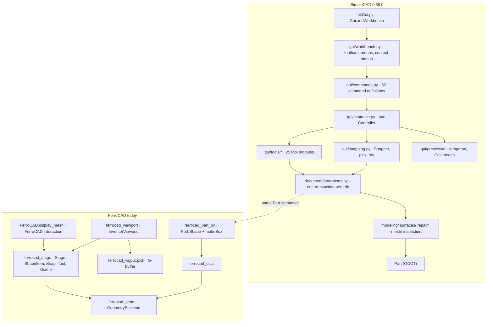

# SimpleCAD bring-up: a canvas-first proving ground

Status: design (2026-10-21).

**Purpose.** Audit SimpleCAD 0.38.0 as FerroCAD's next integration target, test the
hypothesis that it is a better proving ground than `src/Mod/Draft`, map its geometry
and interaction onto what FerroCAD has already built, and give an ordered bring-up
plan **S0–S5**. This is a measurement and a plan; no source file was changed and no
test was executed for it (S1's executed baseline is dated 2026-10-26, §7).

Companion to [`TODO-21-10-2026.md`](../record/TODO-21-10-2026.md) (the measurement stash and
the three open decisions), [`../../developer/workbenches/conformance.md`](../../developer/workbenches/conformance.md) (the upstream harness
this plan extends), [`topology-selection.md`](../../developer/interaction/topology-selection.md) (F0: the
topology, selection and tessellation seam), [`stage.md`](../../developer/viewport/stage.md) (the declarative
presentation stack), [`axis-origin-grid.md`](../../developer/interaction/axis-origin-grid.md) (workplanes,
snapping and grid feedback), [`gizmo-manipulators.md`](../../developer/interaction/gizmo-manipulators.md) (the
manipulator model), [`occt-integration.md`](../../developer/architecture/occt-integration.md) (the kernel seam),
[`python-bindings.md`](../../developer/architecture/python-bindings.md) (the Python facade) and
[`../../developer/workbenches/actions-and-tools.md`](../../developer/workbenches/actions-and-tools.md) (the command and dialog protocol), and
the two decisions written alongside the TODO: [`../../developer/workbenches/qt-strategy.md`](../../developer/workbenches/qt-strategy.md)
(the split plane) and [`part-draft-layering.md`](../../developer/architecture/part-draft-layering.md) (the
`ferrocad_curves` split). This note applies those decisions to SimpleCAD rather than
reopening them.

---

## 0. Provenance and limits

| Item | Value |
| --- | --- |
| FerroCAD revision | `13552db` (2026-10-20), `main`; the working tree additionally holds this note and the untracked design notes (`TODO-21-10-2026.md`, `qt-strategy.md`, `part-draft-layering.md`) |
| SimpleCAD checkout | `../simplecad`, sibling of the git repo, **outside version control** |
| SimpleCAD revision | `9180c4b` — “Release 0.38.0”, 2026-10-20 |
| SimpleCAD history | shallow (`--depth 1`): **1 commit**; release cadence is not measurable from git |
| Upstream FreeCAD checkout | `../freecad-upstream` at `33adf61` (2026-10-14), sparse `src/Mod/{Test,Part,Draft,BIM}`, `src/Ext` |
| Package metadata | `package.xml` 0.38.0, MIT, `freecadmin` 1.1 |
| Test execution | **none at the 2026-10-21 measurement.** S1's executed baseline (2026-10-26) is in §7; every other test number here is a static count of `def test_`, test classes and assertion sites. |
| Network | unavailable; nothing was cloned, fetched or installed |

Counts are over the whole SimpleCAD tree unless a table says `tests/unit` or
`tests/gui`. “Measured” means a command in Appendix A was run against the checkout
above. “Estimate” is labelled wherever it appears.

Two numbers in the brief needed qualification:

- **“156 test files”** is true as *files under `tests/`*: 156 files. Only **154** are
  Python: 88 unit test modules, 1 unit helper (`surface_fixtures.py`), 63 GUI suites
  and 2 benchmarks. The rest are one `README.md` and one `.brep.gz`. There are
  **153 test/benchmark modules**, not 156.
- **“83 mention pivy/coin”** could not be reproduced. Token counts give **39** files
  containing `pivy` or `coin`, **36** importing `pivy.coin`, and **51** distinct
  `So*` class names. The `Part` count of **42** *is* correct once `MeshPart.*` is
  excluded (a naive `\bPart\.` search also matches `MeshPart.meshFromShape` and
  `MeshPart.wireFromSegment`).

---

## 1. Verdict

| Hypothesis | Evidence in the tree | Verdict |
| --- | --- | --- |
| **Sits directly on `Part`** | 180/283 files import `Part`; 0 imports of `Draft`; 1 file imports `PartDesign`; 0 `Sketcher`, 0 `ifcopenshell`, 0 `Arch`/`BIM` | **Supported** |
| **Uses almost no Qt** | Product code has exactly **one** direct `PySide` import (`simplecad/gui/qt.py`), **0** `.ui` files, **11** widget subclasses (9 `QDialog`, 2 `QWidget`) plus **8** `QObject` subclasses and **no** custom `Signal()` definitions. It still uses **58** distinct Qt names through that one seam. | **Supported relative to Draft; overstated as “almost none”** |
| **Canvas-first** | One `Controller`; two Coin event-callback sites; a 1,131-line `Snapper`; pick → snap → preview → commit; 52 command definitions and 25 tool modules, no task-panel workflow | **Supported** |
| **Better proving ground than Draft** | 1,066 headless unit tests vs Draft's 138 (38 GUI); same 42-name `Part` breadth; much smaller Qt surface | **Supported for S0–S4; S5 (GUI) is still a real port** |

The short version: SimpleCAD is a better **first integration** because its headless
half exercises the `Part` kernel and its interaction half exercises picking, hover,
workplanes and push/pull — the things FerroCAD already has. It is not a “no Qt”
target: it still needs a Qt workbench host for its 63 GUI suites, but its Qt is
concentrated behind one import seam and no `.ui` files, which is exactly where a
micro-shim can buy time.

---

## 2. The tree, measured

### 2.1 Size and layout

| Part of the tree | `.py` files | Notes |
| --- | ---: | --- |
| `simplecad/` package | 119 | `gui/` 18, `gui/tools/` 26 (25 modules + `__init__.py`), `gui/previews/` 5, `modeling/` 17, `mesh/` 14, `surfaces/` 9, `document/` 7, `mcp/` 6, `jobs/` 5, `core/` 4, `repair/` 4, `inspection/` 3, package root 1 |
| `tests/` | 154 | 88 unit modules + 1 helper, 63 GUI suites, 2 benchmarks |
| `scripts/` | 8 | workers, MCP stdio server, installers, test runners |
| root | 2 | `Init.py`, `InitGui.py` |
| **Total** | **283** | matches the brief |

Other measured facts:

| Fact | Measured |
| --- | --- |
| `.ui` files | **0** |
| `ViewProvider` references | **0** |
| Custom document objects / Python proxies | **0** (`face_browser.py` only mentions `DocumentObjectItem` in a docstring) |
| `Gui.addWorkbench` calls | 1 (`InitGui.py`) |
| Toolbar/menu command definitions | **52** (`TOOLS` 33 + `SURFACE` 9 + `SMART` 4 + `EXTRAS` 6) |
| GUI tool-session modules | 25 (+ `__init__.py`) in `simplecad/gui/tools/` |
| MCP tools advertised | 46 (the architecture note's “46-tool schemas”), served by `simplecad/mcp/catalog.py` |

`Init.py` is intentionally inert (one docstring). `InitGui.py` imports the workbench
class from a normal module and calls `Gui.addWorkbench(...)`; the architecture note
explains why the class lives outside the loader’s `exec` namespace
(`../simplecad/docs/development/architecture.md` §“Workbench startup and the controller”).

### 2.2 Tests: the unit/GUI split, honestly

| Directory | Files | Test methods | `TestCase` classes | Assertion sites | Shape |
| --- | ---: | ---: | ---: | ---: | --- |
| `tests/unit` | 89 (88 `test_*.py` + `surface_fixtures.py`) | **1,066** | **174** | **4,186** `self.assert*` | `unittest`; 8 `@unittest.skip*` |
| `tests/gui` | 63 | 0 `def test_` | 0 | **1,914** bare `assert` | 63 imperative `run()` scripts, one per suite |
| `tests/benchmarks` | 2 | 0 | 0 | 0 pass/fail | `run()` timing scripts |
| `tests/fixtures` | 0 `.py` | 0 | 0 | 0 | `README.md`, `fitted_surface_loop.brep.gz` |

So the honest split is: **1,066 discoverable unit tests** in a conventional unittest
tree, and **63 GUI scenarios whose pass condition is “`run()` did not raise”**, with
1,914 assertions spread through them. The GUI number is not comparable to the unit
number; do not add them.

Largest unit suites (test methods): `test_geometry.py` 32, `test_surface_line.py` 31,
`test_surface_wrap.py` 29, `test_surface_edit.py` 29, `test_center_snapping.py` 29,
`test_coincident.py` 28, `test_dense_drawing.py` 27, `test_edge_deletion.py` 25.
Surface suites (`test_surface_*.py`, 8 files) total **174** tests; mesh suites
(`test_mesh_*.py`, 16 files) total **136**.

### 2.3 Substrate: what it imports

| Imported module | Files | What it means for FerroCAD |
| --- | ---: | --- |
| `FreeCAD` (`App`) | **217** | facade surface is large but mostly the parts we already have (`Vector`, `Placement`, `Rotation`, `Document`, `Console`, `ParamGet`, observers) |
| `Part` | **180** | the real dependency; 42 distinct names (§4.1) |
| `FreeCADGui` (mentioned) | **111** | 101 import it at module top; the rest reference it in comments/tests |
| `pivy` / `coin` | **39** | 36 import `pivy.coin`; 51 distinct `So*` names |
| `PySide` (mentioned) | **15** | 14 direct imports + 1 comment-only (`gui_mcp.py`); see §6 |
| `numpy` | 37 | no packaging file in FerroCAD installs it; a test-image requirement (runtime unverified) |
| `scipy` | 2 | `surfaces/fit.py`, `modeling/analytic.py`; required only by surface fitting |
| `Mesh` | 35 | FerroCAD has no `Mesh` module |
| `MeshPart` | 13 | `meshFromShape` 12, `wireFromSegment` 2 |

Workbench dependencies, checked one by one:

| Dependency | Hits | Where |
| --- | ---: | --- |
| `Draft` | **0** | searches for `import Draft` and for `from Draft` return nothing |
| `PartDesign` / `Sketcher` | **1** | `simplecad/surfaces/offset.py:248`: `import PartDesign` to register `PartDesign::Draft`; the draft faces tool runs in a worker. `Sketcher`: 0 |
| `ifcopenshell` / `Arch` / `BIM` | **0** | — |
| `Surface` | **1** | `simplecad/surfaces/edit.py:698`: a temporary `Surface::Filling` object for Fill hole |
| `Mesh` object type | **2** | `simplecad/jobs/mesh.py:221,254`: `Mesh::Feature` for edited/split meshes |

This is the strongest form of the “directly on Part” claim: even the hidden
workbench dependencies are single tools in worker processes, not architecture.

### 2.4 The README claims vs the tree

| README says | Tree contains |
| --- | --- |
| “FreeCAD 1.1 or later” | `package.xml` `<freecadmin>1.1</freecadmin>`; `InitGui.py` imports `FreeCADGui` unconditionally |
| “Nothing else to install: FreeCAD’s installers include Python, OpenCascade, Qt, Coin, NumPy and SciPy” | true of an upstream FreeCAD install; **not** true of FerroCAD's bundled CPython, which ships the stdlib and the `FreeCAD`/`Part`/`pivy` facades, and whose packaging files install no NumPy, SciPy or PySide |
| “No custom document objects or saved Python proxies” | **true**: 0 `ViewProvider`, 0 proxy classes, `Part::Feature` everywhere, plus `SC_Support` (`App::PropertyLink`) |
| “Every edit is one Undo step” | `document/operations.py:15` wraps each edit in one `doc.openTransaction`; the tests assert Undo counts |
| “Results are ordinary Part and Mesh objects” | true; `Part::Feature` 16 call sites, `Mesh::Feature` 2, `Surface::Filling` 1, `PartDesign::*` 1 file |
| “Developed and used on macOS; Linux tests; Windows untested” | no Windows-specific code paths found; not exercised here |

### 2.5 Can `tests/unit` run headless under `GuiUp = 0`?

Mostly yes, with named exceptions. Measured across the 88 unit test modules:

| Requirement | Files | Consequence |
| --- | ---: | --- |
| Import `Part` | 69 | the core geometry suites run only once `Part` is wide enough (§4) |
| Import `FreeCAD` | 72 | document creation, `Vector`, `Placement`, `UndoMode` |
| Import `FreeCADGui` **at module top** | **0** | no unit suite requires a window just to import |
| Reach `FreeCADGui` at module import | 2 (`test_idle_work.py`, `test_push_pull_ui.py`) | both import GUI helpers; `test_arrow_planes.py` guards with `skipIf(Controller is None)` |
| Reference a module on the `gui.qt` chain | 18 | needs PySide6 or an import shim (§6); several do so only inside one test or with a stub |
| Import `pivy` | 9 | the app image installs `pivy.coin`; the bare extension does not |
| Import `numpy` | 14 | test-image dependency |
| Import `scipy` | 2 | surface fitting only |
| Import `Mesh` / `MeshPart` | 15 | no module in FerroCAD; expected load errors |
| Call `App.newDocument` | 50 | headless document lifecycle is exercised broadly |
| Create a `QApplication` in `setUpClass` | 1 (`test_push_pull_ui.py:43`) | needs `QT_QPA_PLATFORM=offscreen` or Qt |

**Verdict.** The unit tree is genuinely headless: no module imports `FreeCADGui` at
module scope, and half of it creates documents without a view. It is not
*universally* headless: 18 modules touch Qt, 15 need Mesh, and one constructs a
`QApplication`. S1 counts all 88 and reports the exceptions rather than hiding them.

---

## 3. Architecture in FerroCAD’s terms



| Concern | SimpleCAD | FerroCAD today | Consequence |
| --- | --- | --- | --- |
| **Document objects** | Plain `Part::Feature` (and `Mesh::Feature`); no proxy, no `ViewProvider`; `SC_Support` is an `App::PropertyLink`; `SC_*` properties are dynamic | `ferrocad_part::Part::Feature` with `Shape` + `Placement`; `PropertyLink` and `addProperty` exist; no Mesh | **Close match.** The document layer can run almost unchanged; Mesh/Surface object types are the only document-level gaps. |
| **Undo** | `document/operations.transaction()`: capture materials/locks, `openTransaction`, `settle`, validate, commit; every caller uses it | `ferrocad_core` transactions; `doc.UndoMode` exists; F0.6 proves undo/redo of computed shapes | **Works.** `UndoMode` is a no-op stub, which is enough for SimpleCAD's `if not doc.UndoMode` guard. |
| **Geometry** | Direct `Part` calls from every algorithm package; no kernel seam; `core/geometry.py` is 2,259 lines of shape-level work | `ferrocad_geom` seam + `ferrocad_occt`; 6 core operations plus tessellation/topology | **The gap.** The `Part` surface is 42 names wide; our backend exposes box/fuse/cut/fillet/chamfer/place/resolve/save/load. See §4. |
| **Display** | FreeCAD's built-in Part view provider for the shape; imperative Coin overlays for previews and style; no `ViewProvider` subclass | `FerroCAD.display_mesh(obj)` hook returns a tessellation dict; `ferrocad_stage` compiles `ShapeItem`s; `pivy.coin` is a partial facade | **Structurally close.** The overlays are the mismatch: SimpleCAD mutates a Coin subtree, FerroCAD rebuilds declarative items. |
| **Interaction** | One `Controller` owns the tool, captured document/view, mouse callback, preview and timers; `Snapper` resolves every pointer move; tool sessions in `gui/tools` | `InventorViewport` owns pointer dispatch, `Tool`/`Manipulator`/`TransformGizmo`, `SnapContext`/`SnapCandidate`, `SelectionEvent`/`SelectionRef` | **Same shape, missing adapter.** A `FreeCADGui` view facade over `InventorViewport` is the bring-up trick (§5). |
| **Commands** | `Gui.addCommand` + `SimpleCADWorkbench.Initialize` appends toolbars/menus; 52 commands; enablement in `command_state.py` | `FreeCADGui.addCommand` + an actions bar; no workbench class, no toolbars/menus/context menus | **S5.** The command bodies are portable; the chrome is not. |
| **Tests** | `unittest` headless + `run()` GUI suites inside a real FreeCAD window | conformance harness for unittest files; Xvfb for the window | **S0/S1** reuses the harness model; **S5** needs the window. |

### 3.1 Document objects

The architecture note states the rule plainly: results are ordinary Part and Mesh
objects, “no custom document objects or saved Python proxies”
(`../simplecad/docs/development/architecture.md` §“Package layout”). `document/operations.py`
creates `Part::Feature`, assigns `Shape`, and adds `SC_Support` as an
`App::PropertyLink` only for a profile drawn on a face (`operations.py:81–105`). The
Merge/Slice/Mesh tools create temporary documents (`hidden=True`, `temp=True`) to
use `Part`, `Surface` or `PartDesign` features, then copy the resulting `Shape` back
and close the document.

For FerroCAD this means:

- `Part::Feature` plus `PropertyLink` is enough for the main path.
- The temporary-document idiom works if `App.newDocument(..., hidden=True, temp=True)`
  and `closeDocument` exist; both do.
- `Mesh::Feature` and `Surface::Filling` do **not** exist; those tools are out of the
  Part proving-ground slice.

### 3.2 Geometry

`modeling/`, `surfaces/`, `repair/`, `mesh/` and `inspection/` call `Part` directly.
`core/geometry.py` is the centre of gravity: plane/rectangle/circle/sphere/polygon
construction, face division with lines and profiles, push/pull planning, opposite-face
contact, exact stop and past-face extension, `generalFuse`-based splitting, and
validity/area/volume checks. There is no kernel seam and no backend abstraction.

FerroCAD's rule is the opposite: presentation crates never name OCCT, and the document
core talks to a `dyn GeometryBackend`. The bring-up therefore cannot “load SimpleCAD
and let it call Part” until the `Part` facade is wide enough to be that seam. That is
S2/S3, and it is the critical path for Draft too.

### 3.3 View

There is no view-provider layer. FreeCAD draws `Part::Feature` with its own provider;
SimpleCAD adds transient Coin nodes through `view.getSceneGraph()` and mutates
per-object `ViewObject` properties (`ShapeColor`, `ShapeAppearance`, `LineColor`,
`RootNode`, `DisplayMode`). Under `GuiUp = 0` all of that is guarded by `App.GuiUp`
in the document layer, but a few GUI helpers still dereference `ViewObject`
unconditionally (`gui/pull_snapping.py:27`, `gui/box_selection.py:131`).

The FerroCAD equivalent is `FerroCAD.display_mesh` → `stage_meshes` → `Stage` →
`ShapeItem` (`python/ferrocad_shell/__init__.py:295`,
`python/ferrocad_parametric/__init__.py:32`). It already maps `Tessellation.parts`
to `ShapeItem::part_names`, which is what a pick needs. A `ViewProvider` is not
required; the hook is the seam.

### 3.4 Interaction

`gui/controller.py` (1,670 lines) is one `QtCore.QObject` singleton. It owns the
active tool, the captured `doc`/`view`, the preview, the snapshots, three timers, and
the event filter. `activate()` installs an application event filter and a status-bar
widget; `start(tool)` validates the selection with `command_state.reason`; `click`,
`motion`, `hover`, `numeric`, `commit` and `cancel` drive the tool. `coin_event`
(controller.py:801) is the only bridge from Coin to the controller: it translates
`SoMouseButtonEvent`/`SoLocation2Event` into `click`/`motion`, and calls
`callback.setHandled()` so FreeCAD's navigation style does not also act.

`Snapper` (`gui/snapping.py:608`) is the canvas brain: index edges, vertices, face
centres and circle centres; project them to screen; filter occluded candidates;
distinguish endpoint/midpoint/centre/on-edge/axis; infer world axes within a narrow
screen cone; and keep a screen-space point grid. `pick()` (snapping.py:94) turns
`getObjectsInfo` hits into `(object, subshape, point, name)`, preferring `SC_Support`
profiles and filtering hidden elements.

FerroCAD has the same decomposition: pointer → pick → snap → tool → commit, but with
declarative stage items and neutral `SelectionRef`s. The mapping is in §5.

### 3.5 Commands and undo

`gui/commands.py` defines 52 commands, `gui/workbench.py` appends five toolbars and
menus, and `command_state.py` computes enablement from the selection. `Gui.runCommand`
is used only for `Std_Copy`/`Std_Paste` in product code; the other 29 occurrences are
tests. Every edit goes through `document/operations.transaction()`; previews never
reach the document.

FerroCAD's `FreeCADGui.addCommand`/`runCommand` registry and the shell's actions bar
cover the command half. There is no workbench class, toolbar API or context menu yet;
that is S5.

---

## 4. Geometry: what the tests exercise, and what we have

### 4.1 The `Part` surface is 42 names

Measured over all 283 files, excluding the `MeshPart.*` prefix:

| Group | Names and occurrences |
| --- | --- |
| Primitives | `makeBox` 442, `makeCylinder` 183, `makeSphere` 39, `makeCone` 6, `makeTorus` 4 |
| Profiles and faces | `Face` 183, `makePlane` 139, `makeLine` 139, `makePolygon` 93, `makeCircle` 50, `makeShell` 57, `makeSolid` 26, `makeFace` 9, `makeLoft` 1, `makeFilledFace` 1, `makeWireString` 1, `makeCompound` 186 |
| Curve/surface classes | `Plane` 125, `Circle` 94, `Cylinder` 84, `Wire` 76, `Vertex` 65, `Line` 37, `Sphere` 17, `Ellipse` 15, `Shell` 14, `BSplineSurface` 14, `Arc` 11, `ArcOfCircle` 6, `Solid` 6, `Cone` 6, `Compound` 6, `Geom2d` 4, `LineSegment` 3, `Edge` 2, `BSplineCurve` 2, `Toroid` 1, `ShapeFix` 1 |
| `Shape` and helpers | `Shape` 24, `OCCError` 86, `sortEdges` 6, `__sortEdges__` 7 |

The **42-name breadth is identical to Draft's 42**, but the distribution is not:
Draft's top names are `LineSegment` 93, `Wire` 87, `OCCError` 58, `Shape`/`Face` 56;
SimpleCAD's are `makeBox` 442, `makeCompound` 186, `Face` 183. Draft builds shapes and
wires; SimpleCAD *edits* whole solids and faces. That difference favours SimpleCAD as
a kernel proving ground: it exercises booleans, push/pull, extrusion and whole-solid
queries rather than 2D wire assembly.

### 4.2 Shape-level surface

These are member accesses and calls on a shape value, not on the `Part` module.
Counts are textual occurrences over `simplecad/` and `tests/unit`; they show what a
`Part.Shape` must answer.

| Member | Occurrences | Member | Occurrences |
| --- | ---: | --- | ---: |
| `.Faces` | 1,159 | `.Volume` | 614 |
| `.Area` | 510 | `.Length` | 492 |
| `.Edges` | 480 | `.Solids` | 399 |
| `.CenterOfMass` | 343 | `.Surface` | 283 |
| `.Placement` | 272 | `.copy()` | 216 |
| `.isSame()` | 248 | `.Vertexes` | 241 |
| `.BoundBox` | 181 | `.isClosed()` | 177 |
| `.cut()` | 166 | `.Curve` | 139 |
| `.ShapeType` | 159 | `.isValid()` | 397 |
| `.common()` | 85 | `.Wires` | 82 |
| `.extrude()` | 75 | `.fuse()` | 26 |
| `.generalFuse()` | 19 | `.removeSplitter()` | 18 |
| `.makeFillet()` | 13 | `.makeChamfer()` | 2 |
| `.makeOffsetShape()` | 4 | `.makeThickness()` | 1 |

Unit tests alone make the priority clear: `makeBox` 357, `makeCylinder` 153,
`makePlane` 123, `makeLine` 112, `Face` 92, `makeCompound` 82, `makePolygon` 65;
`Faces` 780, `Volume` 462, `Area` 351, `cut` 140, `copy` 95, `extrude` 60.

### 4.3 Gap table

This table is the **2026-10-21 audit snapshot** that motivated S2–S5. It is kept as
provenance, not as a status report: most of the rows below have since been closed, and
the current state is the measured baseline in §7 (2026-10-27: 88/88 modules load,
**966 passed / 64 failed / 29 errored / 2 skipped**, with the remaining errors bucketed
there). Read the `Status` column as history.

Status vocabulary: **exists** (Python and kernel), **partial** (kernel and/or Python
but not the upstream shape), **missing** (neither). Slices are defined in §7.

| # | Operation | Upstream `Part` API | FerroCAD today | Status | Slice |
| ---: | --- | --- | --- | --- | --- |
| 1 | Box primitive | `Part.makeBox` | `Part.makeBox` → `ferrocad_part::make_box` → OCCT; tessellation with part names | **exists** | — |
| 2 | Planar profiles | `makePlane`, `makePolygon`, `makeLine`, `Face(Wire)` | none | **missing** | S2.1 |
| 3 | Wire/edge/vertex | `Wire`, `Edge`, `Vertex`, `Line`, `sortEdges`, `__sortEdges__` | none | **missing** | S2.1 |
| 4 | Assembly | `makeCompound`, `makeShell`, `makeSolid`, `Compound`, `Shell`, `Solid` | none | **missing** | S2.1 |
| 5 | Shape queries | `.Faces/.Edges/.Vertexes/.Wires/.Shells/.Solids`, `.ShapeType`, `.isValid`, `.Volume`, `.Area`, `.Length`, `.BoundBox`, `.CenterOfMass` | `Shape` is opaque: `isNull`, `isSame`, `mesh`, BRep export; no measurement or accessors | **missing** | S2.1 |
| 6 | Copy / placement | `Shape.copy()`, `Shape.Placement`, `transformShape` | backend `place` (rigid) exists; `Part.Shape` has no `Placement` and no `copy` | **partial** | S2.1 |
| 7 | Booleans | `.fuse`, `.cut`, `.common`, `.multiFuse`, `.generalFuse` | backend `fuse`/`cut`; `common`/`generalFuse`/`multiFuse` absent; Python shape methods absent | **partial** | S2.2 |
| 8 | Extrude / push-pull | `Face.extrude`, `Shape.extrude` | absent; no `BRepPrimAPI_MakePrism` binding | **missing** | S2.2 |
| 9 | Refine | `.removeSplitter()` | absent | **missing** | S2.2 |
| 10 | Curved primitives | `makeCylinder`, `makeSphere`, `makeCone`, `makeTorus` | absent | **missing** | S3.1 |
| 11 | Curve/surface types | `Plane`, `Circle`, `Arc`, `ArcOfCircle`, `Ellipse`, `LineSegment`, `BSplineCurve`, `BSplineSurface`, `Cylinder`, `Sphere`, `Cone`, `Toroid`, `Geom2d` | absent; no type identity for `isinstance(face.Surface, Part.Plane)` | **missing** | S3.1 |
| 12 | Fillet/chamfer | `.makeFillet`, `.makeChamfer` | backend fillet/chamfer with lineage; `Part::Fillet`/`Part::Chamfer` features; no Python shape method | **partial** | S3.2 |
| 13 | Offset/shell/thicken | `.makeOffsetShape`, `.makeOffset2D`, `.makeThickness`, `makeShell` | absent | **missing** | S3.2 |
| 14 | Loft/sweep | `makeLoft`, `.loft`, `.sweep`, `makePipeShell` | absent | **missing** | S3.3 |
| 15 | BRep persistence | `Shape()`, `.read`, `.write`, `.exportBrep` | backend `save_shape`/`load_shape`; Python `exportBrep`, `exportBrepToString`; no `read`/`write` | **partial** | S2.1 |
| 16 | Tessellation | `.tessellate`, `MeshPart.meshFromShape` | `Shape.mesh()` (FerroCAD extension) and `tessellate`; no `MeshPart` | **partial** | S3.4 |
| 17 | Errors | `Part.OCCError` | absent; kernel errors surface as `RuntimeError` | **missing** | S2.1 |
| 18 | Name resolution | `.getElement`, `.getSubShape` | both accessors exist; `getSubShape` resolves through the lineage (positional fallback), `getElement` is positional-only | **done** | — |

Two rows deserve emphasis:

- **`Part.OCCError` (86 references).** It is not cosmetic: the code writes
  `except (AttributeError, Part.OCCError, RuntimeError, ValueError)`. If
  `Part.OCCError` is absent, evaluating that tuple *while handling a geometry error*
  raises `AttributeError`, converting a handled failure into a crash. S2.1 must add
  it as the exception class the kernel actually raises.
- **`Shape.Placement` (272 references).** FreeCAD shapes carry a placement that is
  not baked into the geometry; SimpleCAD relies on `copy(); shape.Placement = ...`
  to work locally, and even compares `obj.Shape.Placement.isSame(obj.Placement)`
  (`document/operations.py:50`). FerroCAD's `place` bakes the transform and the
  handle has no placement. This is a *semantic* decision, not a binding detail: keep
  a placement on the Python `Shape` handle and apply it lazily, or bake and lose the
  `isSame` comparison. The recommendation is the former.

### 4.4 What the first run will hit, in order

The **2026-10-21 prediction** of the first-run blockers, kept with §4.3 as provenance;
the measured order and counts are in §7.

| Family | Unit files | Test methods | First blocker |
| --- | ---: | ---: | --- |
| Draw, pull, profiles | `test_geometry`, `test_dense_drawing`, `test_dense_pull`, `test_line_regions`, `test_circle_regions`, `test_pull_contact`, `test_pull_references`, `test_push_pull_ui` | **137** (measured) | `Part.Plane/Face/Wire/Vertex`, `.Faces/.Edges`, `.extrude` |
| Surface tools | 8 `test_surface_*.py` | **174** | `Part.BSplineSurface`, `.Surface`, `.Curve`, `generalFuse`, `makeOffsetShape` |
| Mesh tools | 16 `test_mesh_*.py` | **136** | `import Mesh` / `MeshPart` — no module at all |
| Booleans and edits | `test_union`, `test_intersection`, `test_joints`, `test_edge_deletion`, `test_slicing`, `test_rounding` | 16 + 17 + 25 + 20 + … | `.common`, `.generalFuse`, `.removeSplitter`, `.makeFillet` |
| Snapping and UI | `test_center_snapping`, `test_edge_snapping`, `test_face_click_snap`, `test_pick`, `test_selection` | 29 + … | `getObjectsInfo`-shaped view; otherwise pure Python and runnable early |

The draw/pull family and the surface family are the two biggest coherent blocks
(311 tests together); the mesh block (136) is a separate subsystem and should not
gate the proving ground.

**Measured 2026-10-27:** `Mesh`/`MeshPart` now load; the mesh family is 116 passed /
1 failed / 19 errored (85.3%), and its remaining blockers are Part-surface members.
The `First blocker` column is the pre-S1 analysis; the 2026-10-27 measured blockers are
in the S2–S3 baseline below.

---

## 5. Interaction: upstream call by call

### 5.1 The viewport calls

| SimpleCAD site | What it needs | FerroCAD equivalent | Verdict |
| --- | --- | --- | --- |
| `view.getObjectsInfo(pos)` — `gui/snapping.py:84` | an **ordered list** of hits, each with `Document`, `Object`, `Component` (`Face6`), `x/y/z`; occlusion order and boundary priority | `InventorViewport::pick` returns **one** `Hit { id, part, point, normal }`; the G-buffer resolves a pixel, the CPU path a primitive; `hovered_selection()` names the part | **partial — top hit only** |
| `view.getObjectInfo(pos)` — 5 sites | the first hit with the same fields | same as above | **partial** |
| `view.getPointOnScreen(point)` — 26 sites | world → screen pixels | `ferrocad_stage::screen::project_device` | **exists** |
| `ray(view, pos)` — `snapping.py:25` | screen → world ray via `getCameraNode().getViewVolume().projectPointToLine` | `ferrocad_graphics::Camera::ray_through` / `pick_at_hit`; `Workplane::ray_local` | **exists** |
| `view.getViewDirection()` | camera forward | `ferrocad_stage::screen::camera_forward` | **exists** |
| `view.getCameraNode().getField(...)` — `camera_state` | camera type, pose, zoom, viewport | `ferrocad_graphics::Camera` fields | **exists (different API)** |
| `view.addEventCallbackPivy(SoEvent, cb)` — `controller.py:656`; `SoMouseButtonEvent` in `gui/tools/slice.py:146` | pointer callback while a tool is active | `InventorViewport::handle_pointer` / `handle_button` + `Tool::on_event` | **exists (different API)** |
| `view.removeEventCallbackPivy(...)` — `controller.py:217` | teardown | `set_tool(None)` / tool slot | **exists** |
| `Gui.Selection.getSelectionEx()` — 41 sites; `addSelection` 108; `clearSelection` 172; `setPreselection` 8 | selection state, sub-element names, picked points | `FreeCADGui.Selection` is a **read-only snapshot**; the shell owns selection; `SelectionEvent`/`SelectionRef` carry `(object, ["Face6"])` | **partial** |
| `Gui.updateGui()` — 149 sites | force a redraw after a preview change | the gpui shell repaints (`cx.notify`); no Python-visible `updateGui` | **missing (adapter needed)** |
| `Gui.activeDocument().activeView()` — 104 sites | the current 3D view | no document/view registry; the shell owns one `InventorViewport` | **missing (adapter needed)** |
| `Gui.getMainWindow().statusBar()` — 67 sites | messages and the `Controls` widget | gpui status bar; no Python API | **missing (S5)** |
| `Gui.activateWorkbench(...)` — 91 sites | switch workbench | the edition is one module; no workbench switch | **missing (S5, by design)** |
| `Gui.runCommand(...)` — 31 sites (2 product: `Std_Copy`, `Std_Paste`) | invoke another command | `FreeCADGui.runCommand` registry | **exists** |
| `QApplication.installEventFilter(self)` — `controller.py:144` | Tab/Enter/Esc/shortcut handling | gpui key dispatch / `InventorViewport::handle_key` | **partial** |

Two calls from the brief are deliberately absent: `Gui.Control(...)` has **0**
occurrences (there are no custom C++ widgets), and Draft's `Gui.Snapper`,
`Gui.InputHint` and `Gui.UserInput` have **0** occurrences — SimpleCAD carries its own
`Snapper` and resolves hints in Python. That is why its `FreeCADGui` surface is much
smaller than Draft's.

### 5.2 Picking and snapping

`pick()` (snapping.py:94) is not just “the top hit”. It sorts candidates so an
`SC_Support` profile wins over its host, filters `visibility.element_visible`, treats
a hit list as an occlusion stack, and has a `prefer_boundary` mode that picks the
front-most vertex/edge/face at that depth. FerroCAD's G-buffer returns the front-most
pixel result and the part id; it has no list to sort and no `SC_Support` priority.
S4 must either add a ranked pick API (a small list from the CPU path or a priority
tag in the pick pass) or accept the top hit and compensate in the tool. Do not
silently equate the two.

`Snapper` resolves in this order: exact feature points (endpoint, midpoint, face
centre, circle centre) → on-edge → world-axis inference → picked face → plane → grid.
FerroCAD's `SnapKind` covers `Point`, `Grid`, `Vertex`, `EdgeMid`, `Centre`, `Origin`
(`crates/ferrocad_stage/src/snap.rs`). Missing: circle centre, “on edge”, world-axis
inference (`Snapper.line_axis`, `axis_point`), the radius magnet (`_refine`), the
screen-space point grid, and exact projection onto the kernel surface. The last one is
already a documented F0 non-goal (“no exact intersector … `IntCurvesFace_ShapeIntersector`
later”, `docs/developer/interaction/topology-selection.md` §11), so the port inherits a known precision gap;
`on_face()` in SimpleCAD exists precisely because the view reports single-precision
picks.

The **face workplane** is the best-matched piece. SimpleCAD's `Plane.from_face(face)`
and `Snapper.face_plane` become FerroCAD's `FaceFrame::resolve` over the stage
tessellation (`crates/ferrocad_stage/src/workplane.rs:121`) plus `Workplane`. Both
reject curved faces. The difference is provenance: SimpleCAD reads `Part.Plane` from
the kernel; FerroCAD fits the display triangles. For planar faces the results agree to
tessellation precision; for a nearly planar face they can differ. S4 should resolve
the workplane from the kernel through the new S2 query surface when precision matters.

### 5.3 Push/pull

The upstream flow is:

1. `click` → `pick(..., face_only=True)` → `(obj, face, anchor, name)`.
2. `extrusion_normal` → the face normal; `extrusion_contact` → the opposite face’s
   exact distance (`OppositeFace`).
3. `pull_drag(view, pos, anchor, normal, down_pos, step)` → a signed distance from the
   screen-space projection of the normal, with a face-on fallback scale.
4. `snap_pull` captures the opposite-face distance while the pointer is within the
   snap radius, and releases it beyond.
5. A Coin preview shows the prism; `commit` calls `document.operations.extrude`, which
   calls `core.geometry.push_pull` / `plan_push_pull`: `face.extrude`, `fuse` or `cut`,
   `removeSplitter`, validity/area/volume checks, and a single transaction.

FerroCAD has the **math** (`TransformGizmo`’s axis projection, `screen::scale_for`)
and, since 2026-10-26, a **push/pull manipulator**
(`ferrocad_part_gui::PushPullStem`) plus a parametric hook that builds
`Part::Extrusion` and one `Part::Fuse`/`Part::Cut` in a transaction. It has no
`Face.extrude` on the SimpleCAD shape API and no in-progress solid preview. S2.2
supplies `extrude`; S4 supplies SimpleCAD's own pull session and preview. The
exact-volume acceptance already exists in `tests/gui/gui_smoke.py`: a 40 × 30
rectangle becomes area 1200, then a 20 mm pull becomes volume 24000.

### 5.4 What each FerroCAD capability corresponds to

| FerroCAD file / document | Capability | SimpleCAD counterpart | Status |
| --- | --- | --- | --- |
| `ferrocad_stage/src/grid.rs` | world/workplane grid, adaptive steps, triad | `gui/viewport_style.py` ground grid and axes; `Snapper` grid points | **partial** — geometry exists; the visual style and per-face grid timing are different |
| `ferrocad_stage/src/snap.rs` | `SnapKind`/`SnapCandidate`, feature-over-grid | `Snapper.snap`, `nearby_points`, `endpoint_hint`, `midpoint_hint`, `center_hint` | **partial** — vertex/midpoint/centre/origin/grid; missing circle centre, on-edge, axis inference, radius magnet |
| `ferrocad_stage/src/workplane.rs` | `Workplane`, `FaceFrame::resolve` | `core.geometry.Plane`, `Snapper.face_plane`, `Controller.drawing_plane` | **partial** — fitted from the tessellation rather than `Part.Plane` |
| `ferrocad_stage/src/input.rs` | `PointerEvent`, `PointerKind`, `MouseButton` | `coin_event`’s `SoMouseButtonEvent`/`SoLocation2Event` payload | **exists** — a structured replacement |
| `ferrocad_stage/src/tool.rs` | `Tool` trait, transient items, stable identities | `gui/tools/*` sessions and `Controller`’s tool state machine | **exists (different API)** |
| `ferrocad_stage/src/interaction.rs` | `InteractionCommit`, `Manipulator` | `document/operations.commit*` plus each tool’s `commit()` | **partial** — the commit is neutral data, but the Python side has no `Manipulator` seam |
| `ferrocad_stage/src/gizmo.rs` | axis/plane/ring drag, projection, screen scale | Move/Rotate/Scale sessions; `axis_point`/`pull_drag` math | **partial** — transform gizmo and the Part push/pull stem exist (2026-10-26); no SimpleCAD-style pull session or solid preview |
| `ferrocad_viewport::InventorViewport` | pick, hover, selection, tool dispatch | `Gui.activeDocument().activeView()` plus `getObjectsInfo`/`addEventCallbackPivy` | **missing adapter** |
| `ferrocad_wgpu::pick` | G-buffer `[entity, part]` pick | `view.getObjectsInfo` (ordered list) / `getObjectInfo` | **partial** — top hit only |
| `docs/developer/interaction/topology-selection.md` F0 | `SelectionRef { object, elements }`, part names | `Gui.Selection` plus `Component` (`Face6`) | **partial** — selection is a read-only snapshot |

### 5.5 Selection and previews

`Gui.Selection` is the state SimpleCAD reads and writes; the `SelectionObject` shape
matters (`item.Object`, `item.SubElementNames`, `item.PickedPoints`, `item.ObjectName`
— see `controller.py:353–397`, `mcp/api.py:373`, `display.py:212`). FerroCAD’s
`_Selection` returns `(object, elements)` tuples and has no `.Object`,
`.SubElementNames` or `.PickedPoints`. S4 must add the object shape, `addSelection`,
`removeSelection`, `clearSelection`, `setPreselection` and `getPreselection`; the
snapshot direction (shell → facade) is already built.

Previews are imperative Coin subtrees: `gui/previews/overlay.py` alone uses
`SoSeparator`, `SoDepthBuffer`, `SoText2`, `SoCoordinate3`, `SoBaseColor`,
`SoTranslation`, `SoSwitch`, `SoLineSet`, `SoDrawStyle`, `SoPointSet`, `SoPickStyle`,
`SoLightModel`; `shaded.py` adds `SoPolygonOffset`, `SoMaterial`, `SoFaceSet`. FerroCAD
has none of the line/point/text/draw-style nodes in `ferrocad_inventor_py` (its
constructible set is `SoSeparator`, `SoSwitch`, `SoCoordinate3`, `SoNormal`,
`SoMaterial`, `SoTransform`, `SoIndexedFaceSet`, `SoIndexedLineSet`,
`SoEventCallback`). The tree's most frequent Coin nodes are `SoSeparator` 49,
`SoCoordinate3` 24, `SoDepthBuffer` 22, `SoPickStyle`/`SoLightModel`/`SoDrawStyle`
18 each, `SoBaseColor` 17, `SoMaterialBinding` 15, `SoMouseButtonEvent`/`SoMaterial`
14, `SoLineSet` 13 and `SoText2` 10 (51 distinct `So*` names). **Do not extend Coin
to match.** The previews are transient, unpickable visuals — exactly what
`ferrocad_stage::ShapeItem` with `selectable(false)` and
`DrawMode::{Wireframe, ShadedWithEdges}` is for. Port the
`Preview` API to stage items. The one real gap is **3-D text** (`SoText2` labels for
lengths and dimensions); stage has no text primitive, so either add one to the stage
or keep the readout in the status bar.

---

## 6. The 15 PySide files

Fifteen files contain the token `PySide`: **14 import it** (12 GUI tests plus 2
infrastructure files) and `tests/gui/gui_mcp.py` only mentions it in a comment while
importing `simplecad.gui.qt` like the rest.

| File | Role | What it needs | Shim or port? |
| --- | --- | --- | --- |
| `simplecad/gui/qt.py` | **the product’s only Qt import seam** (32 product modules import it; 90 import sites tree-wide, tests included) | `QtCore`, `QtGui`, `QtWidgets`; tries `PySide`, then `PySide6`, then `PySide2` | **Micro-shim suffices for import.** Behaviour needs the real classes. |
| `scripts/run_gui_tests.py` | GUI test runner | hard `from PySide import QtCore, QtWidgets`; `QApplication`, `QTimer`, active window | **Replace** with the FerroCAD Xvfb runner; not product code |
| `tests/gui/gui_appearance.py` | GUI suite | `QtTest` (fallback) | **Port/skip**; it drives real widgets |
| `tests/gui/gui_face_browser.py` | GUI suite | `QtTest`, `QTreeWidget` | **Port/skip** |
| `tests/gui/gui_hover_appearance.py` | GUI suite | `QtTest` | **Port/skip** |
| `tests/gui/gui_locking.py` | GUI suite | `QtTest` | **Port/skip** |
| `tests/gui/gui_material_mapping.py` | GUI suite | `QtTest` | **Port/skip** |
| `tests/gui/gui_mcp.py` | GUI suite | comment-only `PySide` mention; imports `gui.qt` for `QApplication`/clipboard | **Port/skip** |
| `tests/gui/gui_mesh_region.py` | GUI suite | `QtTest`; Qt event filter + `QMdiArea` | **Port/skip; highest GUI risk** |
| `tests/gui/gui_pull_see_through.py` | GUI suite | `QtTest` | **Port/skip** |
| `tests/gui/gui_saved_ring_lines.py` | GUI suite | `QtTest` | **Port/skip** |
| `tests/gui/gui_surface_tools.py` | GUI suite | **hard** `from PySide import QtCore, QtWidgets`; live-preview dialogs | **Port/skip; the hard import is a D0 item** |
| `tests/gui/gui_union.py` | GUI suite | `QtTest` | **Port/skip** |
| `tests/gui/gui_viewport_style.py` | GUI suite | `QtTest` | **Port/skip** |
| `tests/gui/gui_visibility.py` | GUI suite | `QtTest` | **Port/skip** |

**Micro-shim assessment.** The frame is [`../../developer/workbenches/qt-strategy.md`](../../developer/workbenches/qt-strategy.md)’s
recommendation D — the split plane: keep the native spatial reference, load `.ui`
declaratively, and shim the widget subset. SimpleCAD has **no `.ui` files**, so the
`.ui` loader is not on its path; the native spatial reference is the
`ferrocad_stage` grid/snap/workplane already mapped in §5. What remains is the
**micro-shim** for code-built widgets. A `PySide` alias over the host’s PySide6 (the
D0 fix in [`TODO-21-10-2026.md`](../record/TODO-21-10-2026.md) §3) is enough to make every import
in the first column resolve, including the two hard `from PySide` imports. It is **not**
enough to run the GUI suites, and it is not enough for any code path that constructs
a widget: the product uses 36 `QtWidgets` classes, 15 `QtCore` and 7 `QtGui` names,
with 9 `QDialog` subclasses, 2 `QWidget` subclasses (`Controls`, `JointControls`)
and 8 `QObject` subclasses (`Controller`, `FaceBrowser`, `DragSelection`,
`SeamDisplay`, `ViewportStyle`, `Bridge`, `Job`, `PanelAnchor`). Those are real
widgets, not import stubs.

The sensible split is:

- **Import-only shim** for S1: let the **18** unit files that statically reach
  `gui.qt` (directly or through `mcp.api`/`face_browser`/`tools`) load, so the Part
  baseline is not blocked on Qt. Several import it only inside one test.
- **Shim the stock dialogs; port the ones a shim cannot carry** for S5. The shell
  already hosts typed modal dialogs (`docs/developer/workbenches/actions-and-tools.md` §6), so a `QDialog`
  that only reads fields and returns them can become a `DialogSpec`. The exception is
  live-preview dialogs (`PreviewDialog` in `gui/tools/surface.py:117`, which re-renders
  on `valueChanged` via a timer): the shell’s protocol is one modal at a time and has
  no live `on_change` callback. S5 needs a modeless preview mechanism (a
  `view`/`preview` request, or a manipulator) before those tools can move.
- **Do not shim `QtTest`.** A no-op `qWait`/`mouseClick` would make 63 GUI suites
  pass vacuously. They must run against a real window or be explicitly skipped.

---

## 7. Bring-up plan S0–S5

The order is deliberately **measure first, then the shared kernel, then the canvas,
then Qt**. S0 and S1 are cheap and reduce uncertainty; S2/S3 are the largest shared
dependency and unblock Draft as well; S4 is the closest match to what we already
built; S5 is the known-expensive port and is gated on implementing the
[`../../developer/workbenches/qt-strategy.md`](../../developer/workbenches/qt-strategy.md) split plane.

| Slice | Deliverable | Acceptance | Risk | Depends on |
| --- | --- | --- | --- | --- |
| **S0** | Audit + conformance hook | `--simplecad` group lists and runs; static audit; no checkout committed; CI optional/skipped | **low** | — |
| **S1** | Headless unit-test baseline | all 88 unit modules attempted; every outcome classified; no harness crash; baseline recorded | **low–medium** (environment) | S0 |
| **S2** | `Part` planar/topology slice | construction, queries, booleans, extrude, persistence; the draw/pull and boolean suites execute | **high** | S1 |
| **S3** | `Part` curved/dress-up slice | cylinders/spheres/cones/tori, curve/surface types, offset/thickness, fillet/chamfer, loft/sweep | **high** | S2 |
| **S4** | Interaction parity | view adapter, ranked pick, snapping, push/pull manipulator, selection object | **medium–high** | S2 |
| **S5** | GUI workbench | qt-strategy split plane, commands/toolbars, previews on stage, GUI suites under Xvfb | **very high** | S3, S4 |

### S0 — Audit and CI hook (pure measurement)

Deliverables:

- Add a `simplecad` group to `tools/conformance.py`, alongside the `App` default
  group and `--part` (`docs/developer/workbenches/conformance.md` §1, `tools/conformance.py:40,224`).
  The group’s source is `<SIMPLECAD_DIR>/tests/unit/test_*.py`, not a subtree of
  `freecad-upstream`; the harness needs a group descriptor that carries **two path
  roots** instead of assuming `--root`.
- `--list --simplecad` prints the 88 unit stems; `--simplecad` prints the same
  `pass/fail/error/skip/load-error` report.
- A static audit records: 283 `.py`, 42 `Part` names, 0 `.ui`, 0 `Draft` imports, 1
  `PartDesign` file, 0 `ViewProvider`, 156 files under `tests/`. It is a drift alarm,
  not a gate on upstream content.
- CI: the `geometry` job may run it **only** when the checkout exists; normal PR CI
  stays hermetic, exactly as `part_conformance` self-skips without
  `FERROCAD_UPSTREAM` (`docs/developer/workbenches/conformance.md` §5). A scheduled/dispatch job can clone
  the pinned revision.

Acceptance:

- `python3 tools/conformance.py --simplecad --list` → 88 stems.
- `python3 tools/conformance.py --simplecad` → a summary line and zero harness
  exceptions; unset checkout → a skip message, exit 0.
- `git -C ../simplecad status --porcelain` is empty afterwards (the harness never
  edits the checkout).
- The revision (`9180c4b`, 0.38.0) is recorded with every report, as `conformance.md`
  already requires for `freecad-upstream`.

**S0 landed (2026-10-24).** `tools/conformance.py --simplecad` lists and runs the
88 `tests/unit/test_*.py` stems and self-skips without the checkout;
`tools/simplecad_audit.py --check` compares the checkout with
[`contracts/simplecad.json`](../../../contracts/simplecad.json) (283 `.py`, 42 `Part`
names, 0 `.ui`, 0 `Draft` imports, 1 `PartDesign` file, 0 `ViewProvider`, 156 files
under `tests/`). The `geometry` CI job runs the audit only when a sibling
`../simplecad` exists. The report itself and its baseline belong to S1.

### S1 — Headless unit baseline

Run the 88 `tests/unit` modules **unchanged** against the FerroCAD image that links
`FreeCAD` + `Part` (+ `pivy`), the way `crates/ferrocad_part_py/tests/part_conformance.rs`
runs the Part group in-process. The standalone `python/ferrocad.abi3.so` is not
enough: `import Part` and `import FreeCAD` must share one core, and `pivy.coin` is
installed by the app image (`ferrocad_gpui::python::bootstrap`), not by the bare
extension.

Environment requirements:

- `numpy` (14 unit files reference it; 12 import it at module level); `scipy` (2 modules, and 2 unit files; only the surface-fitting tests need it).
- `PySide6` **or** a test-only `gui.qt` import stub for the **18** unit files that
  reference a module on the `gui.qt` chain (`mcp.api`/`face_browser`/`tools`);
  several do so only inside one test or with a stub.
- No `Mesh`/`MeshPart`: **15** unit files import one of them and will report a load
  error naming the missing module. That is the correct signal, not a harness failure.
- `FreeCAD.GuiUp = 0` (the facade already sets it); `obj.ViewObject` is not
  guaranteed, so a few GUI helpers (`pull_snapping`, `box_selection`) will error if a
  test calls them. Report, do not patch upstream.

Acceptance:

- All 88 modules attempted; 0 uncaught harness exceptions; every module ends in
  `pass`, `fail`, `error`, `skip` or `load error`.
- The report is recorded with the SimpleCAD revision and the FerroCAD revision; it
  has **no pass threshold**. This is the same contract as the existing conformance
  harness: a measurement, not a gate.
- Exclusions are explicit and counted as `skip` with a reason (for example
  `test_push_pull_ui.py` if Qt is absent). Nothing is silently dropped.
- A cargo test (`ferrocad_parametric` or a dedicated harness test) self-skips when
  `FERROCAD_SIMPLECAD` is unset, mirroring `FERROCAD_UPSTREAM`.
- No file under `../simplecad` is modified.

#### S1 baseline — 2026-10-26, the Part + Mesh image

Measured **in the application image** rather than the bare extension: the
`simplecad_conformance` Rust test boots `ferrocad`, `Part`, `Mesh` and `MeshPart`
as built-in modules in one process and runs `tools/conformance.py --simplecad`
in-process (the same pattern as `part_conformance`). That is the image that
matters: `import Part`, `import Mesh` and `import FreeCAD` see one core.

| Item | Value |
| --- | --- |
| Command | `FERROCAD_SIMPLECAD=$PWD/../simplecad cargo test -p ferrocad_part_py --test simplecad_conformance -- --nocapture` |
| SimpleCAD | `9180c4b` — 0.38.0 |
| Modules attempted | **88** |
| Modules loaded | **88** |
| Load errors | **0** |
| Test outcomes | **405 passed, 43 failed, 635 errored, 2 skipped** (fourth round; the sixth-round packaged baseline is **504 / 63 / 507 / 2**) |
| Harness exceptions | **0** |

The ten `Mesh` modules now load and run:

| Module | pass | fail | error |
| --- | ---: | ---: | ---: |
| `test_analytic` | 2 | 0 | 12 |
| `test_clipboard` | 4 | 0 | 1 |
| `test_idle_work` | 8 | 1 | 6 |
| `test_mesh_conversion` | 2 | 0 | 8 |
| `test_mesh_glue` | 4 | 0 | 2 |
| `test_mesh_slicing` | 3 | 1 | 3 |
| `test_mesh_stretch` | 5 | 0 | 0 |
| `test_mesh_surfaces` | 1 | 0 | 6 |
| `test_precision` | 6 | 0 | 5 |
| `test_surface_wrap` | 5 | 0 | 24 |

What loads but still errors is **per-test API**, not a module boundary. The last two
slices closed the largest seam: `Shape.Faces`/`Wires` return typed `Part.Face`/
`Part.Wire` wrappers (so `Faces[0].valueAt` and `Surface` work), `childShapes()`
is one topological level (`TopoDS_Iterator` semantics), and `Face.Surface` now
returns `Part.Plane`/`Part.Cylinder`/`Part.Sphere` with a `parameter(point)` that
round-trips through `valueAt`; `normalAt` is analytic for those three. The
dominant remaining gaps are now: **`Part.Solid`/`Part.Shell` classes** (so
`Solids`/`Shells` stay plain handles), exact compound enumeration
(`Shape.Compounds`, nested compounds, member order), null-shape getters
returning `[]` instead of raising, `sewShape`, `discretize`, `derivative1At`,
`BSplineSurface.interpolate`, `getObjectsByLabel`, `Material.Transparency`, the
`test_transformed_container_rejected` validation, and cone/torus surface
typing. `test_mesh_collisions` also has one agreement failure (7 vs 8.55) from
our self-intersection detector.

The bare-image baseline below is kept for comparison: it is what a `.so`-only
checkout (no `Part`, no `Mesh`) measures. The 2026-10-27 integrated baseline below the
bare-image section supersedes this table for S2/S3 planning. This table is the
fourth-round snapshot; the sixth-round packaged baseline is **504 / 63 / 507 / 2**
([the closed 2026-10-26 backlog](../record/TODO-26-10-2026.md) P4), and that is the S1 number the
before/after below uses.

#### S1 baseline — 2026-10-26, the bare image

Measured on the **bare `python/` extension image**, not the Part-linked edition:
`python/ferrocad.abi3.so` (FreeCAD `0.1.4`, `rust-fc`) plus the `python/` facade,
`python/PySide` and the system packages. The image has **no `Part`** and no
`Mesh`/`MeshPart`. A harness-capable Part-linked image is still missing: the
prebuilt edition binary has no harness flag (`--check-init`/`--render`/`--script`
only), the §7.1 in-process runner does not exist, and the 2026-10-26 box was at
~98 % disk with other builds in flight, so no rebuild was attempted.

**Superseded 2026-10-27:** the rebuilt `python/ferrocad_combined.abi3.so` and the
in-process harness are that image; see the integrated baseline below.

| Item | Value |
| --- | --- |
| Interpreter | CPython **3.14.4** (system `python3`) |
| FerroCAD revision | **`1427f3d`** (2026-10-26); `python/ferrocad.abi3.so` is from 2026-10-25 12:32 and may predate HEAD |
| SimpleCAD revision | **`9180c4b`** — `9180c4b2992c3a52c810f2b708ec2ed26d9ddf1a`, 0.38.0 |
| Packages | numpy 2.3.5, scipy 1.16.3, pivy 0.6.10 (present; no load error names it), PySide6 6.10.2 (unused: the `PySide` stub wins, see below) |
| Command | `PYTHONPATH=python python3 tools/conformance.py --simplecad` |
| Modules discovered / attempted | **88 / 88** |
| Modules loaded / load errors | **17 / 71** |
| Test outcomes | **165 passed, 0 failed, 1 errored, 1 skipped** (167 records) |
| Harness exceptions | **0**; exit 0, summary printed |
| SimpleCAD worktree | clean (`git status --porcelain` empty); only ignored `__pycache__` |

| Bucket | Modules | Notes |
| --- | --- | --- |
| pass | 15 modules: `test_command_state`, `test_mcp_protocol`, `test_mesh_handles`, `test_mesh_preview`, `test_mesh_region`, `test_mesh_region_adapter`, `test_mesh_region_mcp`, `test_mesh_region_ui`, `test_mesh_retriangulate`, `test_mesh_stretch_adapter`, `test_mesh_transform`, `test_mesh_worker_diagnostics`, `test_startup`, `test_surface_fit`, `test_viewport_style` | 153 tests; none stopped at a missing dependency |
| pass + skip | `test_mesh_collisions` | 8 pass, 1 skip: `NativeAgreementTests` is masked by its guarded import, not excluded |
| pass + error | `test_panel_placement` | 4 pass; `AnchorTests.setUpClass` errors in `QApplication([])` |
| load error: `Part` | 61 modules (list below) | `import Part` fails; the module body never runs |
| load error: `Mesh` | 10 modules (list below) | `import Mesh` is the first missing module; these may also need `Part` |

`Part` load errors (61): `test_appearance`, `test_arcs`, `test_arrow_planes`,
`test_center_snapping`, `test_circle_regions`, `test_circles`, `test_coincident`,
`test_deformation`, `test_degenerate_drawing`, `test_dense_deletion`,
`test_dense_drawing`, `test_dense_pull`, `test_edge_deletion`,
`test_edge_merge_seams`, `test_edge_snapping`, `test_elongating`,
`test_face_click_snap`, `test_face_division`, `test_forming`, `test_geometry`,
`test_healing`, `test_hole_closing`, `test_intersection`, `test_joints`,
`test_length_label`, `test_line_axes`, `test_line_regions`, `test_locking`,
`test_loop_faces`, `test_material_mapping`, `test_measuring`, `test_mirror`,
`test_offsetting`, `test_pick`, `test_polygons`, `test_preferences`,
`test_pull_contact`, `test_pull_references`, `test_pull_split`, `test_push_pull_ui`,
`test_rotate_edges`, `test_rotation`, `test_rounding`, `test_seams`, `test_selection`,
`test_slicing`, `test_smart_select`, `test_spatial_lines`, `test_spheres`,
`test_subdivision`, `test_subdivision_patterns`, `test_subdivision_surfaces`,
`test_surface_drawing`, `test_surface_edit`, `test_surface_line`,
`test_surface_offset`, `test_surface_ops`, `test_surface_pull`, `test_union`,
`test_vertex_edit`, `test_visibility`.

`Mesh` load errors (10): `test_analytic`, `test_clipboard`, `test_idle_work`,
`test_mesh_conversion`, `test_mesh_glue`, `test_mesh_slicing`, `test_mesh_stretch`,
`test_mesh_surfaces`, `test_precision`, `test_surface_wrap`.

Blockers, stated as measured:

- **This is not a Part baseline.** 61 of 88 modules stopped at `import Part`
  because the standalone extension exports no `Part`. The draw/pull suites (137
  tests) and the boolean/edit suites that S2 counts never executed, so the S2/S3
  targets remain estimates. The Part-linked image is the missing piece; loading
  the separate `target/debug/deps/libferrocad_part_py.so` would not satisfy the
  one-core rule (S1) and was not used.
- **No `Mesh`/`MeshPart`.** The 10 modules above stop at `import Mesh`; they are
  consistent with the expected load-error signal, not a harness failure. S3.4 still
  has to decide the mesh boundary.
- **The `PySide` stub shadows PySide6.** `simplecad.gui.qt` tries `PySide` first, so
  the repo's `python/PySide` stub wins over the installed PySide6 6.10.2. The
  stub's `QApplication` has no `__init__`, so `QApplication([])` raises
  `TypeError: QApplication() takes no arguments` in
  `test_panel_placement.AnchorTests.setUpClass`; its one test does not run. The
  repo's opt-in `FERROCAD_PYSIDE_BACKEND=PySide6` was not set, matching the
  headless CI convention.
- **The one skip is a masked load failure.** `test_mesh_collisions` wraps
  `import FreeCAD, Mesh, MeshPart, Part` in `try/except ImportError: App = None`, so
  the missing `Mesh` makes `@unittest.skipIf(App is None, 'needs FreeCAD')` skip
  `NativeAgreementTests`. It is not an intentional exclusion.
- **The 165 passes are not a parity signal.** They come from the 17 modules that
  load without `Part`/`Mesh`; no upstream test was changed and no SimpleCAD file
  was modified.
- **Harness and audit.** `tools/conformance.py` produced a summary with 0 uncaught
  exceptions, so no harness change was needed. `python3 tools/simplecad_audit.py
  --check` reported no drift (283 `.py`, 42 `Part` names, 0 `.ui`, 0 `Draft`
  imports, 1 `PartDesign` file, 0 `ViewProvider`, 156 files under `tests/`).

#### S2–S3 measured baseline — 2026-10-27, the integrated tree

This replaces the S2/S3 estimates. It is measured on the **packaged image** (`python/`
+ a rebuilt `ferrocad_combined.abi3.so`) and cross-checked on the **in-process Rust
harness** (`crates/ferrocad_part_py/tests/simplecad_conformance.rs`). The worktree
already carried the batch of `Part` shape members and `ferrocad_py` changes landed for
this round; the extension was rebuilt from that tree, so the numbers are the integrated
result, not a pinned commit.

| Item | Value |
| --- | --- |
| SimpleCAD | `9180c4b` — 0.38.0 |
| FerroCAD | `476c02e` + the worktree batch; extension rebuilt 2026-10-27 |
| Image | `python/` + `ferrocad_combined.abi3.so` (`Part`, `Mesh`, `MeshPart`, `FreeCAD`) |
| Interpreter / packages | CPython 3.14.4; numpy 2.3.5, scipy 1.16.3, pivy 0.6.10, PySide6 6.10.2 (the `python/PySide` stub still wins) |
| OCCT | 7.8.1 (`.occt/prefix`) |
| Modules attempted / loaded | **88 / 88**, 0 load errors (all three names import) |
| Modules that produced a report | **88**, in a single process |
| Outcomes | **702 passed, 44 failed, 368 errored, 2 skipped** (1,116 records) |
| Harness exceptions | 0 (no process aborts) |

Two defects the first measurement isolated were fixed on the spot (see below), so this
section records the **post-fix** run. The bucket table further down is the pre-fix
taxonomy; its character is unchanged, and the two fixes removed the entries named in
their own bullets.

| Baseline | Modules | Loaded | Outcomes | Harness |
| --- | ---: | ---: | --- | --- |
| S1, 2026-10-26 (fourth round; the S1 table above) | 88 | 88 | 405 passed, 43 failed, 635 errored, 2 skipped | 0 exceptions |
| S1, 2026-10-26 (latest packaged baseline; sixth round) | 88 | 88 | 504 passed, 63 failed, 507 errored, 2 skipped | 0 exceptions |
| S2–S3, 2026-10-27 (post-fix, single process) | 88 | 88 | **702 passed, 44 failed, 368 errored, 2 skipped, 0 aborted** | 0 exceptions |

The **before/after headline is 504/63/507/2 → 702/44/368/2** (88 modules). The delta
against the latest S1 is **+198 passed, −19 failed, −139 errored**; against the
fourth-round snapshot it is +297 passed, +1 failed, −267 errored. The record count moved
1,076 → 1,116 because the harness records each failing `subTest` as its own outcome; a
pass is one test method. The before/after comparison is therefore directional, not a
strict per-test diff.

**Two fixes made after the first measurement.** Both were small and both moved the
numbers:

- **The fillet abort.** `crates/ferrocad_occt/src/topology.rs` called `op.Shape()` to
  trigger the build; OCCT's `Shape()` runs `Check()` and throws `StdFail_NotDone` on a
  failure, so an impossible radius killed the process. Both fillet and chamfer now call
  `Build()` first, test `IsDone()`, and only then read `Shape()`. That turns two aborted
  methods into passes (`test_rounding` is now **10 passed / 1 errored / 0 aborted** of
  11), lets the full 88-module run print a report, and is pinned by
  `an_impossible_fillet_reports_not_done_instead_of_aborting`.
- **`Shape.exportBrepToString()` returned `bytes`** while upstream returns a `str`, so
  SimpleCAD's `json.dumps` of it raised `TypeError: Object of type bytes is not JSON
  serializable` (12 errors). It now returns `str`; `importBrepFromString` still accepts
  both. The 12 records became passes.

**The two harnesses agree.** The packaged per-module pass and the in-process Rust
harness reported identical `(pass, fail, error, skip)` for **all 87 modules** measured
before the fixes (0 module differences), and the abort they shared is the defect fixed
above. The in-process 87-module run took 147.74 s; the packaged full run takes a few
minutes.

| Bucket | Errors | Share | One example | Owning slice |
| --- | ---: | ---: | --- | --- |
| **missing method/property on an existing class** | **198** | **52.2%** | `Part.Shape.fix` — `test_analytic...test_blind_hole_keeps_its_depth` → `AttributeError: 'Part.Shape' object has no attribute 'fix'` (`planar.py:179`) | S2–S3 (102 S2, 84 S3; 12 worker infrastructure) |
| wrong signature/type | 98 | 25.9% | `ancestorsOfType` rejects a face — `test_arcs...test_arc_partitions_support_and_can_pull_region` → `ValueError: the shape is not a sub-element of this shape` (`geometry.py:832`) | S2 (95), S3 (3) |
| SimpleCAD assumption FerroCAD cannot satisfy | 78 | 20.6% | `test_surface_drawing...test_closed_profiles_cross_existing_divisions` → `ValueError: The drawing leaves the surface …` (`operations.py:606`); also `makeCylinder: partial revolutions …` (11), `normal not defined: only planar faces …` (10) | S3 (67), S2 (11) |
| pivy / `FreeCADGui` / Qt need | 5 | 1.3% | `setUpClass (test_dense_drawing.FaceRowTests)` → `TypeError: QApplication() takes no arguments` (`test_dense_drawing.py:427`) | S4 |
| missing `Part`/`Mesh`/`MeshPart` name | **0** | 0% | all three import; no load error names them | S1 closed |
| unknown | **0** | 0% | — | — |
| *assertion mismatch (`FAIL`; not an error bucket)* | 44 | — | `test_geometry...test_clean_solid_faces_removes_internal_edges` → `AssertionError: 17 != 12` (`case.py:918`) | S2–S3 |
| *skip (not an error bucket)* | 2 | — | `FreeCAD bundled font not found` | environment |

The counts are the 379 `ERROR` records only; the 44 `FAIL` and 2 `SKIP` records are
shown separately so every non-pass record is accounted for. The missing-member bucket
resolves to these classes (the `AttributeError` text names pyo3's base class, so a
`Part.Face` reports `'Part.Shape'`; the class below comes from the call site):

| Member | Errors | Declared upstream |
| --- | ---: | --- |
| `Part.Face.isPartOfDomain` | 43 | `TopoShapeFace.pyi:204` |
| `Part.Shape.fix` | 36 | `Part::Shape` gap |
| `Part.BSplineCurve.copy` | 32 | `Geometry.pyi:61` (inherited) |
| `ferrocad.Material.AmbientColor` | 13 | outside the Part audit |
| `FreeCAD.getHomePath` | 12 | outside the Part audit |
| `Part.Ellipse.Center` setter | 10 | `Ellipse` attribute; writability not audited |
| `Part.Shape.makeOffsetShape` | 10 | `Part::Shape` gap |
| `Part.GeomSurface.parameter` | 9 | `GeometrySurface` / `Geometry` (inherited) |
| `Part.Shape.defeaturing` | 5 | `Part::Shape` gap |
| `Part.Shape.makeParallelProjection` | 5 | `Part::Shape` gap |
| `Part.Wire.OrderedEdges` | 4 | `TopoShapeWire.pyi:84` |
| `Part.Circle.parameter` | 4 | `Geometry` (inherited) |
| `Part.BSplineSurface.buildFromPolesMultsKnots` | 4 | `Part::BSplineSurface` gap |
| `Part.Face.validate` | 3 | `TopoShapeFace.pyi:219` |
| `Part.Line.parameter` | 2 | `Geometry` (inherited) |
| `Part.Edge.discretize` | 2 | `GeometryCurve.pyi` (inherited) |
| `Part.Edge.curveOnSurface` | 1 | `TopoShapeEdge.pyi:571` |
| `Part.BSplineSurface.parameter` | 1 | `Geometry` (inherited) |
| `Part.GeomSurface.isSame` | 1 | `Geometry` (inherited) |
| `ferrocad.Material.Shininess` | 1 | outside the Part audit |
| **Total** | **198** | |

**Cross-check against the Part audit.**
`python3 tools/part_api_audit.py --json` (upstream `33adf61`) reports ours 38 functions /
60 classes / 38 object types against upstream 50 / 96 / 80; missing 16 functions, 40
classes and 50 object types; **220/408 (53.9%)** upstream method names in 21 classes; 11
classes with method gaps; 32 classes with no comparable method inventory. Against the
198 missing-member records:

- **60** are named by the audit's per-class `missing.methods`: `fix` (36),
  `makeOffsetShape` (10), `defeaturing` (5), `makeParallelProjection` (5),
  `buildFromPolesMultsKnots` (4).
- **102** are declared upstream on a subclass or base but are not named by that
  per-class list: `isPartOfDomain` (43), `copy` (32), `parameter` (16 total across
  `Circle`/`Line`/`GeomSurface`/`BSplineSurface`), `Center` (10), `OrderedEdges` (4),
  `validate` (3), `discretize` (2), `curveOnSurface` (1), `isSame` (1). The audit
  classifies `Part::Face`, `Part::Wire` and `Part::TopoShapeEdge` as absent method
  classes, and it compares declared members per class rather than inherited ones, so
  these are under-reported by its current shape.
- **36** are outside the Part audit: `ferrocad.Material.AmbientColor` / `Shininess`
  (14), `FreeCAD.getHomePath` (12) and `Part.Ellipse.Center` writability (10; the audit
  does not measure setters).

So **162 of 198** are “declared upstream and missing here”; the audit's per-class
headline names only 60 of them. The other 36 are “used by SimpleCAD but not declared in
the Part audit”. The two missing modules (`flatmesh` 5, `PartDesign` 3) are SimpleCAD
assumptions about FreeCAD's optional modules and sit in the assumption bucket.

**Fifth-round batch (2026-10-27).** `tools/part_api_audit.py --check` now
reports **248/408 (60.8%)** in 21 classes, verified against a rebuilt extension.
`isPartOfDomain`, `fix`, `makeOffsetShape`,
`defeaturing`, the parallel/perspective projections, `makePipeShell`,
`buildFromPolesMultsKnots` and the B-spline accessors, `copy`/`parameter`/`toShape`, the
`Center`/axis setters, `AngleXU` and `getHomePath` are in. The 198-record table above is
the state that motivated them.

**Fifth round (the same day, after the Part API-gap batch).** The numbers below are the
current state; the tables and bullets that follow are the S2–S3 measurement they move.

| Item | Value |
| --- | --- |
| FerroCAD | `f6287a7` + the fifth fan-out; extensions rebuilt 2026-10-27 |
| Modules attempted / loaded / reporting | **88 / 88 / 88**, 0 load errors |
| Outcomes | **837 passed, 73 failed, 164 errored, 2 skipped** (1,074 records) |
| Harness exceptions | 0 (no aborts) |

So the headline is **504/63/507/2 (S1) → 702/44/368/2 (fourth round) → 837/73/164/2**.
The `FAIL` count rising while the errors fall is expected: tests that used to stop at a
missing member now run on to their assertions.

The remaining 164 errors are no longer a long tail of missing members:

| Records | Cause | Owned by |
| ---: | --- | --- |
| **35** | `Part.Geom2d.BSplineCurve2d.toShape` is a documented `NotImplementedError` | Part (`ferrocad_curves`) |
| 16 | `ferrocad.Material.AmbientColor` (and `Shininess`) | App facade |
| 11 | `OCCError: normal not defined: only planar faces are supported` | Part surface regime |
| 6 + 3 | `flatmesh` / `PartDesign` are not shipped | deliberate absence |
| 4 + 2 + 2 | `Shape.curveOnSurface`, `Shape.discretize` | Part surface |
| 5 | the `QApplication()` PySide stub | S5 |
| ~85 | SimpleCAD's own geometry validation (`drawing leaves the surface`, `planar reconstruction`, `mesh could not form valid CAD geometry`, stud fitting, self-intersecting cut outlines) | kernel-regime gaps, not API gaps |

| Family (§4.4) | Modules | Passed | Failed | Errored | Skipped | Records | Pass rate |
| --- | ---: | ---: | ---: | ---: | ---: | ---: | ---: |
| Draw/pull | 8 | 98 | 16 | 12 | 0 | 126 | 77.8% |
| Surface tools | 8 | 98 | 20 | 74 | 2 | 194 | 50.5% |
| Mesh tools (`test_mesh_*`) | 16 | 117 | 2 | 17 | 0 | 136 | 86.0% |
| Booleans/edits | 6 | 66 | 13 | 17 | 0 | 96 | 68.8% |
| Snapping/UI | 5 | 48 | 0 | 0 | 0 | 48 | 100% |
| S2 named acceptance | 6 | 94 | 12 | 6 | 0 | 112 | 83.9% |
| S3 circle/arc/sphere | 4 | 41 | 1 | 3 | 0 | 45 | 91.1% |

On the method denominator (137 draw/pull, 174 surface), the draw/pull family passes
**98 of 137 (71.5%)** and the surface family **98 of 174 (56.3%)** — the S2 "at least
half" bar is met on both counts, and the S3 70% non-mesh target is still short.

**S2 measured.** The draw/pull family records **98 passed / 16 failed / 12 errored**
(126 records; 137 methods) and the six named S2 suites record **94 passed / 12 failed /
6 errored** (112 records; 83.9%). The S2 estimate "at least half of the 137 draw/pull
tests" is met on methods (98/137 = 71.5%). The missing members that dominated it
(`isPartOfDomain`, `fix`, `BSplineCurve.copy`) are landed.

**S3 measured.** The 8 surface suites record **98 passed / 20 failed / 74 errored /
2 skipped** (194 records; 174 methods = 56.3%); the circle/arc/sphere suites record
**41 passed / 1 failed / 3 errored** (45 records; 91.1%). The non-mesh unit set records
**720 passed / 71 failed / 147 errored / 2 skipped** (940 records; 76.6%). The S3
estimate of 70% non-mesh is **now met** (76.6%, counting the mesh-importing modules
that pass most of their tests); the remaining S3 errors are the `BSplineCurve2d`
conversion (35) and the non-planar normal/surface regime.

**Recommendation.** The next lever is no longer a member list:

1. **`Part.Geom2d.BSplineCurve2d.toShape`** — 35 records, one method, already flagged as
the largest remaining bucket. It needs a 2-D B-spline → edge path in `ferrocad_curves`.
2. **A non-planar `normalAt`/`Face.Surface` regime** — 11 direct errors and part of the
   ~85 validation failures (`only planar faces are supported`). This is a kernel slice,
   not a binding.
3. **`Material.AmbientColor`/`Shininess`** — 16 records, App-facade properties.
4. `Shape.curveOnSurface`/`discretize` — 6 records.

**Mesh decision (S3.4).** The mesh suites remain **out of scope as a proving-ground
target**; the minimal `Mesh`/`MeshPart` facade stays so the modules load. Measured
2026-10-27 (fifth round): the 16 `test_mesh_*` modules record **117 passed / 2 failed /
17 errored** (136 records; 86.0%), and their remaining errors are Part-surface and
kernel-regime gaps, not a missing mesh facade. Keep the shims counted; do not gate S3 on
them.

**Sixth round (kernel regimes, S4 remainder, App facade), 2026-10-27.** The same 88
modules now report **896 passed / 73 failed / 98 errored / 2 skipped**, still with 0 load
errors and no aborts. The three error clusters the fifth round named are closed
(`BSplineCurve2d.toShape`, the planar-only `normalAt`, `curveOnSurface`/`discretize`),
as are the `Material.AmbientColor` and `Vector2d` operator gaps. Per family:

| Family | Fifth round | Sixth round |
| --- | --- | --- |
| Draw/pull | 98 p / 16 f / 12 e (77.8%) | **105 / 16 / 5** (83.3%) |
| Surface tools | 98 / 20 / 74 (50.5%) | **131 / 17 / 37** (70.1%) |
| Mesh tools | 117 / 2 / 17 (86.0%) | 117 / 2 / 17 (86.0%) |
| Booleans/edits | 66 / 13 / 17 (68.8%) | **69 / 13 / 14** (71.9%) |
| Snapping/UI | 48 / 0 / 0 (100%) | 48 / 0 / 0 (100%) |
| S2 named acceptance | 94 / 12 / 6 (83.9%) | **97 / 12 / 3** (86.6%) |
| S3 circle/arc/sphere | 41 / 1 / 3 (91.1%) | **44 / 1 / 0** (97.8%) |

What is left is **no longer API breadth**: 16 records are “the drawing leaves the
surface”, 13 “planar reconstruction could not preserve the complete surface boundary”,
10 “this mesh could not form valid CAD geometry”, 7 + 4 stud fitting, 5 seam accuracy,
4 self-intersecting cut outlines and 3 “the operation would create invalid geometry” —
SimpleCAD's own validation rejecting our kernel's output on hard regimes. The rest are
deliberate absences (`flatmesh` 6, `PartDesign` 3, BIM in Draft), the PySide
`QApplication` stub (5), and 3 `common` calls returning `None`.

**Seventh round (reconstruction, mesh, core, flatmesh), 2026-10-27.** The regime work
closed almost all of the above: **966 passed / 64 failed / 29 errored / 2 skipped**, still
88/88 modules with no aborts.

| Family | Sixth round | Seventh round |
| --- | --- | --- |
| Draw/pull | 105 / 16 / 5 (83.3%) | **107 / 16 / 3** (84.9%) |
| Surface tools | 131 / 17 / 37 (70.1%) | **156 / 9 / 12** (87.2%) |
| Mesh tools | 117 / 2 / 17 (86.0%) | **130 / 3 / 3** (95.6%) |
| Booleans/edits | 69 / 13 / 14 (71.9%) | **82 / 11 / 3** (85.4%) |
| Snapping/UI | 48 / 0 / 0 (100%) | 48 / 0 / 0 (100%) |
| S3 circle/arc/sphere | 44 / 1 / 0 (97.8%) | 44 / 1 / 0 (97.8%) |

One bug explained most of it: `Geom2d.*.toShape(surface)` never lifted an *analytic* 2-D
curve onto its surface, so SimpleCAD's surface lines were plane lines and every
"drawing leaves the surface" check failed. Behind it were four more: `makeShell` did not
sew an invalid shell, the Bullseye face maker was “first wire is outer”, `CenterOfMass`
measured a compound of faces by volume, and `Shape.tessellate` returned `f32`. The Mesh
side now defines self-intersection by positive-length contact only and refits planar
segments as they grow; `flatmesh` exists as a pure-Python unwrapper.

The 29 remaining errors: `QApplication()` in the PySide shim (5), `Shape.project` is
planar-only so a wrapped drawing cannot land on a curved face (4), `common` returning
`None` (3), `PartDesign` (4, deliberate), and singles (`Part.Cylinder(Circle)`,
`Toroid.parameter`, `Mesh.decimate`, `Part.Shape.Point`, a pole-less `BSplineSurface`, a
deleted-object `Name`, two invalid-geometry cases).

### S2 — The `Part` planar/topology slice

S2.1 (B-Rep construction and queries):

- `Part.makePlane`, `Part.makePolygon`, `Part.makeLine`, `Part.Face`, `Part.Wire`,
  `Part.Edge`, `Part.Vertex`, `Part.makeCompound`, `Part.makeShell`,
  `Part.makeSolid`, and the `Part.Compound/Shell/Solid/Edge/Wire` classes. The
  analytic classes (`Part.Line`, `Circle`, `LineSegment`, `Arc`, …) belong to the
  `ferrocad_curves` leaf recommended by [`part-draft-layering.md`](../../developer/architecture/part-draft-layering.md);
  they arrive in S3.1, not here.
- `Shape.Faces/Edges/Vertexes/Wires/Shells/Solids`, `ShapeType`, `isValid`,
  `Volume`, `Area`, `Length`, `BoundBox`, `CenterOfMass`, `copy`, `Placement`,
  `getElement`/`getSubShape`, `read`/`write`.
- `Part.OCCError` as the kernel error class.
- The placement model from §4.3, decided and tested.

S2.2 (operations):

- `.fuse`, `.cut`, `.common`, `.multiFuse`, `.generalFuse`, `.extrude`,
  `.removeSplitter`.
- The backend additions belong in `ferrocad_occt` behind `ferrocad_geom`; the
  `common` history helpers already exist in `crates/ferrocad_occt/src/bridge.rs`, so
  `common` is closer than its absence suggests.

Acceptance:

- The draw/pull and boolean suites execute without load errors: `test_geometry.py`
  (32), `test_polygons.py`, `test_union.py` (16), `test_slicing.py` (20),
  `test_rounding.py`, `test_edge_deletion.py` (25). They all load and all run;
  `test_rounding.py` no longer aborts.
- **Measured 2026-10-27 (replaces the estimate):** the draw/pull family records 98
  passed, 16 failed, 12 errored (126 records; 137 methods, so 71.5% of methods pass —
  the “at least half” bar is met on both counts); the six named S2 suites record 94
  passed, 12 failed, 6 errored (112 records; 83.9%). The bucket split is in the measured
  baseline above.
- The Part conformance group does not regress, and `Part.makeBox`/tessellation tests
  stay green.
- No SimpleCAD source change is needed to reach the target.

### S3 — Curved geometry, dress-up and mesh boundary

- **S3.1** `makeCylinder`, `makeSphere`, `makeCone`, `makeTorus`; `Circle`, `Arc`,
  `ArcOfCircle`, `Ellipse`, `LineSegment`, `BSplineCurve`, `BSplineSurface`,
  `Plane`, `Cylinder`, `Sphere`, `Cone`, `Toroid`, `Geom2d`; `isinstance(face.Surface,
  Part.Plane)` must work.
- **S3.2** `makeFillet`, `makeChamfer`, `makeOffsetShape`, `makeOffset2D`,
  `makeThickness`, `makeShell`, solid/shell promotion.
- **S3.3** `makeLoft`, `.loft`, `.sweep`, `makePipeShell`, `makeFilledFace`,
  `ShapeFix` (low priority).
- **S3.4** Mesh boundary: **decided 2026-10-27 — the mesh suites are out of scope as a
  proving-ground target.** The existing minimal `Mesh`/`MeshPart` facade stays (all
  three names import; 0 load errors), but S3 does not build out mesh APIs. Measured:
  the 16 `test_mesh_*` modules are 116 passed / 1 failed / 19 errored (136 records;
  85.3%); the 10 modules that import `Mesh`/`MeshPart` are 48 / 3 / 58 (109 records);
  all 15 importers total 163 tests. The remaining mesh-family errors are Part-surface
  gaps, not a missing mesh facade. Keep them counted; do not let them define success.

Acceptance:

- The surface suites (174 tests) and the circle/arc/sphere suites execute. **Measured
  2026-10-27 (replaces the estimate):** the 8 surface suites record 54 passed, 8
  failed, 120 errored, 2 skipped (184 records; 174 methods = 31.0%); the
  circle/arc/sphere suites record 37 passed, 0 failed, 8 errored (45 records; 82.2%).
  The non-mesh unit set records 564 passed, 43 failed, 360 errored, 2 skipped (969
  records; 58.2%), or 602 / 32 / 306 / 2 (942 records; 63.9%) excluding all 15
  `Mesh`/`MeshPart` importers. The 70% target is not met; the measured gap is 11.8
  points on the first definition.
- Fillet/chamfer keep their lineage; the existing `Part::Fillet`/`Part::Chamfer`
  tests and `part_conformance` do not regress.
- The mesh suites remain counted, with a documented decision.

### S4 — Interaction parity

S4.1 **View facade.** Add `FreeCADGui.activeDocument()` and a view object over
`InventorViewport` exposing `getObjectsInfo`, `getObjectInfo`, `getPointOnScreen`,
`getViewDirection`, `getCameraNode`/camera state, `addEventCallbackPivy`,
`removeEventCallbackPivy` and `updateGui`. This is the adapter that lets the
controller run close to unchanged; it is also the reusable substrate for any other
workbench.

S4.2 **Ranked pick.** `getObjectsInfo` returns an ordered list with
`Document/Object/Component/x/y/z`; at minimum, preserve top-hit semantics and expose
the part name. If `SC_Support` priority and occlusion order are required, add a ranked
API rather than pretending the single hit is a list.

S4.3 **Selection object.** `SelectionObject` with `.Object`, `.SubElementNames`,
`.PickedPoints`, `.ObjectName`; writable `addSelection`/`removeSelection`/
`clearSelection`/`setPreselection`/`getPreselection`.

S4.4 **Snapping.** Circle centres, on-edge, world-axis inference, the screen-space
point grid, and the radius magnet. Use `FaceFrame`/`Workplane` for the workplane; use
the S2 query surface for exact face planes where the tessellation is not enough.

S4.5 **Push/pull.** A `PushPull` manipulator on a face selection: normal, opposite
face, screen-space signed distance, capture/release, preview, one transaction.

S4.6 **Previews.** Port `Preview` to transient `ShapeItem`s; add 3-D text to the
stage or move labels to the status bar.

Acceptance:

- `test_pick.py`, `test_selection.py`, `test_center_snapping.py`,
  `test_edge_snapping.py`, `test_face_click_snap.py`, `test_pull_contact.py` pass
  against the view facade (or a documented subset with the failures named).
- A scripted rectangle → push/pull → line → push/pull reaches area 1200 and volume
  24000, the assertions already in `tests/gui/gui_smoke.py`.
- No kernel dependency reaches `ferrocad_stage`, `ferrocad_viewport` or
  `ferrocad_gpui`.

**S4.1–S4.3 as built (worktree, 2026-10-27).** The view facade, the ranked pick and
the `SelectionObject` are implemented and covered by `tests/test_gui_view_facade.py`
(23 passed) and `tests/test_gui_selection_object.py` (part of a 24-test pair with the
Draft import surface). The facade publishes the camera and stage through
`ferrocad_stage.set_view_camera`/`set_view_stage`, so a headless script or test sees the
same answers as the shell; `getObjectsInfo` returns every distinct
`(entity, sub-element)` nearest first, and `Gui.Selection` reads a shell-pushed snapshot
and queues writes back. S4.4 snapping works through SimpleCAD's own `gui.snapping` over
the facade, but the workplane/radius-magnet cases are not measured yet; S4.5 should reuse
the FerroCAD push/pull stem (P3) rather than a second manipulator; S4.6 previews are
open. Re-run the S4 acceptance against a rebuilt combined extension before quoting a
number.

### S5 — GUI workbench

- Implement [`../../developer/workbenches/qt-strategy.md`](../../developer/workbenches/qt-strategy.md)’s split plane (D) for SimpleCAD: the
  native spatial reference is already `ferrocad_stage`; add the micro-shim for the
  code-built widgets. There is no `.ui` loader work because SimpleCAD has no `.ui`
  files. Where a shim would only paper over behaviour (live previews, `QTreeWidget`,
  `QtTest`), port to the shell or skip explicitly.
- Register `SimpleCADWorkbench`'s 52 commands, five toolbars and menus against the
  FerroCAD actions bar; map `command_state` enablement to the command contract.
- Port the 9 `QDialog` classes to `DialogSpec`; add a modeless live-preview mechanism
  for `PreviewDialog` and the mesh-region Qt event filter.
- Port the status-bar `Controls` (plane selector, snap toggle, value field, sides) to
  shell UI; add key handling for Tab/Enter/Esc/X/Y/Z/arrows.
- Run the 63 GUI suites under Xvfb, in the order `gui_smoke` → `gui_circles` →
  `gui_continuous_line` → `gui_slicing` → `gui_face_browser` (the last exercises
  `QTreeWidget` and the document observer), then all.

Acceptance:

- The five named GUI suites pass under Xvfb; then all 63.
- The 1,914 GUI assertions are not replaced by no-ops; `QtTest` calls have real
  equivalents.
- `gui_mcp` and `test_mcp_protocol` pass; the MCP bridge is unchanged.
- No product code imports `PySide` outside the single `gui/qt.py` seam (or that seam
  is replaced by the chosen strategy).

### 7.1 Wiring `tools/conformance.py`

Today the harness has two implicit groups: the default `App` files under
`src/Mod/Test`, and `--part` with `PART_DIRS`/`PART_FILES`
(`tools/conformance.py:40–68,224–245`). The SimpleCAD group needs a little more:

| Need | Today | S0 change |
| --- | --- | --- |
| A second root | `--root` is the FreeCAD checkout | `--simplecad PATH` (default `../simplecad`) or `--group simplecad` with a `SIMPLECAD_DIR` environment variable |
| Import path | `src/Mod/Part` and `python/` are inserted | also insert `<simplecad>` and `<simplecad>/tests/unit` (tests import `surface_fixtures` and sibling modules) |
| File discovery | fixed stems | `glob("test_*.py")`, sorted; `--list` prints stems |
| Requirements | Part group needs one image | SimpleCAD needs one image with `Part` + `pivy` (+ `numpy`); `Mesh`/`MeshPart` absent is expected |
| Report | same collector | unchanged: `[LOAD ERROR]` names the missing module, `[ERROR]` a runtime gap |
| GUI suites | not supported | **do not add a group**; they are `run()` scripts, not unittest. They belong to the Xvfb job in S5. |

The in-process runner should live beside `part_conformance` — either
`crates/ferrocad_parametric/tests/simplecad_conformance.rs` (the edition already
links `Part` and `ferrocad_gpui`) or a small dedicated harness test. It boots
`ferrocad` + `Part`, installs `pivy`, sets `sys.argv` to
`[conformance.py, --simplecad, <dir>]`, and captures stdout exactly as
`part_conformance.rs:34–79` does. It self-skips without `FERROCAD_SIMPLECAD`.

### 7.2 Where SimpleCAD lives

Like `freecad-upstream`, it is a **sibling checkout outside version control**:

```text
/home/john/projects/ferrocad/
  ferrocad/            the git repo
  freecad-upstream/    sparse FreeCAD checkout (33adf61)
  simplecad/           SimpleCAD checkout (9180c4b, 0.38.0)  <- never committed
```

- Clone: `git clone --depth 1 https://github.com/igsova/SimpleCAD.git simplecad`.
- Pin the revision in every report: `git -C ../simplecad rev-parse --short HEAD` →
  `9180c4b`, version `0.38.0` (2026-10-20).
- Environment: `FERROCAD_SIMPLECAD` (default `<repo>/../simplecad`).
- Never vendor it, never add it to `python/` or `mods/`, never edit it to make a test
  pass. The conformance model requires the upstream files to run unchanged.
- A CI job that needs it must clone at the pinned commit in that job; normal PR CI
  stays hermetic and the harness self-skips.

### 7.3 Run records

**2026-10-29 — P1.1 re-measure (`TODO-29 P1`).** `tools/conformance.py --simplecad`
against `../simplecad` @ `9180c4b` (0.38.0), combined extension rebuilt from `751d315`:
**1061 tests in 88 files, 966 passed, 64 failed, 29 errored, 2 skipped, 0 load errors** —
the 2026-10-27 baseline reproduced exactly, as expected with no code change in between.

The 29 errors, by the cause the harness prints:

| Cause | Count |
| --- | --- |
| `TypeError: QApplication() takes no arguments` (all in `setUpClass`) | 5 |
| `ModuleNotFoundError: PartDesign` | 4 |
| wrap: “the wrapped drawing could not be laid on the face” | 4 |
| boolean returned `None` (`'NoneType' … 'ShapeType'`) | 3 |
| “would create invalid geometry” | 2 |
| chamfered-hole loop · joint as two solids · fitted-face coverage · union not connected | 4 |
| `Toroid.parameter` · `Mesh.decimate` · `Shape.Point` · deleted-object `Name` · pole-less `BSplineSurface` · `Cylinder(Circle)` · `cut` did not complete | 7 |

The five `QApplication()` failures are not a one-line fix: the constructor is only the
first missing name, and the tests then build `QWidget`/`QDialog`/`QTreeWidget` objects the
shim refuses by design (16 tests sit behind the four failing `setUpClass` hooks). They are
GUI tests; this group measures the API surface, so they should be classified rather than
chased until a Qt-free widget layer exists.

**Fixed in the same round — `Shape.project` was the wrong algorithm.** The seam’s
`project` was a planar-only identity, and an earlier note here called the missing piece
`BRepProj_Projection`. Upstream’s `TopoShapePy::project` is actually
`BRepAlgo_NormalProjection` with `Compute3d(true)`, `SetLimit(true)` and
`SetParams(1e-6, 1e-6, GeomAbs_C1, 14, 10000)`; `BRepProj_Projection` backs
`makeParallelProjection`/`makePerspectiveProjection`, which were already implemented. The
bridge now exposes `fc_project_normal` and the backend calls it.

Result: **969 passed, 64 failed, 26 errored, 2 skipped, 0 load errors**. Two `WrapTests`
and the wrapped-text case pass that did not before. The one remaining wrap error is a
different check — `FlatMap.to_surface` returning `None` for a drawing that crosses the
seam — so it is not a projection problem.

**2026-10-30 — re-measured at the `TODO-29` close (`TODO-30 P1`).** Same command, same
checkouts, after the workplane/datum-plane/grid round: **969 passed, 64 failed, 26
errored, 2 skipped, 0 load errors**, identical to the run above. The round added a document
object type and a grid rewrite, neither of which SimpleCAD exercises, so an unchanged
baseline is the expected result and is recorded as such rather than as a no-op.

---

## 8. Draft vs SimpleCAD

| Axis | `src/Mod/Draft` (FreeCAD `33adf61`) | SimpleCAD 0.38.0 (`9180c4b`) | Winner for a first proving ground |
| --- | --- | --- | --- |
| **Qt surface** | 117/244 files mention `PySide`; **74** distinct Qt names (`QtWidgets` 30, `QtGui` 23, `QtCore` 21); **19 `.ui` files**; 11 `loadUi` sites; 32 distinct `.ui` classes (17 plain Qt, 15 `Gui::*`) but only **4** Python Qt subclasses ([`../../developer/workbenches/qt-strategy.md`](../../developer/workbenches/qt-strategy.md) §2.2–2.3) | 14 files import `PySide` (12 GUI tests + 2 infrastructure); 1 product file (`gui/qt.py`); **58** distinct Qt names; **0 `.ui`**; 11 widget subclasses (9 `QDialog`, 2 `QWidget`) | **SimpleCAD**, decisively |
| **`.ui` files** | **19** (11 `loadUi` sites) | **0** | **SimpleCAD** — there is no `.ui` loader on its path |
| **Part breadth** | **42** names; `LineSegment` 93, `Wire` 87, `OCCError` 58, `Shape`/`Face` 56 | **42** names; `makeBox` 442, `makeCompound` 186, `Face` 183, `makeCylinder` 183 | **Tie on breadth; SimpleCAD on relevance** (whole-solid editing) |
| **Test volume** | 138 test methods in 19 files; 5 GUI files / 38 GUI tests; ~100 headless | **1,066** unit tests in 88 files + 63 GUI suites with 1,914 assertions | **SimpleCAD**, roughly eight times the unit test methods |
| **Interaction model** | 65 `gui_*.py` modules, 7 task panels, `Gui.Snapper` 89 refs, `InputHint` 66, `UserInput` 59, 86 commands; task-panel/toolbar-driven | One `Controller`, Coin event callback, `Snapper`, 25 tool modules, 52 command definitions; canvas-driven | **SimpleCAD** (matches `Tool`/`Snapper`/`Manipulator`) |
| **Other workbenches** | Imports `Part`; 0 `Mesh`; uses `Gui` heavily | `Part` 180 files; 0 `Draft`; 1 `PartDesign` tool; 1 `Surface::Filling`; `Mesh` 35 files | **Draft, narrowly** on dependency cleanliness; SimpleCAD's extras are three tools, not a layer |
| **Upstream churn** | Part of FreeCAD; moves with core releases; Qt5→Qt6 and GUI API are core concerns | Independent addon at 0.38.0; package date 2026-10-20; 20 changelog sections (0.30.0→0.38.0); shallow clone, so cadence is not measurable | **SimpleCAD, narrowly** — smaller independent API, but a fast addon cadence is a maintenance tax |

### 8.1 Recommendation

**Both, in parallel, sharing one `Part` kernel slice — with SimpleCAD as the first
integration target.**

Concretely:

1. **Start S0/S1 now.** They are cheap, they do not touch SimpleCAD, and they turn
   “how much of SimpleCAD runs today” into a number instead of an opinion.
2. **Open the shared `Part` slice (S2/S3) as its own track.** Draft and SimpleCAD
   need the same names: `Face`, `Wire`, `Edge`, `Vertex`, `LineSegment`, `Circle`,
   `Arc`, `makePolygon`, `makeCompound`, `makeLine`, `OCCError`, plus shape queries.
   The analytic half belongs in the `ferrocad_curves` leaf recommended by
   [`part-draft-layering.md`](../../developer/architecture/part-draft-layering.md); the B-Rep half extends
   `ferrocad_geom`/`ferrocad_occt`. This is the critical path for both; doing it
   twice would be the expensive mistake.
3. **SimpleCAD S4/S5 before Draft's GUI.** S4 builds the view facade over
   `InventorViewport`, the ranked pick, the selection object and the push/pull
   manipulator — reusable for any canvas-first workbench. Draft's GUI, by contrast,
   is 117 Qt files and 19 `.ui` files, and it is blocked on the Qt decision.
4. **Draft in parallel only on the headless side.** The five D0 fixes and the
   `--draft` conformance group (`test_base`, `test_grid_settings`, `test_pivy`,
   `test_airfoildat`, `test_import`) can land independently. Do not start Draft's
   GUI port before `qt-strategy.md` is settled.

If forced to choose one order, choose **SimpleCAD first**. It has the same `Part`
gap, a fraction of the Qt surface, roughly ten times the headless tests, and the
interaction model we already built. Draft first would spend the Qt budget before the
kernel is ready.

---

## 9. Open questions and what could not be verified

1. **The S1 image and the S2/S3 baseline both exist.** The Part + Mesh image loads all
   88 modules. The latest S1 baseline (sixth round) is **504 passed, 63 failed, 507
   errored, 2 skipped**; the 2026-10-27 seventh-round run is **966 / 64 / 29 / 2 with no
   aborts, in a single 88-module process**. The S2/S3 targets are replaced by the
   measured baseline in §7; what remains is a short, named list rather than a regime.
2. **Network was unavailable.** SimpleCAD could not be re-cloned, updated, or
   inspected beyond the local `--depth 1` checkout; no dependency was installed.
3. **Release cadence is not measurable.** The SimpleCAD clone has one commit. The
   changelog has 20 sections but no dates, so “releases frequently” is qualitative.
4. **The 83-file pivy/coin count is not reproducible.** Measured: 39 files, 36
   `pivy.coin` imports, 51 `So*` names. The `Part` 42-name count is reproducible once
   `MeshPart.*` is excluded.
5. **The Qt and Part-layering decisions are recorded** in the two companion notes
   (untracked in the working tree at `13552db`, written 2026-10-21): `qt-strategy.md`
   recommends the split plane, and `part-draft-layering.md` recommends the
   `ferrocad_curves` leaf. This note applies both; it does not reopen them.
6. **`Shape.Placement` semantics were not executed.** The recommendation (keep a
   placement on the handle, apply lazily) follows upstream behaviour and SimpleCAD's
   `copy(); Placement = ...` idiom, but the OCCT baking path in `ferrocad_occt::place`
   means the two models must be reconciled explicitly in S2.1.
7. **The bundled runtime’s third-party packages were not verified.** NumPy and SciPy
   are referenced by 14 and 2 unit files (12 import NumPy at module level); the app
   ships a python-build-standalone stdlib, and no packaging file in the tree installs
   NumPy/SciPy. S1 must settle the test image (system interpreter vs bundled runtime)
   before trusting a pass count.
8. **`Part::Feature` dynamic properties were not exercised.** `addProperty` and
   `App::PropertyLink` exist, but `SC_Support`/`SC_*` and `setEditorMode` were not
   run against a FerroCAD document.
9. **FreeCAD’s `ViewObject` behaviour at `GuiUp = 0` was not executed.** The
   `App.GuiUp` guards suggest the document layer is safe; a few GUI helpers are not.
10. **Draft’s “32 widget classes” is an inventory, not a subclass count.** Draft
    loads most panels from `.ui`; [`../../developer/workbenches/qt-strategy.md`](../../developer/workbenches/qt-strategy.md) counts 32 distinct
    classes across the 19 files and only 4 Python Qt subclasses. The 244 files, 42
    `Part` names, 19 `.ui`, 65 `gui_*.py`, 7 task panels, 138 tests and 86 commands
    were re-measured here.

---

## Appendix A. How the numbers were obtained

Representative commands (all read-only, all run in `../simplecad` unless noted):

| Number | Command |
| --- | --- |
| 283 `.py` | `find . -name '*.py' \| wc -l` |
| 156 files under `tests/` | `find tests -type f \| wc -l` (154 are `.py`) |
| 1,066 unit tests | `grep -rhoE '^[[:space:]]+def test_' tests/unit \| wc -l` |
| 174 `TestCase` classes | `grep -rhoE '^class [A-Za-z0-9_]+\([^)]*TestCase[^)]*\)' tests/unit \| wc -l` |
| 4,186 unit assertions | `grep -rhoE 'self\.assert[A-Za-z]+' tests/unit \| wc -l` |
| 63 GUI suites | `ls tests/gui/gui_*.py \| wc -l`; `grep -rl '^def run(' tests/gui \| wc -l` |
| 42 `Part` names | `grep -rhoE '(^\|[^A-Za-z_])Part\.[A-Za-z_][A-Za-z0-9_]*' --include='*.py' . \| sed -E 's/^[^P]*//' \| LC_ALL=C sort -u \| wc -l` |
| 0 Draft imports | `grep -rn 'import Draft\|from Draft' .` (no output) |
| 1 PartDesign file | `grep -rn 'import PartDesign\|from PartDesign' .` → `surfaces/offset.py:248` |
| 39 pivy/coin files | `grep -rlE 'pivy\|\\bcoin\\b' --include='*.py' . \| wc -l` |
| 15 PySide mentions | `grep -rl 'PySide' --include='*.py' . \| wc -l` |
| Draft comparison | same commands in `../freecad-upstream/src/Mod/Draft` |
