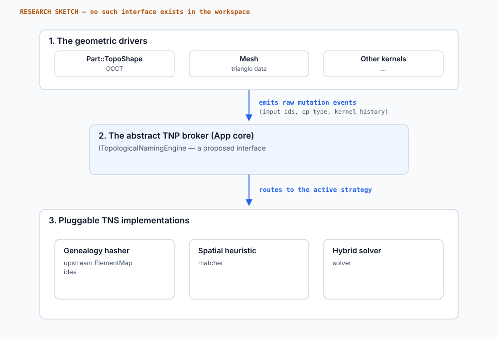

# Decoupling topological naming from the geometry kernel

Status: research (2026-10-29). An open question and a sketch, not a design and not a
plan. Companion to [`occt-history-spike.md`](occt-history-spike.md),
[`geometry-and-topology.md`](geometry-and-topology.md), the developer design in
[`../../developer/architecture/lineage-and-naming.md`](../../developer/architecture/lineage-and-naming.md),
and the general introduction's
[chapter 4](../../general/04-how-freecad-organizes-geometry.md).

## 1. The question

FerroCAD stores element names in a crate (`ferrocad_lineage`) that never links a
geometry kernel, and reaches the kernel through a trait
(`ferrocad_geom::GeometryBackend`). Does that mean topological naming has been
"decoupled" from the kernel?

The honest answer is **partly, and only at the storage boundary**. Three stronger
claims are often implied by that architecture, and none of them is established:

1. That a *naming engine* can be swapped independently of the geometry backend.
2. That a second kernel could supply provenance and get working names.
3. That names, or whole parametric histories, are portable between kernels.

This note records what is true today, and what would have to be demonstrated before
any of the three is written down as a design.

## 2. What upstream already separates

FreeCAD does not keep naming entirely "inside Part". Its split is:

| Layer | Location | Owns |
| --- | --- | --- |
| Base application | `src/App/ComplexGeoData.{h,cpp}`, `src/App/ElementMap.{h,cpp}` | The map type (`Data::ElementMap`), the versioned contract (`getElementMapVersion`), and the base class for shape payloads. |
| Kernel wrapper | `src/Mod/Part/App/TopoShape*.cpp`, `Part::TopoShapeMapper` | Consumes OCCT history (`BRepTools_History`, `Modified`/`Generated`/`IsDeleted`) and folds it into names. |
| Persistence | `PropertyPartShape::Save` / `Restore` | Stores the shape with its map and `ElementMapVersion`; re-derives on mismatch. |

So the storage/type half is already kernel-neutral upstream, and FerroCAD mirrors that
shape. What upstream does not separate is the *derivation*: names are a function of
OCCT's topology and of FreeCAD's boolean wrappers.

The spike found the strongest evidence for that dependency:

- FreeCAD wraps every boolean in `FCBRepAlgoAPI_*` subclasses (added 2024) to control
  fuzzy tolerance, keep the original topology available, and flatten compound tools.
  Stock `BRepAlgoAPI_*` produces different — and worse — history.
- Names such as `Face6` and `;FUSE;…` are assigned by FreeCAD from that history. OCCT
  reports relationships only, never names.
- OCCT pins its component of `ElementMapVersion` to `0x070200` on purpose, so a kernel
  upgrade does not spuriously invalidate saved maps. The version is an OCCT-version
  fact, not a portable naming fact.

## 3. What FerroCAD has today

Grounded in the workspace, not in intent:

- `crates/ferrocad_lineage` defines the payload-generic vocabulary: `ElementRef<T>`,
  `ElementId`, `OperandId`, `Provenance`, `History<T>`, `ElementMap<T>`, `ReverseMap`,
  `Lineage<T>`, `MapVersion`, and the `NamePolicy` trait with `DefaultNamePolicy`. It
  has no workspace dependencies.
- `crates/ferrocad_geom` re-exports that vocabulary with `Shape` as the payload and
  defines the `GeometryBackend` trait. `Shape` is an opaque handle
  (`Box<dyn ShapeData>`), so kernel types do not leak into document code.
- `crates/ferrocad_occt` implements the backend and translates OCCT operation history
  into `History<Shape>`, folding it with `Lineage::from_history`.
- `crates/ferrocad_part` persists the lineage in `ShapeProperty`, folds history after
  boolean and dress-up operations, and resolves stored names through the map first
  (positional fallback only when a shape has no map at all).

The provenance of these pieces is recorded step by step in
[`lineage-and-naming.md` §7](../../developer/architecture/lineage-and-naming.md); S1–S6c
are in, while the exposed `ElementMapVersion` and several guarded sizes are still
unreproduced.

That is a genuine improvement over "the map is a field on the Part shape". It is also
compatible with a second backend in principle, because a backend can build a
`History<Shape>` from whatever its kernel reports. What has not happened is the
experiment.

## 4. What is unproven, and could turn out to be false

- **Provenance is not a contract yet.** `GeometryBackend` exposes operations, not a
  documented statement of what history each operation must report. A second backend
  could implement the geometry methods and still produce histories that the naming
  policy cannot read meaningfully.
- **The naming policy is OCCT-shaped.** `DefaultNamePolicy` reproduces FreeCAD's names,
  including its treatment of compound cuts. That is deliberate for `.FCStd`
  compatibility, but it is not evidence of generality.
- **Cross-kernel history is not a solved problem.** Kernels disagree about topology
  conventions (OCCT's periodic cylinder carries a seam edge; another kernel need not),
  about boolean results, and about what counts as a "modified" face. There is no
  standard interchange format for operation history — only for results (STEP, IGES,
  STL).
- **Names in files are not portable.** A saved `.FCStd` reference was written against a
  map derived under OCCT. Re-deriving it under different topology is the naming problem
  again, at file scale.
- **"Swap kernels" is a product decision, not a refactor.** A second backend is worth
  having for healing, testing, or a future kernel, but nothing requires the naming
  layer to be identical across backends. Forcing that could make both worse.

## 5. The broker sketch (proposed, not implemented)

If the experiment is ever run, a plausible shape is an explicit provenance and naming
contract at the seam, rather than more vocabulary in the already-generic crate:

*A research sketch. There is no `ITopologicalNamingEngine`, no broker, and no second
backend in the workspace.*

The sketch has three parts:

1. **A provenance contract on the backend.** Each mutating operation returns a
   `History` whose relations are meaningful for that kernel, plus an explicit statement
   of the topology conventions the backend guarantees (seams, periodic faces, compound
   handling).
2. **An abstract naming engine.** `TrackOperation(history)`, `ResolveElement(name)` and
   `StableId(element)` as a document-level service, with the policy injected rather than
   hard-coded.
3. **External graph storage.** Lineage stays a side table (as it is today), so strategies
   can be benchmarked without touching geometry payloads or files.

This is intentionally close to what already exists. The difference would be that the
backend contract, not just the type signature, is explicit enough for a second
implementation to satisfy it.

## 6. How this could stop being research

Promote this note only when all of the following hold:

1. A second `GeometryBackend` implementation exists (even a deterministic test backend
   over analytic shapes) and runs the conformance suite for names.
2. The provenance a backend must supply is written down in `ferrocad_geom` and checked
   by tests, not merely implied by the OCCT implementation.
3. A defined subset — primitives, fuse, cut, common — keeps a meaningful name set across
   the two backends, or the gap is documented as a limit rather than a bug.
4. The `.FCStd` story is explicit: which names are upstream-compatible, which are
   re-derived, and what happens on a mismatch.

Until then, the correct statement is the one in chapter 5: the vocabulary and storage
are kernel-neutral; the naming semantics are not yet proven to be.

## 7. What to read next

- [`occt-history-spike.md`](occt-history-spike.md) — the measured history surface and
  the boolean-wrapper finding.
- [`geometry-and-topology.md`](geometry-and-topology.md) §6–§9 — the `GeometryEngine`
  seam and the deferred lineage engine.
- [`../../developer/architecture/lineage-and-naming.md`](../../developer/architecture/lineage-and-naming.md)
  — the implemented layer and its conformance status.
