# The transform session: explicit uncommitted state, one move, no undo-as-cancel

Status: **design and plan (2026-10-30).** *Plan only — nothing below A0 is built yet.*
Read against the tree in
[`../research/transform-session-compatibility.md`](../research/transform-session-compatibility.md),
which corrected two things here: the display stage carries **world-space** geometry with an
identity placement (so the session datum is a world point, not a `Placement`), and the shell has
no document handle (so A0 must also add a facade surface for the pending edit).

This is the **session half** of the 2026-10-30 transform synthesis. The other half — the
loadout slots, the `Select ▾` topology filter and hover-to-arm — is
[`tool-loadout.md`](tool-loadout.md); the two share the stage numbering and are meant to be
read together, but each stands alone. This note is the authority for how an uncommitted
transform becomes a first-class object, what commits it, what rolls it back, and what the
user sees while it is live.

## 0. The problem

### 0.1 Two invisible modes for one gesture

The transform triad (`TransformGizmo`) and the floating Move HUD (ΔX / ΔY / ΔZ) describe the
same gesture with two different state machines:

- **Two modes, one boolean.** Selecting an object arms the triad in *normal* mode (a release
  commits immediately, with no exact-entry form). Choosing `Move` arms the same triad in
  *deferred* mode (`InventorViewport::set_gizmo_preview`: a release only emits
  `TransformPreview` and waits for the HUD's accept). The switch is a bool on the viewport
  mirrored by `Shell::gizmo_deferred`, so neither side can be sure who owns the drag.
- **Silent data loss on context exit.** In deferred mode, selecting another object, clearing
  the selection or touching a face stem cancels the preview (`replace_selection` →
  `clear_dialog_preview`).
- **One-shot dismissal.** Accepting the Move HUD closes it, so a second precise step means
  re-opening the wheel.

(The fourth strand of the split — the triad and a workbench manipulator both arming on one
click — belongs to the loadout note.)

### 0.2 The defect that motivated this note

On 2026-10-30 a user reported, in three separate rounds, that dragging the triad "resets to
the original location" and that ending a Move makes the triad disappear. The causes were
symptomatic of the split, not of the maths:

1. The drag delta was **round-tripped through the HUD's text fields** (`{:.2}`) and re-read
   from them, so a release previewed the rounded delta — zero for any drag under 0.005 mm —
   and the object and triad snapped back.
2. Accepting the HUD set `triad_dismissed`, deliberately removing the handles from the object
   the user had just placed.
3. The first harness "proved" the triad followed the drag by **injecting hand-made
   `TransformPreview` events**, so no test could see either defect.

Each is fixed locally (commit `1559fa0`), but the structure that produced them survives: the
pending move lives in **three** places — the dialog's field text, `OpenDialog::translation`,
and the viewport's `preview_home` overlay snapshot — and the only durable record of a
completed gesture is an undo entry.

### 0.3 What we will not do

- **No undo-as-cancel.** A preview must never open a transaction and revert it. Undo is the
  user's history; a gesture the user has not confirmed must not appear in it.
- **No document mutation for previews.** The document is untouched during a drag today only
  because the preview lives in the *display* stage (`ShapeItem::temporary_transform`). That is
  a render-side accident, not a model: nothing stops the next feature from writing through and
  undoing.
- **No second state machine.** One session object, owned once, read by every view.

---

## 1. The unified transform session

There is no "normal drag" versus "deferred drag". Every translation or rotation gesture runs
inside one cumulative **Transform Session** that collapses consecutive handle adjustments and
typed overrides into a single undo transaction.

### 1.1 Lifecycle

```mermaid
stateDiagram-v2
    [*] --> ArmedIdle: body selected (or armed by hover, see tool-loadout.md)
    ArmedIdle --> SessionActive: begin handle drag, or Tab / digit

    state SessionActive {
        [*] --> Accumulating
        Accumulating --> Accumulating: drag an axis (adds to Δ; tape + preview update)
        Accumulating --> Accumulating: type in the pill (updates Δ; tape + preview update)
    }

    SessionActive --> ArmedIdle: Enter (checkpoint: commit one step, re-arm at the new origin, Δ = 0)
    SessionActive --> NextContext: another object / slot change / wheel verb (auto-commit if Δ ≠ 0, then switch)
    SessionActive --> ArmedIdle: Esc (rollback: restore the session-start pose, clear the preview, Δ = 0)
```



### 1.2 The four invariants

1. **Cumulative deltas.** When a session begins, the shell pins the selection's starting
   placement as the *session datum*. Drag X +15 mm, release, drag Y +20 mm, release, then type
   `16.5` into ΔX: all four adjust the same live preview relative to that datum and collapse
   into one transaction.
2. **Implicit auto-commit on context exit.** If the accumulated delta is non-zero, switching
   slot, choosing a wheel verb, selecting another object or clicking empty space commits the
   preview as one transaction *before* changing context. The user cannot lose a drag by
   forgetting to press Move.
3. **Checkpoint on Enter.** Enter commits the current delta, moves the session datum to the new
   placement, resets Δ to 0 and keeps the object selected — ready for the next step.
4. **Explicit rollback on Esc.** Esc is the only abort: mid-drag it cancels the stroke; with a
   non-zero delta it discards the preview and returns the geometry to the session datum; with
   Δ = 0 it clears the selection. **Rollback never touches the undo stack.**

---

## 2. The model: uncommitted state is a first-class object

This is the base work. It is deliberately not a UX change: §3 is a *view* of one thing.

### 2.1 Why the current shape cannot hold a ghost

The preview today is `ShapeItem::temporary_transform` — a matrix on the **display** item,
composed by the viewport, forgotten at commit, and restored by an overlay snapshot
(`preview_home`) that exists only for transforms. Three consequences:

- There is no *base* value to draw against, so a ghost of the uncommitted state cannot be
  expressed except by re-deriving it from the same matrix that draws the live one.
- The pending value lives in as many places as there are ways to edit it (field text, session
  delta, overlay snapshot), which is exactly how the 2026-10-30 defect happened.
- Only transforms can preview. A fillet radius, an extrusion length or a sketch point has no
  preview channel at all — `DressUpScrubber` and `PushPullStem` commit to see anything.

### 2.2 `PendingEdit` — designed, **deferred** (D0)

This is the general document-side representation of an uncommitted edit: a `staged` map beside a
captured `base`, no document write, `abort` as a drop, `commit` as one named transaction.
It is **not on the critical path** and is not built in A1–A3. The reasons are in §6 (D0): the
commit already goes through the mod layer as an `InteractionCommit`, and nothing in the document
reads a pending value yet. The design is kept here because it is what the *next* consumer will
need, and because writing it down is the check that the session is genuinely a special case of
it rather than a parallel mechanism.

```rust
pub struct PendingEdit {
    id: PendingId,
    label: String,                                          // becomes the committed transaction's name
    base: BTreeMap<(ObjectId, String), Option<Property>>,   // committed values, captured once
    staged: BTreeMap<(ObjectId, String), Property>,         // what the user is changing
}
```

When it is built, it needs a name that is not `pending`: `TransactionManager` already has a
`pending` meaning "booked but not active" (`document/transaction.rs:96-148`), so either this
type or that field should be renamed (`StagedEdit` is the obvious pairing).

### 2.3 `EditView` — one read path for "what the user sees"

Reads must not have to remember whether a preview is live:

```rust
pub struct EditView<'a> { /* doc + optional pending */ }
impl<'a> EditView<'a> {
    pub fn property(&self, object: ObjectId, name: &str) -> Option<Cow<'a, Property>>; // staged wins
    pub fn committed(&self, object: ObjectId, name: &str) -> Option<&'a Property>;     // the ghost's base
}
impl Document { pub fn view(&self) -> EditView<'_>; pub fn view_with(&self, id: PendingId) -> EditView<'_>; }
```

- The display/stage pass reads `view()`; snapping and hit testing read `view()` (so you snap to
what you see); exporters and save read the document. This is what stops the next preview from
re-introducing a second source of truth.
- ⚠️ It is **not enforceable yet**: `Document::object_mut()` still hands out the raw store
(`document/mod.rs:215-221`). A0 makes `EditView` the path the display and snap code takes; it
does not make it the only possible one. That would need `object_mut` to become crate-private,
which is a larger change than this stage should carry.

### 2.4 `TransformSession` (new, `ferrocad_stage::session`)

The transform case is the first consumer, and it must live below gpui so the toy and
parametric editions and the headless tests all share it:

```rust
pub struct TransformSession {
    target: u32,              // stage entity
    datum: Vector3,           // world-space origin at begin (the ghost ring)
    delta: Vector3,           // accumulated translation
    mode: GizmoMode,          // translate | rotate (rotation wired after U3)
    dirty: bool,
}
impl TransformSession {
    pub fn begin(stage: &Stage, target: u32) -> Option<Self>;
    pub fn set_translation(&mut self, delta: Vector3);
    pub fn translate_axis(&mut self, axis: Axis, value: f64);   // absolute along the axis
    pub fn delta(&self) -> Vector3;
    pub fn datum(&self) -> Vector3;                             // the ghost's base
    pub fn transform(&self) -> Matrix4;                         // what the item is drawn with
    pub fn checkpoint(&mut self, datum: Vector3);               // Enter: new datum, Δ = 0
    pub fn is_dirty(&self) -> bool;
}
```

The datum is a **world point from `ShapeItem::origin`** (falling back to `anchor()`), not a
`Placement`: document items arrive as world-space tessellations with an identity placement, and
the triad already hugs `origin`. The delta is a matrix so rotation is expressible before any
`Placement` is involved — only the commit needs the object, which the facade owns.

One owner: the shell holds it; the viewport **renders** it (`set_session`). That deletes the
three-way split — `preview_translation`, `apply_gizmo_preview` and the dialog's mirrored delta
all become *reads* of the session, and `set_gizmo_preview(deferred)` disappears because there is
only one mode. `preview_home` is unaffected: it anchors gizmos and manipulators, not items.

The session is also the `PendingEdit`'s writer: a translate stages `Placement` on the target
(`pending.stage_property(target, "Placement", base ∘ delta)`). Because the shell has no
`Document`, that goes through the facade as an opaque handle (A0):
`transform_begin(name) -> id`, `transform_stage(id, delta)`, `transform_commit(id)`,
`transform_abort(id)` — the same shape as a dialog token.

### 2.5 Commit, checkpoint, rollback — mapped to the model

| User action | Session | PendingEdit | History |
| --- | --- | --- | --- |
| drag / type | `set_translation` | nothing leaves the process | **no entry** |
| `Esc` | dropped | — | **no entry** |
| `Enter` | `checkpoint` (new datum, Δ = 0) | one `InteractionCommit` → the mod's transaction | **exactly one** named entry |
| selection / slot / tool change while dirty | committed first | one `InteractionCommit` | one entry, then the change |
| `Ctrl+Z` after any of the above | — | — | reverts the *committed* step; a live preview is untouched because it was never in history |

### 2.6 What the renderer needs

- `ShapeItem` keeps `temporary_transform` as the *rendering* of a staged transform (no public
  API change), but it is now written in exactly one place, from `session.transform()`.
- A new overlay, `ferrocad_stage::measure_tape`, builds the ghost disc and the stair-step legs
  from `(session.datum(), session.transform())`. It is a `RenderQueue` like `workplane_stem`:
  depth off, never picked, rebuilt when the session changes.
- The tape needs no new renderer feature. Every element is a 1 px line or a screen-facing
  ribbon, both of which exist.
- The ghost's *base* geometry is already in memory: the shell keeps the un-previewed stage
  (`last_stage`) and merges overlays over it, so a faded "uncommitted" rendering needs no new
  data, only a second draw.

### 2.7 Compatibility

- **Facade.** Nothing new is needed on the critical path: the commit is the
  `InteractionCommit` the gizmo already produces (`to_interaction_with("transform", "apply",
  matrix, readout)`), routed by the shell through `python::apply_interaction` to the edition's
  provider. The session replaces *how the delta is accumulated*, not how it is applied.
- **Python.** `App_Move` keeps its argument form (`Activated(dx, dy, dz)`); only its
  no-argument form stops returning a dialog (U1). `FreeCADGui.Preview` keeps its channel.
  `Document` gains `begin_pending`/`commit_pending`/`abort_pending` only if a script needs
  them — not in A0.
- **Upstream scripts.** Unchanged: they call `openTransaction`/`commitTransaction` themselves,
  which is the *committed* path and is untouched.
- **`.ferrocad` / `.FCStd`.** A pending edit is never serialized (persistence reads
  `SavedDocument`, not `Document`); save with a live session commits it first (D4).
- **Editions.** A mod that supplies a manipulator keeps working: manipulators commit through
  the same session, so they get preview and rollback for free once A3 lands.

### 2.8 The commit boundary (D0, decided 2026-10-30)

**Previews stay in Rust; the commit goes through the mod layer.** This is the whole boundary,
and it is worth stating as a rule because both directions look tempting:

| | Where | Why |
| --- | --- | --- |
| Drag tick, typed Δ, `Esc` | `ferrocad_stage::TransformSession` + the viewport's display transform | 60–120/s. Crossing into Python per tick would put the GIL on the interaction path, and `apply_interaction` also recomputes — a kernel operation — which is why it must happen once, not per tick |
| Commit (Enter, auto-commit, checkpoint) | The mod layer, as an `InteractionCommit` | One crossing per commit. The module owns the transaction name, the status text, the recompute, and any veto or derived feature; a built-in `_move_selection` and a mod's own move are then the same code path |

The vision check the decision was made against: workbenches own edits, so an edit must pass
through one. The performance cost is real but it is paid **once per session**, not once per
frame — and the expensive half of it (`recompute`) was always there because the document has to
be rebuilt to show the result.

What this deliberately does **not** add:

- no new facade method for the session (`transform_begin`/`stage`/`commit` are gone from the
  plan) — the existing interaction route already carries a matrix;
- no core `PendingEdit` on the critical path (see §2.2 and the trigger in §5);
- no per-tick callback into Python, and no synchronous mod callbacks for anything phrased in
  frames. The mod-facing event surface is a separate, small, low-frequency contract in
  [`mod-events.md`](mod-events.md) (stage **E1**).

---

## 3. The numeric surface: in-place pill and 3-D tape

To honour `visual-language.md` §0.1 ("geometry is the interface; chrome recedes") the Move
HUD's button bar (`Cancel` / `Move`) is replaced by a 3-D measuring tape in the stage and a
two-stage pill in the gpui overlay.

### 3.1 Stage: the 3-D measuring tape

While a session has a non-zero offset from its datum `O_start` to the previewed origin
`O_current`:

- **Ghost origin disc** — a 10 px ring at `O_start` in `gizmo::INACTIVE_COLOR` (#94A3B8 @ 0.50),
  marking where the body started.
- **Orthogonal axis legs (stair-step tape)** — dashed 1 px lines (the `axis-origin-grid.md`
  dashed-ray technique) tracing the non-zero components along the frame's basis:
  `O_start ──(ΔX, #F87171)──► P_x ──(ΔY, #4ADE80)──► P_xy ──(ΔZ, #38BDF8)──► O_current`,
  with perpendicular 6 px end-ticks at each corner. Depth-off, never picked, rebuilt from the
  session each frame (the same contract as `workplane_stem`).
- A **`SESSION_HOLD`** state keeps the tape and the pill live after the pointer is released,
  until `Enter`, a context switch or `Esc`.

### 3.2 gpui: the expandable pill

One pill anchored to the active measurement (`readout_anchor` during a drag, clamped near
`O_current` when expanded) replaces both the separate Move dialog spec and the separate
`GizmoValue` readout.

- **Compact** (during a drag, and lingering in `SESSION_HOLD`) shows only the constrained value
  in 12 px semibold tabular monospace on `ui::WHEEL_GLASS` with a `ui::CHROME_LINE` border:
  `[ ΔX +24.50 mm ]`, or `[ ΔX +24.50  ΔY +10.00 mm ]` for a planar accumulation. Clicking the
  pill or pressing `Tab` expands it.
- **Expanded** (via `Tab` or a digit `0–9`, `-`, `.`) unfolds in place:
  `[ ΔX ( 24.50 )  ΔY ( 10.00 )  ΔZ ( 0.00 ) ]`. There are no `Move`/`Cancel` buttons:
  `Enter` commits (checkpoint), `Tab`/`Shift+Tab` cycle the fields, `Esc` rolls back.
- **Position freeze** reuses the existing `hud_lock` / freeze-on-focus invariant
  (`selection-gizmos-and-forms.md` §5.1), so typing `500` never slides the input out from under
  the pointer.

### 3.3 Keyboard-only workflow

Select an object with the Move slot active (see [`tool-loadout.md`](tool-loadout.md)) → press
`Tab` (or start typing `25`) → the pill expands to `[ ΔX ( 25 )  ΔY ( 0.0 )  ΔZ ( 0.0 ) ]` at
the object's origin and the tape previews the +25 mm X offset live → `Tab` to ΔY, type `10`,
`Enter` to commit both in one undo step.

---

## 4. Spec changes this note owns

Section numbers are from the synthesis and are re-checked against each file when its stage
lands; the status column is updated then. The loadout-owned rows are in
[`tool-loadout.md`](tool-loadout.md) §4.

### 4.1 [`selection-gizmos-and-forms.md`](../../developer/interaction/selection-gizmos-and-forms.md)

| Section | Change | Stage |
| --- | --- | --- |
| §4.2 States and transitions | unify the **normal** and **deferred** drag columns. Every `TransformGizmo` drag runs the cumulative session (`Begin → Update → End`), the preview survives the release, and no document transaction fires on mouse-up | U1 |
| §5.1 / §5.2 Form state machine | replace the floating Move command dialog (`Cancel`/`Move`) with the two-stage pill; change context loss from *silently cancelled* to *auto-commit if dirty*, reserving `Esc` for rollback | U1 (semantics), U2 (pill) |
| §7 Invariant 3 | "every pending transform session has an explicit rollback (`Esc`), an explicit checkpoint (`Enter`), and auto-commits non-zero deltas when the user deliberately switches selection, slot or tool" | U1 |

### 4.2 [`gizmo-manipulators.md`](../../developer/interaction/gizmo-manipulators.md)

| Section | Change | Stage |
| --- | --- | --- |
| §5 / §7 lifecycle, snapping, readout | promote `Tab`/digit entry from "deferred escalation" to the primary mechanism of the readout pill; merge `GizmoValue::readout` with the Δ pill so they are two states of one overlay | U2 |

### 4.3 [`visual-language.md`](../../developer/interaction/visual-language.md)

| Section | Change | Stage |
| --- | --- | --- |
| §1.5 Text and glass chrome | remove `Cancel`/`Move` button chrome from the translation HUD; specify compact↔expanded pill geometry and the 1 px dashed tape strokes (`AXIS_X`, `AXIS_Y`, `AXIS_Z`, `INACTIVE_COLOR` ghost ring) | U2, U3 |
| §5 State model | add the post-drag `SESSION_HOLD` where the tape and pill stay live until `Enter`, a context switch or `Esc` (the hover-to-arm case belongs to the loadout note) | U3 |

### 4.4 [`transform-ux.md`](../../developer/interaction/transform-ux.md)

The mode/pivot/re-pivot note stays authoritative for *what the handles do*; its lifecycle
section is superseded by §1 here, and its pending-mode discussion by §2. Add the pointer at U1.

---

## 5. Stages

A1–A3 are invisible (no user-visible change, existing tests stay green). U1–U3 are this note's
share of the UX overhaul; U4–U5 belong to [`tool-loadout.md`](tool-loadout.md), E1 is the
mod-facing event contract ([`mod-events.md`](mod-events.md)), and U6 is the shared convergence
sweep.

| Stage | Deliverable | Why this order | Spec updated |
| --- | --- | --- | --- |
| **A0** | ~~`PendingEdit` + `EditView` + facade handle~~ — **deferred by D0**. The design stays in §2.2–§2.3; nothing on the critical path needs it. Trigger: the first non-display consumer (a script reading a pending value, save-with-live-session, or a preview the document must hold) | Building it now would be scaffolding with no caller — the recon showed the shell cannot even reach it | — |
| **A1** | `TransformSession` in `ferrocad_stage` (world datum + matrix delta); the viewport renders it via `set_session`; the shell owns it; the commit is the existing `InteractionCommit` → mod layer | One owner for the pending delta before any behaviour changes | — |
| **A2** | delete the alternative preview paths: `set_gizmo_preview`/`gizmo_deferred`, the item-transform writes in `preview_translation`/`apply_gizmo_preview`, and the shell's mirrored field delta. `preview_home` (overlay anchors) is untouched | Removes the three-way split that caused the 2026-10-30 defect | — |
| **A3** | the push/pull stem and the dress-up scrubber preview through the session's snapshot (they preview nothing today) — via the mod-published `Preview` channel, not a document change | Proves the display-only preview generalises beyond the triad, without pulling A0 forward | §4.2 |
| **U1** | one drag mode: release keeps the preview; `Enter` checkpoint; `Esc` rollback; auto-commit on context exit; `App_Move`'s no-arg form stops opening a dialog | The behaviour change all three reports asked for | §4.1 |
| **U2** | the two-stage pill (`GizmoValue` + Δ fields merged); `Tab`/digit escalation; button bar gone | Needs U1's session to read from | §4.1, §4.2, §4.3 |
| **U3** | the 3-D measuring tape: ghost disc + stair-step legs + end-ticks; `SESSION_HOLD` | Needs the session's base/effective pair | §4.3 |
| **U6** | this note's share of the sweep: spec text final, dead code gone, user-docs Move page | Converges with the loadout half | all of §4 |

### Stage acceptance

- **A0** — deferred; acceptance moves with the trigger. When it is built: a pending edit stages,
  aborts (document byte-identical, `undo_names()` unchanged) and commits (one entry named by the
  session label, one recompute); `EditView` returns the staged value for reads and the committed
  value for ghosts; a `.ferrocad` round-trip never persists a pending edit.
- **A1** — session arithmetic (cumulative translation, checkpoint, dirty) and one viewport test
  that renders a session and asserts the emitted item transforms. The commit produces the same
  `InteractionCommit` the deferred release produces today (asserted on the values, not on a
  snapshot).
- **A2** — grep-level: `gizmo_deferred` and `preview_home` are gone; every preview entry point
  takes a session snapshot. The 2026-10-30 regression tests
  (`a_move_hud_drag_survives_its_release`,
  `a_deferred_drag_reports_previews_and_never_commits`'s successor) pass unchanged in
  behaviour.
- **A3** — dragging a fillet radius or a stem previews a ghost shape, and `Esc` leaves
  `undo_names()` unchanged.
- **U1** — drag, release, drag again, `Enter`: one undo entry; `Esc` after any drag: zero undo
  entries and the original pose; selecting another object mid-session keeps the move.
- **U2** — `Tab` on an armed object expands the pill, typing moves the preview, `Enter`
  commits; the old dialog buttons are absent; the headless harness can drive it without a
  window (the pill is shell state, not gpui-only).
- **U3** — the tape's legs are proportional to the non-zero delta components, the ghost disc
  sits at the datum, and nothing is pickable.

### Risks and mitigations

| Risk | Mitigation |
| --- | --- |
| Deferring A0 leaves the document with no "uncommitted" concept, and the next feature reintroduces a private one | The session is the uncommitted value for transforms, and §2.2/§2.3 are the written contract for the general case; the trigger for building it is named, not left to taste |
| The commit-per-session crossing is slower than a Rust write | It is one crossing per commit against 60–120 ticks/s of breathing room, and the recompute it does was always required. Measure it in U1 with `FERROCAD_TRACE=1` and record the number |
| A mod that owns `transform` can make a commit slow or blocking | It already can (the non-deferred release goes through the same route), and the fix belongs to that mod; the shell reports the status text it returns |
| Recomputed ghosts (a fillet's *shape*) need a recompute preview the DAG cannot do without mutating | Out of scope for A3: it previews the properties already shown, and the rebuild waits for commit. Decide in U6 whether a second DAG pass is worth it |
| Auto-commit on context exit surprises a user who expected to lose the drag | The inverse of today's data loss; the tape and pill make the pending state explicit, and one undo removes it |
| Dropping the dialog breaks scripts or tests that accept it | `App_Move` keeps the argument form; only the no-arg dialog goes, and its callers are in-tree |

### Explicitly deferred

- Rotation sessions (`GizmoMode::Rotate`) — the session carries the mode from A1 but only
  translation is wired until after U3.
- Sub-element (face/edge) transforms — they need the loadout's filter and their own reference
  model.
- Multi-selection sessions — A1 takes one target; a set is a later widening (the `PendingEdit`
  already handles many properties).
- A real ghost *recompute* for parametric shapes (see the risk row).

---

## 6. Decisions

| # | Question | State | Decision |
| --- | --- | --- | --- |
| **D0** | Where is the commit boundary — Rust or the mod layer? | **decided 2026-10-30** | **The mod layer**, one `InteractionCommit` per commit. Previews never cross: no per-tick GIL, no per-tick recompute (§2.8). The vision wins where it is cheap, the frame budget wins where it is not |
| **D1** | Through the command **dialog** callback or the interaction provider? | **closed by D0** | The interaction provider: it is the same seam a workbench gizmo already uses (`to_interaction_with`), so a `Part::Fillet` and a `Move` share one commit route. The Move *command* keeps its dialog only for scripts that call it with arguments |
| D3 | One session per shell or per viewport? | open, A1 | Per shell; the viewport is a view, and a second window must not start a second session on the same object |
| D4 | Save with a live session: commit or abort? | open, U1 | Commit, and say so in the status line: losing a drag to `Ctrl+S` is the same defect class as losing it to a selection change |
| D6 | Does the tape appear for a typed-only session (no drag)? | open, U3 | Yes, once a delta is non-zero — typing is a gesture too |

The loadout note owns D2 and D5. The mod-facing event contract is [`mod-events.md`](mod-events.md)
(stage E1), which also records what was **not** built: a mod-to-mod event bus.
