# The transform session: explicit uncommitted state, one move, no undo-as-cancel

Status: **design and plan (2026-10-30).** *Plan only — A1a and A1b are the only pieces with
code behind them.*
Read against the tree in
[`../research/transform-session-compatibility.md`](../research/transform-session-compatibility.md),
which corrected the pending value's shape: the display stage carries **world-space** geometry
with an identity placement, so the session datum is a world point, not a `Placement`. The
recon also expected a facade handle for a core pending edit; **D0 removed that need** (the
commit goes through the existing interaction provider) and A0 is deferred.

This is the **session half** of the 2026-10-30 transform synthesis. The other half — the
loadout slots, the `Select ▾` topology filter and hover-to-arm — is
[`tool-loadout.md`](tool-loadout.md); the two share the stage numbering and are meant to be
read together, but each stands alone. This note is the authority for how an uncommitted
transform becomes a first-class object, what commits it, what rolls it back, and what the
user sees while it is live.

## 0. The problem

### 0.1 Two invisible modes for one gesture

The transform triad (`TransformGizmo`) and the floating Move HUD (ΔX / ΔY / ΔZ) describe the
same gesture with two different state machines:

- **Two modes, one boolean.** Selecting an object arms the triad in *normal* mode (a release
  commits immediately, with no exact-entry form). Choosing `Move` arms the same triad in
  *deferred* mode (`InventorViewport::set_gizmo_preview`: a release only emits
  `TransformPreview` and waits for the HUD's accept). The switch is a bool on the viewport
  mirrored by `Shell::gizmo_deferred`, so neither side can be sure who owns the drag.
- **Silent data loss on context exit.** In deferred mode, selecting another object, clearing
  the selection or touching a face stem cancels the preview (`replace_selection` →
  `clear_dialog_preview`).
- **One-shot dismissal.** Accepting the Move HUD closes it, so a second precise step means
  re-opening the wheel.

(The fourth strand of the split — the triad and a workbench manipulator both arming on one
click — belongs to the loadout note.)

### 0.2 The defect that motivated this note

On 2026-10-30 a user reported, in three separate rounds, that dragging the triad "resets to
the original location" and that ending a Move makes the triad disappear. The causes were
symptomatic of the split, not of the maths:

1. The drag delta was **round-tripped through the HUD's text fields** (`{:.2}`) and re-read
   from them, so a release previewed the rounded delta — zero for any drag under 0.005 mm —
   and the object and triad snapped back.
2. Accepting the HUD set `triad_dismissed`, deliberately removing the handles from the object
   the user had just placed.
3. The first harness "proved" the triad followed the drag by **injecting hand-made
   `TransformPreview` events**, so no test could see either defect.

Each is fixed locally (commit `1559fa0`), but the structure that produced them survives: the
pending move lives in **three** places — the dialog's field text, `OpenDialog::translation`,
and the viewport's `preview_home` overlay snapshot — and the only durable record of a
completed gesture is an undo entry.

### 0.3 What we will not do

- **No undo-as-cancel.** A preview must never open a transaction and revert it. Undo is the
  user's history; a gesture the user has not confirmed must not appear in it.
- **No document mutation for previews.** The document is untouched during a drag today only
  because the preview lives in the *display* stage (`ShapeItem::temporary_transform`). That is
  a render-side accident, not a model: nothing stops the next feature from writing through and
  undoing.
- **No second state machine.** One session object, owned once, read by every view.

---

## 1. The unified transform session

There is no "normal drag" versus "deferred drag". Every translation or rotation gesture runs
inside one cumulative **Transform Session** that collapses consecutive handle adjustments and
typed overrides into a single undo transaction.

### 1.1 Lifecycle

```mermaid
stateDiagram-v2
    [*] --> ArmedIdle: body selected (or armed by hover, see tool-loadout.md)
    ArmedIdle --> SessionActive: begin handle drag, or Tab / digit

    state SessionActive {
        [*] --> Accumulating
        Accumulating --> Accumulating: drag an axis (adds to Δ; tape + preview update)
        Accumulating --> Accumulating: type in the pill (updates Δ; tape + preview update)
    }

    SessionActive --> ArmedIdle: Enter (checkpoint: commit one step, re-arm at the new origin, Δ = 0)
    SessionActive --> SessionActive: another object / slot / scope / tool is refused while Δ ≠ 0
    SessionActive --> ArmedIdle: Esc (rollback: restore the session-start pose, clear the preview, Δ = 0)
```



### 1.2 The four invariants

1. **Cumulative deltas.** When a session begins, the shell pins the selection's starting
   **world origin** as the *session datum*. Drag X +15 mm, release, drag Y +20 mm, release, then
   type `16.5` into ΔX: all four adjust the same live preview relative to that datum and
   collapse into one transaction.
2. **A pending move locks the context.** If the accumulated delta is non-zero, switching
   slot, changing the handle set or `Select ▾`, selecting another object, clearing the
   selection or starting a tool is **refused** (with a status line) until the user finishes
   with `✓`/`Enter` or `✗`/`Esc`. Nothing is committed and nothing is dropped by a stray
   click: the pending value is explicit state, so the user decides it. The rule is one
   gate (`shell/context.rs`: `InteractionContext` × `Action`), not scattered guards, and
   it refuses **edit commands** too (`CmdType: ForEdit`, e.g. Create Box) while view
   commands stay live; a drag whose target is not the session's subject is refused and the
   viewport cancels it. (Revised 2026-10-31 from the earlier auto-commit rule.)
3. **Checkpoint on Enter.** Enter commits the current delta, moves the session datum to the new
   placement, resets Δ to 0 and keeps the object selected — ready for the next step.
4. **Explicit rollback on Esc.** Esc is the only abort: mid-drag it cancels the stroke; with a
   non-zero delta it discards the preview and returns the geometry to the session datum; with
   Δ = 0 it clears the selection. **Rollback never touches the undo stack.**

---

## 2. The model: uncommitted state is a first-class object

This is the base work. It is deliberately not a UX change: §3 is a *view* of one thing.

### 2.1 Why the current shape cannot hold a ghost

The preview today is `ShapeItem::temporary_transform` — a matrix on the **display** item,
composed by the viewport, forgotten at commit, and restored by an overlay snapshot
(`preview_home`) that exists only for transforms. Three consequences:

- There is no *base* value to draw against, so a ghost of the uncommitted state cannot be
  expressed except by re-deriving it from the same matrix that draws the live one.
- The pending value lives in as many places as there are ways to edit it (field text, session
  delta, overlay snapshot), which is exactly how the 2026-10-30 defect happened.
- Only transforms could preview. A fillet radius, an extrusion length or a sketch point had
  no preview channel at all — `DressUpScrubber` and `PushPullStem` committed to see
  anything. A3 gives them a **display-only property preview** (the face at the pending
  depth, the edge swath at the pending radius); the exact recomputed shape still waits for
  the commit.

### 2.2 `PendingEdit` — designed, **deferred** (D0)

This is the general document-side representation of an uncommitted edit: a `staged` map beside a
captured `base`, no document write, `abort` as a drop, `commit` as one named transaction.
It is **not on the critical path** and is not built in A1a–A3. The reasons are in §6 (D0): the
commit already goes through the mod layer as an `InteractionCommit`, and nothing in the document
reads a pending value yet. The design is kept here because it is what the *next* consumer will
need, and because writing it down is the check that the session is genuinely a special case of
it rather than a parallel mechanism.

```rust
pub struct PendingEdit {
    id: PendingId,
    label: String,                                          // becomes the committed transaction's name
    base: BTreeMap<(ObjectId, String), Option<Property>>,   // committed values, captured once
    staged: BTreeMap<(ObjectId, String), Property>,         // what the user is changing
}
```

When it is built, it needs a name that is not `pending`: `TransactionManager` already has a
`pending` meaning "booked but not active" (`document/transaction.rs:96-148`), so either this
type or that field should be renamed (`StagedEdit` is the obvious pairing).

### 2.3 `EditView` — one read path for "what the user sees"

Reads must not have to remember whether a preview is live:

```rust
pub struct EditView<'a> { /* doc + optional pending */ }
impl<'a> EditView<'a> {
    pub fn property(&self, object: ObjectId, name: &str) -> Option<Cow<'a, Property>>; // staged wins
    pub fn committed(&self, object: ObjectId, name: &str) -> Option<&'a Property>;     // the ghost's base
}
impl Document { pub fn view(&self) -> EditView<'_>; pub fn view_with(&self, id: PendingId) -> EditView<'_>; }
```

- The display/stage pass reads `view()`; snapping and hit testing read `view()` (so you snap to
what you see); exporters and save read the document. This is what stops the next preview from
re-introducing a second source of truth.
- ⚠️ It is **not enforceable yet**: `Document::object_mut()` still hands out the raw store
(`document/mod.rs:215-221`). A0 makes `EditView` the path the display and snap code takes; it
does not make it the only possible one. That would need `object_mut` to become crate-private,
which is a larger change than this stage should carry.

### 2.4 `TransformSession` (new, `ferrocad_stage::session`)

The transform case is the first consumer, and it must live below gpui so the toy and
parametric editions and the headless tests all share it:

```rust
pub struct TransformSession {
    targets: Vec<u32>,        // stage entities: the selection, not one object
    datum: Vector3,           // world-space origin at begin (the ghost ring)
    delta: Vector3,           // accumulated translation
    mode: GizmoMode,          // translate | rotate (rotation wired after U3)
    dirty: bool,
}
impl TransformSession {
    pub fn begin(stage: &Stage, targets: &[u32]) -> Option<Self>;
    pub fn set_translation(&mut self, delta: Vector3);
    pub fn translate_axis(&mut self, axis: Axis, value: f64);   // absolute along the axis
    pub fn delta(&self) -> Vector3;
    pub fn datum(&self) -> Vector3;                             // the ghost's base
    pub fn transform(&self) -> Matrix4;                         // what the item is drawn with
    pub fn checkpoint(&mut self, datum: Vector3);               // Enter: new datum, Δ = 0
    pub fn is_dirty(&self) -> bool;
}
```

A session is the **selection's** pending move, not one object's: `targets` keeps the selected
entities (dropping any the stage has not got), and the datum is the **primary's** anchor — the
entity the triad hugs — not an average or a bounding-box centre. This is what lets U1 commit a
multi-object move as one value, and what unblocks moving the commit route off `_move_selection`.

The datum is a **world point from `ShapeItem::origin`** (falling back to `anchor()`), not a
`Placement`: document items arrive as world-space tessellations with an identity placement, and
the triad already hugs `origin`. The delta is a matrix so rotation is expressible before any
`Placement` is involved — only the commit needs the object, which the facade owns.

**Rotation has no shell-side state and keeps the viewport's direct path.** A translation
drag is preview-only: the viewport queues `Begin`/`Update`/`End` and the shell owns the value.
A rotation drag has no HUD or session, so the viewport previews it directly
(`apply_gizmo_preview`) and commits the matrix through `to_interaction_with`;
`queue_transform_preview` is not called for a rotation handle. The `mode` field below, and
the matrix delta, are where that state moves if a rotate session (with a pill or a form) ever
exists — which is why the session is a `Transform` session rather than a `Move` one.

One owner: the shell holds it; the viewport **renders** it. A2 deleted the three-way split:
translation previews go through `preview_transform`, and the separate `PendingMove`, the
dialog's mirrored field delta and `set_gizmo_preview`/`gizmo_deferred` are gone. Rotation
still uses the viewport's `apply_gizmo_preview` because it has no session yet. `preview_home`
is unaffected: it anchors gizmos and manipulators, not items.

How that owner arrived: **A1a** built this type and its arithmetic, **A1b** made
`preview_transform` the one translation write path, **A1c** wired the shell (one session,
opened at the press, fed every tick, preferred over the Δ fields), and **A2** deleted the other
writers. Moving the HUD's commit onto the interaction route (§2.8) remains open.

The session does **not** write the document. A translate never stages a `Placement`: the
uncommitted value is the session's own delta, and at commit the shell hands it to the mod layer
as the `InteractionCommit` the gizmo already produces (§2.8). That is why D0 let A0 — the
core `PendingEdit` — be deferred rather than extended: there is nothing to stage, and no facade
method to add.

### 2.5 Commit, checkpoint, rollback — mapped to the model

| User action | Session | PendingEdit | History |
| --- | --- | --- | --- |
| drag / type | `set_translation` | nothing leaves the process | **no entry** |
| `Esc` | dropped | — | **no entry** |
| `Enter` | `checkpoint` (new datum, Δ = 0) | one `InteractionCommit` → the mod's transaction | **exactly one** named entry |
| selection / slot / scope / tool change while dirty | refused (the move locks the context) | — | no entry until `Enter`/`✓` |
| `Ctrl+Z` after any of the above | — | — | reverts the *committed* step; a live preview is untouched because it was never in history |

### 2.6 What the renderer needs

- `ShapeItem` keeps `temporary_transform` as the *rendering* of a staged transform (no public
  API change), but it is now written in exactly one place, from `session.transform()`.
- A new overlay, `ferrocad_stage::measure_tape` (**built 2026-10-31**), builds the ghost
  disc and the stair-step legs from `TransformTape` (the session's datum and absolute
  delta). It is a `RenderQueue` like `workplane_stem`: depth off, never picked, rebuilt
  when the session changes.
- The tape needs no new renderer feature. Every element is a 1 px line or a screen-facing
  ribbon, both of which exist.
- The ghost's *base* geometry is already in memory: the shell keeps the un-previewed stage
  (`last_stage`) and merges overlays over it, so a faded "uncommitted" rendering needs no new
  data, only a second draw.

### 2.7 Compatibility

- **Facade.** Nothing new is needed on the critical path: the commit is the
  `InteractionCommit` the gizmo already produces (`to_interaction_with("transform", "apply",
  matrix, readout)`), routed by the shell through `python::apply_interaction` to the edition's
  provider. The session replaces *how the delta is accumulated*, not how it is applied.
- **Python.** `App_Move` keeps its argument form (`Activated(dx, dy, dz)`); only its
  no-argument form stops returning a dialog (U1). `FreeCADGui.Preview` keeps its channel.
  `Document` gains `begin_pending`/`commit_pending`/`abort_pending` only if a script needs
  them — not in A0.
- **Upstream scripts.** Unchanged: they call `openTransaction`/`commitTransaction` themselves,
  which is the *committed* path and is untouched.
- **`.ferrocad` / `.FCStd`.** A pending edit is never serialized (persistence reads
  `SavedDocument`, not `Document`); save with a live session commits it first (D4).
- **Editions.** A mod that supplies a manipulator keeps working: manipulators commit through
  the same session, so they get preview and rollback for free once A3 lands.

### 2.8 The commit boundary (D0, decided 2026-10-30)

**Previews stay in Rust; the commit goes through the mod layer.** This is the whole boundary,
and it is worth stating as a rule because both directions look tempting:

| | Where | Why |
| --- | --- | --- |
| Drag tick, typed Δ, `Esc` | `ferrocad_stage::TransformSession` + the viewport's display transform | 60–120/s. Crossing into Python per tick would put the GIL on the interaction path, and `apply_interaction` also recomputes — a kernel operation — which is why it must happen once, not per tick |
| Commit (Enter, checkpoint) | The mod layer, as an `InteractionCommit` | One crossing per commit. The module owns the transaction name, the status text, the recompute, and any veto or derived feature; a built-in `_move_selection` and a mod's own move are then the same code path |

The vision check the decision was made against: workbenches own edits, so an edit must pass
through one. The performance cost is real but it is paid **once per session**, not once per
frame — and the expensive half of it (`recompute`) was always there because the document has to
be rebuilt to show the result.

**Where it stands after A1c (2026-10-30).** The gizmo's own release already goes through the
interaction provider (`to_interaction_with` → `apply_interaction`), but the **Move HUD's** accept
still goes through the command callback (`App_Move.on_accept` → `_move_selection`), and that is
deliberate for now: the parametric `transform` provider moves the object it is handed, while
`_move_selection` moves the whole **selection**. Switching the HUD to the interaction route
before the session can carry a set of targets would silently narrow a multi-object move to one
object. The unification is U1's, when the session owns the selection (see §5, *Explicitly
deferred*). Until then the session is the value and the command is the writer — both on the mod
side of the boundary, which is what D0 is about.

What this deliberately does **not** add:

- no new facade method for the session (`transform_begin`/`stage`/`commit` are gone from the
  plan) — the existing interaction route already carries a matrix;
- no core `PendingEdit` on the critical path (see §2.2 and the trigger in §5);
- no per-tick callback into Python, and no synchronous mod callbacks for anything phrased in
  frames. The mod-facing event surface is a separate, small, low-frequency contract in
  [`mod-events.md`](mod-events.md) (stage **E1**).

---

## 3. The numeric surface: the always-on form and the 3-D tape

To honour `visual-language.md` §0.1 ("geometry is the interface; chrome recedes") the Move
HUD's button bar (`Cancel` / `Move`) is replaced by a 3-D measuring tape in the stage and an
always-on form in the gpui overlay.

### 3.1 Stage: the 3-D measuring tape

**Built 2026-10-31** in `ferrocad_stage::measure_tape`; the viewport draws its three line
packets under the controls. While a session has a non-zero offset from its datum `O_start`
to the previewed origin `O_current`:

- **Ghost origin disc** — a 10 px ring at `O_start` in `gizmo::INACTIVE_COLOR` (#94A3B8 @ 0.50),
  marking where the body started.
- **Orthogonal axis legs (stair-step tape)** — dashed 1 px lines (the `axis-origin-grid.md`
  dashed-ray technique) tracing the non-zero components along the frame's basis:
  `O_start ──(ΔX, #F87171)──► P_x ──(ΔY, #4ADE80)──► P_xy ──(ΔZ, #38BDF8)──► O_current`,
  with perpendicular 6 px end-ticks at each corner. Depth-off, never picked, rebuilt from the
  session each frame (the same contract as `workplane_stem`).
- A **`SESSION_HOLD`** keeps the tape and the pill live after the pointer is released, until
  `Enter`, a context switch or `Esc`. It is not a separate state: the session already
  survives the release (U1), and the tape/pill simply render it until it commits or drops.

### 3.2 gpui: the always-on Move chrome and the tape's ruler tags

**Built 2026-10-31** (U2b). The Move surface is a shell-owned pair, not a command dialog:
`shell::move_hud::MoveHud` (three `TextInput`s, a frozen `origin`, subscriptions) lives
`Option` in the `Shell`, and the command token is acquired only per commit. That is what
lets the surface stay on screen across a commit and coexist with a command modal — a
dialog would have hit the "a dialog is already open" gate. `pill::PillState` holds the
focused field (`Option<usize>`), the last dragged axis and the coordinate mode.

- **Two pieces.** The coordinates are **docked** at the canvas' bottom-left, stacked
  above the loadout bar (`render::move_fields_bar`), so the canvas around the gizmo stays
  clear. The pending move's `✗`/`✓` pair is the only floating piece
  (`render::move_finish_overlay`): a small dielectric pill placed **24 px right and
  24 px above** the gizmo origin, clear of the Z arrowhead and the YZ plane, clamped into
  the safe area and frozen under the pointer so a click cannot slide it away. While a drag
  is running the pill is **not rendered at all**, so the stroke can never end on top of
  it; it returns on the first paint after the release.
- **Always visible while Move has a target.** Slot 1 equipped + a selection + translate
  handles + no active tool ⇒ the row is on screen. `ensure_move_hud` runs on every
  selection, re-arm, slot change, tool end and viewport pick; it opens or closes the
  surface and is idempotent while it is already up. Clearing the selection or equipping
  another hand closes it. **Pressing `1` while Move is already equipped pauses the hand**
  (`activate_loadout_slot`): the selection stays, the triad, row and pill leave the canvas
  for inspection, and `1` again or any command that equips the hand re-arms it; a changed
  selection clears the pause. A modal or the object wheel hides both pieces (they are not
  stacked under a backdrop); a right-press on the finish pill opens that wheel.
- **Chrome order and the pending gate.** The docked row is
  `[Δ|XYZ]  ΔX [ ] ΔY [ ] ΔZ [ ] mm` on `ui::DOCK_BG` with the `TextInput` field tokens;
  the separate in-context pill holds `✗` then `✓`. The pair is rendered only while the
  move is **pending** (`Shell::move_is_pending`: a dirty session, or non-zero parsed
  fields before a session could open); at rest the row is a coordinate inspector and has
  nothing to finish. The 3-D ruler follows the same gate — a clean session draws no tape
  — so `✓`/`✗` and the dashed legs appear and vanish together.
- **Two coordinate modes.** `Δ` (default) shows the pending offset; `XYZ` shows
  `origin_0 + delta`, where `origin_0` is the gizmo origin frozen while the session is
  dirty (a re-pivot therefore moves the measured point). Typing in `XYZ` subtracts the
  origin, so the preview, the tape and the commit always speak deltas. The badge toggles
  the mode, as does `=`; a per-field `=`/`@` prefix (`=15`) asks for an absolute value in
  either mode. The origin is re-read after every commit/rollback and selection change.
  The fields are world/triad axes; expressing them in a rotated workplane's basis is a
  follow-up (the triad itself is world-aligned today).
- **Unfocused by default.** Opening the form and every drag/release leave all fields at the
  resting `ui::CHROME_LINE` border with no caret, so `1`/`2`/`3` keep equipping loadout
  slots and the viewport keeps its own keys. `Tab` opens the remembered drag axis (and
  selects its value), then cycles; a digit other than `1`–`3`, `-` or `.` focuses that field
  and starts the number; a click in a field or on a ruler tag focuses it. A blurred field
  paints **no** selection highlight, so only the focused field shows the `ACTIVE_ACCENT`
  ring.
- **Commit and rollback.** `Enter`/`✓` spends the pending value through `App_Move` and
  resets the fields/origin; `Esc`/`✗` rolls it back the same way. **Neither closes the
  form** — it belongs to the hand — and both hand the keyboard back to the viewport, where
  the pair and the ruler vanish. A clean form commits nothing (no zero-length
  transaction); a field that does not parse reports a validation status and stays open.
- **The `Esc` cascade** ends at rest: a pending move rolls back (form stays), then the
  session pivot is dropped, and a clean form passes the key on so the shell clears the
  selection — taking the form and the triad with it. A command modal consumes its own
  `Esc` (the panel stops propagation), so cancelling a dialog never clears the selection
  behind it.
- **Position freeze** reuses the `hud_lock` freeze-under-pointer invariant
  (`selection-gizmos-and-forms.md` §5.1) for the finish pill only. The docked row is laid
  out above the loadout, so typing `500` can never slide the inputs under the pointer.

### 3.3 Keyboard-only workflow

Select an object with the Move slot active (see [`tool-loadout.md`](tool-loadout.md)): the
form appears at its rest pose. Press `Tab` → the caret (with the value selected) is in `ΔX`
and the tape previews the typed offset live, with the ruler tag on the X leg → type `25`,
`Tab` to `ΔY`, type `10`, `Enter` to commit both in one undo step. `Tab`, not a digit,
opens a field because `1`/`2`/`3` are reserved for the loadout. `=` switches the form to
`X/Y/Z`; typing `0` then `Enter` snaps the pivot there.

---

## 4. Spec changes this note owns

Section numbers are from the synthesis and are re-checked against each file when its stage
lands; the status column is updated then. The loadout-owned rows are in
[`tool-loadout.md`](tool-loadout.md) §4.

### 4.1 [`selection-gizmos-and-forms.md`](../../developer/interaction/selection-gizmos-and-forms.md)

| Section | Change | Stage |
| --- | --- | --- |
| §4.2 States and transitions | unify the **normal** and **deferred** drag columns. Every `TransformGizmo` drag runs the cumulative session (`Begin → Update → End`), the preview survives the release, and no document transaction fires on mouse-up | U1 |
| §5.1 / §5.2 Form state machine | replace the floating Move command dialog (`Cancel`/`Move`) with the always-on coordinate row (docked with the loadout) plus an in-context pending-only `✗`/`✓` pill; change context loss from *silently cancelled* to a **locked context** the user must finish with `✗`/`✓` (revised 2026-10-31 from auto-commit), reserving `Esc` for rollback; at rest the row is an inspector (no pill, no tape) | U1 (semantics), U2 (HUD) — done 2026-10-31 |
| §7 Invariant 3 | "every pending transform session has an explicit rollback (`Esc`), an explicit checkpoint (`Enter`), and locks the context while its delta is non-zero" | U1 |

### 4.2 [`gizmo-manipulators.md`](../../developer/interaction/gizmo-manipulators.md)

| Section | Change | Stage |
| --- | --- | --- |
| §5 / §7 lifecycle, snapping, readout | promote `Tab`/digit entry from "deferred escalation" to the primary mechanism of the readout; a translation's numbers are the tape's ruler tags, not a second pill at the tip | U2 — done 2026-10-31 |

### 4.3 [`visual-language.md`](../../developer/interaction/visual-language.md)

| Section | Change | Stage |
| --- | --- | --- |
| §1.5 Text and glass chrome | remove `Cancel`/`Move` button chrome from the translation HUD; the chrome is a docked 3-field row plus an in-context `✗`/`✓` pill, and the tape draws 1 px dashed strokes (`AXIS_X`, `AXIS_Y`, `AXIS_Z`, `INACTIVE_COLOR` ghost ring) with per-leg ruler tags | U2, U3 — done 2026-10-31 |
| §5 State model | add the post-drag `SESSION_HOLD` where the tape and pill stay live until `Enter`, a context switch or `Esc` (the hover-to-arm case belongs to the loadout note) | U3 |

### 4.4 [`transform-ux.md`](../../developer/interaction/transform-ux.md)

The mode/pivot/re-pivot note stays authoritative for *what the handles do*; its lifecycle
section is superseded by §1 here, and its pending-mode discussion by §2. Add the pointer at U1.

---

## 5. Stages

A1a–A3 are invisible (no user-visible change, existing tests stay green). U1–U3 are this note's
share of the UX overhaul; U4–U5 belong to [`tool-loadout.md`](tool-loadout.md), E1 is the
mod-facing event contract ([`mod-events.md`](mod-events.md)), and U6 is the shared convergence
sweep.

| Stage | Deliverable | Why this order | Spec updated |
| --- | --- | --- | --- |
| **A0** | ~~`PendingEdit` + `EditView` + facade handle~~ — **deferred by D0**. The design stays in §2.2–§2.3; nothing on the critical path needs it. Trigger: the first non-display consumer (a script reading a pending value, save-with-live-session, or a preview the document must hold) | Building it now would be scaffolding with no caller — the recon showed the shell cannot even reach it | — |
| **A1a** | `TransformSession` in `ferrocad_stage` (`session`): the world datum from `ShapeItem::anchor()` (which already applies the `origin` → bounding-box-minimum fallback), the accumulated translation, `transform()`, `checkpoint`, dirty. No consumer yet | The arithmetic lands before anything calls it, so it is tested headless in the crate the toy and Parametric editions already share, and no behaviour can move with it | — (**done 2026-10-30**: 9 unit tests + a doctest, `ferrocad_stage` 225) |
| **A1b** | `InventorViewport::preview_transform(entities, Option<Matrix4>)`, the **one** owner of item-preview writes: `preview_translation` becomes a wrapper over it and `apply_gizmo_preview` routes through the same helper | One write path for the item preview, so A1c has a single seam to push a session into and A2 has one thing — not three — to delete | — (**done 2026-10-30**: `ferrocad_viewport` 201, including a rotation-carrying matrix and the no-stranded-ghost rule) |
| **A1c** | shell wiring: the shell owns one session, opens it at `TransformPreview::Begin` from the un-previewed stage (`Shell::last_stage`), feeds it every tick, prefers it over the Δ fields for preview and commit, and drops it with the HUD | Puts the owner on the commit path without changing the commit's route: see §2.8 on why the HUD's accept still goes through `App_Move` until the session carries a selection | — (**done 2026-10-30**: the drag test asserts the session's delta and datum and that cancelling drops it; the commit still reads the command's callback) |
| **A2** | delete the alternative preview paths: `set_gizmo_preview`/`gizmo_deferred`, the two wrapper paths A1b left (`preview_translation`, and `apply_gizmo_preview`'s route through `preview_transform`), and the shell's separately stored field delta. `preview_home` (overlay anchors) is untouched | Removes the three-way split that caused the 2026-10-30 defect | — (**done 2026-10-31**: `set_gizmo_preview`/`gizmo_deferred`, `preview_translation` and `PendingMove` are gone; a translation drag is preview-only through `preview_transform`, while rotation keeps the viewport's direct preview/commit because it has no session yet. `preview_home` untouched. viewport 202, gpui 256) |
| **A3** | the push/pull stem and the dress-up scrubber preview through the session's snapshot (they preview nothing today) — via the mod-published `Preview` channel, not a document change | Proves the display-only preview generalises beyond the triad, without pulling A0 forward | §4.2 — **done 2026-10-31**: `Manipulator::preview_items` is the manipulator half of the same unpickable display-only contract as `FreeCADGui.Preview`; the push/pull stem ghosts the face at the pending depth and the dress-up scrubber ghosts the edge swath at the pending radius. The viewport draws them only while dragging; no document write and no recompute. part_gui 30, viewport 204 |
| **U1** | one drag mode: release keeps the preview; `Enter` checkpoint; `Esc` rollback; a pending move locks the context; `App_Move`'s no-arg form stops opening a dialog | The behaviour change all three reports asked for | §4.1 — **done 2026-10-31**: the mode is unified, `Enter` commits through the `App_Move` token, `Esc` drops the session, and the session is the selection's (742aee7). A dirty session originally auto-committed on a context exit; **revised the same day** to refuse the exit instead (U2's `block_pending_move`). The no-arg form now opens the U2 pill, not the buttoned dialog |
| **U2** | the numeric surface: the always-on coordinate row docked with the loadout, an in-context pending-only `✓`/`✗` pill (green commit / red discard), `Tab`/digit focus on the dragged axis, coordinates vs offsets, translation numbers on the tape's ruler tags; button bar gone | Needs U1's session to read from | §4.1, §4.2, §4.3 — **done 2026-10-31** (revised five times the same day): `shell::move_hud::MoveHud` is a shell surface (not a dialog), `shell::pill::PillState` holds the focus, the drag-axis memory and the coordinate mode. The row is always visible with a Move target (bottom-left, above the loadout) and opens **unfocused** so `1`/`2`/`3` still equip slots; it survives a commit. The `✗`/`✓` pair is a separate pill anchored beside the gizmo and appears only while the move is pending (`Shell::move_is_pending`), so at rest the row is a coordinate inspector and the tape is not drawn. `Tab`/a non-slot digit/a click/a ruler tag focuses a field; the badge or `=` flips `Δ` ↔ `XYZ` (`origin_0 + delta`, `=`/`@` per-field override). `Esc` cascades (rollback → pivot → clear selection) and `1` on the active hand pauses Move. A pending move **locks the context** (`block_pending_move`), so a selection change, hand/scope switch or tool start is refused until it is finished. gpui 289 |
| **U3** | the 3-D measuring tape: ghost disc + stair-step legs + end-ticks; `SESSION_HOLD` | Needs the session's base/effective pair | §4.3 — **done 2026-10-31**: `ferrocad_stage::measure_tape` builds the ring, dashed legs and 6 px ticks from `TransformTape`; the viewport draws them depth-off and never picked, and the tape follows the session through the release. Stage 236, viewport 203 |
| **U6** | this note's share of the sweep: spec text final, dead code gone, user-docs Move page | Converges with the loadout half | all of §4 — **done 2026-10-31**: the four interaction specs agree with the built session/loadout; the retired vocabulary is gone from the code; the user-docs loadout page is authored; gpui 268 |

### Stage acceptance

- **A0** — deferred; acceptance moves with the trigger. When it is built: a pending edit stages,
  aborts (document byte-identical, `undo_names()` unchanged) and commits (one entry named by the
  session label, one recompute); `EditView` returns the staged value for reads and the committed
  value for ghosts; a `.ferrocad` round-trip never persists a pending edit.
- **A1a** — unit tests for the session's arithmetic: `begin` pins the datum from `anchor()`;
  consecutive drags and typed values accumulate against that datum; `checkpoint` moves the
  datum and zeroes Δ; `transform()` is the matrix a commit would carry; `dirty` is false at
  begin, set by an accumulation and reset by `checkpoint`. No consumer: the module is tested but
  nothing calls it, so no viewport or shell test changes.
- **A1b** — a rotation matrix pushed through `preview_transform` lands on the target item and
  clears when the argument is `None`; the existing preview tests are unchanged, because
  `preview_translation` and the gizmo route became wrappers rather than moving code.
- **A1c** — the session holds the drag's accumulated delta and the pose the gesture started
  from (the item's world anchor at `Begin`), the Δ fields and the commit read through it, and
  cancelling drops it together with the ghost. Asserted in
  `a_move_hud_drag_survives_its_release`; the commit's *route* is unchanged (§2.8).
- **A2** — grep-level: `gizmo_deferred`, `set_gizmo_preview`, `preview_translation` and
  `PendingMove` are gone; `preview_transform` is the only **translation** item writer
  (`apply_gizmo_preview` remains for rotation, which has no session) and `preview_home` keeps
  its gizmo/manipulator anchors. The 2026-10-30 regression tests
  (`a_move_hud_drag_survives_its_release`,
  `a_drag_reports_previews_and_never_commits`) and the rotation path
  (`a_rotation_drag_previews_and_commits_directly`) pass.
- **A3** — dragging a fillet radius or a stem previews a ghost shape, and `Esc` leaves
  `undo_names()` unchanged. **Built 2026-10-31**:
  `a_push_pull_drag_ghosts_the_face_at_the_pending_distance`,
  `a_dress_up_drag_ghosts_the_swath_at_the_pending_radius` and
  `a_manipulator_preview_is_drawn_only_while_dragging` cover the ghost and its lifetime;
  the preview is a display-only item and `Esc` routes no commit, so history is untouched.
- **U1** — drag, release, drag again, `Enter`: one undo entry; `Esc` after any drag: zero undo
  entries and the original pose; selecting another object mid-session keeps the move.
- **U2** — `Tab` on an armed object opens the form on the dragged axis, typing moves the
  preview, `Enter` commits; the form has its mode switch, its three fields and a `✗`/`✓`
  pair that exists only while the move is pending; the headless harness can drive it
  without a window (the form is shell state, not gpui-only). **Built 2026-10-31** (gpui 284): `a_drag_leaves_the_fields_visible_and_tab_focuses_the_drag_axis`,
  `a_resting_move_hud_lets_a_digit_equip_a_slot`,
  `the_coordinate_mode_shows_and_parses_absolute_values`,
  `the_move_form_coexists_with_a_command_dialog`, `clicking_a_ruler_tag_focuses_its_field`,
  `a_typed_edit_opens_the_session` and `accepting_an_empty_move_form_spends_nothing` cover
  the keyboard, the mode and the surface's lifetime.
- **U3** — the tape's legs are proportional to the non-zero delta components, the ghost disc
  sits at the datum, and nothing is pickable. **Built 2026-10-31**:
  `the_legs_follow_only_the_nonzero_axes_in_order`,
  `the_ghost_ring_sits_at_the_datum` and
  `a_transform_tape_draws_lines_and_is_never_pickable` cover the three; the shell test
  `a_move_session_draws_the_tape_until_it_ends` covers `SESSION_HOLD`.

### Risks and mitigations

| Risk | Mitigation |
| --- | --- |
| Deferring A0 leaves the document with no "uncommitted" concept, and the next feature reintroduces a private one | The session is the uncommitted value for transforms, and §2.2/§2.3 are the written contract for the general case; the trigger for building it is named, not left to taste |
| The commit-per-session crossing is slower than a Rust write | It is one crossing per commit against 60–120 ticks/s of breathing room, and the recompute it does was always required. Measure it in U1 with `FERROCAD_TRACE=1` and record the number |
| A mod that owns `transform` can make a commit slow or blocking | It already can (the non-deferred release goes through the same route), and the fix belongs to that mod; the shell reports the status text it returns |
| Recomputed ghosts (a fillet's *shape*) need a recompute preview the DAG cannot do without mutating | Out of scope for A3: it previews the properties already shown, and the rebuild waits for commit. **Decided in U6 (2026-10-31): no second DAG pass.** The property ghost is the honest, side-effect-free preview; a recomputed shape is a later feature with its own DAG contract, not a patch on this one |
| A pending move that refuses a context change surprises a user who expected their click to land | It cannot lose work either way; the refusal is announced in the status line, and `✗` (red) / `✓` (green) are the one obvious way out. This replaced auto-commit on 2026-10-31 after it silently spent a drag the user had not confirmed |
| Dropping the dialog breaks scripts or tests that accept it | `App_Move` keeps the argument form; only the no-arg dialog goes, and its callers are in-tree |

### Explicitly deferred

- Rotation sessions (`GizmoMode::Rotate`) — the session carries the mode from A1a but only
  translation is wired until after U3.
- Sub-element (face/edge) transforms — they need the loadout's filter and their own reference
  model.
- Multi-selection sessions — A1a takes one target; a set is a later widening (the `PendingEdit`
  already handles many properties).
- A real ghost *recompute* for parametric shapes (see the risk row).

---

## 6. Decisions

| # | Question | State | Decision |
| --- | --- | --- | --- |
| **D0** | Where is the commit boundary — Rust or the mod layer? | **decided 2026-10-30** | **The mod layer**, one `InteractionCommit` per commit. Previews never cross: no per-tick GIL, no per-tick recompute (§2.8). The vision wins where it is cheap, the frame budget wins where it is not |
| **D1** | Through the command **dialog** callback or the interaction provider? | **closed by D0** | The interaction provider: it is the same seam a workbench gizmo already uses (`to_interaction_with`), so a `Part::Fillet` and a `Move` share one commit route. The Move *command* keeps its dialog only for scripts that call it with arguments |
| D3 | One session per shell or per viewport? | **decided 2026-10-30** | **One session per shell.** It is driven by pointer events the shell already receives as `TransformPreview` ticks, the pending value already lives in `Shell::pending_move`, and a second window must not start a second session on the same object. The viewport stays a view: it renders a session snapshot and never owns one |
| D4 | Save with a live session: commit or abort? | **decided 2026-10-30** | **Commit it first, and say so** — the status line reads `saved, pending move committed`. Losing a drag to `Ctrl+S` is the same defect class as losing it to a selection change, and `Esc` remains the only way to discard. The implementation point is the **save command in `python/ferrocad_shell`**, not the session: the command commits the pending value before it writes, and reports that in its status line; the session itself never knows a save happened |
| D6 | Does the tape appear for a typed-only session (no drag)? | **decided 2026-10-31** | Yes, once a delta is non-zero — typing is a gesture too. The tape is the session's view, and a typed edit updates the session.

The loadout note owns D2 and D5. The mod-facing event contract is [`mod-events.md`](mod-events.md)
(stage E1), which also records what was **not** built: a mod-to-mod event bus.
