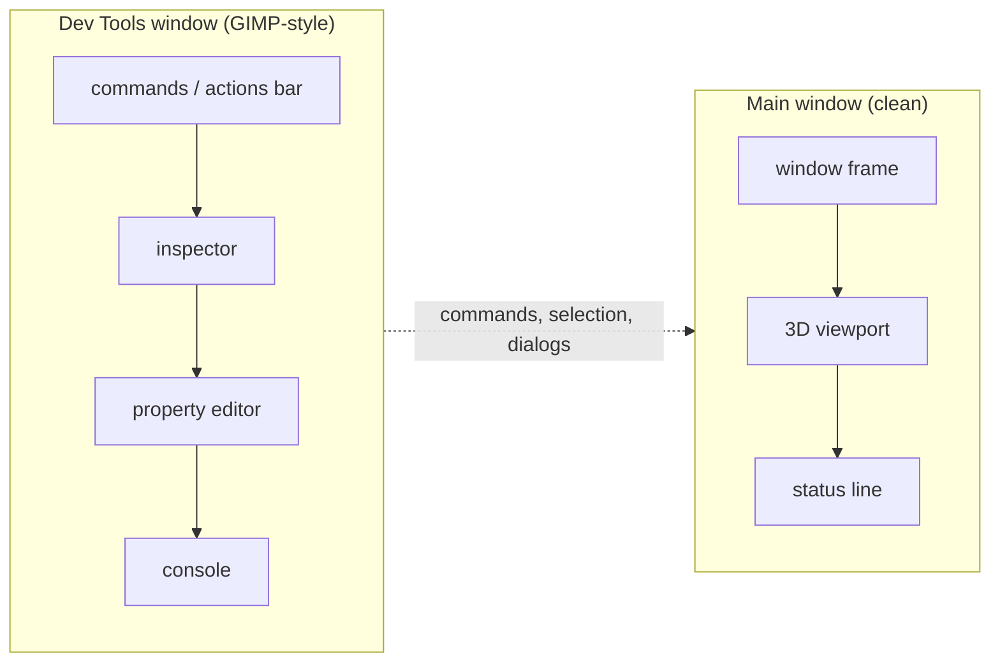

# Dev tools window: move the old tooling out of the main window

Status: task (2026-10-22). Backlog entry **P0.5** in
[`TODO-22-10-2026.md`](../TODO-22-10-2026.md). Companion to
[`app-shell-vision.md`](../app-shell-vision.md) and
[`actions-and-tools.md`](../actions-and-tools.md).

## Goal

Make the main window a **clean slate** for the future navigation/tool design: the
viewport, the window frame, and a minimal status line. Move the development UI — the
actions bar (the menu/toolbar), the inspector, the property editor, and the console —
into a separate **Dev Tools** window, GIMP-toolbox style. It can be toggled, closed, and
reopened without losing state.

This is a **reset, not a redesign**. The command registry, the Python facade, and every
command keep their behaviour; only their home changes. The new navigation and tool UI is
designed later against the clean viewport.

## Non-goals

- Designing the new navigation or tool surface.
- Changing command semantics, the Python API, or the actions' enablement rules.
- Docking, tabbing or layout persistence (first cut: one floating window).
- Removing the transient tool strip (it is session feedback, not chrome; see
  “Decisions” below).

## Current surfaces (inventory)

All in `crates/ferrocad_gpui/src/shell.rs` unless noted.

| Surface | Where | Destination |
| --- | --- | --- |
| Window frame / title bar | `window_frame(...)` at the root render | **stays** (main) |
| Actions bar (commands, enablement, checked state) | `actions_bar` (`:1226`) | **moves** |
| Model inspector (documents → objects) | `tree_panel` (`:1484`) | **moves** |
| Property editor | `properties_panel` (right pane) | **moves** |
| Console (transcript + input) | `console_panel` (`:1712`) | **moves** |
| Status line (status + hover pass-through + version) | root render, before `window_frame` | **stays** (minimal) |
| Transient tool strip | `tool_strip` (`:1162`) | **stays for now** (see Decisions) |
| Modal dialogs / dialog overlay | `dialog_overlay` | **stays** in the main window |
| Root layout | the `content` chain in `Shell::render` | split into two views |

The root layout today is: `actions_bar` → `[tree | viewport | properties]` → `console`
→ `status`, inside `window_frame`.

## Target layout

Dialogs stay in the main window so a command invoked from the Dev Tools window opens
its modal over the viewport, where the user is looking.

## Mechanics

- `Shell` keeps `ShellModel` as the single source of truth. The Dev Tools view holds
  an `Entity<Shell>` (or a `WeakEntity`) and reads `shell.read(cx)`; it never owns a
  second model and never boots a second interpreter.
- Extract the panels into `pub(crate)` render functions (or small `Render` views) so
  both windows can call them. The dev view composes them; `Shell::render` composes only
  the viewport and status.
- **Do not render the viewport entity twice.** The main window owns it; the Dev Tools
  view must not include it.
- Open the second window with `cx.open_window(WindowOptions, …)` (the pattern is in
  `crates/ferrocad_gpui/src/lib.rs:146`). Store `WindowHandle<DevTools>` on the shell;
  the toggle opens, focuses, or closes it. A closed window keeps its state; reopening
  rebuilds the view around the same `Shell` entity.
- Default bounds: a narrow tall window (about 420×760), title “FerroCAD Dev Tools”,
  placed beside the main window. Use the existing `window_frame` so it is decorated
  consistently.
- Commands: register `Dev_ToggleTools` (menu text “Dev Tools”, accel `Ctrl+Shift+D`).
  When no second window can be opened (headless, or a platform refusal), return a
  clear `{"status": …}` and leave the main window unchanged.
- Shortcuts run from either window; the Dev Tools window must not swallow `Esc` meant
  for the viewport (the modal and tool cancel paths stay on the shell root).

## Subtasks

- [ ] **D1 — extract panels.** `actions_bar`, `tree_panel`, `properties_panel`,
      `console_panel` become reusable from a second view without duplicating state.
      Keep the existing `#[gpui::test]`s compiling.
- [ ] **D2 — `DevTools` view.** A second-window view over `Entity<Shell>`; renders the
      four panels in a single column, observers refresh it with the shell.
- [ ] **D3 — slim the main window.** Remove the four panels from `Shell::render`;
      keep the viewport, the status line and the dialog overlay.
- [ ] **D4 — toggle and lifecycle.** `Dev_ToggleTools` + `Ctrl+Shift+D`, the
      `WindowHandle`, focus/close/reopen, and the headless status path.
- [ ] **D5 — tests.** Headless: the main shell renders without the four panels; the
      Dev Tools view lists the commands with enablement; selecting in the inspector
      updates the property editor; running a command updates the shell; closing and
      reopening preserves the model; one interpreter only.
- [ ] **D6 — docs.** Update `app-shell-vision.md` S1/S6 and `actions-and-tools.md`
      (where the bar lives); note the reset in the TODO.

## Acceptance

- The main window shows only the window frame, the viewport and the status line (plus
  the transient tool strip while a tool runs, and a modal when one is open).
- The Dev Tools window shows the actions bar, inspector, property editor and console;
  they behave exactly as they did in the combined window.
- A command run from Dev Tools opens its dialog in the main window and applies there.
- Closing the Dev Tools window does not change the document, stop the viewport, or
  drop the selection; reopening restores the same view.
- `cargo test -p ferrocad_gpui` and `cargo test -p ferrocad_toy` pass; the toy starts
  and can toggle the window.
- No Python API change, no second interpreter.

## Risks

- **Entity reuse across windows.** gpui can render one entity in several windows; the
  viewport must not be one of them. Keep the viewport in `Shell::render` only.
- **Focus and key routing.** `Ctrl+Shift+D` and the command shortcuts must work from
  either window; `Esc` must still reach the tool/modal path. Add tests for both.
- **Refresh cost.** The dev view should subscribe to the shell, not poll; the shell
  already notifies on model changes.
- **Platform windows.** A second window is normal on Wayland/X11 and macOS; verify the
  Linux session first.

## Decisions to make while doing it

- **Tool strip:** keep it in the main window for now. It is transient session feedback,
  not chrome, and the new interaction design will replace it. Moving it to Dev Tools
  would hide the cancellation affordance.
- **Dialog placement:** main window, over the viewport.
- **Status line:** keep the minimal status + hover line; it is the only main-window
  chrome we retain.
