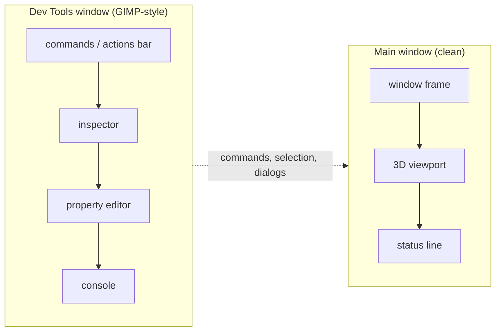

# Dev tools window: move the old tooling out of the main window

Status: task (2026-10-22). Backlog entry **P0.5** in
[`TODO-22-10-2026.md`](../record/TODO-22-10-2026.md). Companion to
[`app-shell-vision.md`](../direction/app-shell-vision.md) and
[`actions-and-tools.md`](../workbenches/actions-and-tools.md).

## Goal

Make the main window a **clean slate** for the future navigation/tool design: the
viewport, the window frame, and a minimal status line. Move the development UI — the
actions bar (the menu/toolbar), the inspector, the property editor, and the console —
into a separate **Dev Tools** window, GIMP-toolbox style. It can be toggled, closed, and
reopened without losing state.

This is a **reset, not a redesign**. The command registry, the Python facade, and every
command keep their behaviour; only their home changes. The new navigation and tool UI is
designed later against the clean viewport.

## Non-goals

- Designing the new navigation or tool surface.
- Changing command semantics, the Python API, or the actions' enablement rules.
- Docking, tabbing or layout persistence (first cut: one floating window).
- Removing the transient tool strip (it is session feedback, not chrome; see
  “Decisions” below).

## Surfaces at the start (inventory)

The line numbers and the `actions_bar` row are the pre-reset tree (2026-10-22); the
strip was removed in P0.6/T6, and the four panels now render in the Dev Tools window.

All in `crates/ferrocad_gpui/src/shell.rs` unless noted.

| Surface | Where | Destination |
| --- | --- | --- |
| Window frame / title bar | `window_frame(...)` at the root render | **stays** (main) |
| Actions bar (commands, enablement, checked state) | `actions_bar` (`:1226`) | **moves** |
| Model inspector (documents → objects) | `tree_panel` (`:1484`) | **moves** |
| Property editor | `properties_panel` (right pane) | **moves** |
| Console (transcript + input) | `console_panel` (`:1712`) | **moves** |
| Status line (status + hover pass-through + version) | root render, before `window_frame` | **stays** (minimal) |
| Transient tool strip | `tool_strip` (`:1162`) | **stays for now** (see Decisions) |
| Modal dialogs / dialog overlay | `dialog_overlay` | **stays** in the main window |
| Root layout | the `content` chain in `Shell::render` | split into two views |

The root layout today is: `actions_bar` → `[tree | viewport | properties]` → `console`
→ `status`, inside `window_frame`.

## Target layout

Dialogs stay in the main window so a command invoked from the Dev Tools window opens
its modal over the viewport, where the user is looking.

## Mechanics

- `Shell` keeps `ShellModel` as the single source of truth. The Dev Tools view holds
  an `Entity<Shell>` (or a `WeakEntity`) and reads `shell.read(cx)`; it never owns a
  second model and never boots a second interpreter.
- Extract the panels into `pub(crate)` render functions (or small `Render` views) so
  both windows can call them. The dev view composes them; `Shell::render` composes only
  the viewport and status.
- **Do not render the viewport entity twice.** The main window owns it; the Dev Tools
  view must not include it.
- Open the second window with `cx.open_window(WindowOptions, …)` (the pattern is in
  `crates/ferrocad_gpui/src/lib.rs:146`). Store `WindowHandle<DevTools>` on the shell;
  the toggle opens, focuses, or closes it. A closed window keeps its state; reopening
  rebuilds the view around the same `Shell` entity.
- Default bounds: a narrow tall window (about 420×760), title “FerroCAD Dev Tools”,
  placed beside the main window. Use the existing `window_frame` so it is decorated
  consistently. The window is `WindowKind::Floating`: macOS gives it the native
  floating level and X11/Wayland make it transient for the main window, so it stays
  above the model while the user orbits (Windows has no such hint in this version).
- A literal **bug button** sits at the right of the status bar
  (`chrome::dev_tools_button`, painted by `ferrocad_widgets::icon::bug`). It runs
  `Dev_ToggleTools`, so the toggle is visible without opening the title-bar menu, and
  it inks with the accent while the window is open.
- Commands: register `Dev_ToggleTools` (menu text “Dev Tools”, accel `Ctrl+Shift+D`).
  When no second window can be opened (headless, or a platform refusal), return a
  clear `{"status": …}` and leave the main window unchanged.
- Shortcuts run from either window; the Dev Tools window must not swallow `Esc` meant
  for the viewport (the modal and tool cancel paths stay on the shell root).

## Subtasks

- [x] **D1 — extract panels.** `actions_bar`, `tree_panel`, `properties_panel`,
      `console_panel` become reusable from a second view without duplicating state.
      Keep the existing `#[gpui::test]`s compiling. (P0.6/T6 later removed the flat
      `actions_bar`; the Dev Tools replacement is `chrome::command_list_panel`.)
- [x] **D2 — `DevTools` view.** A second-window view over `Entity<Shell>`; renders the
      four panels in a single column, observers refresh it with the shell.
- [x] **D3 — slim the main window.** Remove the four panels from `Shell::render`;
      keep the viewport, the status line and the dialog overlay.
- [x] **D4 — toggle and lifecycle.** `Dev_ToggleTools` + `Ctrl+Shift+D`, the
      `WindowHandle`, focus/close/reopen, and the headless status path.
- [x] **D5 — tests.** Headless: the main shell renders without the four panels; the
      Dev Tools view lists the commands with enablement; selecting in the inspector
      updates the property editor; running a command updates the shell; closing and
      reopening preserves the model; one interpreter only. (The one-interpreter claim
      is structural — `dev_tools.rs` owns only an `Entity<Shell>`, and the interpreter
      is configured once — rather than asserted by a test.)
- [x] **D6 — docs.** `app-shell-vision.md` §5, `actions-and-tools.md` §7/§16 and the
      TODO all carry the reset. (The earlier “Partially done” note described the
      staging; `app-shell-vision.md` §5 and the backlog were updated in the same
      pass.)

## Acceptance

- The main window shows only the window frame, the viewport and the status line (plus
  the transient tool strip while a tool runs, and a modal when one is open). ✅
- The Dev Tools window shows the commands, inspector, property editor and console;
  they behave exactly as they did in the combined window. ✅ (The flat bar is replaced
  by the vertical command list in P0.6/T6.)
- A command run from Dev Tools opens its dialog in the main window and applies there. ✅
  (Headless: `run_command` with the Dev Tools window open opens the dialog on the
  shared shell, and `Esc` from the Dev Tools window cancels it. A row click calls the
  same `run_command`, but no test clicks a row specifically.)
- Closing the Dev Tools window does not change the document, stop the viewport, or
  drop the selection; reopening restores the same view. ✅
- `cargo test -p ferrocad_gpui` and `cargo test -p ferrocad_toy` pass; the toy starts
  and can toggle the window. ✅ (2026-10-22: gpui lib **115 passed**, toy **14 passed**;
  the toy's live window/toggle was not exercised in this pass.)
- No Python API change, no second interpreter. ✅ (`ferrocad_shell.commands()` gained
  the two optional surface fields plus `dev_only`, and `set_provider` was added for
  the header provider rows; `FreeCADGui._command_list()` forwards the dev-only flag,
  but its public upstream surface is unchanged. The Dev Tools view owns only
  `Entity<Shell>`.)

## As built (2026-10-22)

- The panels stay free functions (`pub(crate)` in `shell.rs`) rather than separate
  `Render` views: the Dev Tools view builds them from the shell's `Context`, so their
  listeners still run against the one `Shell` entity. `dev_tools::DevTools` only owns
  the `Entity<Shell>`, a focus handle and a change subscription.
- Opening the window is **deferred by one effect cycle** (`cx.defer`): `open_window`
  draws the first frame synchronously, and that frame reads the shell, so creating it
  inside the command's own `shell.update` would be re-entrant. The deferred open sets
  the final `dev tools: open` status once the handle exists.
- The main window's root has a focus handle now (`Shell::root_focus_handle`); boot
  focuses it instead of the console, which no longer lives in that window's tree. That
  keeps `Esc` and the shortcuts working from the main window.
- `Dev_ToggleTools` is registered by `ferrocad_shell` (`FerroCAD_Surface: "hidden"`,
  `Ctrl+Shift+D`); its `Activated` returns `{"status": "dev tools: no GUI window to
  toggle"}` for headless/upstream callers, while `Shell::run_command` intercepts the id
  to own the actual window.
- The app menu (`☰`) that reveals the toggle lives at the leading edge of the **main
  window's title bar** (`window_frame_with_leading`), checked while the window is
  open; the viewport's `Grid`/`Axes`/`WP` controls float as a compact pill over
  the canvas' top-left, so the main window has no `3D viewport` sub-header row. The Dev
  Tools window's own title bar carries no menu (it calls plain `window_frame`).
- The **command list is where the dev-only commands live**. `Mods_Settings` and the
  backend settings commands (`GridOverlay_Settings`, `GridOverlayCoin_Settings`,
  `AxisOverlay_Settings`, `AxisOverlayCoin_Settings`) carry `FerroCAD_DevOnly`, so
  they remain in the Dev Tools list (and the registry) while no header/dock surface
  offers them. The main header has only `Grid`, `Axes` and `WP`.
- The Dev Tools body starts with an inline **Providers** panel: one row per
  registered feature, one button per backend, the active one accented. It switches
  through the same `Shell::activate_provider` path as the header popover rows, so
  the `Mods` dialog is no longer the user-facing parameters path.
- A **GPU adapter** panel follows Providers (before the command list). It shows
  `Auto` plus one row per adapter `ferrocad_wgpu::adapter::adapters()` enumerates,
  with backend, device type and driver; the persisted row is accented and labelled
  `active`, and the footer names the adapter the viewport renderer is on (or `no
  viewport`). The list is enumerated once when the window opens, not per frame.
  A click runs a synthetic `ferrocad-gpu:auto` / `ferrocad-gpu:adapter:<name>` id
  through `Shell::run_command`, which persists the choice with
  `ferrocad_shell.set_gpu_adapter` and recreates the viewport through the existing
  `Shell::enable_viewport` path. That path replaces the viewport entity and its
  event subscription, so running it a second time is safe.
- **Adapter scope (honest limitation).** The setting selects the adapter of the
  renderer the shell creates for the **image path**. Zero-copy presentation
  (`crates/ferrocad_gpui/src/interop.rs`) builds its own renderer on the window
  renderer's adapter at the first paint, and the window compositor keeps its own
  device, so while zero-copy is active that adapter wins regardless of the
  setting. The panel and the status line say so; this is a constraint, not a
  claim that the window device follows the setting.
- The stored value is
  `User parameter:BaseApp/Preferences/View/GpuAdapter` (default `auto`). The
  grammar is `auto`, `backend:vulkan|gl|metal|dx12`, or `adapter:<name
  substring>`; an invalid persisted value falls back to `Auto` with a console
  line rather than leaving the viewport without a renderer.
- The menu is **title-bar chrome, not header chrome**. When the platform draws the
  decorations, `window_frame_with_leading` cannot put it in a client title bar, so it
  renders a slim `leading-bar` below the platform title bar instead of dropping the
  menu. The headless test platform reports server-side decorations and exercises that
  branch; a `TitleBarHarness` renders the production `title_bar` for the click/popover
  assertions. The real client-decoration frame is visual-only.
- Shortcuts run from both windows through `Shell::handle_key`; the Dev Tools root also
  forwards `Esc` to an open modal in the main window.
- **Pane accordion (2026-10-25).** The column could not hold every pane: the old
  fixed heights summed to more than the 760 px default window (Providers 180, GPU 200,
  Commands 240, Console 160, plus the two flexible panes), so the lower ones were
  simply clipped. The panes are now `ferrocad_widgets::accordion` sections with the
  same heights as *preferred* values, and every pane keeps a header.
  `ferrocad_widgets::window_chrome::content_height` removes the client title bar and
  insets from `viewport_size()` so the fit test is against the real content box. In
  the default window the stack does not fit, so the open panes each paint a body and
  share the remaining height. Commands, Model and Properties start open (the tree and
  the property editor are useful side by side); Providers, GPU and Console start
  collapsed. The choice is `Shell::dev_accordion`, so it survives closing and
  reopening the window. Clicking a header **toggles only that pane** — the others keep
  their bodies — so any set can be open at once; `open_only`/`close_all` narrow it when
  a pane needs the height. In a window tall enough for every body, all bodies show
  until the first header click, after which the manual set wins. Tests that type into
  the console or a property field therefore show their pane first — an unpainted field
  cannot take focus.
- **Scrollbars (2026-10-25).** gpui reserves `scrollbar_width` in the layout but paints
  nothing, and the published `bite-gpui` crates ship no scrollbar element (Zed's lives
  in its private `ui` crate). Every `overflow_y_scroll()` pane therefore scrolled with
  no affordance. `ferrocad_widgets::scroll` supplies it: `scroll_area` wraps the rows in
  a tracked scroll container and overlays a 4 px thumb (20 % white, accent while
  dragged) on a 10 px hit strip; the console's text area, which owns its container,
  takes `scroll_thumb` alone. The thumb is painted by a `canvas`, so it tracks the live
  offset without the shell re-rendering. Pressing the track jumps the scroll to that
  position; dragging the thumb scrolls; a wheel event over the strip is forwarded to
  the tracked handle, since the strip has no scrollable ancestor of its own.
  `Shell::dev_scroll` holds one handle per Dev Tools pane so a pane keeps its position
  across repaints and window reopens.

## Risks

- **Entity reuse across windows.** gpui can render one entity in several windows; the
  viewport must not be one of them. Keep the viewport in `Shell::render` only.
- **Focus and key routing.** `Ctrl+Shift+D` and the command shortcuts must work from
  either window; `Esc` must still reach the tool/modal path. Add tests for both.
- **Refresh cost.** The dev view should subscribe to the shell, not poll; the shell
  already notifies on model changes.
- **Platform windows.** A second window is normal on Wayland/X11 and macOS; verify the
  Linux session first.

## Decisions to make while doing it

- **Tool strip:** keep it in the main window for now. It is transient session feedback,
  not chrome, and the new interaction design will replace it. Moving it to Dev Tools
  would hide the cancellation affordance.
- **Dialog placement:** main window, over the viewport.
- **Status line:** keep the minimal status + hover line; it is the only main-window
  chrome we retain.
