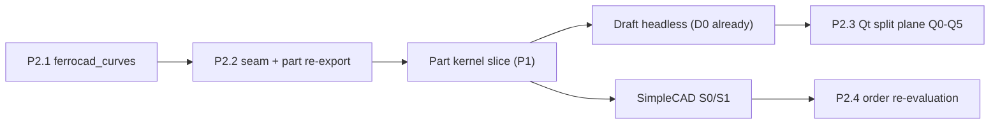

# P2 — architecture: curves, Part/Draft layering, Qt, SimpleCAD order

Status: task (2026-10-22). Backlog entry **P2** in
[`TODO-22-10-2026.md`](../TODO-22-10-2026.md). Companion to
[`part-draft-layering.md`](../architecture/part-draft-layering.md),
[`qt-strategy.md`](../workbenches/qt-strategy.md),
[`simplecad-bringup.md`](../workbenches/simplecad-bringup.md), and
[`architecture.md`](../architecture.md) §6.

P2 is the **shape of the work**, not its bulk. It decides where code lives before the
Part kernel and the Draft GUI are written, so the kernel slice does not land in the
wrong crate. P2.1/P2.2 are prerequisites for the Part kernel and for SimpleCAD; P2.3 is
a program that starts only when the Draft GUI work does.

## P2.1 — the `ferrocad_curves` leaf

Add a new leaf crate over `ferrocad_types` for **analytic geometry**:

- `Vector2` (if needed), `Line`, `LineSegment`, `Circle`, `Arc`, `Ellipse`,
  `BSplineCurve`, `BezierCurve`, `Plane`/`Workplane` frame helpers, and an `EdgeCurve`
  enum.
- `Wire` as an ordered edge list; `polygon`; `sort_edges`; the tolerance constants.
- 2D intersections and offsets only as needed by the first consumer; no speculation.
- **No** `Shape`, no `TopoDS`, no OCCT, no document types.

Why a new crate rather than widening `ferrocad_geom`: `ferrocad_geom` is the
kernel-neutral **B-Rep seam** (`Shape`, `History`, `ElementMap`, `GeometryBackend`),
and every presentation crate depends on it; the analytic layer is a different concern.
Naming it `ferrocad_curves` (not `ferrocad_planar`) keeps 3D-parameterised curves
honest — Draft's curves lie in a workplane, but they are 3D curves.

Subtasks:

- [ ] Crate skeleton over `ferrocad_types`, with a `#![deny(missing_docs)]`-style
      header matching the workspace.
- [ ] The curve types and `EdgeCurve`, with round-trip/parameterisation tests.
- [ ] `Wire` ordering (`sort_edges`) with degenerate/duplicate-endpoint tests.
- [ ] A doc comment that points at the upstream `Part::Geom*` classes it mirrors.

**Acceptance:** `cargo test -p ferrocad_curves` is green with no OCCT in the dependency
tree (`cargo tree -p ferrocad_curves | grep -i occt` is empty).

## P2.2 — Part/Draft layering and the seam

Decide the crate edges and the single seam:

- `ferrocad_geom -> ferrocad_curves` (one direction only).
- `ferrocad_geom` gains `make_edge(&EdgeCurve) -> Result<Shape, GeomError>` (and
  `make_wire`, `make_face` when the first consumer needs them). The kernel
  implementation stays in `ferrocad_occt`; `ferrocad_geom` stays kernel-neutral.
- `ferrocad_part` is the **document layer**: `Part::Feature`, the shape property, and
  a re-export of both halves (`ferrocad_curves` + `ferrocad_geom::Shape`), so a
  consumer of `ferrocad_part` gets the whole `Part` contract.
- `import Part` recombines them in `ferrocad_part_py`; `import Draft` is upstream
  Python on top of it.
- Forbidden edges, restated: `ferrocad_draft -> ferrocad_occt` (go through Part),
  `ferrocad_curves -> ferrocad_geom`, `ferrocad_core -> ferrocad_curves`.

Subtasks:

- [ ] Add the `ferrocad_curves` edge and the `make_edge` method to
      `GeometryBackend`/`ferrocad_geom`; implement it in `ferrocad_occt`.
- [ ] Implement `curve_of` (`Edge.Curve`) — the Draft geometry code reads
      `edge.Curve` 251 times; without it the Draft tests cannot run.
- [ ] Re-export the halves from `ferrocad_part`; update the dependency table in
      `docs/architecture.md` §6.
- [ ] Update `docs/architecture/part-draft-layering.md` "after" table to match the code.
- [ ] A test that a `Part.LineSegment` round-trips to an `Edge` and back
      (`Part.LineSegment(...).toShape().Curve`), headless.

**Acceptance:** the dependency graph matches the documented table; `cargo test` is green
for `geom`, `occt`, `part`, `part_py`; no new edge into `ferrocad_occt` from a
workbench crate.

**Cost of being wrong:** a wrong home is a mechanical move (a module and its imports);
a wrong edge is architectural. Prefer a new leaf over widening `ferrocad_types`.

## P2.3 — the Qt split plane (gated)

Implement [`qt-strategy.md`](../workbenches/qt-strategy.md) option **D** only when the Draft GUI
work starts; it is a program, not a slice:

- **Q0** — pin the contract: `tools/draft_contract.py` emits
  `contracts/draft-forms.json` (19 `.ui`, 32 classes, 72 member pairs); the headless
  import fixes from D0; `ParameterGrp.GetStrings()`.
- **Q1** — `ferrocad_ui`: parse the 19 `.ui` files into a form tree (widgets, layouts,
  properties, spacers, the custom-widget registry).
- **Q2** — `ferrocad_ui_py`: `FreeCADGui.PySideUic.loadUi` and the proxy/micro-shim
  (`FormProxy`/`WidgetProxy`/`SignalProxy`), headless.
- **Q3** — render the six core forms in gpui; `Control.showDialog/closeDialog` over an
  async modal.
- **Q4** — `Snapper`/`WorkingPlane`/`draftToolBar` routed to `ferrocad_stage`; async
  point input; the snap bar as commands.
- **Q5** — the remaining forms (`SetStyle`, `Hatch`, `AnnotationStyleEditor`, the
  code-built `task_scale`).

**Gate:** do not start Q1 until Q0's contract JSON is stable and the Draft headless
group (D0.6) is green. Do not bundle Qt as a shortcut (option A); the evidence is in
`qt-strategy.md` §2.2–§2.3 and §3.

**Acceptance (program-level):** the six core panels open, accept and apply against a
real Draft command, headless where possible; preference pages are explicitly deferred.

## P2.4 — SimpleCAD order

Keep the recommendation from [`simplecad-bringup.md`](../workbenches/simplecad-bringup.md):
**SimpleCAD first** as the integration target, because it sits directly on `Part`,
has no `.ui` files, and is canvas-first.

- [ ] Wire the **S0/S1** audit into the harness (`tools/conformance.py --simplecad`)
      before writing `Part` code, so the baseline is a number.
- [ ] Re-evaluate after the Part kernel slice: if SimpleCAD's headless tests expose
      gaps that also unblock Draft, keep it first; if not, run both on the shared
      kernel and let the editor decide.
- [ ] Record the outcome here and in the TODO.

## P2.5 — `QtSvg`

Decide whether the distribution needs `QtSvg` (absent from the system PySide6). It is
only needed by a Qt-based Draft GUI (icon/resource loading); the split plane does not
need it. Default: **not required**; revisit if Q0's probe shows a hard import.

## Order and dependencies

P2.1 → P2.2 must land **before** the Part kernel implementation so the kernel writes
into the right crate. P2.3 starts only after D0.6 and the kernel; P2.4 is a decision
point, not a code slice.

## Risks

- **Over-designing curves.** Implement only the primitives the first consumer (Draft's
  `draftgeoutils`) uses; the upstream surface is 42 names, not the whole geometry
  kernel.
- **A second 2D model.** Draft's curves are 3D-parameterised; do not let a
  "planar" shortcut leak into the API.
- **Qt scope creep.** Q0–Q2 are headless and testable; Q3+ is where the cost lives.
  Keep the gate.
