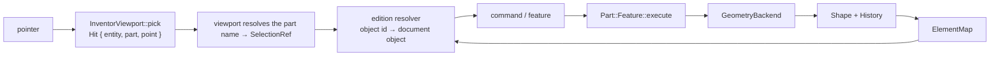

# Topology, selection, and the F0 prerequisite

Status: **F0.0 (binding reconnaissance and the tessellation/topology spike), F0.1
(the kernel-neutral vocabulary), F0.2 (the OCCT implementation), F0.3 (pick
coherence), F0.4 (the stage view) and F0.5 (the selection bridge) are built
(2026-10-20); F0.6 is planned.** Companion to [`geometry-and-topology.md`](geometry-and-topology.md)
(the naming problem and the lineage engine), [`occt-integration.md`](occt-integration.md)
(the crate layout), [`occt-history-spike.md`](occt-history-spike.md) (the verified
history bridge), and [`gizmo-manipulators.md`](gizmo-manipulators.md) (the manipulators
that need this seam).

This note answers three questions:

1. Do we bind OCCT directly, hide it behind a FerroCAD wrapper, or build on Part?
2. What exactly does the topology prerequisite (F0) have to deliver?
3. What, in the code as it stands, is already there?

## 0. Decision

**Keep the three-layer split, and deepen it.** F0 is not a Part feature and not an
OCCT binding in the UI:

| Layer | Crate | Role |
| --- | --- | --- |
| Seam | `ferrocad_geom` | kernel-neutral topology, tessellation, selection and lineage vocabulary; the `GeometryBackend` trait |
| Kernel | `ferrocad_occt` | the only crate that names `opencascade-sys`; one implementation |
| Workbench | `ferrocad_part` | document object types and the Python `Part` surface; consumes the seam |

Part is a **consumer** of the seam, not the seam itself. A BIM workbench depends on
`ferrocad_geom` plus its own backend (IfcOpenShell is itself OCCT-backed for geometry,
but its model is IFC, not `Part::Feature`), never on Part — and still gets the Spatial
Transactor, because the manipulators consume neutral `ElementRef`/`Hit` data.

## 1. What exists today

| Crate | Has | Does not have |
| --- | --- | --- |
| `ferrocad_geom` | `Shape`, `ElementRef`, `History`, `ElementMap` (+`apply`/`from_history`), `SelectionRef`, `ElementKind`, `Continuity`, `Tessellation`/`TessellationOptions`, `Capabilities`; `GeometryBackend` gains `capabilities`, `tessellate`, `elements`, `ancestors`, `continuity`, `chamfer` (defaulted, so `NullBackend` need not implement them) | — |
| `ferrocad_occt` | box/fuse/cut/fillet/place/chamfer, BREP save/load, the six seam methods, fillet/chamfer lineage, `fc_topology.hxx` (list access, `IsSame` lookups, edge tangents) | — |
| `ferrocad_part` | `Part::Feature` (Shape + Placement), `Part::PropertyPartShape`, `register(backend)`, `make_box` | `Part::Fillet`/`Part::Chamfer` object types, element maps, a selection service |
| `ferrocad_part_py` | `Part.makeBox`, `Part.Shape` (`isNull`, `isSame`, `exportBrep`, `exportBrepToString`), the extension converter hook | `Faces`/`Edges`/`Vertexes`, `ShapeType`, `tessellate`, `Part.show`, booleans, fillet |
| renderer | `Vertex.part_idx`; the GPU pick pass writes `[entity_id, part_idx]`; the CPU path reports `Hit { part, element }`; screen-space line tolerance (2 px) | — |
| viewport | a click resolves `(entity, part)` through the stage item's name table and reports `SelectionEvent`/`SelectionRef`; `hovered_part`/`hovered_selection` mirror it | the entity → document-object mapping (the edition's job, F0.6/commands) |
| conformance | `part_conformance` runs upstream Part tests when `FERROCAD_UPSTREAM` is set; CI `geometry` job | tessellation/topology coverage |

So Part is still a **shape carrier** at the document level: it persists a BREP and
round-trips `obj.Shape`, but it does not yet own fillet/chamfer features. The **picking
and selection halves are done**: a click on a tessellated shape now reports
`SelectionRef { object, elements: ["Face6"] }`.

## 2. Why not the two alternatives

**Bind OCCT directly in the tools or viewport.** It forces the base app and every
presentation crate to link OCCT, breaks the `default-members`/edition split, leaks
`TopoDS_Shape` into UI code, and makes a second backend impossible. `ferrocad_occt`
already *is* the direct binding; it is simply the only crate allowed to be that.

**Make Part the shared foundation.** Part carries FreeCAD's `Part::Feature` semantics
and the Python `Part` compatibility contract. BIM does not want `Part::Feature`; it
wants IFC entities and a spatial structure. If the gizmo depended on Part, every
workbench would inherit Part's document types.

## 3. Dependency rules

The existing rules in [`architecture.md`](architecture.md) §6 stand; F0 adds one edge
and no kernel edge:

```
ferrocad_geom   -> ferrocad_types                          [seam; never OCCT]
ferrocad_occt   -> ferrocad_geom, ferrocad_types, opencascade-sys
ferrocad_part   -> ferrocad_core, ferrocad_geom, ferrocad_types
ferrocad_stage  -> ferrocad_graphics, ferrocad_types, ferrocad_geom
ferrocad_viewport -> ferrocad_stage, ferrocad_geom, ferrocad_inventor, ...
                                                             [+ geom for SelectionRef]
edition (ferrocad_parametric) -> ferrocad_part_py, ferrocad, ...      [composition root]
```

`ferrocad_stage` gains `ferrocad_geom` so a `ShapeItem` can be built from a
`Tessellation` without a second mesh type. F0.5 adds the same leaf dependency to
`ferrocad_viewport`, so a click can report a `SelectionRef`. `ferrocad_geom` is a leaf above
`ferrocad_types`, so the presentation crates still link no kernel.

## 4. The seam: what F0.1 adds to `ferrocad_geom`

```rust
pub enum ElementKind { Solid, Shell, Face, Wire, Edge, Vertex }

pub struct TessellationOptions {
    /// Linear deflection in model units; `None` derives it from the bounding box.
    pub linear_deflection: Option<f64>,
    pub angular_deflection: f64,
    pub relative: bool,
}

pub struct Tessellation {
    pub positions: Vec<[f32; 3]>,
    pub normals: Vec<[f32; 3]>,      // empty ⇒ flat-shaded per triangle
    pub triangles: Vec<u32>,         // 3 per triangle
    pub triangle_parts: Vec<u32>,    // part id per triangle
    pub edges: Vec<u32>,             // 2 per topological-edge segment
    pub segment_parts: Vec<u32>,     // part id per segment
    pub vertices: Vec<u32>,          // one per topological vertex
    pub vertex_parts: Vec<u32>,      // part id per vertex
    pub parts: Vec<String>,          // part id → "Face6" / "Edge3"
}

pub struct Capabilities(/* bitflags */);

pub trait GeometryBackend: Send + Sync {
    fn capabilities(&self) -> Capabilities;   // BOOLEANS | FILLET | CHAMFER | …
    fn tessellate(&self, shape: &Shape, opts: &TessellationOptions)
        -> Result<Tessellation, GeomError>;
    fn elements(&self, shape: &Shape, kind: ElementKind) -> Vec<ElementRef>;
    fn ancestors(&self, shape: &Shape, element: &ElementRef, kind: ElementKind)
        -> Vec<ElementRef>;
    fn continuity(&self, shape: &Shape, a: &ElementRef, b: &ElementRef)
        -> Option<Continuity>;
    fn chamfer(&self, shape: &Shape, edges: &[ElementRef], d1: f64, d2: Option<f64>)
        -> Result<OpResult, GeomError>;
    // …the existing methods
}
```

Two deliberate choices:

- **The mesh carries names, not `ElementRef`s.** A sub-shape handle is a kernel copy; a
  display mesh should stay cheap. `parts: Vec<String>` plus `backend.resolve` on
  selection keeps it that way, and matches the fact that names are the persisted
  contract.
- **The mesh is a plain value type.** No `Shape`, no kernel types, so it can cross into
  `ferrocad_stage` and Python without dragging a kernel along.

The trait additions have **defaults**: `capabilities` is empty, `tessellate` and
`chamfer` report the operation as unsupported (via `unsupported`), and
`elements`/`ancestors` are empty. A backend therefore compiles before it supports a
slice, and `NullBackend` needs no changes.

**F0.1 as built (2026-10-20).** `ferrocad_geom` gained `ElementKind` (with FreeCAD name
prefixes), `Continuity`, `TessellationOptions`, `Tessellation` (plus triangle/segment/
part accessors), `Capabilities` (`BOOLEANS | FILLET | CHAMFER | TESSELLATION |
TOPOLOGY`), `SelectionRef`, `UnsupportedOperation`/`unsupported`, the six defaulted
trait methods above, and `ElementMap::apply`/`from_history` (modified before generated,
first output wins, deleted names retired). Six new tests cover the bitflags, the map
fold, the null backend's empty topology, the mesh accessors and the selection
constructors; `cargo test -p ferrocad_geom` is 11 tests + the doctest.

**F0.2 as built (2026-10-20).** `ferrocad_occt` gained `src/topology.rs` and
`include/fc_topology.hxx`. `OcctBackend` now advertises
`BOOLEANS | FILLET | CHAMFER | TESSELLATION | TOPOLOGY`, tessellates with
`BRepMesh_IncrementalMesh` (deflection from `TessellationOptions`, or 1e-3 of the
bounding diagonal), enumerates elements with `TopExp::MapShapes`, answers adjacency in
both directions, reports edge-to-edge continuity from their shared-vertex tangents,
and implements `chamfer`. Fillet and chamfer now report lineage (`Generated` faces and
the consumed edge) instead of an empty `History`.

Implementation notes worth keeping:

- `resolve` understands `SolidN`/`ShellN`/`FaceN`/`WireN`/`EdgeN`/`VertexN`, matching
  `elements` names.
- Adjacency looks keys up with `IsSame` (`fc_indexed_map_find_index_same` /
  `fc_data_map_find_index_same`), because an ancestor list stores shapes with the
  orientation they have in the parent.
- The mesh is flat-shaded. Face, edge and vertex positions share one array, so
  per-vertex normals would have to cover all three; the renderer flat-shades instead.
- An input edge can be both `deleted` and the source of a `generated` face (a fillet);
  the lineage records both, and `ElementMap::apply` retires the edge name.

**F0.3 as built (2026-10-20).** `ferrocad_graphics::Hit` gained `part` (the
`Vertex.part_idx` of the hit primitive) and `element` is now `Option<u32>` — the
primitive ordinal when the CPU ray cast resolves one, `None` from the G-buffer (it
resolves a pixel). CPU picking reads `part` from the primitive's first vertex; the GPU
path writes the same field from the `[entity_id, part_idx]` target. Line picking uses a
screen-space tolerance (`LINE_PICK_PIXELS = 2`) derived from the camera and the
segment's distance; `pick_hit` without a camera keeps a fixed 0.04-world fallback.
`ferrocad_stage::ShapeItem` gained `set_mesh`/`with_mesh` (and `parts()`), which tags
each position and flows into `Vertex.part_idx` for both the surface and wire packets.
`ferrocad_stage_py::Hit.part_idx` now returns `part`, and `element` is optional; the
inventor facade sets `SoFaceDetail`/`SoLineDetail` `part_index = part` and
`face_index`/`line_index = element` (or `-1` when the G-buffer answered).

Zero-copy presentation picks on the window's device: `Presenter` gained defaulted
`pick_at` and `supports_pick`, `GpuiInteropPresenter` delegates to its
`FerrocadRenderer`, and `InventorViewport::pick` prefers the presenter when it supports
picking (an empty hit is authoritative), then the fallback view's G-buffer, then the CPU
ray cast. Hover, button events and tool dispatch share that one pick (they previously
picked separately, and the button/tool paths always used the CPU ray).

**F0.4 as built (2026-10-20).** `ferrocad_stage` now depends on `ferrocad_geom`.
`ShapeItem::from_tessellation`/`set_tessellation`/`with_tessellation` flatten a
`Tessellation` (per-primitive part ids → per-position ids, names kept), and the item
exposes `part_name(id)`/`part_names()`. `set_highlight(&[part])` emits a separate
flat-shaded surface and wire sub-mesh for the selected parts, in `HIGHLIGHT_COLOR`,
with `HIGHLIGHT_DEPTH_BIAS`; `with_vertices(true)` emits the topological vertices as a
`Topology::Points` packet. The base and highlight generations are separate, so moving
the selection does not re-upload the body. `StateSnapshot.depth_bias` is now honoured
by the wgpu shaders (`clip.z -= bias * clip.w`), which is what lets the coplanar
highlight win the depth test.

## 5. F0.0 findings: `opencascade-sys` 0.3.0

Checked against the published crate sources and then **verified by running**
`spikes/occt-tessellation/` against conda-forge OCCT 7.8.1.

| Need | Binding | Status |
| --- | --- | --- |
| Meshing | `b_rep_mesh::IncrementalMesh_new(&shape, deflection)` | bound; the 2-arg constructor only (angle/parallel defaulted, not exposed) |
| Triangles | `poly::Poly_Triangulation` (`NbNodes`, `NbTriangles`, `Node`, `Triangle`, `Poly_Triangle::Value`, `Normal`, `HasNormals`) | bound |
| Per-face mesh | `BRep_Tool_Triangulation(&face, &mut TopLoc_Location)` | bound |
| Location transform | `TopLoc_Location_Transformation`, `gp_Pnt::Transform`, `gp_Dir::Transform` | bound |
| Face/edge/vertex walk | `TopExp::MapShapes` (deduplicated) and `TopExp_Explorer` | bound |
| Ancestors | `TopExp::MapShapesAndAncestors` + `TopTools_IndexedDataMapOfShapeListOfShape` | map bound; **list iteration missing** (`TopTools_ListOfShape` exposes only `Append`/`Size`) |
| Edge polylines | `BRepAdaptor_Curve` + `GCPnts_TangentialDeflection` | **bound and sufficient** — no bridge needed (the planned `Poly_Polygon3D` route is unnecessary) |
| Equal chamfer | `BRepFilletAPI_MakeChamfer::add_edge(distance, edge)` | bound |
| Asymmetric chamfer | `Add(d1, d2, edge, face)` / `SetDist` | **not bound**; note OCCT's argument order is `(d1, d2, edge, face)` |
| Fillet/chamfer history | `BRepFilletAPI_MakeShape::Modified/Generated/IsDeleted` | **not bound** for these classes |
| Bounds (deflection) | `BRepBndLib`, `Bnd_Box` | bound |
| Exact face hit (optional) | `IntCurvesFace_ShapeIntersector` | **not bound** |

Three C++-side additions cover the gaps, in the proven sibling-bridge pattern
(`spikes/occt-tessellation/bridge/include/fc_topology.hxx`; the real one is at
`crates/ferrocad_occt/include/fc_topology.hxx`):

- `fc_list_size` / `fc_list_value` for `TopTools_ListOfShape`, plus `IsSame`-based
  index lookups for both the indexed map and the ancestor data map;
- `fc_chamfer_add_asym(op, d1, d2, edge, face)`;
- `fc_fillet_*` / `fc_chamfer_modified/generated/is_deleted` lineage;
- `fc_edge_tangents(edge1, edge2, out)` for tangent continuity. The earlier plan used
  `BRep_Tool::Continuity`, but its signature is `(edge, face1, face2)` — *surface*
  continuity across one edge, not continuity between two adjacent edges.

No `opencascade-sys` fork or patch is needed, which keeps the bundling story
([`occt-bundling.md`](occt-bundling.md)) unchanged.

### What the spike measured (box 10×10×10, deflection 0.5)

- **Topology:** 1 solid, 6 faces, 12 edges, 8 vertices.
- **Mesh:** 2 triangles per planar face (12 total); `Poly_Triangulation` node and
  triangle indices are **1-based**; `HasNormals` is false (planar faces); three faces
  are `TopAbs_REVERSED`; the triangulation location is identity for a primitive.
- **Enumerating sub-shapes:** `TopExp_Explorer` yields **24** edges — a shared edge is
  visited once per parent face. `TopExp::MapShapes` yields the deduplicated **12**. Use
  `MapShapes` for anything indexed.
- **Ancestors:** `MapShapesAndAncestors(S, TS, TA, M)` keys the map by `TS` and stores
  the containing `TA` elements. It is **ancestor-only**: `(EDGE, FACE)` gives each
  edge's two faces, but `(FACE, EDGE)` is empty. Face → edges needs an explorer over
  the face. The trait's `ancestors` must therefore choose the direction (map when
  going coarser, explorer when going finer).
- **Edges:** every edge samples to ≥ 2 points through `BRepAdaptor_Curve` +
  `GCPnts_TangentialDeflection`; no polygon bridge is required.
- **Chamfer:** equal-distance and the bridged two-distance form both build; one
  chamfered edge turns 6 faces into 7.
- **Fillet:** builds (7 faces); for the seeded edge the lineage is
  `Modified = 0`, `Generated = 1`, `IsDeleted = true` — the fillet face is **generated**,
  so the element map must consume `generated`, not only `modified`.

Run it with:

```sh
cd spikes/occt-tessellation
export OCCT_INCLUDE_DIR=<prefix>/include/opencascade
cargo run
```

## 6. Tessellation contract

- **Index bases.** FreeCAD names are 1-based (`Face6`); Rust ids are 0-based
  (`part == 5` for `Face6`). Convert once, at the seam. `Poly_Triangulation` node and
  triangle indices are 1-based too (the spike confirmed the minimum index is 1).
- **Enumerate with `MapShapes`, not `TopExp_Explorer`.** The explorer visits a shared
  sub-shape once per parent (24 edges on a box); `MapShapes` deduplicates (12).
- **Ancestors are one-directional.** `MapShapesAndAncestors(S, TS, TA, M)` maps `TS`
  to containing `TA`; edge → faces works, face → edges needs an explorer over the
  face. The backend's `ancestors` chooses by direction.
- **Per-face vertex duplication is deliberate.** `BRepMesh` triangulates each face
  independently; a shared geometric vertex cannot carry two part ids. Do not weld
  across faces.
- **Winding.** OCCT face orientation (`TopAbs_REVERSED`) is applied when flattening a
  triangulation, so the renderer's flat normal points outward.
- **Normals.** F0.2 emits none and lets the renderer flat-shade. Faces, edges and
  vertices share one position array, so per-vertex normals would have to cover all
  three; a later slice can split the buffers if smooth shading is wanted.
- **Continuity.** Two edges that share a vertex are compared by their unit tangents at
  that vertex: equal up to sign ⇒ `G1`, otherwise `C0`. Higher orders need curvature
  and are not distinguished; fillet propagation only needs the tangent test.
- **Edges are topological, not mesh seams.** Each topological edge is emitted once as a
  polyline sampled from its polygon-on-triangulation, so the edge lines coincide with
  the face boundaries. `segment_parts` carries the edge ordinal.
- **Deflection.** Default to a fraction of the bounding-box diagonal (with absolute
  floor and ceiling), not a fixed model-unit number; the mesh is a display artefact.
- **Caching.** Tessellation is derived and never persisted. Cache it in the workbench
  view, keyed by `(entity id, shape property version)` — not by `Shape::is_same`,
  whose identity token is not stable across save/load or backend operations.

## 7. The selection loop



- The **viewport** owns `Hit`, resolves `part` through the **name table the stage item
  already carries** (`ShapeItem::part_names`, copied from `Tessellation::parts`), and
  reports a `SelectionEvent` (`Picked(SelectionRef)` or `Cleared`). It never learns
  document names and never links `ferrocad_part`.
- Names are read from the live stage item, not a cache, so a host that assembles a stage
  with `stage_mut` and clicks before the next paint still resolves the current names. A
  click costs one pass over the stage items (not over geometry).
- `PickId(0)` is the compiler's untagged default (and what a non-selectable `ShapeItem`
  emits), so it resolves to `Cleared` rather than an object.
- The **edition** maps `SelectionRef::object` to a document object; the part names are
  already the persisted contract (`LinkSub`).
- A **command** stores `(object, [names])` and a feature `execute` resolves the names
  through the injected backend.

**F0.5 as built.** `InventorViewport` emits a selection on a left press+release that did
not orbit the camera or the navigation cube, did not move a gizmo handle, and was not
consumed by an active tool or the chrome (`orbit_clicked` is the drag-threshold check
captured before the gesture state is cleared). A click that moves a gizmo handle returns
at the commit, so a drag never also selects. `take_selection()` consumes the update;
`hovered_part()`/`hovered_selection()` mirror it for hover previews. The viewport gained
one dependency, `ferrocad_geom` (a leaf: `SelectionRef`), so no kernel reaches presentation.

## 8. Naming and lineage

F0 ships **positional** names (`FaceN`, `EdgeN`, `VertexN`) but treats them as opaque
strings from day one:

- `ElementMap::apply(History)` folds an operation's `generated`/`modified`/`deleted`
  into the map, so a feature can keep the previous names alive across a rebuild.
- `GeometryBackend::resolve` consults the map when present and falls back to positional
  resolution otherwise.
- Do **not** promise `.FCStd` sub-shape compatibility yet, and do not encode positional
  names in a way that cannot be migrated.

## 9. Capabilities

`Capabilities` is what keeps non-solid backends honest: a mesh-only backend returns
`Capabilities::empty()`, and the fillet/draft manipulators never materialise, instead of
every backend stubbing `fillet` with an error. OCCT returns the full set; `NullBackend`
returns none.

## 10. Slice plan

| Slice | Deliverable | Acceptance |
| --- | --- | --- |
| **F0.0 recon** ✅ | Check the `opencascade-sys` 0.3.0 surface (§5); list the sibling-bridge gaps | §5; no code |
| **F0.0b spike** ✅ | `spikes/occt-tessellation/` against OCCT 7.8.1, with `fc_topology.hxx` | box: 6 faces / 12 edges / 8 vertices, 12 triangles, 1-based nodes, adjacency both ways, equal + two-distance chamfer, fillet lineage |
| **F0.1 vocabulary** ✅ | §4 types and trait additions; `ElementMap::apply`; defaulted trait methods | `cargo test -p ferrocad_geom` — 11 tests, no OCCT |
| **F0.2 OCCT** ✅ | `tessellate`, `elements`, `ancestors`, `continuity`, `chamfer`, fillet history | `cargo test -p ferrocad_occt` — 13 tests: part identity, name round-trip, both adjacency directions, C0 corners, equal/asymmetric chamfer, fillet lineage, placed tessellation |
| **F0.3 pick coherence** ✅ | `Hit { part, element: Option<u32> }`; the CPU path reads `Vertex.part_idx`; Python `Hit.part_idx` returns the part; screen-space line tolerance | `ferrocad_graphics` 22 tests (two-group part id, screen-space line hit) and `ferrocad_stage`'s part-tagged mesh test; CPU and GPU agree on `part` |
| **F0.4 stage view** ✅ | `ShapeItem` from `Tessellation`, part names, per-part highlight sub-mesh, vertex packets, honour `depth_bias` | `ferrocad_stage` 59 tests (tessellation→item, highlight only the selected part, clearing it, a points packet); a wgpu test draws a depth-biased coplanar overlay over the base |
| **F0.5 selection bridge** ✅ | `SelectionEvent`/`SelectionRef` from `InventorViewport`, part-name resolution from the stage item, hover mirror | `ferrocad_viewport` 93 tests: a click on each half of a two-face slab yields `("Face1")`/`("Face2")`, an untagged mesh yields the whole object, empty space clears, an orbit and a gizmo commit do not select, a non-selectable item is not selected; no viewport → Part dependency |
| **F0.6 parametric edit** | `Part::Fillet` / `Part::Chamfer` object types (`Base` LinkSub + `Edges` + `Radius`/distances) whose `execute` resolves names and calls the backend; tangent-chain walk over `ancestors` + `continuity` | changing `Radius` and recomputing rebuilds the shape; undo/redo is a document transaction; the F1 arc scrubber only has to update a property |

The first slice to write is **F0.1**, because it is testable without a kernel and pins
the vocabulary the other five slices code against. **F0.0b** can run in parallel on a
machine with OCCT.

## 11. Deferred and non-goals

- **No stable naming beyond `ElementMap::apply`.** FreeCAD's `MappedName` tokens and
  `.FCStd` sub-shape compatibility are a later slice.
- **No exact intersector.** Face selection uses the rendered tessellation, so the pick
  agrees with what is drawn. `IntCurvesFace_ShapeIntersector` can be added later for
  precise snapping.
- **No cross-face vertex welding, no smooth shading across tangent faces.**
- **No compound-scoped names** (`Solid1:Face2`) in F0.
- **No persistence of tessellation or element maps** beyond the shape property's BREP
  and the names the document already stores.
- **No OCCT in `default-members`, the base app, or any presentation crate.**

## 12. Verification

Planned commands for the slices (all green at F0.5; counts are the current suites):

```sh
cargo test -p ferrocad_geom                      # F0.1, no kernel
cargo test -p ferrocad_stage -p ferrocad_graphics -p ferrocad_viewport
cargo test -p ferrocad_occt                      # needs OCCT 7.8+ (the geometry CI job)
cargo test -p ferrocad_part
cargo test -p ferrocad_stage_py                  # Hit.part, the Python surface
```

`ferrocad_viewport`'s F0.5 tests are `a_click_selects_the_named_sub_element_under_the_pointer`
(press+release on each half of a two-face slab), `hover_mirrors_the_selection_without_consuming_it`,
`an_untagged_mesh_selects_the_whole_object`, `clicking_empty_space_clears_the_selection`,
`an_orbit_drag_is_not_a_selection` and `a_non_selectable_item_is_not_selected`; the gizmo
test also asserts a commit produces no selection.

The geometry job sets `OCCT_INCLUDE_DIR` / `OpenCASCADE_DIR` / `LD_LIBRARY_PATH` from a
fetched OCCT prefix, as [`occt-integration.md`](occt-integration.md) §8 describes.
Headless checks use `WgpuRenderer::new_default` + `ViewSpec` + `renderer.image()` (the
pattern in `crates/ferrocad_gpui/examples/inventor_roundtrip.rs`), with a per-part
colour probe to confirm the part ids reached the vertex buffer.

Two local prefixes are supported:

- **apt** (Ubuntu 26.04 ships OCCT 7.9.2): `libocct-data-exchange-dev` pulls the whole
  dependency chain. Headers are in `/usr/include/opencascade`, the CMake config in
  `/usr/lib/x86_64-linux-gnu/cmake/opencascade`, so `OpenCASCADE_DIR` need not be set.
- **CI-matching** (conda-forge `occt=7.8.1`, rootless, the way the workflows fetch it):

  ```sh
  export CMAKE_POLICY_VERSION_MINIMUM=3.5   # CMake ≥ 4 rejects the crate's 3.1 minimum
  export OpenCASCADE_DIR=<prefix>/lib/cmake/opencascade
  export OCCT_INCLUDE_DIR=<prefix>/include/opencascade
  export CMAKE_PREFIX_PATH=<prefix>
  export LD_LIBRARY_PATH=<prefix>/lib:$LD_LIBRARY_PATH
  cargo test -p ferrocad_occt -p ferrocad_part -p ferrocad_part_py
  ```

`opencascade-sys`'s build script only reruns on `DEP_OCCT_ROOT`, so switching prefixes
needs `cargo clean -p opencascade-sys` (or a separate `CARGO_TARGET_DIR`).
