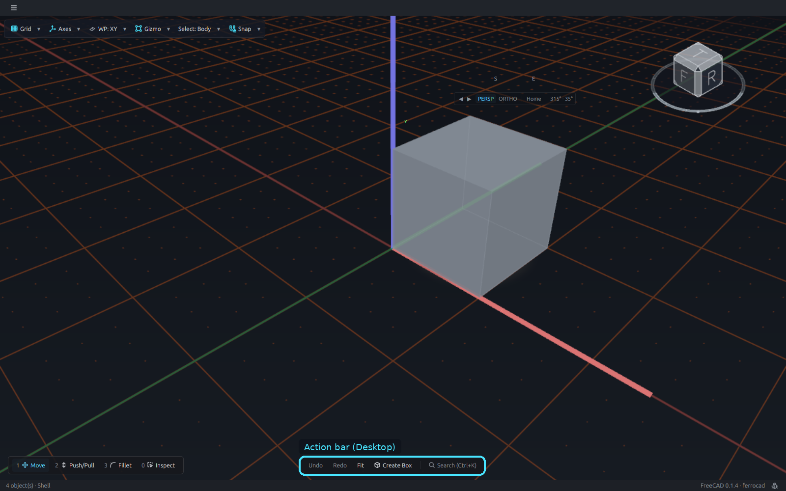
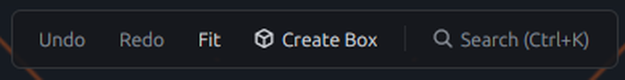
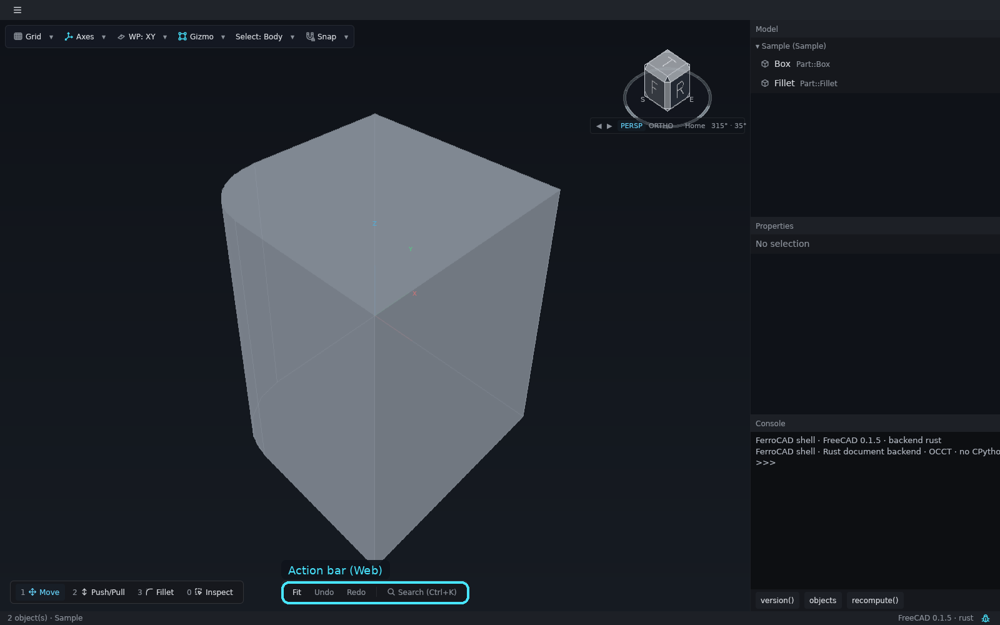
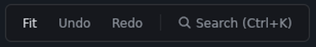

# The action bar

The action bar is the strip that floats at the **bottom-centre** of the canvas. It
carries the commands that create something or act on the whole document; the verbs that
depend on what is under the pointer live in the wheel menu. That split is why the action
bar does not change width when the selection changes.

<button class="fc-tabs__tab is-active" data-fc-tab="desktop" type="button" role="tab" aria-selected="true">Desktop</button>
<button class="fc-tabs__tab" data-fc-tab="web" type="button" role="tab" aria-selected="false">Web</button>

<figure class="fc-tabs__panel" data-fc-panel="desktop" role="tabpanel">

<figcaption><strong>Desktop</strong> — the bottom-centre strip: Undo, Redo, Fit, Create Box and Search. A running tool replaces this strip in the same slot.</figcaption>
</figure>
<figure class="fc-tabs__panel" data-fc-panel="web" role="tabpanel">

<figcaption><strong>Web</strong> — the same slot in the browser build, with Fit, Undo, Redo and Search. The registry decides the buttons; the shell does not name a workbench.</figcaption>
</figure>

## What is on it

The bar is a row of command buttons, a divider, and **Search (Ctrl+K)**:

- Each button shows a curated glyph (when the command has one), its label, and its live
  state.
- A disabled command is muted and does not respond.
- A checked or live command is drawn in accent ink. The background is reserved for an
  additive hover; the bar is a command strip, not a checklist.
- **Search** opens the command palette. `Ctrl+K` on Windows and Linux, `Cmd+K` on macOS.

A command's check state comes from `IsChecked()`; its enablement comes from
`IsActive()`. The bar rebuilds when the selection changes, so a command enables or
disables without anyone telling the button to.

## While a tool is running

Starting a tool **replaces** the action bar with the **tool strip** in the same
bottom-centre slot. The two are never stacked, and the canvas rectangle does not move.

The tool strip shows:

- the tool's name;
- its point count;
- a short hint;
- **Cancel** and **Finish**.

**Finish** takes the same host path as `Enter`; **Cancel** takes the same path as `Esc`,
so the buttons and the keys cannot drift. While a tool owns the canvas, a second command
cannot be started underneath it.

## Dialogs and the palette

A command can answer with a dialog instead of acting immediately. The shell renders the
dialog natively — a floating HUD beside the gizmo, or a modal over a dimmed canvas,
depending on the command's presentation. `Enter` accepts, `Esc` cancels, and a text
field's own `Enter` submits through the same accept path. A dialog is data from the
command, not a Qt widget built by the workbench; that is what lets the same command run
headlessly with no window at all.

The Search palette is the other route to a command. It lists the registry rather than a
fixed menu, so a workbench's commands are searchable as soon as they are registered.

## Where the buttons come from

The bar renders the commands assigned to the `dock` surface, skipping diagnostics that
are marked dev-only. A command with no `FerroCAD_Surface` lands on the dock by default,
which is always safe; `FerroCAD_Surface: "radial"` removes it from the bar and makes it a
wheel wedge instead. See [Commands](../../mods/commands.md) for the surface keys and
[Dialogs and transactions](../../mods/commands.md#dialogs) for the return shapes a
command can use.

The action bar is also the place a workbench puts its **global** switches. Selection
verbs belong in the wheel, and environment state belongs in the
[toolbar](ui-toolbars.md), so the bottom strip never has to grow just because something
became selected.
