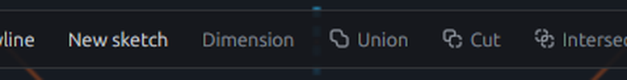
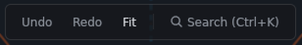

# The globals: document actions, Search and Fit

The `dock` globals are no longer one column. Each one sits where the thing it acts on
lives: **Undo**, **Redo** and **Save** are document operations, so they sit in the window
title bar beside the document's name; **Fit** is a view operation, so it sits beside the
navigation cube; **Search** is the entry point to every command, so it is a pill centred
in the title bar. The verbs that depend on what is under the pointer live in the
wheel menu, and the two hands' tools live in the bottom row. That split is why none of
these controls ever grows a list of tools.

<button class="fc-tabs__tab is-active" data-fc-tab="desktop" type="button" role="tab" aria-selected="true">Desktop</button>
<button class="fc-tabs__tab" data-fc-tab="web" type="button" role="tab" aria-selected="false">Web</button>

<figure class="fc-tabs__panel" data-fc-panel="desktop" role="tabpanel">

<figcaption><strong>Desktop</strong> — Undo, Redo and Save sit beside the document's name in the title bar. Fit is in the navigation cube's control bar at the top-right, and Search is centred over the canvas. The bottom row belongs to the two hands.</figcaption>
</figure>
<figure class="fc-tabs__panel" data-fc-panel="web" role="tabpanel">

<figcaption><strong>Web</strong> — the same split in the browser build: document actions by the title, Fit by the navigation cube, Search centred in the title bar. The registry decides the buttons; the shell does not name a workbench.</figcaption>
</figure>

## What is where

- **Title bar:** `Undo` and `Redo` are icon-only, and `Save` completes the document group.
  Each shows a curated glyph and names itself (with its shortcut) in a tooltip; the history
  verbs also name the top of their stack, so hovering `↶` reads `Undo: Move 1 object
  (Ctrl+Z)`. A disabled command is muted and does not respond. While a transform is pending
  the group dims and drops its clicks, exactly as the old card did.
- **Navigation cube:** `Fit` frames the whole stage, beside the projection toggle, `Home`
  and the viewpoint angles. It is a view verb, so it lives with the other view controls.
- **Title bar, centred:** **Search** opens the command palette. `Ctrl+K` on Windows and Linux,
  `Cmd+K` on macOS. It is an entry point rather than a command, so it has no menu of its
  own and stays available while a transform is pending.

A command's enablement comes from `IsActive()`. The title actions rebuild when the
document changes, so Undo or Save enables or disables without anyone telling the button
to.

These controls hold the globals and nothing else: creation tools are pills in the [create
dock](ui-tool-loadout.md) beside the Modify hand, and object verbs are wheel wedges. That
is why none of them grows when a workbench registers another tool.

## While a tool is running

Starting a tool **adds its completion row to the bottom-left column**, directly above the
hands' bar — and only once the tool has begun, which means its first click has placed the
anchor (the box included: it anchors on the press and only then offers `W`/`L`/`H`). An
armed tool that has placed nothing
shows only its hover ghost on the canvas, so pressing a pill never looks like opening a
dialog. Nothing else moves, so the canvas rectangle does not change and the loadout the
tool was started from stays in hand.

The tool's row shows:

- the tool's name;
- its numbers (when the tool has fields) or its point count;
- a short hint;
- **Cancel** and **Finish** — once the row is there, which is already "there is something to
  finish". A tool that has placed nothing shows no row at all; `Esc` leaves it.

**Finish** takes the same host path as `Enter`; **Cancel** takes the same path as `Esc`,
so the buttons and the keys cannot drift. `Esc` also leaves a tool that has placed
nothing, when no buttons are showing yet.

## Dialogs and the palette

A command can answer with a dialog instead of acting immediately. The shell renders the
dialog natively — a floating HUD beside the gizmo, or a modal over a dimmed canvas,
depending on the command's presentation. `Enter` accepts, `Esc` cancels, and a text
field's own `Enter` submits through the same accept path. A dialog is data from the
command, not a Qt widget built by the workbench; that is what lets the same command run
headlessly with no window at all.

The Search palette is the other route to a command. It lists the registry rather than a
fixed menu, so a workbench's commands are searchable as soon as they are registered.

## Where the buttons come from

`Undo`, `Redo`, `Fit` and `Save` are registry commands; `Save` is a `File` command and the
other three describe document or view state. The shell places `Undo`/`Redo`/`Save` beside
the title and the viewport draws `Fit` in the navigation cube's bar, so the same command
can be run from these buttons, the palette, or its shortcut. A command with no
`FerroCAD_Surface` lands on the palette by default, which is always safe;
`FerroCAD_Surface: "radial"` makes it a wheel wedge instead, and `"creation"` makes it a
pill in the create dock. See [Commands](../../mods/commands.md) for the surface keys and
[Dialogs and transactions](../../mods/commands.md#dialogs) for the return shapes a
command can use.

These are the **global** verbs. Selection verbs belong in the wheel, environment state
belongs in the [toolbar](ui-toolbars.md), and new geometry belongs to the Add hand, so the
chrome never has to grow just because something became selected.
