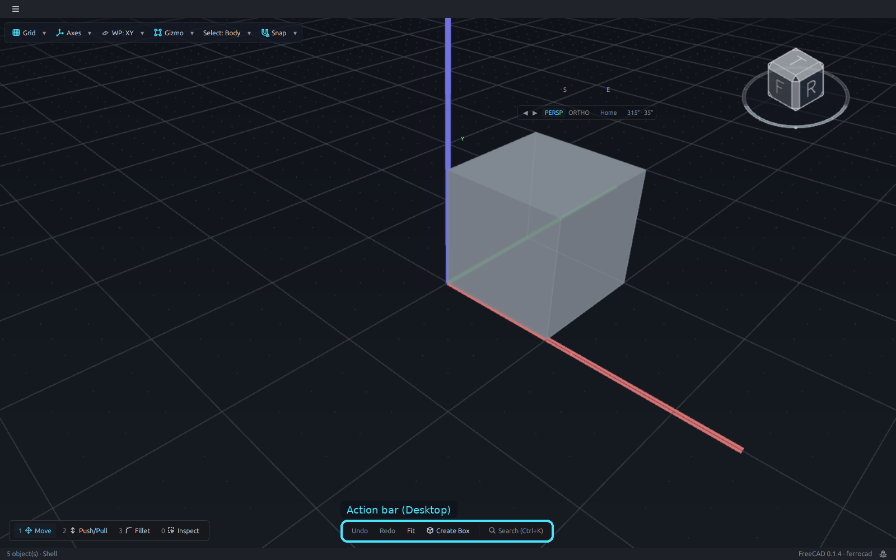
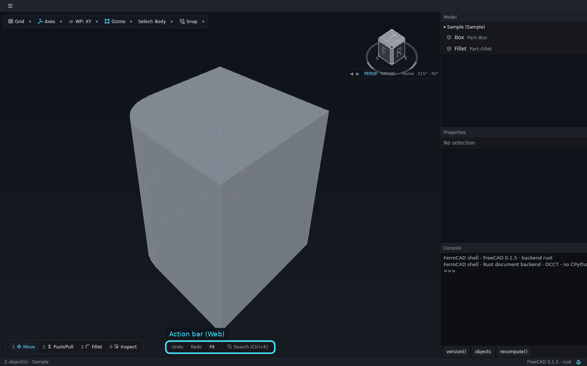

# The globals dock

The `dock` surface is the **vertical pill on the left edge** of the canvas: `Undo`, `Redo`,
`Fit` and Search. It carries the commands that act on the whole document; the verbs that
depend on what is under the pointer live in the wheel menu, and the two hands' tools live in
the bottom row. That split is why the dock never changes width when the selection changes.

<button class="fc-tabs__tab is-active" data-fc-tab="desktop" type="button" role="tab" aria-selected="true">Desktop</button>
<button class="fc-tabs__tab" data-fc-tab="web" type="button" role="tab" aria-selected="false">Web</button>

<figure class="fc-tabs__panel" data-fc-panel="desktop" role="tabpanel">

<figcaption><strong>Desktop</strong> — the left-edge column: Undo, Redo, Fit, then Search. The bottom row below it belongs to the two hands.</figcaption>
</figure>
<figure class="fc-tabs__panel" data-fc-panel="web" role="tabpanel">

<figcaption><strong>Web</strong> — the same column in the browser build, with Undo, Redo, Fit and Search. The registry decides the buttons; the shell does not name a workbench.</figcaption>
</figure>

## What is on it

The dock is a column of command buttons, a hairline, and **Search (Ctrl+K)**:

- Each button shows a curated glyph (when the command has one), its label, and its live
  state.
- A disabled command is muted and does not respond.
- A checked or live command is drawn in accent ink. The background is reserved for an
  additive hover; the dock is a command strip, not a checklist.
- **Search** opens the command palette. `Ctrl+K` on Windows and Linux, `Cmd+K` on macOS.

A command's check state comes from `IsChecked()`; its enablement comes from
`IsActive()`. The dock rebuilds when the selection changes, so a command enables or
disables without anyone telling the button to.

It holds the globals and nothing else: creation tools are pills in the [create
dock](ui-tool-loadout.md) beside the Modify hand, and object verbs are wheel wedges. That is
why it never grows when a workbench registers another tool.

## While a tool is running

Starting a tool **adds a pill over the bottom-centre of the canvas**. Nothing is swapped:
the dock keeps its column, and the bottom row keeps both hands, so the canvas rectangle
does not move and the loadout the tool was started from stays in hand.

The tool's pill shows:

- the tool's name;
- its numbers (when the tool has fields) or its point count;
- a short hint;
- **Cancel** and **Finish** — but only once there is something to finish: the first placed
  point, or a tool whose numbers are the input. A tool that has placed nothing is a
  readout, like the idle Modify hand's coordinate row.

**Finish** takes the same host path as `Enter`; **Cancel** takes the same path as `Esc`,
so the buttons and the keys cannot drift. `Esc` also leaves a tool that has placed
nothing, when no buttons are showing yet.

## Dialogs and the palette

A command can answer with a dialog instead of acting immediately. The shell renders the
dialog natively — a floating HUD beside the gizmo, or a modal over a dimmed canvas,
depending on the command's presentation. `Enter` accepts, `Esc` cancels, and a text
field's own `Enter` submits through the same accept path. A dialog is data from the
command, not a Qt widget built by the workbench; that is what lets the same command run
headlessly with no window at all.

The Search palette is the other route to a command. It lists the registry rather than a
fixed menu, so a workbench's commands are searchable as soon as they are registered.

## Where the buttons come from

The dock renders the commands assigned to the `dock` surface, skipping diagnostics that
are marked dev-only. A command with no `FerroCAD_Surface` lands on the dock by default,
which is always safe; `FerroCAD_Surface: "radial"` removes it from the dock and makes it a
wheel wedge instead, and `"creation"` makes it a pill in the create dock. See
[Commands](../../mods/commands.md) for the surface keys and
[Dialogs and transactions](../../mods/commands.md#dialogs) for the return shapes a
command can use.

The dock is the place a workbench puts its **global** switches. Selection verbs belong in
the wheel, environment state belongs in the [toolbar](ui-toolbars.md), and new geometry
belongs to the Add hand, so the dock never has to grow just because something became
selected.
