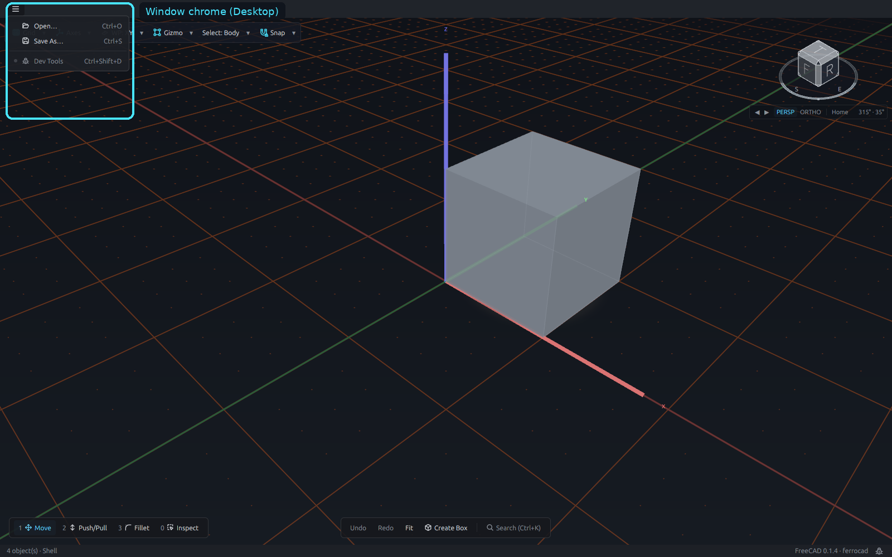
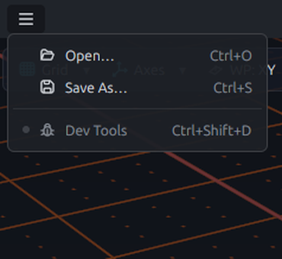
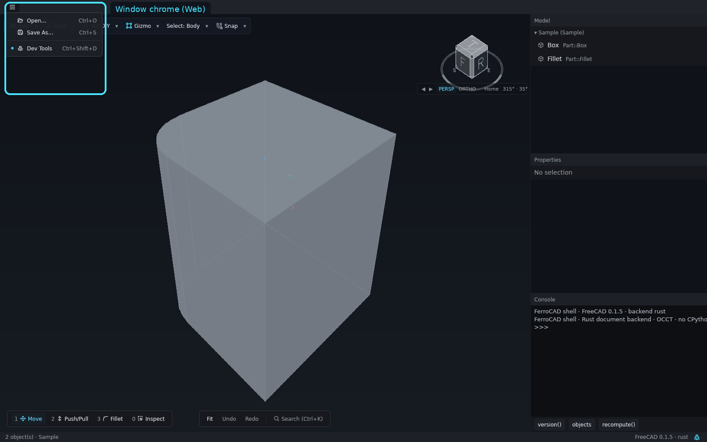
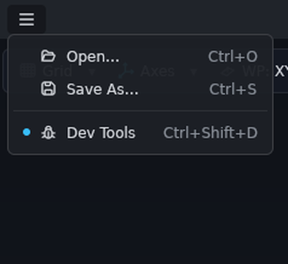

# Window chrome

The chrome is everything around the canvas that belongs to the window rather than the
document: the title bar and its application menu, the status line, and the separate
Dev Tools window.

<button class="fc-tabs__tab is-active" data-fc-tab="desktop" type="button" role="tab" aria-selected="true">Desktop</button>
<button class="fc-tabs__tab" data-fc-tab="web" type="button" role="tab" aria-selected="false">Web</button>

<figure class="fc-tabs__panel" data-fc-panel="desktop" role="tabpanel">

<figcaption><strong>Desktop</strong> — the leading <code>☰</code> menu open over the canvas. It holds the file verbs and the Dev Tools toggle. The platform title bar is drawn by the compositor, so it is not part of this nested capture; the menu and the status line at the bottom are the window-owned chrome.</figcaption>
</figure>
<figure class="fc-tabs__panel" data-fc-panel="web" role="tabpanel">

<figcaption><strong>Web</strong> — the browser build has one window. The same <code>☰</code> menu appears at the leading edge, and the inspector, property editor and console sit in the column beside the canvas instead of a second Dev Tools window.</figcaption>
</figure>

## The title bar and the application menu

The main window draws its own title bar when the desktop asks the application to do so
(rather than drawing the frame itself). The bar is draggable on a left press, opens the
window menu on a right press, and carries the minimize, maximize and close buttons. The
border around the window is a resize grip.

At the **leading edge** of the title bar is the **application menu** (`☰`). It is
app-level chrome, not a workbench menu, and it holds:

- the file verbs the host provides, such as `Open…` and `Save As…`;
- the **Dev Tools** toggle.

A workbench command whose group is `File` joins the file verbs, so a mod can put its own
open/save command in the same menu. If there is nothing to offer, the button is absent.

When a compositor draws the window frame itself, there is no client title bar to put the
menu in. Rather than losing it, the shell draws a slim leading bar directly below the
platform title bar. The application menu stays at the same visual level; only the frame
ownership changes.

## The canvas and the floating controls

The main window is the frame, the viewport and the status line. Everything else opens
over the canvas:

- the [toolbar](ui-toolbars.md) pill at the top-left;
- the [tool loadout](ui-tool-loadout.md) and the Move coordinate row at the bottom-left;
- the [action bar](ui-action-bar.md), or the active tool strip, at the bottom-centre;
- the [wheel menu](ui-wheel-menu.md) at the pointer;
- command dialogs, the Search palette, the settings card and the in-context `✗`/`✓`
  finish pill.

Those surfaces are deliberately not stacked. The action bar and a running tool share one
slot; the Move coordinates sit above the loadout so typing a large delta cannot move the
inputs; and a modal or the wheel hides the transient Move pieces rather than drawing on
top of them.

## The status line

The thin line at the bottom of the window is the shell's neutral feedback channel:

- **Left:** the last command's status message. When the pointer is over an overlay's
  interior, a cyan pass-through readout is added beside it, so you can see what a click
  would reach.
- **Right:** `FreeCAD <version> · <backend>` and the **Dev Tools** toggle.

A command can replace the status message; view commands such as `Grid` and `Axes` report
there too. They stay usable while a transform is pending, because the pending context
permits view-only commands.

## Dev Tools

**Dev Tools** is a second, floating window over the **same** shell. It owns no model of
its own; commands run there use the same registry and the same document, and a dialog
opened from it still appears over the canvas you are looking at. Its panes are:

| Pane | What it shows |
| --- | --- |
| **Providers** | the registered backends for each feature, and which one is active |
| **GPU adapter** | the viewport's adapter choice |
| **Commands** | every registered command, with its live enablement and owning surface |
| **Model** | the document tree |
| **Properties** | the property editor for the current selection |
| **Python console** | the transcript and the live input line |

The console in Dev Tools sees the same `FreeCAD` and `FreeCADGui` objects as the
viewport. On the browser host there is one window, so the inspector, property editor and
console sit in a column beside the canvas instead of a second window.

## Dismissing a surface

`Esc` closes the topmost surface. The order is palette → wheel → command dialog →
popover → tool → settings card → a pending move (rolled back, with the coordinates still
on screen) → the session pivot. Only at rest does `Esc` clear the selection. A surface
that owns a value — a dialog, a tool, a pending transform — consumes its own `Esc`, so
closing it never also clears the selection behind it.

See also [How a click becomes a document edit](how-the-shell-talks-to-the-document.md)
for why the window is a client of the document model rather than the model itself.
