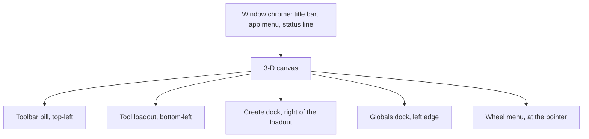
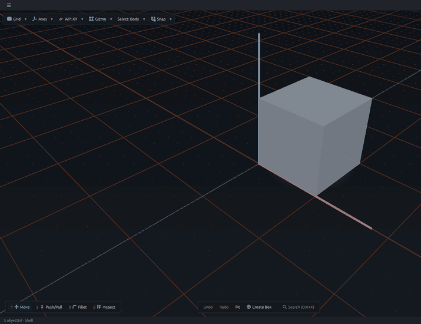

# UI controls: the window at a glance

FerroCAD's main window is deliberately spare: the 3-D viewport fills the canvas, and
the controls that act on it float over the scene instead of reserving rows at the top
and bottom. This section describes the controls you meet there, where each one lives,
and what it changes. Each surface and tool page pairs a highlighted window snapshot with a
close-up, in a **Desktop / Web** tab pair: the desktop tab shows the full application
chrome and the manipulators, and the web tab shows the same shell in the browser.

**New to the window?** The [UI quickstart](ui-quickstart.md) is the one-screen map; the
rest of this page is the longer tour.

## The five surfaces

| Control | Where it sits | What it is for | Read more |
| --- | --- | --- | --- |
| **Window chrome** | around the canvas | the title bar, the application menu, the status line and the Dev Tools window | [Window chrome](ui-chrome.md) |
| **Toolbar** | floating pill at the top-left of the canvas | environment state: grid, axes, workplane, gizmo, selection filter and snapping | [The viewport toolbar](ui-toolbars.md) |
| **Globals dock** | column on the left edge of the canvas | the workbench's global commands (Undo, Redo, Fit) and Search | [The globals dock](ui-action-bar.md) |
| **Wheel menu** | at the pointer, on demand | the verbs that apply to the object under the pointer | [The wheel menu](ui-wheel-menu.md) |
| **Tools** | bottom row: the loadout at the bottom-left, the create dock right after it | the hand the pointer carries, the topology filter, and the pill per creation category | [The tool loadout](ui-tool-loadout.md) |

## The pointer's tools

The loadout's slots are the tools the pointer can carry. Each has a page with a
highlighted window view and a close-up:

| Tool | Slot | What it does | Figure source | Read more |
| --- | --- | --- | --- | --- |
| **Move** | 1 | translates the selection with the triad and its coordinate row | desktop + browser | [Move](ui-move.md) |
| **Rotate** | 1 (toggle) | rotates the body with the rings and the angle row | desktop + browser | [Rotate](ui-rotate.md) |
| **Extrude** | 2 Push/Pull | extrudes a face outward, or pockets it inward, along its normal | desktop + browser | [Extrude](ui-extrude.md) |
| **Fillet** | 3 Fillet | rounds or bevels an edge with the edge scrubber | desktop + browser | [Fillet](ui-fillet.md) |

Each tool page has a **Desktop / Web** tab pair. The desktop tab is the Parametric
edition; the browser tab is the same shell UI on WebGL2, with the same transform gizmo
and Part manipulators over the wasm kernel. Only the window and the sample geometry
differ.

## Pick scope in motion

The `Select` filter decides what a click reports. The animation keeps Inspect equipped
and moves the filter from `Body` to `Face` to `Edge`; the highlighted scope and the
status line follow the same store:

*Animation (desktop): `Body` selects the whole body, `Face` highlights a face, and
`Edge` highlights an edge. The header label, the `Body | Face | Edge` switcher and the
status line name the same scope.*

## Why the controls are arranged this way

- **The canvas comes first.** The toolbar is an overlay, not a pane header, so the
  scene reaches the title bar. Opening a tool or a dialog does not move the canvas
  rectangle either: the globals are a column on the left edge, the hands and the tool's
  completion row share the bottom-left column, and that column grows upward.
- **State is ink, not a box.** An active tool, a checked command and a custom
  workplane are drawn in accent ink. A background is kept for hover, the active loadout
  slot and a selected segment, so the scene stays visually dominant.
- **Controls are commands, not hard-coded buttons.** The toolbar rows, action-bar
  buttons and wheel wedges all come from the command registry. A workbench or mod
  says where its command belongs (`FerroCAD_Surface`), and the shell places it; the
  shell itself names no workbench. The contract is
  [Commands](../../mods/commands.md).
- **Transient surfaces dismiss cleanly.** Popovers are not modal, and `Esc` closes
  the topmost surface. A pending transform is the exception: it owns the context
  until you finish it with `✓`/`Enter` or roll it back with `✗`/`Esc`.

## Where to go next

- The task-by-task guide for the hands and the `Select` filter is
  [Switch tools with the loadout](../how-to/tool-loadout.md).
- The full interaction model — selection, gizmos, the form and the wheel — is
  [Selection, gizmos, the floating form and the wheel](../../developer/interaction/selection-gizmos-and-forms.md).
- The command contract for mods is [Commands](../../mods/commands.md); the shell-side
  design is [Actions and tools](../../developer/workbenches/actions-and-tools.md).
- The ink, type and state rules are [The visual language](../../developer/interaction/visual-language.md).
