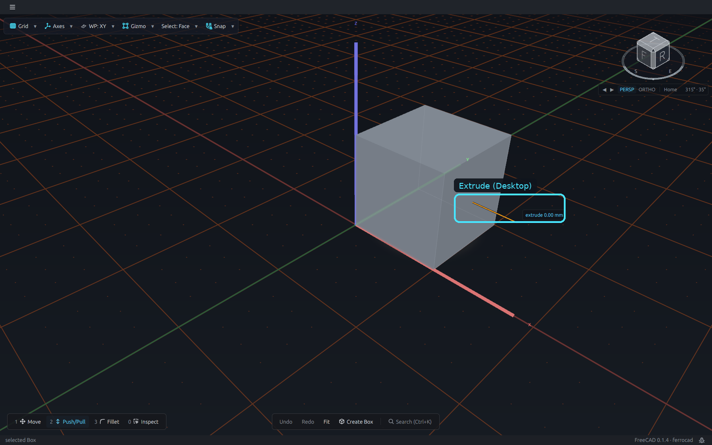
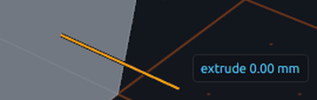
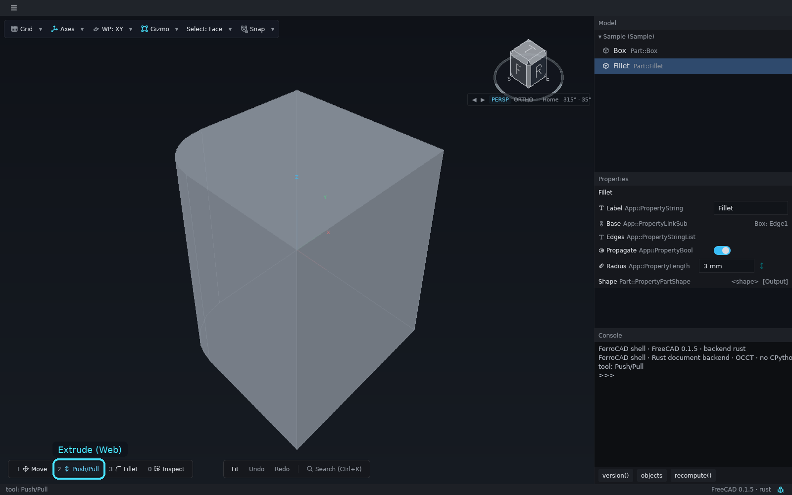
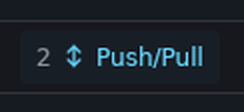
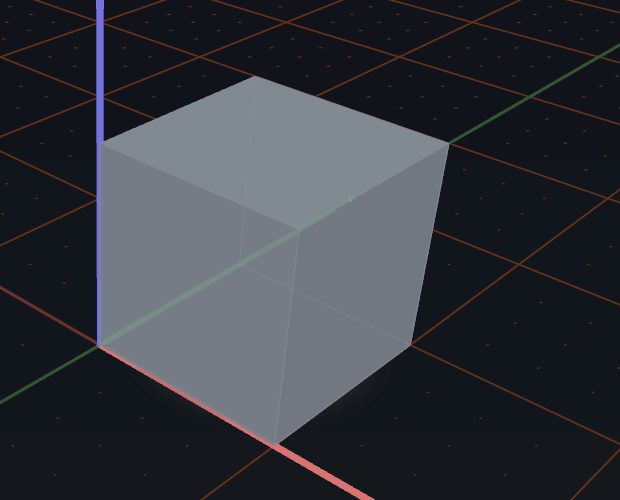

# Extrude (Push/Pull)

**Extrude** is the positive half of the **Push/Pull** hand in Slot 2. The same stem
pockets when the distance is negative. Select a planar face, equip Push/Pull (`2`), and
the face grows a stem along its outward normal.

<button class="fc-tabs__tab is-active" data-fc-tab="desktop" type="button" role="tab" aria-selected="true">Desktop</button>
<button class="fc-tabs__tab" data-fc-tab="web" type="button" role="tab" aria-selected="false">Web</button>

<figure class="fc-tabs__panel" data-fc-panel="desktop" role="tabpanel">

<figcaption><strong>Desktop</strong> — the Parametric edition. The amber stem leaves the selected face along its normal; the label is the signed distance. Slot 2 is armed and the header shows the <code>Face</code> filter. Close-up: the stem and the <code>extrude 0.00 mm</code> label at rest.</figcaption>
</figure>
<figure class="fc-tabs__panel" data-fc-panel="web" role="tabpanel">

<figcaption><strong>Web</strong> — the same slot, armed, with no stem. The browser host sets the <code>Face</code> filter and reports <code>tool: Push/Pull</code>, but it does not contribute the Part manipulator, so there is nothing on the face to drag. The cyan box marks the armed slot.</figcaption>
</figure>

*Animation (desktop): select a face, drag the amber stem, then release. The label tracks
the signed distance and the translucent preview follows the drag; the solid appears on
release.*

## The stem

- The **sign** is the verb. A positive distance is an **extrude** (a fuse); a negative
  distance is a **pocket** (a cut). The label follows the drag.
- A drag previews the result; the commit is one document transaction, so undo reverses
  the extrude or pocket as one step.
- Push/Pull defaults the topology filter to `Face`, so the click keeps the face you
  pointed at instead of reporting the whole body. The header's `Select ▾` can override
  the filter without changing the hand.

The edition builds a `Part::Extrusion` from the named face and applies the boolean (fuse
or cut). The intermediate extrusion is hidden, so the result is the only solid drawn.
This is the Parametric edition's workbench hook, not a shell operation: the same neutral
commit is what a BIM or future workbench would receive.

## The browser build does not have it yet

The browser shell arms the Push/Pull slot and sets the `Face` filter, but it does not
contribute the Part manipulator, so **no stem appears**. Its Rust document backend also
declines the `push_pull` / `extrude` commit as "not available in this build".

Closing the gap needs both halves: `ferrocad_part_gui::push_pull_manipulator` added to
the web shell's contributions, and a Rust commit path that builds the extrusion and
boolean. That is a workbench feature, not a screenshot fix, so the **desktop** tab is the
working reference and the **web** tab records the gap. The gap is listed in the browser
host's [limits](../../../crates/ferrocad_web_gpui/README.md#what-it-does-not-have-yet).

The slot, filter and pending-session rules are in
[The tool loadout](ui-tool-loadout.md) and
[Switch tools with the loadout](../how-to/tool-loadout.md); the manipulator design is in
[Transform interaction](../../developer/interaction/transform-ux.md).
