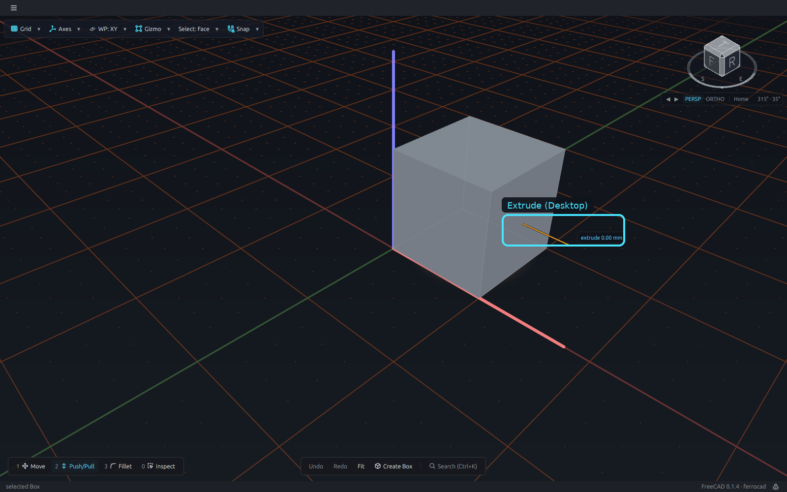
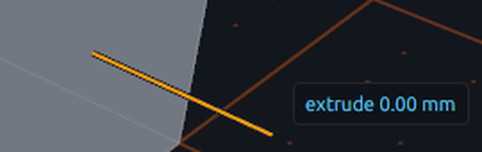
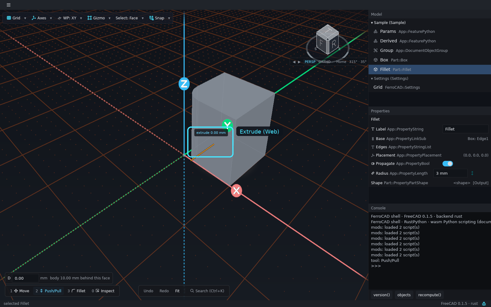
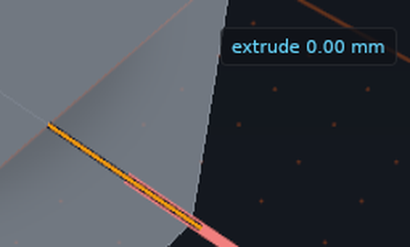
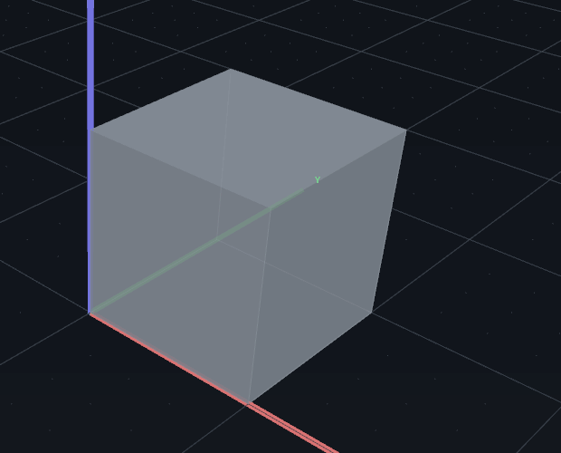

# Extrude (Push/Pull)

**Extrude** is the positive half of the **Push/Pull** hand in Slot 2. The same stem
pockets when the distance is negative. Select a planar face, equip Push/Pull (`2`), and
the face grows a stem along its outward normal.

<button class="fc-tabs__tab is-active" data-fc-tab="desktop" type="button" role="tab" aria-selected="true">Desktop</button>
<button class="fc-tabs__tab" data-fc-tab="web" type="button" role="tab" aria-selected="false">Web</button>

<figure class="fc-tabs__panel" data-fc-panel="desktop" role="tabpanel">

<figcaption><strong>Desktop</strong> — the Parametric edition. The amber stem leaves the selected face along its normal; the label is the signed distance. Slot 2 is armed and the header shows the <code>Face</code> filter. Close-up: the stem and the <code>extrude 0.00 mm</code> label at rest.</figcaption>
</figure>
<figure class="fc-tabs__panel" data-fc-panel="web" role="tabpanel">

<figcaption><strong>Web</strong> — the browser build with both script halves. The same amber stem leaves the selected face; the header shows the <code>Face</code> filter and the status reports <code>tool: Push/Pull</code>. Close-up: the stem and the <code>extrude 0.00 mm</code> label at rest.</figcaption>
</figure>

*Animation (desktop): select a face, drag the amber stem, then release. The label tracks
the signed distance and a translucent swept volume follows the drag; the release leaves
the distance pending, and the solid appears when you accept it with `✓`.*

## The stem

- The **sign** is the verb. A positive distance is an **extrude** (a fuse); a negative
  distance is a **pocket** (a cut). The label follows the drag.
- A drag previews the result as a translucent **swept volume** (the face plus the walls it
  pushes out), and the release leaves it **pending**: the ghost stays at the distance and
  `✓` (or `Enter`) applies it while `✗` (or `Esc`) puts the stem back at rest. The amber
  stem **rides the swept face** — its base is the face at the pending distance — so it
  stays under the pointer while you drag. Drag the stem again to adjust the held distance;
  it continues from the value you left.
- The same distance is a **number you can type**. A `D` field docks with the loadout as
  soon as the stem is armed: type `7.5`, press `Enter`, and the ghost, the readout and the
  commit all follow. `D` is signed — a negative value is a pocket. The row also tells you
  how much body is behind the face, so you can see where a pocket would go through; the
  distance itself has no limit. The commit is one document transaction, so undo reverses
  the extrude or pocket as one step.
- Push/Pull defaults the topology filter to `Face`, so the click keeps the face you
  pointed at instead of reporting the whole body. The header's `Select ▾` can override
  the filter without changing the hand.

The edition builds a `Part::Extrusion` from the named face and applies the boolean (fuse
or cut). The intermediate extrusion is hidden, so the result is the only solid drawn.
This is the Parametric edition's workbench hook, not a shell operation: the same neutral
commit is what a BIM or future workbench would receive.

Pulling the **cap** a previous pull produced re-opens that feature instead of adding
another one: the stem opens at the existing distance, and `✓` changes the same hidden
extrusion. Dragging it past zero turns the extrude into a pocket (the boolean is
rebuilt as a cut), so one face always has one push/pull operation.

## Where it runs

Push/Pull is part of the shared shell, and `ferrocad_part_gui::push_pull_manipulator`
is installed on both hosts. The **desktop** tab is the Parametric edition; the **web**
tab is the WebGL2 build, where the same factory draws the stem over the wasm kernel and
the document half applies the commit. Both hosts select the face, preview the drag and
commit one transaction; only the surrounding window and the sample geometry differ.

The slot, filter and pending-session rules are in
[The tool loadout](ui-tool-loadout.md) and
[Switch tools with the loadout](../how-to/tool-loadout.md); the manipulator design is in
[Transform interaction](../../developer/interaction/transform-ux.md).
