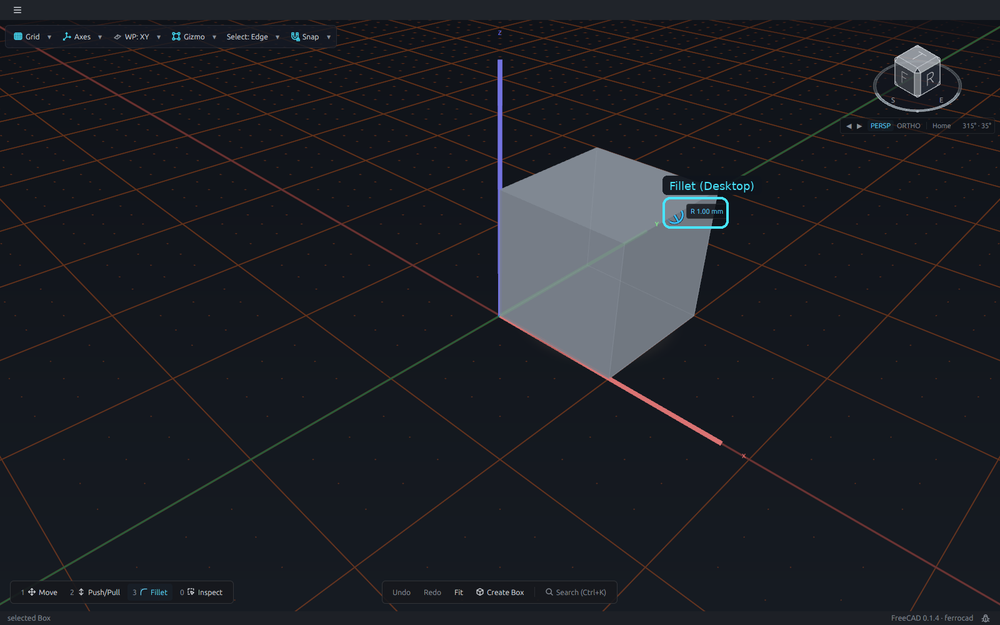
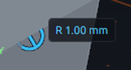
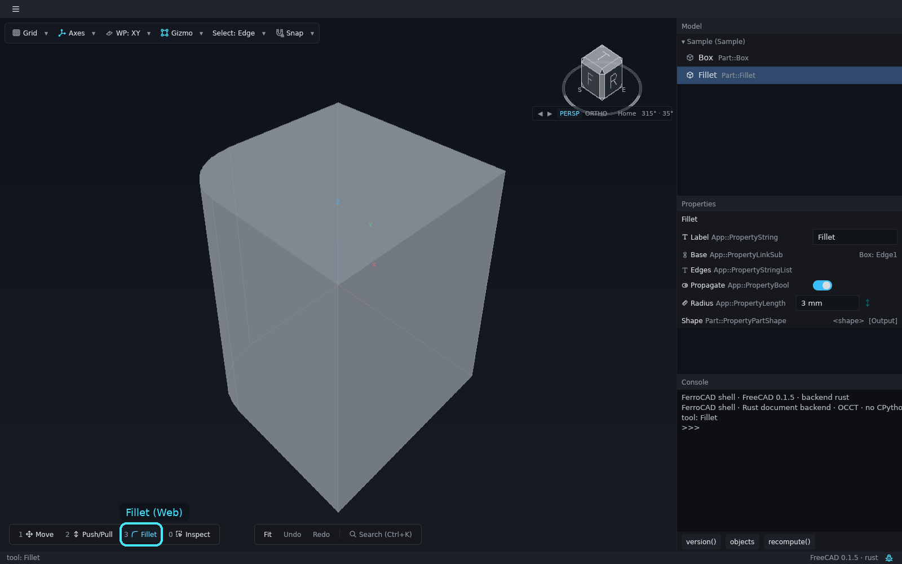
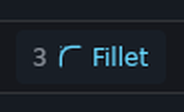
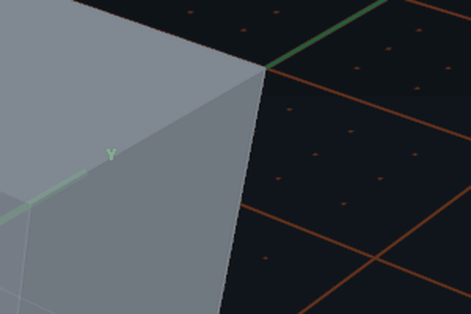

# Fillet

**Fillet** is Slot 3 of the loadout. Select an edge, equip Fillet (`3`), and the edge
grows a radius scrubber. Dragging it sets the radius; the same handle chamfers when the
edition offers the second distance.

<button class="fc-tabs__tab is-active" data-fc-tab="desktop" type="button" role="tab" aria-selected="true">Desktop</button>
<button class="fc-tabs__tab" data-fc-tab="web" type="button" role="tab" aria-selected="false">Web</button>

<figure class="fc-tabs__panel" data-fc-panel="desktop" role="tabpanel">

<figcaption><strong>Desktop</strong> — the Parametric edition. The scrubber sits on the top-right edge and the label reads <code>R 1.00 mm</code> at rest. Slot 3 is armed and the header shows the <code>Edge</code> filter. Close-up: the radius handle and its label.</figcaption>
</figure>
<figure class="fc-tabs__panel" data-fc-panel="web" role="tabpanel">

<figcaption><strong>Web</strong> — the same slot, armed, with no scrubber. The browser host sets the <code>Edge</code> filter and reports <code>tool: Fillet</code>, but it does not contribute the Part dress-up manipulator, so no radius handle appears on the edge. The cyan box marks the armed slot.</figcaption>
</figure>

*Animation (desktop): select the top-right edge, drag the radius arc, then release. The
arc grows with the radius, the readout tracks it, and the fillet is committed on
release.*

## The scrubber

- The **edge filter** is the slot's default. `Edge` resolves the nearest drawn edge of the
  body under the pointer at any distance, so the click and the highlight always name the
  same edge. In a wireframe view the edge is found within about 8 px of the pointer.
- A drag previews the round (or bevel); the commit is one transaction.
- The edition creates or updates the `Part::Fillet` / `Part::Chamfer` feature with the
  selected edge as its `Base` and applies the radius (or the two chamfer distances)
  through the kernel.

## The browser build does not have it yet

The browser shell arms the Fillet slot and sets the `Edge` filter, but it does not
contribute the Part dress-up manipulator, so **no scrubber appears**; the status line says
only `tool: Fillet`. The sample document's `Part::Fillet` is a **feature**, not an
interactive handle, and the Rust backend declines the `dress_up` commit as "not available
in this build".

Closing the gap needs the same two halves as Push/Pull:
`ferrocad_part_gui::fillet_manipulator` added to the web shell's contributions and a Rust
commit path that creates or updates the `Part::Fillet` / `Part::Chamfer` feature. The
**desktop** tab is the working reference and the **web** tab records the gap. The gap is
listed in the browser host's
[limits](../../../crates/ferrocad_web_gpui/README.md#what-it-does-not-have-yet).

The slot, filter and pending-session rules are in
[The tool loadout](ui-tool-loadout.md) and
[Switch tools with the loadout](../how-to/tool-loadout.md); the dress-up design is in
[Gizmo manipulators](../../developer/interaction/gizmo-manipulators.md).
