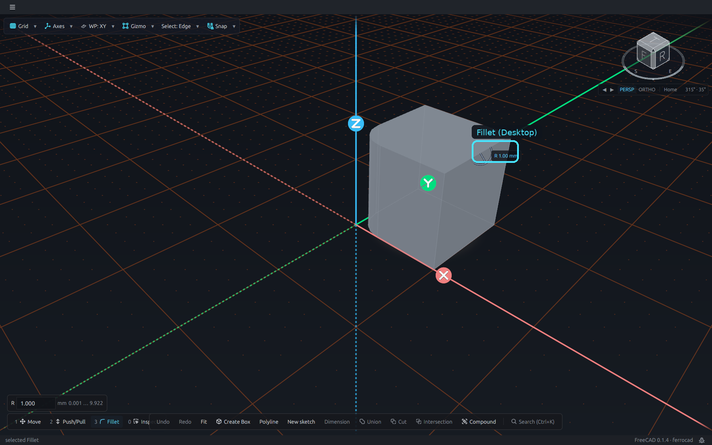
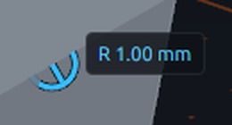
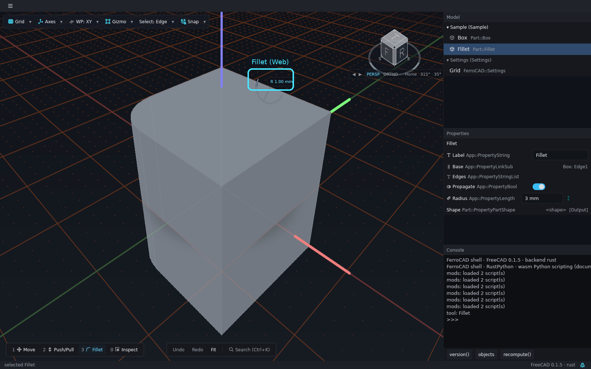
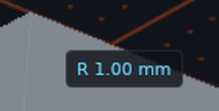
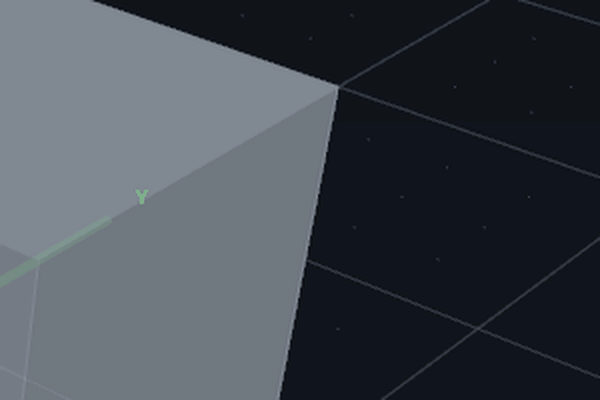

# Fillet

**Fillet** is Slot 3 of the loadout. Select an edge, equip Fillet (`3`), and the edge
grows a radius scrubber. Dragging it sets the radius; the same handle chamfers when the
edition offers the second distance.

<button class="fc-tabs__tab is-active" data-fc-tab="desktop" type="button" role="tab" aria-selected="true">Desktop</button>
<button class="fc-tabs__tab" data-fc-tab="web" type="button" role="tab" aria-selected="false">Web</button>

<figure class="fc-tabs__panel" data-fc-panel="desktop" role="tabpanel">

<figcaption><strong>Desktop</strong> — the Parametric edition. The scrubber sits on the top-right edge and the label reads <code>R 1.00 mm</code> at rest. Slot 3 is armed and the header shows the <code>Edge</code> filter. Close-up: the radius handle and its label.</figcaption>
</figure>
<figure class="fc-tabs__panel" data-fc-panel="web" role="tabpanel">

<figcaption><strong>Web</strong> — the browser build with both script halves. The scrubber sits on the selected edge and the label reads <code>R 1.00 mm</code> at rest; the header shows the <code>Edge</code> filter. Close-up: the radius handle and its label.</figcaption>
</figure>

*Animation (desktop): select the top-right edge, drag the radius arc, then release. The
arc grows with the radius and the readout tracks it; the release leaves the radius
pending, and the fillet is applied when you accept it with `✓`.*

## The scrubber

- The **edge filter** is the slot's default. `Edge` resolves the nearest drawn edge of the
  body under the pointer at any distance, so the click and the highlight always name the
  same edge. In a wireframe view the edge is found within about 8 px of the pointer.
- A drag previews the round (or bevel) as a swath along the edge, and the release leaves
  it **pending**: `✓` (or `Enter`) applies it as one transaction, `✗` (or `Esc`) puts the
  scrubber back at rest. Dragging the arc again adjusts the held radius.
- The radius is also a **number you can type**: an `R` field (a chamfer shows `D1`/`D2`)
  docks with the loadout, and a typed value is held exactly like a dragged one. The row
  prints the allowed range: the scrubber's floor, and the **largest radius the kernel can
  complete on that edge**, measured when you arm the handle. A value you type past the
  ceiling is clamped and the field shows what was taken.
- The edition creates or updates the `Part::Fillet` / `Part::Chamfer` feature with the
  selected edge as its `Base` and applies the radius (or the two chamfer distances)
  through the kernel.
- An **existing fillet can be changed**: select the round face it produced, or any edge of
  that round, and a small `R` grip (or the edge scrubber) appears already showing the
  current radius. Drag it — or type in the same docked field — and `✓` edits that
  `Part::Fillet`; it does not stack a second one. Selecting any *other* edge of the body
  still makes a new fillet, as you would expect.
- A fillet the kernel refuses is **rolled back**: the status toast reports it, the model is
  exactly as it was, and the handle returns to its resting value — no ghost is left
  hanging.

## Where it runs

Fillet is part of the shared shell. `ferrocad_part_gui::fillet_manipulator` is installed
on both hosts, and the document half applies the `dress_up` commit itself, so the
**web** tab draws the same radius scrubber as the **desktop** Parametric edition. Only
the surrounding window and the sample geometry differ.

The slot, filter and pending-session rules are in
[The tool loadout](ui-tool-loadout.md) and
[Switch tools with the loadout](../how-to/tool-loadout.md); the dress-up design is in
[Gizmo manipulators](../../developer/interaction/gizmo-manipulators.md).
