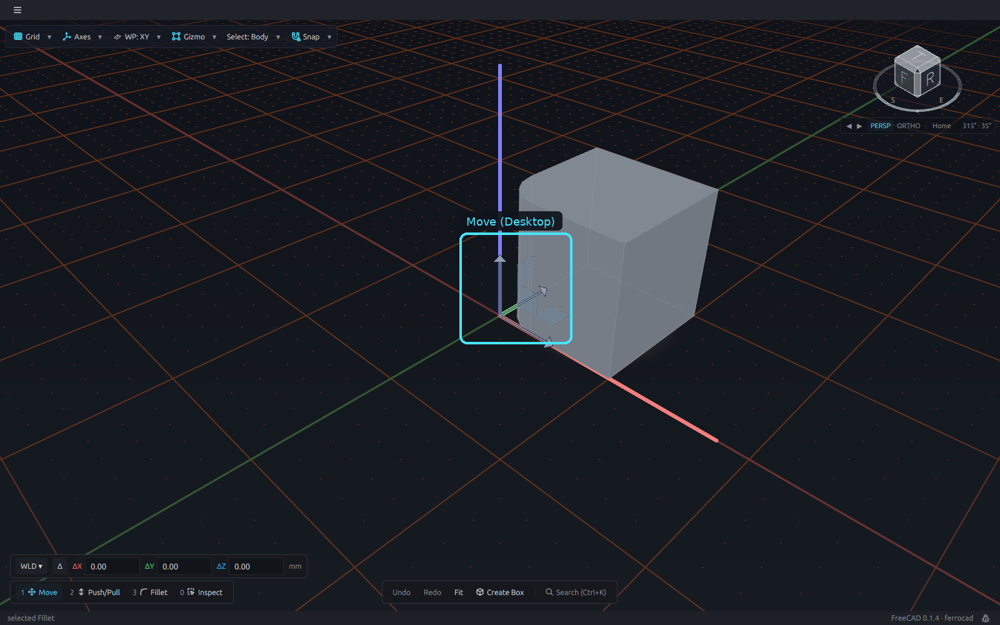
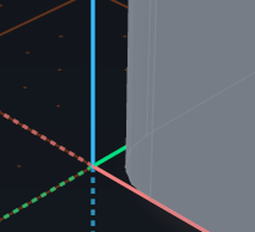
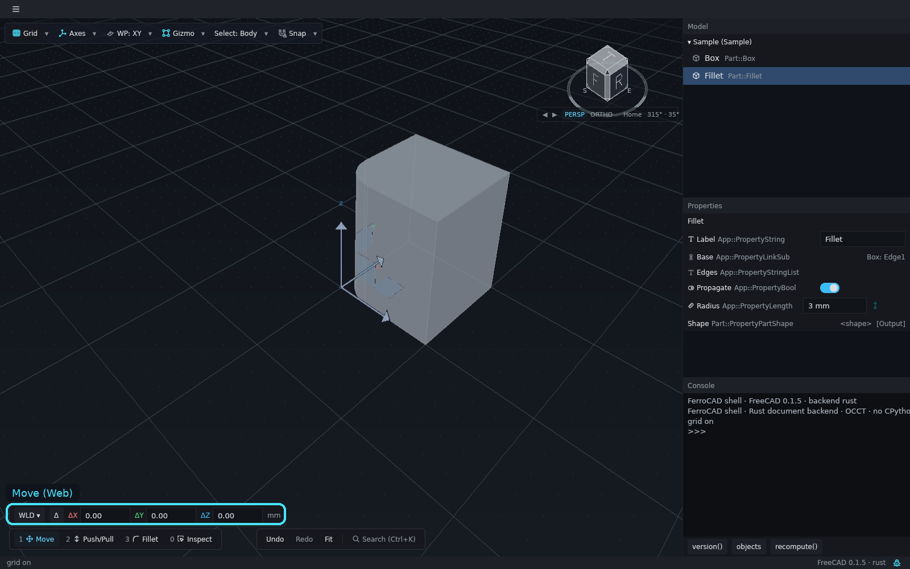
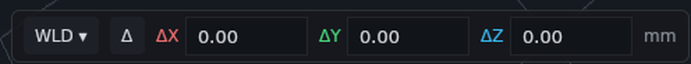
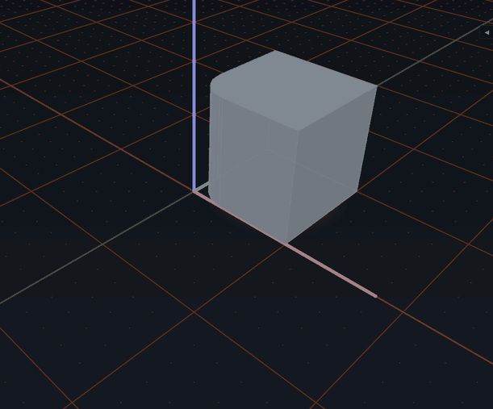
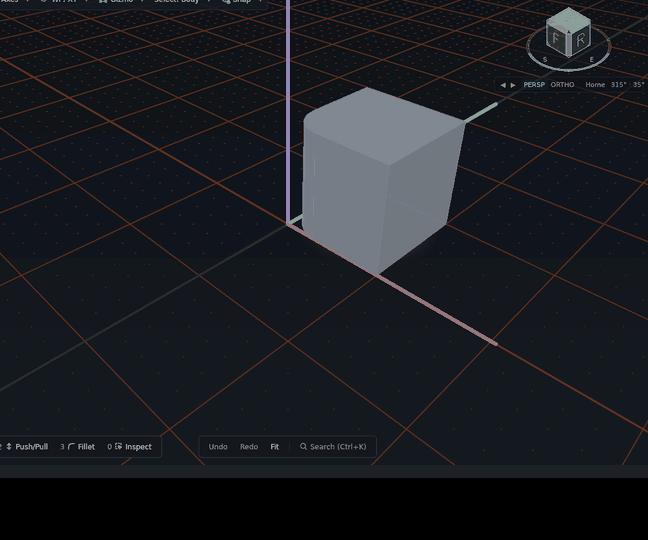

# Move

**Move** is Slot 1 of the tool loadout: it is the hand that translates a body with the
shared transform triad. It is also the hand the wheel's `Move` verb equips.

<button class="fc-tabs__tab is-active" data-fc-tab="desktop" type="button" role="tab" aria-selected="true">Desktop</button>
<button class="fc-tabs__tab" data-fc-tab="web" type="button" role="tab" aria-selected="false">Web</button>

<figure class="fc-tabs__panel" data-fc-panel="desktop" role="tabpanel">

<figcaption><strong>Desktop</strong> — the Parametric edition. The cyan box marks the transform triad at the box's origin (its corner); <code>1</code> toggles it to the rotation rings. The coordinate row sits above the loadout at the bottom-left.</figcaption>
</figure>
<figure class="fc-tabs__panel" data-fc-panel="web" role="tabpanel">

<figcaption><strong>Web</strong> — the browser build with both script halves; the inspector column sits beside the canvas. The triad sits at the box's origin (its corner), as in the desktop tab; the cyan box marks it. Close-up: the three arrows and their planes. The coordinate row sits above the loadout at the bottom-left.</figcaption>
</figure>

<button class="fc-tabs__tab is-active" data-fc-tab="desktop" type="button" role="tab" aria-selected="true">Desktop</button>
<button class="fc-tabs__tab" data-fc-tab="web" type="button" role="tab" aria-selected="false">Web</button>

<figure class="fc-tabs__panel" data-fc-panel="desktop" role="tabpanel">

<figcaption><strong>Desktop</strong> — select the filleted body, grab the X arrow and drag. The release leaves the move pending; <code>✓</code> accepts it. The body stays at the previewed placement, while the <code>Δ</code> fields return to zero because they are deltas, not a placement readout. The visible body is the <code>Part::Fillet</code> feature; the move writes its <code>Placement</code> and the base box follows on the recompute.</figcaption>
</figure>
<figure class="fc-tabs__panel" data-fc-panel="web" role="tabpanel">

<figcaption><strong>Web</strong> — the same gesture on the same <code>Sample</code> document. Release leaves the move pending; <code>✓</code> accepts it and the dressed-up body stays at the previewed placement.</figcaption>
</figure>

## The coordinate row

With Move equipped and a body selected, the row is always on screen, docked at the
bottom-left above the loadout. It reads the translation in the current frame:

- `WLD` is the world grid, `LOC` the body's own committed orientation, and `WP` the
  active workplane. The same switch orients the triad's arrows.
- `ΔX`, `ΔY` and `ΔZ` are offsets by default. The `Δ` switch (or `=`) shows absolute
  coordinates instead, so typing `0` in `X` can snap the pivot onto the YZ plane.
- The fields follow the triad and the measuring tape live. `Tab` focuses the field for
  the axis you last dragged; a digit starts typing in the remembered field.

A typed value is still one ordinary move: `Enter` (or the form's `✓`) commits it as one
undo step; `Esc` (or `✗`) rolls it back without spending an undo entry. A release after
a drag does not commit: it leaves the move pending so the number and the tape can be
checked first.

## Hover-to-arm

With Move equipped and nothing selected, hovering a body materialises the triad at the
body's origin in a dimmed idle ink. Pressing one of its handles selects the body and
opens the move in the same gesture. Leaving the body dissolves the preview; a latched
selection keeps its triad.

## Where it runs

Move is part of the shared shell, so it is available in both hosts. The two tabs are the
same `ferrocad_shell_core` UI: the **desktop** tab is the Parametric edition and the
**web** tab is the WebGL2 build, with the triad at the body's origin in both.
Both hosts have the same row, the same keys and the same commit rules; only the
surrounding window and the sample geometry differ.

The task-by-task guide, including the pending-move keys and the `WLD`/`LOC`/`WP` frame,
is [Switch tools with the loadout](../how-to/tool-loadout.md). The slot itself is
[The tool loadout](ui-tool-loadout.md). The interaction model is
[Selection, gizmos, the floating form and the wheel](../../developer/interaction/selection-gizmos-and-forms.md).
