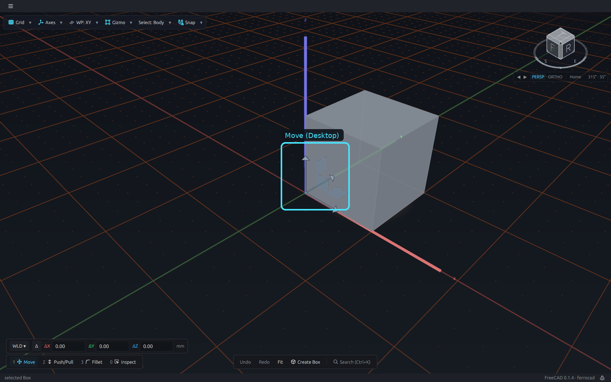
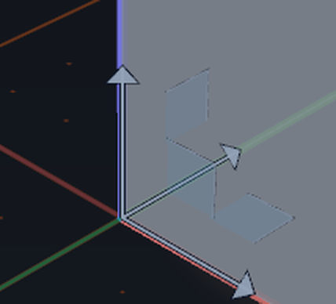
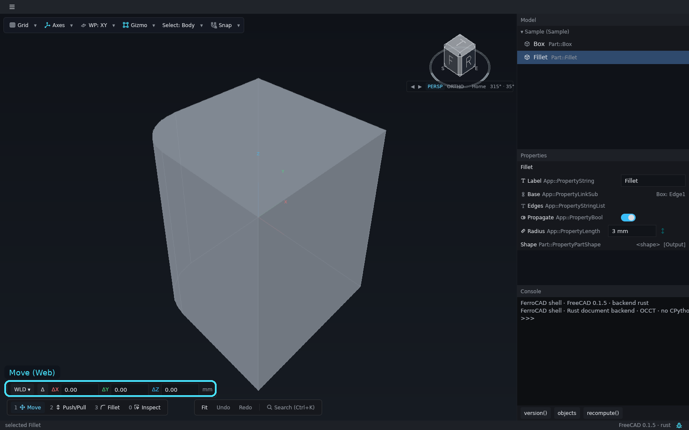
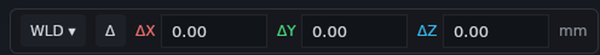

# Move

**Move** is Slot 1 of the tool loadout: it is the hand that translates a body with the
shared transform triad. It is also the hand the wheel's `Move` verb equips.

<button class="fc-tabs__tab is-active" data-fc-tab="desktop" type="button" role="tab" aria-selected="true">Desktop</button>
<button class="fc-tabs__tab" data-fc-tab="web" type="button" role="tab" aria-selected="false">Web</button>

<figure class="fc-tabs__panel" data-fc-panel="desktop" role="tabpanel">

<figcaption><strong>Desktop</strong> — the Parametric edition. The cyan box marks the transform triad at the body's visible corner; <code>1</code> toggles it to the rotation rings. The coordinate row sits above the loadout at the bottom-left.</figcaption>
</figure>
<figure class="fc-tabs__panel" data-fc-panel="web" role="tabpanel">

<figcaption><strong>Web</strong> — the browser build, with the inspector column beside the canvas. The sample body's origin is inside the solid, so the triad is occluded; the docked coordinate row is the visible control. Close-up: <code>WLD</code>, the <code>Δ</code> switch, the three fields and their unit.</figcaption>
</figure>

## The coordinate row

With Move equipped and a body selected, the row is always on screen, docked at the
bottom-left above the loadout. It reads the translation in the current frame:

- `WLD` is the world grid, `LOC` the body's own committed orientation, and `WP` the
  active workplane. The same switch orients the triad's arrows.
- `ΔX`, `ΔY` and `ΔZ` are offsets by default. The `Δ` switch (or `=`) shows absolute
  coordinates instead, so typing `0` in `X` can snap the pivot onto the YZ plane.
- The fields follow the triad and the measuring tape live. `Tab` focuses the field for
  the axis you last dragged; a digit starts typing in the remembered field.

A typed value is still one ordinary move: `Enter` (or the form's `✓`) commits it as one
undo step; `Esc` (or `✗`) rolls it back without spending an undo entry. A release after
a drag does not commit: it leaves the move pending so the number and the tape can be
checked first.

## Hover-to-arm

With Move equipped and nothing selected, hovering a body materialises the triad at the
body's origin in a dimmed idle ink. Pressing one of its handles selects the body and
opens the move in the same gesture. Leaving the body dissolves the preview; a latched
selection keeps its triad.

## Where it runs

Move is part of the shared shell, so it is available in both hosts. The two tabs are the
same `ferrocad_shell_core` UI: the **desktop** tab is the Parametric edition, where the
triad is in front of the body, and the **web** tab is the WebGL2 build, where the sample
body's origin is inside the solid and the coordinate row is the visible part. Both hosts
have the same row, the same keys and the same commit rules; only the surrounding window
and the sample geometry differ.

The task-by-task guide, including the pending-move keys and the `WLD`/`LOC`/`WP` frame,
is [Switch tools with the loadout](../how-to/tool-loadout.md). The slot itself is
[The tool loadout](ui-tool-loadout.md). The interaction model is
[Selection, gizmos, the floating form and the wheel](../../developer/interaction/selection-gizmos-and-forms.md).
