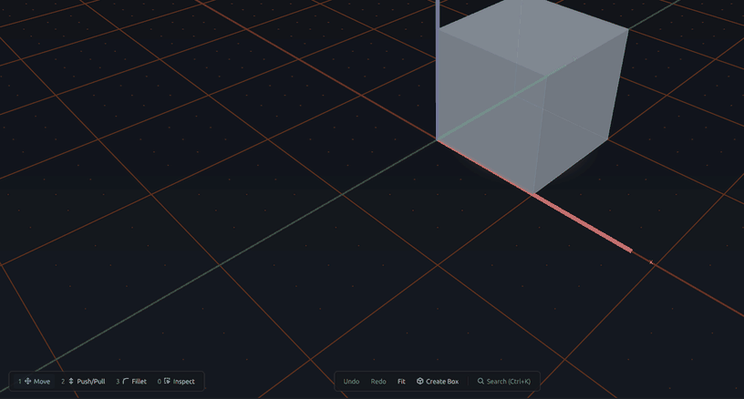
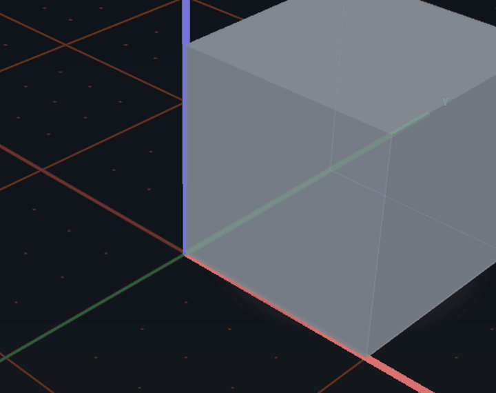
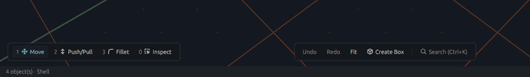
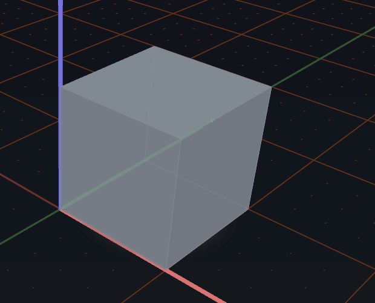
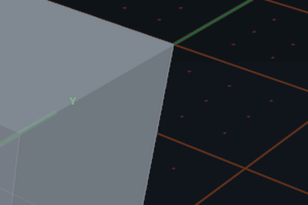
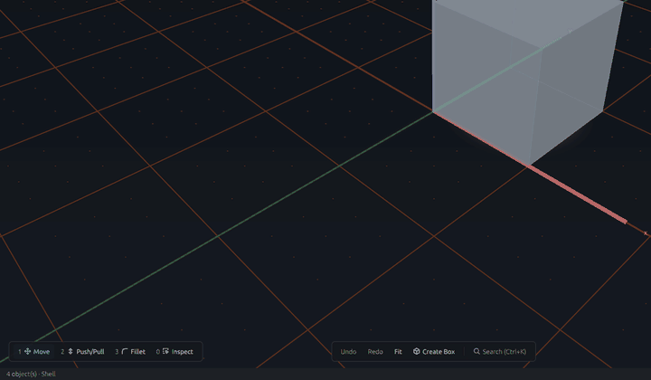
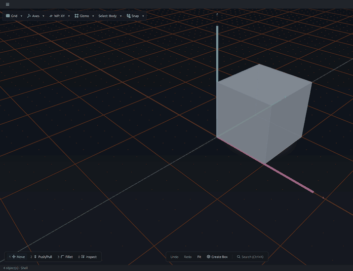

# UI quickstart

FerroCAD's UI is a small set of floating controls around one 3-D canvas. This page is the
one-screen map: every surface, what it is for, and the page that explains it. Read it once,
then use the linked pages as the reference.

## The surfaces

| Control | Where it sits | What it does | Read more |
| --- | --- | --- | --- |
| **Window chrome** | around the canvas | the title bar and application menu, the status line, and the Dev Tools window | [Window chrome](ui-chrome.md) |
| **Toolbar** | floating pill at the top-left | Grid, Axes, WP, Gizmo, Select and Snap | [The viewport toolbar](ui-toolbars.md) |
| **Action bar** | bottom-centre | the workbench's creation and global commands, and Search; a running tool replaces it with the tool strip | [The action bar](ui-action-bar.md) |
| **Wheel menu** | at the pointer, on demand | the verbs for the object under the pointer: Move, Rotate, visibility, workplane and Delete in the built-in set | [The wheel menu](ui-wheel-menu.md) |
| **Tool loadout** | bottom-left | the one hand the pointer carries: `1 Move`/`Rotate`, `2 Push/Pull`, `3 Fillet`, `0 Inspect` | [The tool loadout](ui-tool-loadout.md) |

Also in the window:

- **Search palette** (`Ctrl+K`, or `Cmd+K` on macOS) — the action bar's search over the
  command registry.
- **Dev Tools** — the application menu's second window, or the inspector column in the
  browser build.
- **Tool strip** — replaces the action bar while a tool is collecting points.
- **Pending-transform form** — the docked coordinate or angle row and the `✓`/`✗` pill.
- **Dialogs, the settings card and popovers** — transient surfaces over the canvas;
  `Esc` closes the topmost one.

## The pointer's tools

| Tool | Slot | What a drag does | Read more |
| --- | --- | --- | --- |
| **Move** | `1` | translates the selection with the transform triad | [Move](ui-move.md) |
| **Rotate** | `1` again | rotates the body with the three rings | [Rotate](ui-rotate.md) |
| **Extrude** | `2` Push/Pull | extrudes or pockets a face along its normal | [Extrude](ui-extrude.md) |
| **Fillet** | `3` | rounds or bevels an edge with the radius scrubber | [Fillet](ui-fillet.md) |
| **Inspect** | `0` | selects and inspects without growing handles | [The tool loadout](ui-tool-loadout.md#the-slots) |

*The loadout switches hands; each hand re-picks its target so the relevant handles appear.*

## Why the wheel and the action bar both exist

They serve different jobs. The wheel is the **immediate, spatial** layer: it opens at the
pointer and offers the verbs that fit the object under it. The action bar is the
**persistent, explicit** layer: it shows the current workbench and keeps the commands that
are not tied to a particular selection one click away. The wheel is fast and
context-aware; the bar is stable and legible about state. They are complementary, not
competing.

*The wheel is the immediate layer: it opens at the pointer, and flicking to a wedge
equips the hand. The persistent action bar keeps the non-selection commands one click
away.*

A persistent bar is also the natural home for a **mode/context switch** between the 2-D
drafting and 3-D solid libraries. The current window has one 3-D canvas and does not yet
expose that split; when it does, the switch belongs with the stable chrome, not in the
selection-dependent wheel.

## Add or modify

The cleanest default sorting rule is **adding something** to an edge, face, object or
scene versus **modifying what is already there**. Creating a box — or, in a workbench that
offers them, a sketch or a surface cut — adds geometry; extruding a face or rounding an
edge modifies geometry that already exists. That gives a command a natural context and a
natural surface:

- **Add** verbs are usually creation commands. They belong on the action bar, and on the
  wheel when the creation target is the object under the pointer.
- **Modify** verbs are usually selection-tied. Move, Rotate, Push/Pull, Fillet and
  visibility belong on the wheel and in the loadout, because their target is the thing you
  are pointing at.

*Add: `Create Box` from the action bar; the status line confirms `created Box001`.*

*Modify a face: the amber stem is a selection-tied modify verb, so it lives in the
loadout and on the surface.*

*Modify an edge: the same rule puts the Fillet scrubber on the edge under the pointer.*

## The in-between zones

The rule is a heuristic, not an airtight partition. Pending creation and pending
modification are the limbo: a running tool that has not finished collecting points, a
Push/Pull or Fillet drag whose value is not committed, or — when a workbench adds one — a
boolean whose inputs are not final. In those states "add" and "modify" blur, and the user
is least sure what comes next. The window handles them with explicit state rather than by
guessing:

- a running tool replaces the action bar with the **tool strip** in the same slot;
- a pending transform owns the context until `Enter`/`✓` or `Esc`/`✗`;
- the wheel does not open while a tool or dialog owns the canvas;
- `Esc` closes the topmost transient surface first.

*Limbo: the Move is pending, the coordinate row and ✓/✗ pill are live, and `Esc` rolls
the body back without spending an undo step.*

## The practical rule

Treat **add versus modify** as the default sorting rule. Use the **wheel** for the
selection-tied actions it sorts well. Use the **persistent bars** for state and for the
limbo cases the rule cannot resolve. When a new command does not fit cleanly, put it on
the bar: a stable, explicit home is easier to learn than a wheel that changes its contents
unpredictably.

*Selection-tied actions follow the `Select` filter: body, face or edge, named in the
header and the status line.*

## Where to start

- Walk the surfaces in order: [Window chrome](ui-chrome.md),
  [The viewport toolbar](ui-toolbars.md), [The action bar](ui-action-bar.md),
  [The wheel menu](ui-wheel-menu.md), [The tool loadout](ui-tool-loadout.md).
- Learn the hands: [Move](ui-move.md), [Rotate](ui-rotate.md), [Extrude](ui-extrude.md),
  [Fillet](ui-fillet.md), and Inspect in [The tool loadout](ui-tool-loadout.md#the-slots).
- Read the longer tour: [UI controls](ui-controls.md).
- See the interaction model:
  [Selection, gizmos, the floating form and the wheel](../../developer/interaction/selection-gizmos-and-forms.md).
