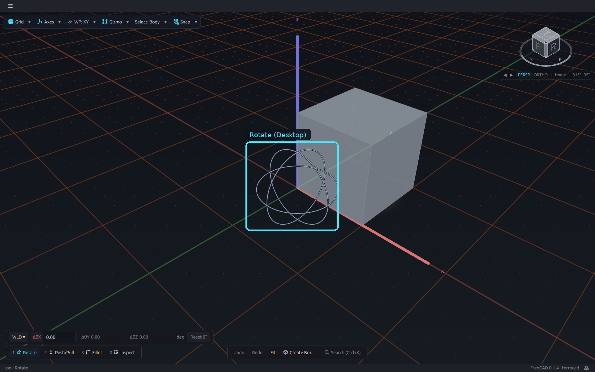
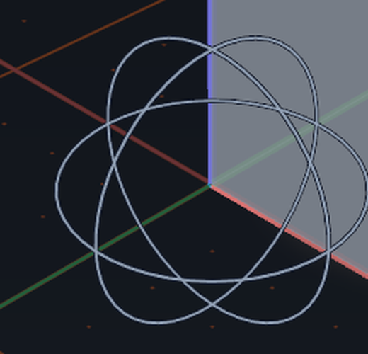
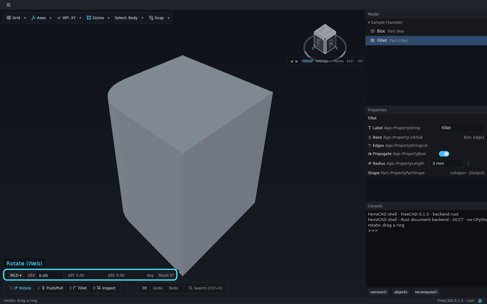
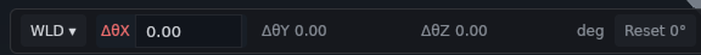

# Rotate

**Rotate** is the second handle set of Slot 1. The loadout keeps one hand, so the slot
names what you will actually get: `1 Move` for the arrows, `1 Rotate` for the rings.
Pressing `1` while Slot 1 is already active toggles between them; the wheel's `Rotate`
verb also equips the Rotate hand, and the next pick arms the rings.

<button class="fc-tabs__tab is-active" data-fc-tab="desktop" type="button" role="tab" aria-selected="true">Desktop</button>
<button class="fc-tabs__tab" data-fc-tab="web" type="button" role="tab" aria-selected="false">Web</button>

<figure class="fc-tabs__panel" data-fc-panel="desktop" role="tabpanel">

<figcaption><strong>Desktop</strong> — the Parametric edition. Pressing <code>1</code> while Slot 1 is active swaps the triad for the three rings at the body's visible corner; the cyan box marks them. The angle row sits above the loadout at the bottom-left.</figcaption>
</figure>
<figure class="fc-tabs__panel" data-fc-panel="web" role="tabpanel">

<figcaption><strong>Web</strong> — the browser build. The sample body's origin is inside the solid, so the rings are occluded; the docked angle row is the visible control. Close-up: only the active axis holds an input; <code>ΔθX</code> is live, the other two are muted, and the row ends with the degree unit and <code>Reset 0°</code>.</figcaption>
</figure>

## The angle row

The row shows one cell per ring, but **only the active ring's cell holds an input**. A
rotation is an axis plus an angle, not three independent coordinate fields. While a step
is pending:

- the other two rings stay visible but are muted and refuse clicks, and their cells show
  `—`;
- the frame switch (`WLD`/`LOC`/`WP`) and `Reset 0°` are disabled;
- the only exits are `✓`/`Enter` to commit and `✗`/`Esc` to roll back.

Dragging the same ring again adds to its angle (three 30° drags show 30°, then 60°, then
90°). Dragging a different ring, or typing another cell's axis while nothing is pending,
chooses the ring the next angle will use.

`WLD` keeps the rings aligned with the world grid, `LOC` turns them with the body's
committed orientation, and `WP` follows the active workplane. `Reset 0°` commits the
rotation that returns the body to world alignment; it is disabled while a step is
pending. The button names the stored orientation, for example `Reset (Z 45°)` for a pure
axis or `Reset (21.4°)` for a compound tilt.

## The protractor

A ring drag draws a 3-D protractor: the swept glass sector, a dashed start spoke, the
live spoke and the 15° detents. The flat `✗ │ ✓` strip appears beside the rings while the
step is pending, and the pending angle is what the row shows. A ring rotates the body the
triad sits on; drag the centre disc first to re-pivot onto a vertex or an edge midpoint.

## Where it runs

Rotate is part of the shared shell and is available in both hosts. The **desktop** tab
shows the rings at a body corner, where they are visible; the **web** tab shows the same
row and keys on the browser build, with the rings hidden inside the sample solid. The
rings are always drawn at the body origin, so whether you see the geometry or only the
numeric row depends on where that origin falls.

The full key list and the pending-rotation rules are in
[Switch tools with the loadout](../how-to/tool-loadout.md). The state machine and the
protractor geometry are in
[Selection, gizmos, the floating form and the wheel](../../developer/interaction/selection-gizmos-and-forms.md).
