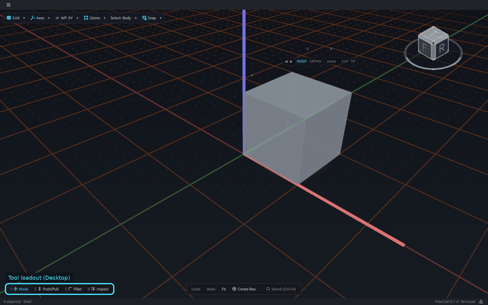
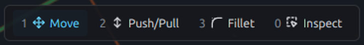
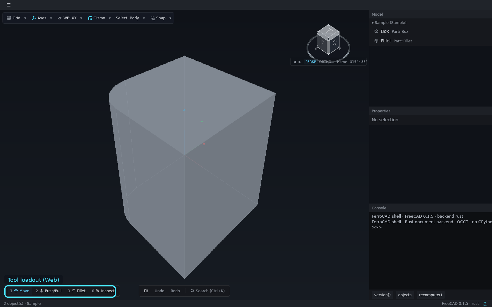
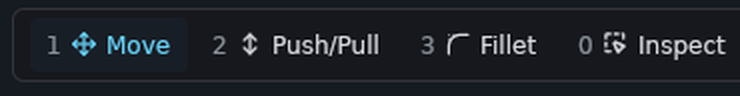
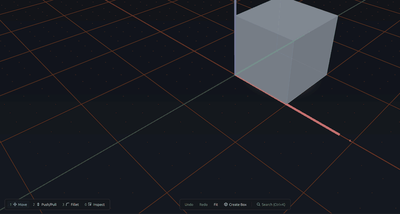

# The tool loadout

The tool loadout is the bar at the **bottom-left** of the canvas. FerroCAD's pointer
carries **one hand at a time**; the loadout names the equipped hand, shows its key, and
switches it.

<button class="fc-tabs__tab is-active" data-fc-tab="desktop" type="button" role="tab" aria-selected="true">Desktop</button>
<button class="fc-tabs__tab" data-fc-tab="web" type="button" role="tab" aria-selected="false">Web</button>

<figure class="fc-tabs__panel" data-fc-panel="desktop" role="tabpanel">

<figcaption><strong>Desktop</strong> — the four slots: <code>1 Move</code>, <code>2 Push/Pull</code>, <code>3 Fillet</code> and <code>0 Inspect</code>. The active slot is drawn in accent ink over a tinted background.</figcaption>
</figure>
<figure class="fc-tabs__panel" data-fc-panel="web" role="tabpanel">

<figcaption><strong>Web</strong> — the same bar and the same slots in the browser build. The hand is view state, so it is not saved with the document.</figcaption>
</figure>

*Animation (desktop): click a body, then switch hands with `1` (Move/Rotate), `2`, `3`
and `0`. Each hand re-picks its target so the relevant handles appear.*

## The bar

The bar reads `[1 Move] [2 Push/Pull] [3 Fillet] [0 Inspect]` and shares its baseline and
glass with the action bar. Each slot shows its key, a glyph and a label. The active slot
is drawn in accent ink over a tinted background; a click equips it exactly as its key
does, so the hotkey stays discoverable without opening a menu.

Slot 1 hosts both handle sets, so its label names the one you will actually get: `Move`
for the translation arrows, `Rotate` for the rotation rings. Pressing `1` while Move is
already equipped toggles between them.

## The slots

| Key | Slot | A drag with this hand | `Select ▾` default |
| --- | --- | --- | --- |
| `1` | **Move** | moves or rotates the selected body with the transform triad | Body |
| `2` | **Push/Pull** | extrudes or pockets the face under the pointer | Face |
| `3` | **Fillet** | fillets or chamfers the edge under the pointer | Edge |
| `0` | **Inspect** | selects and inspects; no handles appear, and the highlighted scope follows the pointer | Body |

The bar always lists all four slots. Push/Pull and Fillet do something where the edition
supplies the matching manipulator (the Part workbench does); Move and Inspect are always
available. Inspect is its own selection hand, not a paused Move: it shows no handles and
adds no numeric surface.

Each hand has its own page: [Move](ui-move.md), [Rotate](ui-rotate.md), [Extrude](ui-extrude.md)
and [Fillet](ui-fillet.md).

## The `Select` filter

The header's `Select: <value> ▾` control — between `Gizmo ▾` and `Snap ▾` — is the
**topology filter**. It decides which element a click reports:

| Value | What a pick reports |
| --- | --- |
| **Auto** | whatever the viewport's pick reports; the pre-loadout behaviour |
| **Body** | the whole body, even when you click a face or an edge |
| **Face** | the first sub-element the pick reports (`Face6`, …) |
| **Edge** | the nearest drawn edge of the body under the pointer |

Equipping a slot resets the filter to that slot's default (the last column of the slot
table). The header control can override the filter without changing the hand; its label
turns cyan while the override differs from the slot's default. The bar and the header
read and write the same store, so they can never disagree.

`Edge` is a real scope, not a label. It resolves to the nearest drawn edge of the body
under the pointer at any distance, and never falls back to the face. In a wireframe view
there is no surface to hit, so the edge is found within about 8 px of the pointer.

With **Inspect** equipped, the same filter appears as a compact `Body | Face | Edge`
switcher just above the loadout bar. It reads and writes the same store as the header;
`Auto` stays a header-only choice. The switcher appears when Inspect is active and no
tool, modal or wheel is open.

## Hover-to-arm

With **Move** equipped and nothing selected, hovering a body materialises the triad at
the body's origin in a dimmed idle ink — a preview, not a selection. Pressing a handle
selects the body and opens the move in the same gesture. Leaving the body dissolves the
preview; a latched selection keeps its triad.

## A pending step locks the loadout

While a move or rotation is pending, the loadout bar dims and refuses clicks. Switching
hands, changing `Select`, selecting another object or starting another editing command is
blocked until you finish with `✓`/`Enter` or roll back with `✗`/`Esc`. View commands such
as `Grid` and `Axes` still work, and `Esc` with nothing pending clears the selection.

The loadout is **view state**: it belongs to the window, not to the document, and it is
not saved.

The task-by-task guide — including the pending-move keys, hover-to-arm and the Move/Rotate
form — is [Switch tools with the loadout](../how-to/tool-loadout.md).
