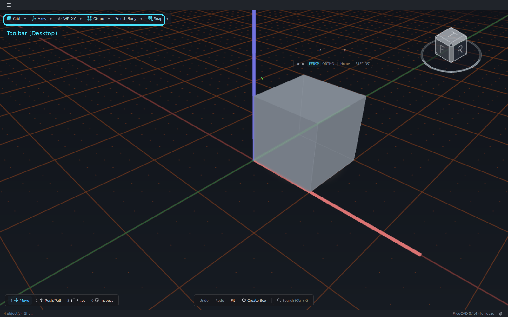
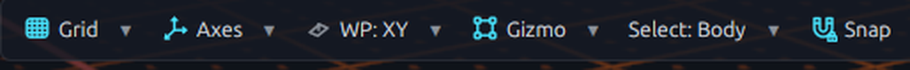
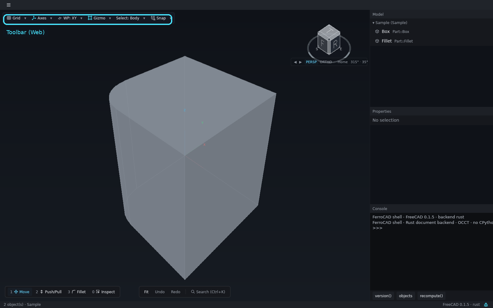
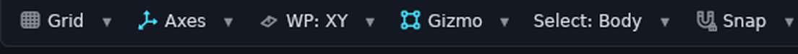

# The viewport toolbar

The environment controls are a compact, translucent pill floating in the **top-left** of
the canvas. It is not a pane header: the scene reaches the title bar, and the pill
occludes only itself, so a press on the canvas beside it still orbits or selects.

<button class="fc-tabs__tab is-active" data-fc-tab="desktop" type="button" role="tab" aria-selected="true">Desktop</button>
<button class="fc-tabs__tab" data-fc-tab="web" type="button" role="tab" aria-selected="false">Web</button>

<figure class="fc-tabs__panel" data-fc-panel="desktop" role="tabpanel">

<figcaption><strong>Desktop</strong> — the pill in reading order: Grid, Axes, WP, Gizmo, Select and Snap. A label runs the primary command; its caret opens the popover.</figcaption>
</figure>
<figure class="fc-tabs__panel" data-fc-panel="web" role="tabpanel">

<figcaption><strong>Web</strong> — the same pill and the same order in the browser build, with the inspector column beside the canvas. The labels, carets and popovers are the shared shell controls.</figcaption>
</figure>

## The controls, left to right

| Control | Kind | Label | The caret opens |
| --- | --- | --- | --- |
| **Grid** | capability | shows or hides the reference grid | the active provider and its spacing, the provider choices, and the grid commands |
| **Axes** | capability | shows or hides the world axis cross | the active provider and its length/width, the provider choices, and the axis commands |
| **WP** | selector | the active workplane (`WP: XY`, `WP: Face1`, …) | the datum-plane menu |
| **Gizmo** | capability | shows or hides the transform gizmo | the provider choices, `Show gizmo`, `Gizmo settings…` and `Reset to edition defaults` |
| **Select** | selector | the topology filter (`Select: Body`, …) | `Auto`, `Body`, `Face` and `Edge` |
| **Snap** | capability | the global snap switch | the six snap modes |

The order is stable: Grid, Axes, WP, Gizmo, Select, Snap. The `Gizmo` control sits
between `WP` and `Select` so the environment controls keep one visual order.

## Toggles and selectors

The shell distinguishes a **capability** from a **selector**:

- **Capabilities** — Grid, Axes, Gizmo and Snap — can be on or off. The label runs the
  primary command, and the glyph ink carries the state: greyscale when off, colour when
  on. Hovering the label states it in words as well.
- **Selectors** — WP and Select — always have a value. There is no dot, because the
  value is the label itself. A custom workplane and an overridden selection filter are
  drawn in accent ink, so a non-default state is visible without opening the menu.

`Select` is the [topology filter](ui-tool-loadout.md#the-select-filter): it shares one
store with the bottom-left loadout bar. Equipping a slot sets the filter to that slot's
default; choosing a value here overrides the filter without changing the hand, and the
label turns cyan while the override differs from the slot's default.

## Split buttons

Grid, Axes, Gizmo and Snap are **split buttons**:

- the **label** runs the primary command;
- the **caret** opens the popover;
- a **right press on the label** opens the popover too, and never runs the command;
- opening is not a toggle — an outside press dismisses the popover before the caret's
  click is dispatched, so a toggle would immediately reopen it.

`WP` and `Select` are single selectors: a press anywhere on the control opens their
menu.

## What a popover contains

The popovers are not modal. They have no backdrop and do not swallow a click on the
canvas; the pill they hang from occludes, so pressing the glass does not start an orbit.
`Esc`, a click elsewhere, or choosing a one-shot action closes the popover.

Rows come in two kinds:

- **State rows** — a command toggle, a provider choice, or a filter segment. These keep
  the popover open after the click so several options can be set in one visit, and their
  status dot follows the change.
- **Action rows** — a one-shot command. Choosing one runs it and dismisses the popover.

A Grid, Axes or Gizmo popover starts with read-only **provider** rows, such as
`Provider: …` and `Spacing: …`, before the choices. If no provider is registered, one
muted row says so rather than showing empty values.

## One provider per feature

Grid, axes and the gizmo can each have more than one registered backend. The popover
lists them as a radio set with a dot on the active one; only that backend draws. The
switch belongs to the feature, not to the backend, so there is one control and one
appearance setting even when the drawing has several implementations. The contract is
[Providers](../../mods/providers.md).

## Where the rows come from

The toolbar is presentation over the command registry. A command says where it belongs
with `FerroCAD_Surface` (`grid`, `workplane`, `axis`, `snap`, `radial`, `mods`, `dock` or
`hidden`) and which header control owns it with `FerroCAD_Parent`. The shell does not
name a workbench; it places whatever the registry provides. Mod authors should read
[Commands](../../mods/commands.md) for the exact keys.

The selection-dependent verbs are deliberately **not** here. They live in the
[wheel menu](ui-wheel-menu.md) and the [tool loadout](ui-tool-loadout.md), so the
environment controls never reflow when the selection changes.
