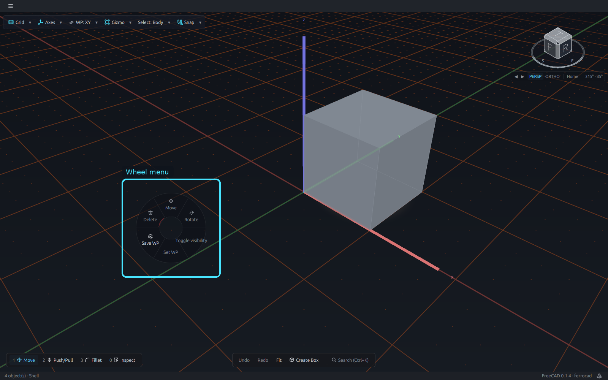
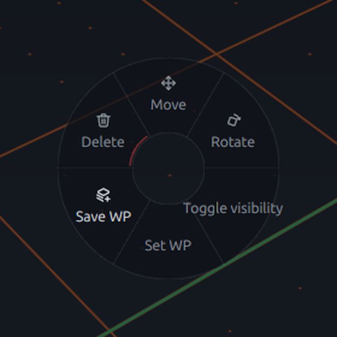
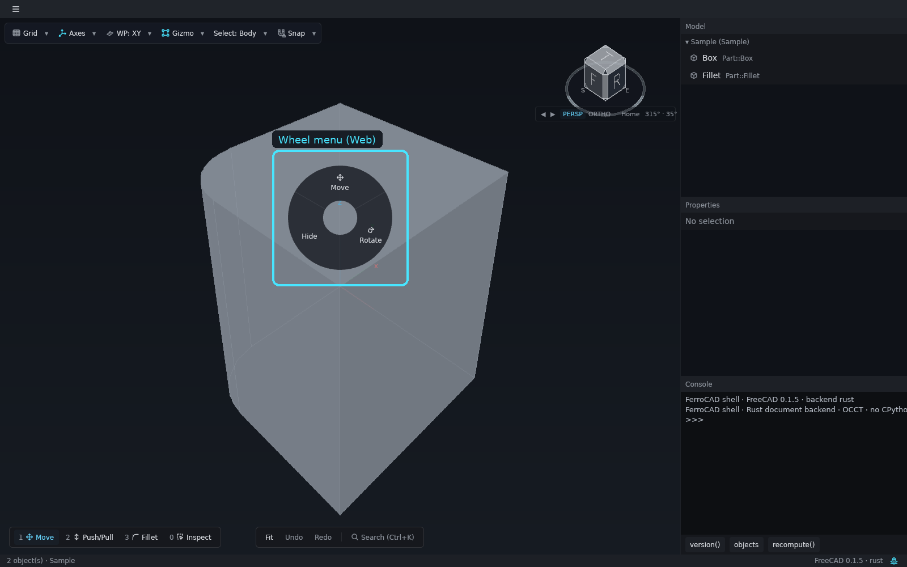
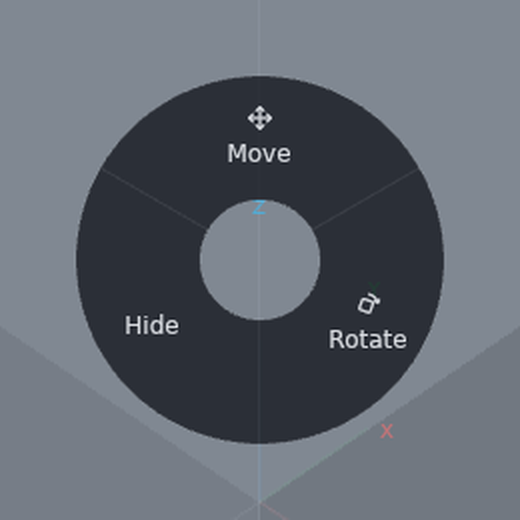
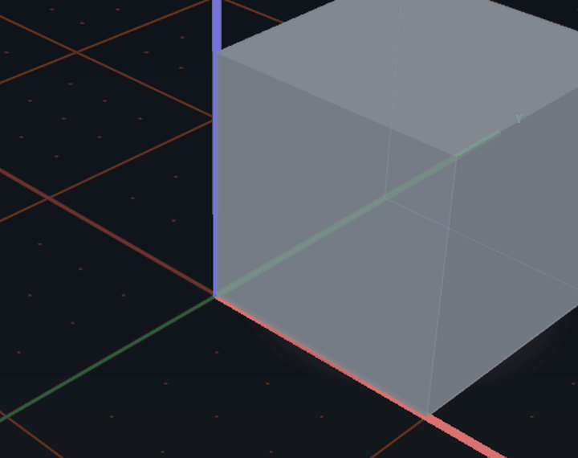

# The wheel menu

The wheel menu is a radial marking menu that opens at the pointer. It exists so an
object verb is one gesture away: you do not have to find a permanent toolbar row, and the
action bar does not have to reflow every time the selection changes.

The menu is a ring of wedges around a hollow centre. The centre is a **deadzone**: a
release there cancels. Slots are ordered by tone — structural, additive, destructive —
with the destructive slot last, so the dangerous verb never moves when a new one is
added. In a four-slot wheel that puts it at the south position. A hand-changing verb
such as `Rotate` equips the new hand immediately; its handles re-arm on the next pick.

<button class="fc-tabs__tab is-active" data-fc-tab="desktop" type="button" role="tab" aria-selected="true">Desktop</button>
<button class="fc-tabs__tab" data-fc-tab="web" type="button" role="tab" aria-selected="false">Web</button>

<figure class="fc-tabs__panel" data-fc-panel="desktop" role="tabpanel">

<figcaption><strong>Desktop</strong> — the wheel opened over the canvas, with the toolbar, loadout and action bar around it. The structural verbs are Move, Rotate, Toggle visibility, Save WP and Set WP; Delete is the destructive slot, ordered last.</figcaption>
</figure>
<figure class="fc-tabs__panel" data-fc-panel="web" role="tabpanel">

<figcaption><strong>Web</strong> — the same widget in the browser build. The Rust document backend offers Move, Rotate and Hide; the desktop wheel's Toggle visibility, Save WP and Set WP are not registered there.</figcaption>
</figure>

*Animation (desktop): right-press on a body, flick to the `Rotate` wedge and release,
then click the body again to re-arm the rings. The wheel's verb equips the hand; the
existing triad stays until the next selection change.*

## Opening and choosing

| Gesture | Effect |
| --- | --- |
| **Right-press** on the canvas | resolves the object under the pointer and opens the wheel **armed** there. Opening does not change the selection |
| Move while armed | highlights the wedge under the pointer |
| Release over a wedge (a flick) | runs that verb and closes |
| Quick release near the press (under 200 ms, under 12 px) | **latches** the wheel, so a trackpad tap leaves it open instead of flashing closed |
| Move while latched | highlights without holding a button |
| Primary click on a wedge while latched | runs it and closes; a click in the deadzone or outside cancels |
| Long hold released in the deadzone or outside | cancels |
| `Space` | opens the wheel latched at the pointer (or the window centre); with the wheel already open it commits the hovered wedge, or closes if nothing is hovered |
| `Esc`, or a selection change | closes it |

The right-press path is available only when no tool session or dialog owns the canvas.

## What it offers

The registry decides which commands are object verbs. A command with
`FerroCAD_Surface: "radial"` is a wedge instead of an action-bar row; a command with
`FerroCAD_Wheel: true` is offered in the wheel **and** stays on its own surface. In the
built-in set that means, for example, Move, Rotate and Toggle visibility as structural
verbs, Delete as the destructive verb, and `Set WP` offered from the wheel while its row
remains in the `WP` menu.

The wedges carry the same state as any other command:

- a disabled wedge is muted and refuses the click;
- the icon is the command's curated glyph, when it has one;
- the inner arc uses the command's **tone**: cyan for structural, amber for additive,
  red for destructive; hover adds the standard highlight tint.

If no object verb is enabled — for example over empty space with nothing to manipulate —
the wheel falls back to the **creation and global** verbs from the action bar, so the same
gesture is never a dead end. If there is still nothing to offer, the wheel does not open.

## The context target

The wheel acts on the **context target**, the object the viewport resolves at the pointer
when the wheel opens:

| Pointer at open | What the wheel shows | Selection at open | Selection on commit |
| --- | --- | --- | --- |
| an object already selected | the selection verbs | unchanged | unchanged |
| an object outside the selection | object verbs, offered | unchanged | the target replaces the selection |
| empty space, with a selection | the selection verbs | unchanged | unchanged |
| empty space, with no selection | creation verbs from the action bar | unchanged | unchanged |

Opening the wheel is read-only. A target outside the selection is **promoted only when a
verb is chosen**, and a target already in the selection is not re-selected: the command
acts on the whole selection. Cancelling simply discards the context target.

## Keys at a glance

| Key | Effect |
| --- | --- |
| `Space` | open the wheel latched; commit the hovered wedge if it is open |
| `Esc` | close the wheel without choosing |

Right-press is the spatial form of the same gesture: it opens at the object you are
pointing at rather than at the last pointer position.

## Under the hood

The ring geometry and painting are a reusable widget
(`ferrocad_widgets::wheel`); the `WheelMenu` sidecar owns the armed/latched phases,
hover, the tap-versus-flick decision, dismissal and its own overlay. The shell only
decides **when** to open it and **what** a chosen id means. The full state machine is in
[Selection, gizmos, the floating form and the wheel](../../developer/interaction/selection-gizmos-and-forms.md);
the command flags are in [Actions and tools](../../developer/workbenches/actions-and-tools.md)
and [Commands](../../mods/commands.md).
