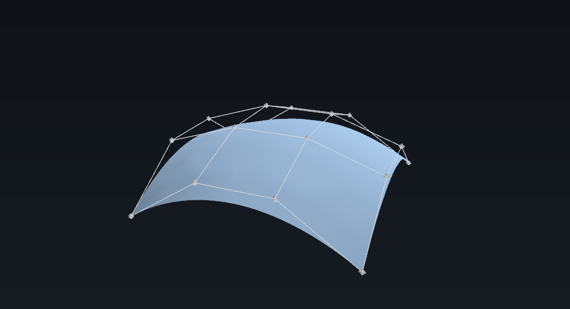
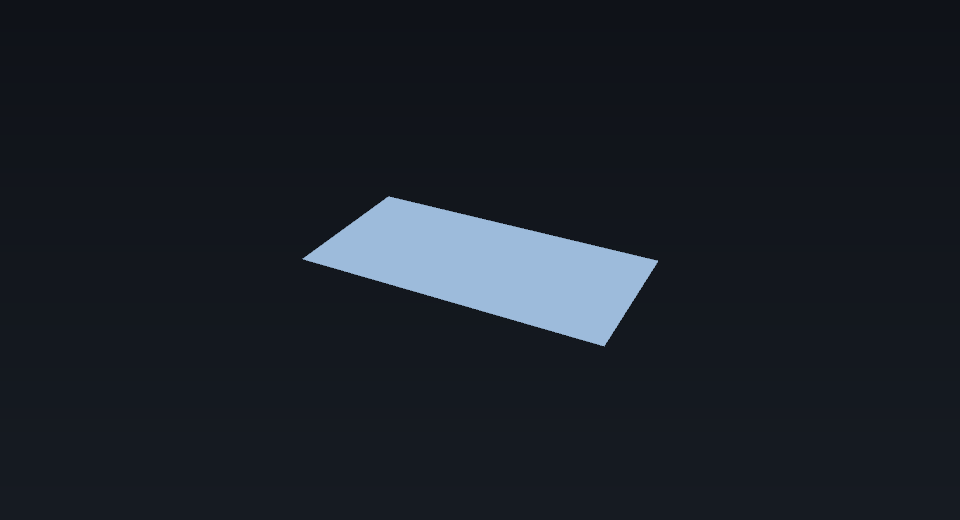
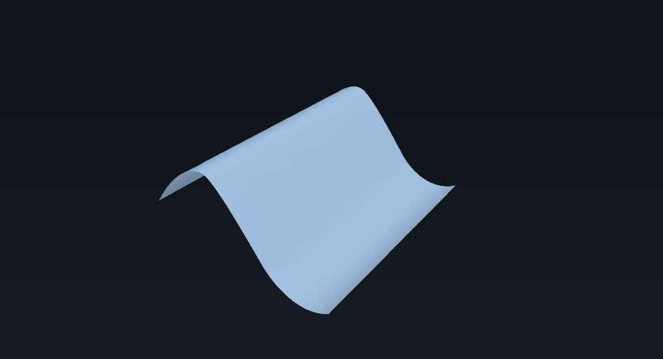
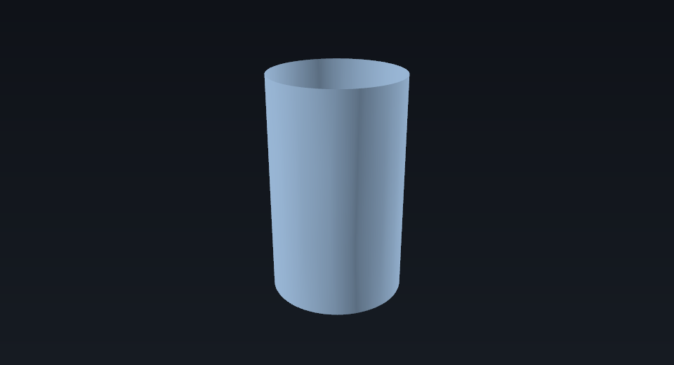

# Model a NURBS surface

`Part.BSplineSurface` is the surface counterpart of `Part.BSplineCurve`. It holds the
whole control-point description — poles, weights, knot vectors with multiplicities, and
the two degrees — and turns it into a face with `toShape()`.

**Needs:** the `Part` workbench, which means an edition or extension built with OCCT.



*The patch this page builds, with its control cage: `surface.getPoles()` joined along U
and V, with a marker at each pole. It is rendered from the real face and pole grid by
[`tools/generate_general_figures.py`](../../../tools/generate_general_figures.py); the
image and the code below describe the same surface.*

The geometric background — what NURBS are, and why the weights matter — is in
[chapter 1](../../general/01-the-dna-of-3d-geometry.md).

## The description

| Argument | What it is | Default |
| --- | --- | --- |
| `poles` | A `[u][v]` grid of control points. | required |
| `umults`, `vmults` | The multiplicity of each distinct knot. | required |
| `uknots`, `vknots` | The distinct knot values. | uniform on `[0, 1]` |
| `udegree`, `vdegree` | The polynomial degree in each direction. | `3` |
| `uperiodic`, `vperiodic` | Whether the surface closes in that direction. | `False` |
| `weights` | A `[u][v]` grid of rational weights. | all `1.0` |

For a non-periodic direction, the multiplicities must sum to
`poles + degree + 1`. A **clamped** surface repeats each end knot `degree + 1` times,
which makes the patch interpolate its corner poles. For a periodic direction the sum is
`poles` instead.

## Build a patch

A 4 by 4 grid with degree 3 in both directions, clamped at both ends:

```python
import Part

poles = [
    [[0, 0, 0], [0, 3, 2], [0, 6, 2], [0, 9, 0]],
    [[3, 0, 2], [3, 3, 3], [3, 6, 3], [3, 9, 2]],
    [[6, 0, 2], [6, 3, 3], [6, 6, 3], [6, 9, 2]],
    [[9, 0, 0], [9, 3, 2], [9, 6, 2], [9, 9, 0]],
]

surface = Part.BSplineSurface()
surface.buildFromPolesMultsKnots(
    poles,
    [4, 4],        # umults: each end knot repeated degree + 1 times
    [4, 4],        # vmults
    [0.0, 1.0],    # uknots: the two distinct U knots
    [0.0, 1.0],    # vknots
    False,         # uperiodic
    False,         # vperiodic
    3,             # udegree
    3,             # vdegree
)
```

The four poles in U and degree 3 give `4 + 3 + 1 = 8` knots, so each of the two end
knots has multiplicity 4 — the arithmetic behind the `[4, 4]` lists.

## Read it back

```python
print(surface.TypeId)                            # Part::GeomBSplineSurface
print(surface.UDegree, surface.VDegree)          # 3 3
print(len(surface.getPoles()), len(surface.getPoles()[0]))  # 4 4
print(surface.getUKnots(), surface.getUMultiplicities())    # [0.0, 1.0] [4, 4]
print(surface.getWeights()[0])                   # [1.0, 1.0, 1.0, 1.0]
```

The same values in a table:

| Call | Result |
| --- | --- |
| `surface.TypeId` | `Part::GeomBSplineSurface` |
| `surface.UDegree`, `surface.VDegree` | `3`, `3` |
| `surface.getPoles()` | a 4 by 4 grid of vectors |
| `surface.getUKnots()` | `[0.0, 1.0]` |
| `surface.getUMultiplicities()` | `[4, 4]` |
| `surface.getWeights()` | every weight `1.0` |

## Draw the cage

The cage is the pole grid itself: join each pole to its neighbour along U and along V.
`surface.getPoles()` returns exactly the grid the surface was built from, so the same
lines and markers can be drawn over any preview:

- the lines are the segments between adjacent poles in the `[u][v]` grid;
- the markers are the poles themselves;
- the surface generally does not pass through the poles, except at the four corners of
a clamped patch.

The figure at the top of this page is the surface plus that cage, drawn from the same
`getPoles()` grid.

## Make a face and put it in a document

```python
face = surface.toShape()
print(face.ShapeType, face.isValid(), face.Area)   # Face True 87.45840756478856

import FreeCAD
doc = FreeCAD.newDocument("NurbsPatch")
patch = doc.addObject("Part::Feature", "Patch")
patch.Shape = face
doc.recompute()
```

`face.Surface` gives the `Part.BSplineSurface` back, so the description survives the
round trip.

## Interpolate a grid instead

`interpolate` fits a surface through a grid rather than taking its control points:

```python
surface = Part.BSplineSurface()
surface.interpolate(points)   # a [u][v] grid of vectors
face = surface.toShape()
```

An interpolated surface can build its face and report `bounds`, `UKnotSequence` and
`VKnotSequence`. The pole, knot and degree getters describe an explicitly built
surface; call `buildFromPolesMultsKnots` when you need them.

## More shapes

### A flat patch

Degree 1 keeps the surface bilinear, so four poles give the flat rectangle between them:

```python
surface = Part.BSplineSurface()
surface.buildFromPolesMultsKnots(
    [[[0, 0, 0], [2, 0, 0]], [[0, 1, 0], [2, 1, 0]]],
    [2, 2], [2, 2], [0.0, 1.0], [0.0, 1.0],
    False, False, 1, 1,
)
face = surface.toShape()
print(face.Area, face.isValid())   # 2.0 True
```



*Four poles and degree 1 produce a flat bilinear patch; all four poles are corners of
the surface.*

### A wavy sheet

Build the pole grid in a comprehension instead of typing it. The wave runs along U; the
four poles across V set the width:

```python
import math

poles = [
    [[u, v * 3.0, math.sin(2 * math.pi * u / 8) * 2.0] for v in range(4)]
    for u in range(8)
]
surface = Part.BSplineSurface()
surface.buildFromPolesMultsKnots(
    poles,
    [4, 2, 2, 4], [4, 4],
    [0.0, 1 / 3, 2 / 3, 1.0], [0.0, 1.0],
    False, False, 3, 3,
)
face = surface.toShape()   # area 83.071692, valid
```



*The sheet from the generated 8 by 4 pole grid, rendered from its face.*

### A closed tube

`vperiodic=True` closes the surface around V. For a periodic direction the
multiplicities of every knot except the last must sum to the pole count; the usual choice
is `poles + 1` knots of multiplicity 1:

```python
poles = [
    [
        [2.0 * math.cos(2 * math.pi * v / 8),
         2.0 * math.sin(2 * math.pi * v / 8),
         u * 2.0]
        for v in range(8)
    ]
    for u in range(4)
]
surface = Part.BSplineSurface()
surface.buildFromPolesMultsKnots(
    poles, [4, 4], [1] * 9,
    [0.0, 1.0], [index / 8 for index in range(9)],
    False, True, 3, 3,
)
face = surface.toShape()   # area 67.995767, valid
```



*The tube is closed around V and open at the two U ends.*

## Turning a face into a solid

`toShape()` stops at a **face**. To close it into a solid — by extruding the face or by
capping a closed surface and sewing a shell — see
[Make a solid from a NURBS surface](solid-from-a-nurbs-surface.md).

## Weights and conics

With every weight at `1.0` the surface is polynomial. A different weight makes it
rational, and rational quadratics can represent a circle or an ellipse as a conic
rather than as a polynomial approximation. Pass `weights` in the same `[u][v]` shape as
the poles.

The effect is easy to see on the patch above: setting the weight at `poles[1][1]` to
`0.5` pulls the surface toward that pole and changes the area from `87.458408` to
`87.2452`, still valid. A control net that closes into a full disc is a separate case —
the current `toShape()` path rejects that degenerate boundary — so start from an open
patch when you need a face.

## Reference

- `help(Part.BSplineSurface)` prints the class docstrings, which mirror upstream's
  signatures.
- The generated [Python API reference](../../python-api/index.md) covers the base
  `FreeCAD` facade; the workbench modules such as `Part` are documented by their
  docstrings and measured against upstream by
  [`tools/part_api_audit.py`](../../../tools/part_api_audit.py).
