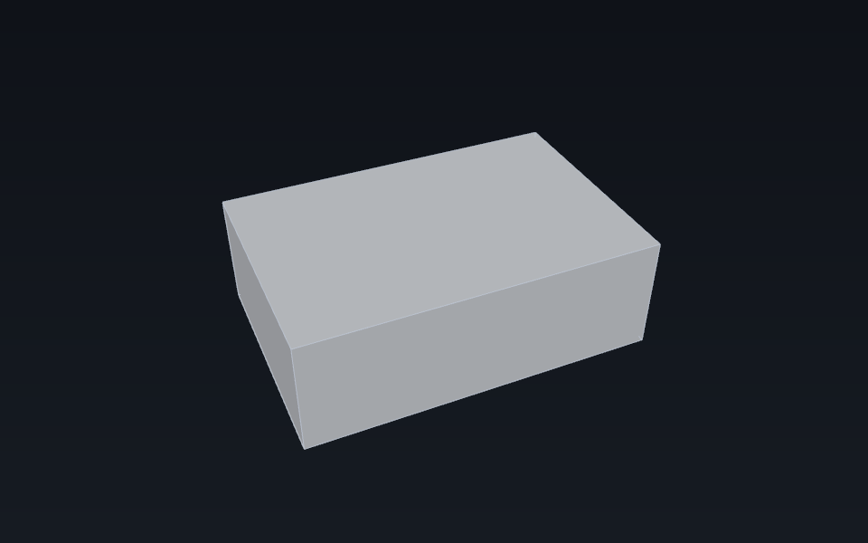

<!-- generated by tools/userdocs.py from tools/workflows/02_parametric_recompute.py -->

# Wire two objects together with an expression

Add an expression that reads one object's length from another, recompute, then change the input and watch the dependent value follow.

> **Generated page.** `tools/userdocs.py` writes it from
> [`tools/workflows/02_parametric_recompute.py`](../../../tools/workflows/02_parametric_recompute.py).
> Edit the workflow, not this page; `python3 tools/userdocs.py --check`
> fails when the two disagree.

**Requires:** the `FreeCAD` facade; no workbench module and no GPU.

## 1. Two objects, one dependency

Expressions are evaluated on recompute, not on assignment. The document records the dependency edge, so it can order the objects without the script doing so.

```python
doc = FreeCAD.newDocument("Parametric")

source = doc.addObject("App::FeaturePython", "Source")
source.addProperty("App::PropertyLength", "Length", "Base", "Input length")
source.Length = "10 mm"

derived = doc.addObject("App::FeaturePython", "Derived")
derived.addProperty("App::PropertyLength", "Result", "Base", "Computed")
derived.setExpression("Result", "Source.Length * 2")
```

```python
doc.recompute()
```

| Read back | Value |
| --- | --- |
| Source.Length | 10 mm |
| Derived.Result | 20 mm |
| Derived.State | ["Up-to-date"] |

## 2. Change the input

Assigning to the source does not touch `Derived`; the next recompute does, because the dependency is stored in the document.

```python
source.Length = "15 mm"
doc.recompute()
```

| Read back | Value |
| --- | --- |
| Source.Length | 15 mm |
| Derived.Result | 30 mm |

## 3. What the result describes

`Derived.Result` is 30 mm after the input changed. The box below uses that computed value; the depth and height are illustrative.

```python
box_size = (float(derived.Result), 20.0, 10.0)
box_center = [value / 2.0 for value in box_size]
span = max(box_size)
box_eye = [
    box_center[0] - span * 0.8,
    box_center[1] - span * 1.8,
    box_center[2] + span * 1.5,
]
```

| Read back | Value |
| --- | --- |
| Box (result, depth, height) | [30.0, 20.0, 10.0] |



*The 30 mm `Derived.Result` after the input changed to 15 mm, drawn as a box; the depth and height are illustrative.*

## 4. Read the expression back

The expression is part of the document, not of the Python object.

```python
expr = derived.ExpressionEngine
```

*ExpressionEngine*

```json
[
  [
    "Result",
    "Source.Length * 2"
  ]
]
```

## 5. Close the document

```python
FreeCAD.closeDocument('Parametric')
```

| Read back | Value |
| --- | --- |
| Open documents | [] |
