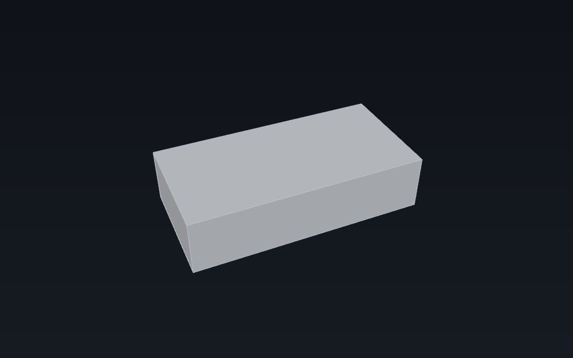
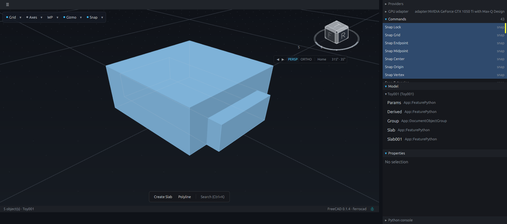

<!-- generated by tools/userdocs.py from tools/workflows/05_selection_and_commands.py -->

# Drive a command from the selection

Selection is UI state the shell pushes into the facade, and a command reads it when the shell asks whether it is enabled. This page runs a command with no selection, selects an object, opens a dialog and accepts it, and deletes the selection.

> **Generated page.** `tools/userdocs.py` writes it from
> [`tools/workflows/05_selection_and_commands.py`](../../../tools/workflows/05_selection_and_commands.py).
> Edit the workflow, not this page; `python3 tools/userdocs.py --check`
> fails when the two disagree.

**Requires:** the `ferrocad_toy` app script (it registers on import); no window: the shell's pushes are ordinary function calls.

## 1. Boot the edition

```python
import json
import ferrocad_shell
import ferrocad_toy

ferrocad_toy.bootstrap("Toy")
```

| Read back | Value |
| --- | --- |
| Objects | ["Params", "Derived", "Group", "Slab"] |

## 2. Enablement follows the selection

The shell pushes its selection into `FreeCADGui.Selection`; a command answers `IsActive` against it. Nothing is enabled or disabled by hand.

```python
ferrocad_shell.set_selection('[]')
```

```python
def delete_state():
    for command in json.loads(ferrocad_shell.commands()):
        if command["id"] == "App_Delete":
            return command["enabled"]
```

| Read back | Value |
| --- | --- |
| App_Delete, nothing selected | false |

```python
ferrocad_shell.set_selection('[{"object": "Slab"}]')
```

| Read back | Value |
| --- | --- |
| Selection | ["Slab"] |
| App_Delete, one object selected | true |

## 3. A command that asks for input

`Toy_MakeSlab` does not act immediately. It returns a dialog description and a token; the shell renders the fields natively and sends the typed values back to that token.

```python
request = json.loads(ferrocad_shell.run_command("Toy_MakeSlab"))
```

*Dialog request*

```json
{
  "accept": "Create",
  "fields": [
    {
      "kind": "quantity",
      "label": "Width",
      "min": 0.1,
      "name": "Width",
      "value": 40.0
    },
    {
      "kind": "quantity",
      "label": "Depth",
      "min": 0.1,
      "name": "Depth",
      "value": 40.0
    },
    {
      "kind": "quantity",
      "label": "Height",
      "min": 0.1,
      "name": "Height",
      "value": 20.0
    }
  ],
  "title": "Create Slab"
}
```

Accepting runs the command's callback, which owns its transaction.

```python
accepted = json.loads(
    ferrocad_shell.dialog_accept(
        json.dumps(
            {
                "token": request["token"],
                "values": {"Width": 50.0, "Depth": 25.0, "Height": 12.0},
            }
        )
    )
)
```

| Read back | Value |
| --- | --- |
| Accept response | {"ok": true, "status": "created Slab001"} |
| Objects | ["Params", "Derived", "Group", "Slab", "Slab001"] |

## 4. What the command created

`Toy_MakeSlab` created a second slab with the values from the dialog. The box below is its footprint and height; the document tree above is the same object.

```python
created = next(
    obj
    for obj in FreeCAD.ActiveDocument.Objects
    if obj.Name.startswith("Slab") and obj.Name != "Slab"
)
box_size = (float(created.Width), float(created.Depth), float(created.Height))
box_center = [value / 2.0 for value in box_size]
span = max(box_size)
box_eye = [
    box_center[0] - span * 0.8,
    box_center[1] - span * 1.8,
    box_center[2] + span * 1.5,
]
```

| Read back | Value |
| --- | --- |
| Created object | Slab001 |
| Box (width, depth, height) | [50.0, 25.0, 12.0] |



*The slab `Toy_MakeSlab` created from the dialog values, drawn by the same offscreen renderer the viewport uses.*



*The same document in the Toy edition, with Dev Tools open. `Slab001` is the object the dialog created, and the Commands list is the shell's view of `commands()`.*

## 5. Cancelling instead

A token is single-use. Cancelling drops it without running the callback, so a cancelled dialog leaves no transaction behind.

```python
cancelled = json.loads(ferrocad_shell.run_command("Toy_MakeSlab"))
cancel_response = json.loads(
    ferrocad_shell.dialog_cancel(cancelled["token"])
)
```

| Read back | Value |
| --- | --- |
| Cancel response | {"ok": true} |
| Objects | ["Params", "Derived", "Group", "Slab", "Slab001"] |

## 6. Act on the selection

`App_Delete` is the shell's own edit command. It reads the same selection snapshot and deletes what it names.

```python
ferrocad_shell.set_selection('[{"object": "Slab"}]')
deleted = json.loads(ferrocad_shell.run_command("App_Delete"))
```

| Read back | Value |
| --- | --- |
| Delete response | {"ok": true, "status": "deleted 1 object(s)"} |
| Objects | ["Params", "Derived", "Group", "Slab001"] |

> Every call above is a plain function on the shell's Python module. The same functions are what the window calls while you click, which is why these pages run with no window at all.

## 7. Close the document

```python
FreeCAD.closeDocument('Toy')
```

| Read back | Value |
| --- | --- |
| Open documents | [] |
