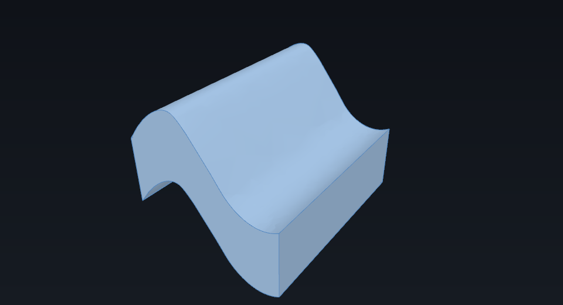
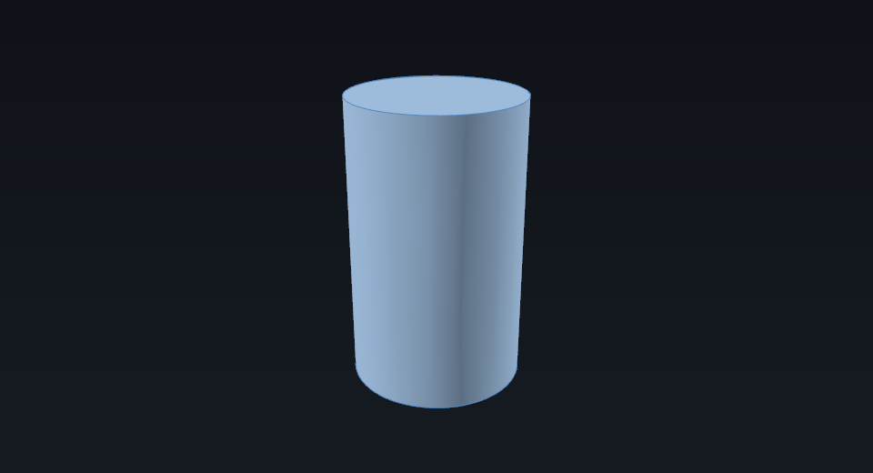

# Make a solid from a NURBS surface

`Part.BSplineSurface.toShape()` returns a **face** — a surface with a boundary. A solid
needs a closed shell. There are two common ways to get there: extrude the face, or cap
its open ends and sew the pieces into a shell.

**Needs:** the `Part` workbench, which means an edition or extension built with OCCT.

## Extrude a face

`Face.extrude(vector)` sweeps a face along a vector. The result is a solid with the
original face at one end, a translated copy at the other, and walls along every boundary
edge. The wavy sheet from
[Model a NURBS surface](model-a-nurbs-surface.md), rebuilt here so the page stands alone:

```python
import math
import Part

poles = [
    [[u, v * 3.0, math.sin(2 * math.pi * u / 8) * 2.0] for v in range(4)]
    for u in range(8)
]
surface = Part.BSplineSurface()
surface.buildFromPolesMultsKnots(
    poles,
    [4, 2, 2, 4], [4, 4],
    [0.0, 1 / 3, 2 / 3, 1.0], [0.0, 1.0],
    False, False, 3, 3,
)
face = surface.toShape()

slab = face.extrude((0.0, 0.0, 3.0))
print(slab.ShapeType, slab.isValid(), slab.Volume)
# Solid True 190.4042448629122
```



*The slab keeps the wavy top face and adds vertical walls and a bottom face.*

## Cap a closed surface

A periodic surface has no open boundary along its closed direction; it is open only at
the other ends. The tube from the other page is closed around V, so its two U ends are
the only open boundaries:

```python
import math
import Part

poles = [
    [
        [
            2.0 * math.cos(2 * math.pi * v / 8),
            2.0 * math.sin(2 * math.pi * v / 8),
            u * 2.0,
        ]
        for v in range(8)
    ]
    for u in range(4)
]
surface = Part.BSplineSurface()
surface.buildFromPolesMultsKnots(
    poles, [4, 4], [1] * 9,
    [0.0, 1.0], [index / 8 for index in range(9)],
    False, True, 3, 3,
)

tube = surface.toShape()
caps = [Part.Face(Part.Wire([edge])) for edge in tube.Edges if edge.isClosed()]
shell = Part.makeShell([tube.reversed(), *caps])
solid = Part.makeSolid(shell)
print(solid.ShapeType, solid.isValid(), solid.Volume)
# Solid True 61.31958336992129
```



*Two caps and the periodic face form a closed shell; `makeSolid` turns it into a solid.*

`tube.reversed()` matters. The face produced from a surface points inward, so without the
reversal the shell still closes but is inside-out: the volume comes out negative
(`-61.32`). Reverse the tube — not the caps — so the normals face outward.

## Check the result

- `solid.isValid()` — the solid is topologically valid.
- `solid.isClosed()` — its shell is closed.
- `solid.Volume` — positive for an outward-oriented solid. A negative value is the
  inside-out symptom described above, not a different shape.
