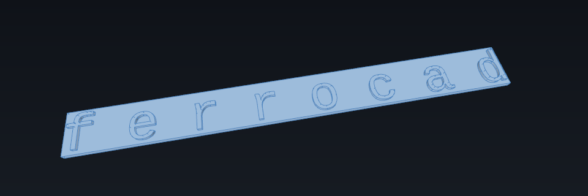

# Make 3-D text from a font

`Draft.make_shape_string` turns a string and a font file into a flat, single-line
**compound of faces**; the `Part` workbench extrudes those faces into letters and fuses
them onto — or cuts them out of — a plate. This is upstream's Draft ShapeString in its
scripted form, and it is the starting point for 3-D text.

**Needs:** the `Part` workbench, which means an edition or extension built with OCCT.
The glyph outlines do not need FreeType or a system font engine: they come from
`ferrocad_text`, which reads the font with `skrifa`/`read-fonts`.



*The model this page builds: `Draft.make_shape_string("ferrocad", FONT, 20.0, 1.0)`
extruded 2 mm and fused onto a 3 mm plate. The figure is rendered from the real
geometry by [`tools/generate_general_figures.py`](../../../tools/generate_general_figures.py).*

## Build the string

```python
import Draft
import FreeCAD
import Part

FONT = "/path/to/LiberationMono-Regular.ttf"   # .ttf, .otf, .ttc or .pfb
doc = FreeCAD.newDocument("Text3D")
string = Draft.make_shape_string("ferrocad", FONT, 20.0, 1.0)

print(string.String, len(string.Shape.Faces))   # ferrocad 8
```

| Argument | What it is |
| --- | --- |
| `string` | The text. One line, left to right (as upstream). |
| `fontfile` | The font path. A path starting with `.` is resolved against the document's directory. |
| `size` | The height in the document's units (millimetres). With `ScaleToSize` on — the default — it is the **cap height**. |
| `tracking` | Inter-character spacing, in the same units. |

A space has an advance but no outline, so it contributes no wires; a string made only of
spaces produces an empty compound.

## What the object holds

The object is a `Part::Part2DObjectPython` whose proxy rebuilds the geometry on every
recompute. These are the properties `execute` reads:

| Property | Meaning |
| --- | --- |
| `String`, `FontFile` | The text and the font. |
| `Size`, `Tracking` | As above. |
| `MakeFace` | `True` (default) fills each glyph's outer wire and counters into faces; `False` keeps the bare wires. |
| `ScaleToSize` | `True` (default) rescales so the font's cap height is exactly `Size`. |
| `Justification` | One of the nine upstream positions, default `Bottom-Left`. |
| `JustificationReference` | `Cap Height` (default) or `Shape Height` — what the vertical justification measures. |
| `KeepLeftMargin` | Keep the left side bearing instead of dropping it when justifying left. |
| `ObliqueAngle` | A shear in the −80°…+80° range. |

Change a property and call `doc.recompute()` to rebuild `Shape`. The proxy is persisted
with the document, so a native save and reopen keeps the object editable.

## A wire is not a solid

`Part.makeWireString` returns **one list of closed wires per character** — upstream's
`list[list[Wire]]`. A glyph like `o` has two: the outer contour and the counter.

```python
wires = Part.makeWireString("o", FONT, 100.0)
outer, counter = wires[0]

shell = outer.extrude((0, 0, 2.0))
print(shell.ShapeType, shell.isClosed())   # Shell False

face = Part.Face(wires[0], "Part::FaceMakerBullseye")
print(face.ShapeType, len(face.Wires))     # Face 2

solid = face.extrude((0, 0, 2.0))
print(solid.ShapeType, solid.isClosed())   # Solid True
```

A bare wire sweeps into an open shell — and a counter wire into a negative-volume one —
so only a **face** sweeps into a solid. `Part::FaceMakerBullseye` nests the counter
inside the outer wire as a hole; the ShapeString proxy falls back through `Cheese`,
`Simple` and `Unified` when a font's contours do not satisfy Bullseye.

`makeWireString` accepts both upstream call forms, `(text, dir, fontfile, height[,
tracking])` and `(text, fontspec, height[, tracking])`. The choice is made by the type of
the second argument; Draft uses the second.

## Extrude and fuse the letters

```python
DEPTH = 2.0
solids = [face.extrude((0, 0, DEPTH)) for face in string.Shape.Faces]
text = solids[0].multiFuse(solids[1:])
print(text.ShapeType, text.Volume)   # Compound 1550.8126621170838
```

Each glyph is a separate solid, so fusing disjoint letters returns a compound rather
than one solid — which is exactly what a boolean takes. Overlapping letters would make
the boolean resolve the overlap instead.

## Raise it on, or etch it into, a plate

The text sits with its baseline on `y = 0`, but the round letters (`o`, `e`, `c`)
overshoot the baseline by a fraction of a millimetre. Place the plate from the bounding
box, not from the baseline, or the text hangs below it.

```python
bound = text.BoundBox
plate = Part.makeBox(bound.XLength + 4, bound.YLength + 4, 3)
print(plate.Volume)   # 21012.30842713021

raised = text.copy()          # translate mutates in place
raised.translate(FreeCAD.Vector(-bound.XMin + 2, -bound.YMin + 2, plate.BoundBox.ZMax))
model = plate.fuse(raised)
print(model.isValid(), model.Volume)   # True 22563.121089247303
```

`model.Volume` is `plate.Volume + text.Volume` to floating-point precision: the text
stands on the plate and the two do not overlap.

For **etched** text, lower the text so only part of its depth is inside the plate, then
subtract it:

```python
placed = text.copy()
placed.translate(FreeCAD.Vector(-bound.XMin + 2, -bound.YMin + 2, 2.0))
etched = plate.cut(placed)
print(etched.isValid(), etched.Volume)   # True 20236.902903819246
```

The 2 mm text now spans `z = 2…4` inside the 3 mm plate, so one millimetre of it is
removed and `etched.Volume == plate.Volume - text.Volume / 2`.

`Shape.translate` returns the same shape and mutates it, so a second placement needs a
copy — otherwise the first placement is applied twice.

## Sizing: there is no DPI

`Size` is a length in the document's units, not a point size, and nothing in the pipeline
needs a resolution:

- A font is outline data in font units; the em is scaled away. There is no 72 or 96 PPI
  constant anywhere, because a "point" has no meaning before a medium has pixels, and a
  CAD model has none.
- With `ScaleToSize` on, `Size` is the **cap height**, measured from the font's `M`.
  Ascenders go above it: `ferrocad` at `Size = 20` is 22 mm tall (`f` and `d` reach over
  the cap height) and about 261 mm wide.
- `Tracking` is a length too, and it is scaled with the text.
- `Part.makeWireString`'s own `height` is not a cap height. It is upstream's font-size
  scale (`height / (10 × line height)`), so `height = 100` gives a 5.81 mm cap height in
  Liberation Mono. `Draft.make_shape_string` passes `Size` through that scale and then
  rescales; with `ScaleToSize = False` the text therefore comes out roughly a tenth of
  the requested size.

## One line, left to right

- The command builds a **single line**. There is no line breaking, paragraph layout or
  line height: a paragraph is several ShapeStrings placed line by line, spaced in the
  document's units.
- Only left-to-right text. Each code point maps to one glyph in order; there is no
  complex-script shaping (no ligature substitution, no reordering) and no right-to-left
  or vertical layout.
- Advances and kerning come from the font's tables.
- Some fonts have overlapping or slightly open contours. Those are errors for a face, and
  they are why the face maker falls back; a font that fails every maker leaves that
  glyph out.

## Run it headlessly

```sh
cargo run -p ferrocad_parametric -- \
  --script examples/headless_text.py --stl target/text.stl --size 1200x900
```

The script is [`examples/headless_text.py`](../../../examples/headless_text.py); it builds
the same raised model and the edition writes the STL. Add `--render target/text.png`
instead of `--stl` on a machine with a GPU adapter for an image.

## Where this runs

- The outline half is kernel-free: `ferrocad_text` turns a font into contours, and
  `Part.makeWireString` uses the kernel only to join them into edges and wires.
- The solid half is `Part`: faces, extrusion, fuses and cuts. The workflow therefore needs
  an OCCT build; the base extension and the toy edition cannot produce a solid from it.
- A flat text outline could be drawn as wires without a kernel, but that is a sketch of
  polylines rather than 3-D text, and it is not a separate feature here.

## Reference

- `help(Draft.make_shape_string)` prints the signature and docstring.
- The design note [`text-and-3d-text.md`](../../project/tasks/text-and-3d-text.md) records
  the decisions (skrifa instead of FreeType; no DPI) and the open questions.
- [`tests/test_text_workflow.py`](../../../tests/test_text_workflow.py) is the executable
  version of every claim on this page.
