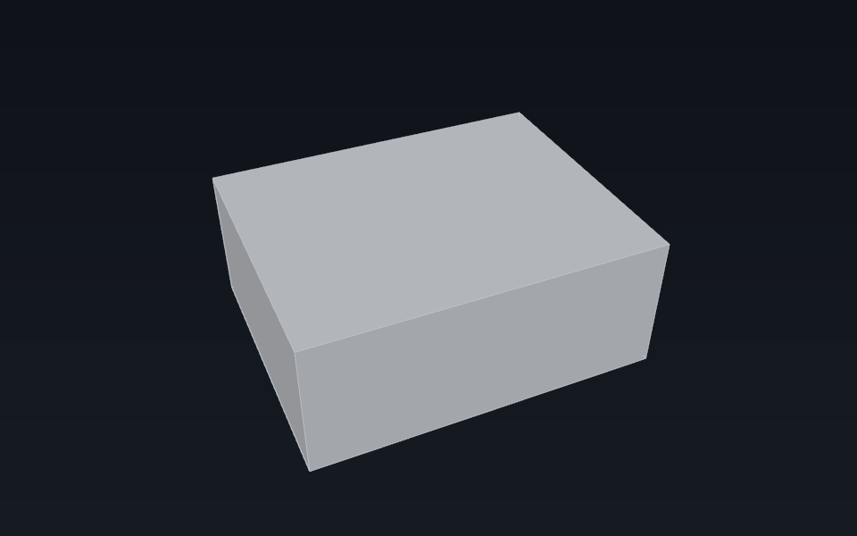

<!-- generated by tools/userdocs.py from tools/workflows/03_undo_and_persistence.py -->

# Undo an edit and reload the document

Group an edit into a named transaction, undo and redo it, then save the document, close it, open it again, and read the values back.

> **Generated page.** `tools/userdocs.py` writes it from
> [`tools/workflows/03_undo_and_persistence.py`](../../../tools/workflows/03_undo_and_persistence.py).
> Edit the workflow, not this page; `python3 tools/userdocs.py --check`
> fails when the two disagree.

**Requires:** the `FreeCAD` facade; a writable temporary directory.

## 1. Build a document

```python
import tempfile
```

```python
doc = FreeCAD.newDocument("Undoable")

part = doc.addObject("App::FeaturePython", "Part")
part.addProperty("App::PropertyLength", "Length", "Base", "Overall length")
part.addProperty("App::PropertyEnumeration", "Finish", "Base", "Surface finish")
part.Finish = ["As machined", "Anodised"]
part.Length = "10 mm"
doc.recompute()
```

| Read back | Value |
| --- | --- |
| part.Length | 10 mm |

## 2. One transaction, one undo

Everything between `openTransaction` and `commitTransaction` is one undoable step. A workbench wraps each command in exactly this, which is why undo never lands in the middle of a command.

```python
doc.openTransaction("Resize")
part.Length = "25 mm"
part.Finish = "Anodised"
doc.commitTransaction()
doc.recompute()
```

| Read back | Value |
| --- | --- |
| part.Length after the edit | 25 mm |
| part.Finish after the edit | Anodised |

```python
doc.undo(); doc.recompute()
```

| Read back | Value |
| --- | --- |
| part.Length after undo | 10 mm |
| part.Finish after undo | As machined |

```python
doc.redo(); doc.recompute()
```

| Read back | Value |
| --- | --- |
| part.Length after redo | 25 mm |

## 3. Save and reload

`saveAs` writes the document format; `open` reads it into a new document with the same names and property values. The path is a temporary file, so it is not shown.

```python
import os
path = os.path.join(tempfile.mkdtemp(prefix="ferrocad-userdocs-"), "undoable.ferrocad")
doc.saveAs(path)
doc_name = doc.Name
```

```python
FreeCAD.closeDocument(doc_name)
```

| Read back | Value |
| --- | --- |
| Open documents after close | [] |

```python
reopened = FreeCAD.open(path)
```

```python
reloaded = reopened.getObject("Part")
```

| Read back | Value |
| --- | --- |
| Reloaded name | Part |
| Reloaded Length | 25 mm |
| Reloaded Finish | Anodised |

## 4. What the reloaded length describes

The reloaded value is the 25 mm length after the redo, read from the file. The box below uses it; the depth and height are illustrative.

```python
box_size = (float(reloaded.Length), 20.0, 10.0)
box_center = [value / 2.0 for value in box_size]
span = max(box_size)
box_eye = [
    box_center[0] - span * 0.8,
    box_center[1] - span * 1.8,
    box_center[2] + span * 1.5,
]
```

| Read back | Value |
| --- | --- |
| Box (length, depth, height) | [25.0, 20.0, 10.0] |



*The 25 mm length after redo and reload, drawn as a box; the depth and height are illustrative.*

## 5. Clean up

```python
import shutil
FreeCAD.closeDocument(reopened.Name)
shutil.rmtree(os.path.dirname(path))
```

| Read back | Value |
| --- | --- |
| Open documents | [] |
