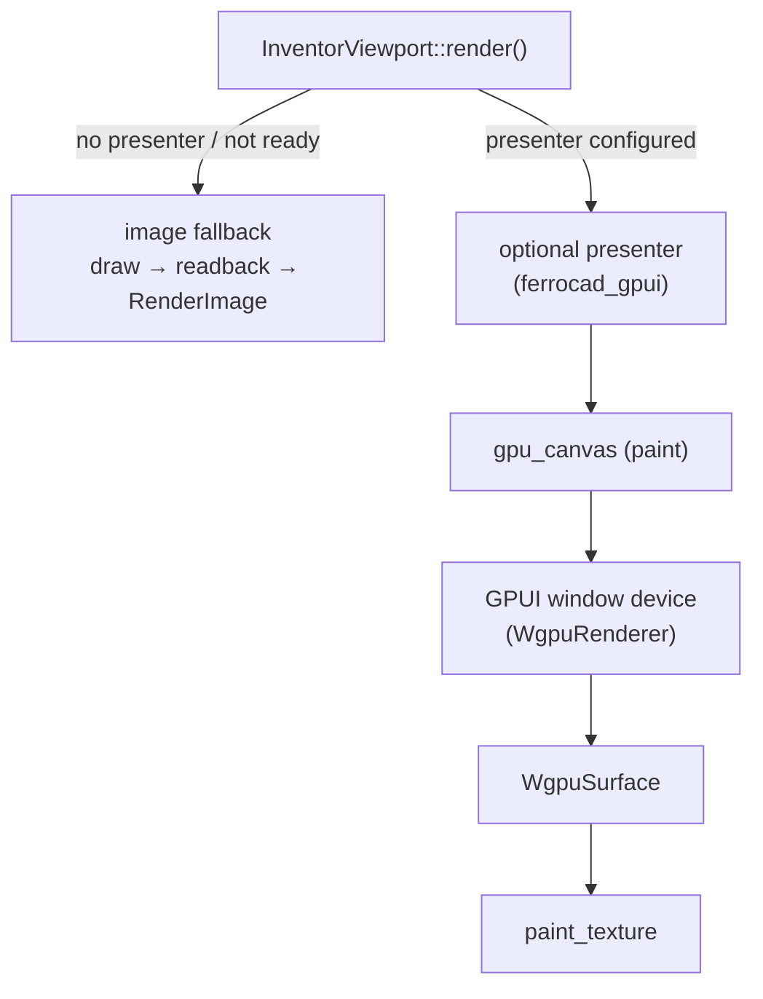

# Zero-copy GPU presentation (`gpui_interop`) — assessment

Status: **implemented (2026-10-20)**; the investigation below is kept as the
rationale, and §9 records the slice that landed. It replaces the `ferrocad_wgpu`
readback → `RenderImage` path with a zero-copy GPU hand-off through
[`gpui_interop`](https://crates.io/crates/gpui_interop).

Companions: [`inventor-renderer.md`](inventor-renderer.md) (the current renderer and
host seam), [`inventor-plan.md`](inventor-plan.md) (the backend boundary),
[`navicube.md`](../interaction/navicube.md) (the overlay pass that must survive the change).

## 0. TL;DR — recommendation

- `gpui_interop` **0.1.0** (published 2026-10-20) is a direct fit for the problem, but
  it is experimental. It depends on `bite-gpui ^1.23` and `wgpu ^29.0.4`; this
  workspace has `bite-gpui 1.23.305` and `wgpu 29.0.4`, so the requirements unify.
- **Both wgpu shapes are implemented; Linux tries the dma-buf one first.** The
  presenter builds a `WgpuSharedBuffer`, submits the frame through it and calls
  `paint_surface` with the fence-carrying handle. When the device cannot export (a
  GL adapter, or no Vulkan external-memory extensions) it falls back to a
  `WgpuSurface` sampled with `paint_texture` on the same device.
- Both shapes render on **GPUI's own wgpu device**. The dma-buf shape is same-adapter,
  not a second device: a wgpu texture cannot be exported, so `WgpuSharedBuffer`
  allocates its own exportable image on that device.
- The dma-buf shape adds a Vulkan export, a `sync_file`, an import and a fence per
  frame; the upstream `interop_wgpu` example treats it as the slower `--transfer`
  shape. The same-device fallback is already built, so it can become the default if
  a windowed measurement shows the export cost matters.
- The one architectural consequence: **the renderer must run on GPUI's wgpu device**.
  The current `WgpuRenderer::new_default` device cannot hand a texture to GPUI, and a
  wgpu-allocated texture cannot be exported as a dma-buf either.
- Platform support is not uniform:
  - **Linux (X11/Wayland):** ready — GPUI's window renderer is `WgpuRenderer` by
    default, so the dma-buf export is available on a Vulkan device and the
    same-device fallback needs no dma-buf requirements.
  - **Windows:** only where the window itself is created with `WgpuRenderer` through
    `WindowOptions::with_renderer_factory`. Under the default Direct3D 11 renderer,
    `Adapter::wgpu()` makes a *separate* DX12 device and the transport is
    `SharedSurface`, which needs raw D3D12 resources our wgpu texture cannot provide.
  - **macOS:** unsupported by `gpui_interop` 0.1.0 (`macos.rs` is a stub, and
    `gpui_wgpu` has no `GpuRenderer` impl there). Keep the image path.
  - **Headless/WASM:** no canvas device — keep the image path.
- **Keep `image()` and `ImageData`.** They are still needed for headless rendering,
  screenshots, tests with `FakeView`, and every unsupported platform.
- **Implemented first slice:** an optional (default-on) `gpu-interop` feature, a
  wgpu-free presenter seam in `ferrocad_viewport`, and a `ferrocad_gpui` presenter
  that prefers the dma-buf export on Linux and falls back to the same-device
  `WgpuSurface` (Windows/FreeBSD use the latter). See §9.

## 1. The current path, and what it costs

Today the viewport draws and then reads the whole target back on every `Render`
(`crates/ferrocad_viewport/src/inventor_view.rs`):

```rust
// refresh(), ~L684
if self.view.draw_frame(&views).is_ok() {
    if let Ok(image) = self.view.image() {
        self.frame = Some(Arc::new(render_image(image)));
    }
}
```

`render_image()` swaps R and B for gpui's `RenderImage` (`inventor_view.rs` ~L806),
and `WgpuRenderer::read_back()` (`crates/ferrocad_wgpu/src/renderer.rs` ~L721) does,
per frame:

1. allocate a full-size `MAP_READ` buffer;
2. `copy_texture_to_buffer` of the whole target;
3. submit and `map_async`;
4. `device.poll(wait_indefinitely())` — a CPU stall on the render thread;
5. copy every row into a `Vec<u8>` (stripping wgpu's 256-byte row padding);
6. hand the `Vec` to gpui, which uploads it as a texture again.

For a 1920×1080 viewport that is ~8 MB copied GPU→CPU and CPU→GPU per frame, plus a
synchronous wait. It is the main avoidable cost in an otherwise GPU-resident
pipeline, and it also forces the renderer to own a private device.

## 2. What `gpui_interop` provides

The crate's contract is a paint-time callback, `gpui::gpu_canvas`, whose
`GpuCanvasContext` is the only place the window renderer's device is reachable:

```rust
use gpui::{Corners, gpu_canvas};
use gpui_interop::{WgpuSurface, attach};
use gpui_wgpu::{ImportedTextureExt as _, WgpuRenderer};

let surface = gpu_canvas(move |gpu| {
    // First paint: attach to the window renderer and build the producer.
    let interop = attach(gpu.try_device::<WgpuRenderer>()).ok()?;
    let (device, queue) = interop.adapter().wgpu()?;
    let mut surface = WgpuSurface::new(&device, width, height).ok()?;

    // ... render the scene into surface.view() and submit on queue ...

    gpu.paint_texture(
        surface.view().to_imported_handle().ok()?,
        Corners::default(),
        1.0,
        false,
    );
});
```

The two wgpu shapes are deliberately different:

| Shape | API | Cost | Use when |
| --- | --- | --- | --- |
| Same-device view | `WgpuSurface` + `paint_texture` | none beyond the render | same wgpu device — **fallback, and the path on Windows/FreeBSD** |
| Exported dma-buf (Linux) | `WgpuSharedBuffer` + `paint_surface` | export + `sync_file` + import/fence | same adapter, cross-device shape — **tried first on Linux** |
| Shared D3D12 texture (Windows) | `SharedSurface` + `paint_surface` | D3D12 fence + D3D11 open | Direct3D 11 window renderer |

The upstream examples confirm the intended shape:

- `interop_wgpu` builds the producer lazily in the first `gpu_canvas`, reads
  `gpu.bounds()` × `gpu.scale_factor()` on every paint, resizes the target, renders,
  and then either `paint_surface` (dma-buf, when the Vulkan device can export) or
  `paint_texture` (same device). It falls back to `WgpuSurface` on non-Vulkan/GL
  adapters.
- `interop_cube_drag` shows the input gateway (`surface_input`) and the
  build-on-first-paint pattern. FerroCAD does not need `surface_input` yet: the
  existing gpui handlers already own hit-testing, drag and the navigation cube.
- `interop_bevy --transfer` / `--bench` document that the dma-buf path is slower than
  the same-device view. The implementation still tries it first (the chosen
  same-adapter shape) and keeps the same-device path as the measured fallback.

`WgpuSurface` enforces the two invariants of the imported-texture path: an sRGB
format (`Rgba8UnormSrgb` or `Bgra8UnormSrgb`) and `TEXTURE_BINDING`. Our
`TARGET_FORMAT` is `Rgba8UnormSrgb`, and `create_color()` already allocates with
`TEXTURE_BINDING`, so an alternative implementation could import the renderer's own
resolve target and skip the second allocation. The first slice should still use
`WgpuSurface` because it is the maintained, documented contract.

## 3. Current seam versus what is needed

`ferrocad_inventor::InventorView` already describes the two shapes:

```text
InventorView ──┬─ borrow_surface() → host composites the shared texture (zero-copy)
               └─ image()          → host wraps RGBA pixels as a gpui RenderImage
```

The `borrow_surface()` half is not usable as written:

- `WgpuRenderer::borrow_surface()` returns `&wgpu::Texture` from the renderer's
  private device, not the window's device;
- the host has no way to turn it into a gpui `ImportedTextureHandle` without
  `gpui_wgpu` and a compatible device;
- the viewport ignores it and always calls `image()`.

`gpui_interop` fills exactly that gap: it matches the producer to the window's
renderer, and `ImportedTextureExt` turns the same-device view into a gpui handle.
The trait can stay as the neutral description; the host-side presenter implements
the actual hand-off.

## 4. Proposed integration



### 4.1 `ferrocad_viewport` (no wgpu, no new backend dependency)

Add a presentation seam that only names gpui types (which the crate already uses):

```rust
pub trait Presenter {
    /// `Pending` until the first paint, then `Ready` or `Unsupported`.
    fn status(&self) -> PresenterStatus;
    /// The target size in physical pixels, from the element bounds × scale.
    fn set_size(&mut self, size: [u32; 2]);
    /// Called inside `gpu_canvas`; builds the device-bound objects on first paint
    /// and resizes the target.
    fn prepare(&mut self, gpu: &mut gpui::GpuCanvasContext);
    /// Draw the compiled views into the presenter's target.
    fn draw(&mut self, views: &[ViewSpec<'_>]) -> bool;
    /// Composite the target into the canvas.
    fn present(&mut self, gpu: &mut gpui::GpuCanvasContext);
}
```

`InventorViewport` stores `Option<Rc<RefCell<Box<dyn Presenter>>>>`:

- `refresh()` calls `presenter.draw(&views)` when the presenter is ready, otherwise
  the existing `self.view.draw_frame()` + `image()` path;
- `Render::render()` returns `gpu_canvas(...)` when a presenter is configured and
  `img(...)` otherwise. The first paint calls `prepare()` and requests another frame;
  subsequent frames draw in `refresh()` and only `present()` at paint;
- `sync_size()` forwards the element's physical size to `set_size()`, so the camera
  viewport and the GPU target stay in lockstep.

The trait is a plain gpui-only abstraction; `ferrocad_viewport` keeps its "no wgpu"
rule, and existing tests with `FakeView` continue to exercise the image path.

### 4.2 `ferrocad_gpui` (host implementation)

A `GpuiInteropPresenter` implements `Presenter`:

1. On first `prepare`, `attach(gpu.try_device::<gpui_wgpu::WgpuRenderer>())`.
2. `Adapter::wgpu()` yields `(Arc<Device>, Arc<Queue>)` — the window's own device.
3. Build `WgpuRenderer::with_sample_count(GpuContext::new(device.clone(), queue.clone()), size, samples)`
   and the output: on Linux try `WgpuSharedBuffer::new`, else `WgpuSurface::new`;
   on Windows/FreeBSD use `WgpuSurface`.
4. On resize, resize the renderer's MSAA/depth targets and reallocate the output —
   they must share the extent, because the MSAA target resolves into it.
5. `draw()` calls `WgpuRenderer::encode_views(output.view(), views)`; this covers the
   scene, the navicube and every directive overlay in the existing single pass, and
   returns the command buffer the dma-buf path must submit itself.
6. `present()` submits and hands the frame to gpui:
   - exported: `WgpuSharedBuffer::submit(&queue, Some(commands))` registers the
     exportable fence, then `paint_surface(handle)`;
   - same-device: `queue.submit(Some(commands))`, then
     `paint_texture(surface.view().to_imported_handle()?, Corners::default(), 1.0, false)`.
     `flip_v: false` matches the top-left-origin wgpu target (the same orientation
     the current `RenderImage` path assumes).

`Shell::enable_viewport` (or a feature-gated helper) wires the presenter into the
viewport. The initial `WgpuRenderer::new_default` remains the fallback until the
presenter is ready; a later slice can replace it with a lazy fallback view so no
second device is created when interop succeeds.

### 4.3 What does not change

- `ferrocad_wgpu`'s pipelines, mesh/texture caches, pick pass and `render_views`
  all stay; only the device/queue and the target view change.
- Picking keeps working, and now goes through the presenter: `Presenter::pick_at`
  delegates to the window-device renderer's G-buffer pass (one texel, not the whole
  frame), and `Presenter::supports_pick` makes that answer authoritative, so an empty
  hit does not run a second pass. The viewport prefers it over its image-path renderer
  and the CPU ray cast; hover, button events and tool dispatch all use that one pick.
- The scene compiler, directives, navicube, tools and gizmo are untouched.
- `ferrocad_inventor_py` and the Python surface are untouched.
- The headless example (`inventor_roundtrip --headless`), tests and the image
  fallback all keep the readback path.

## 5. Platform notes

| Platform | Window renderer | Zero-copy path | Notes |
| --- | --- | --- | --- |
| Linux X11/Wayland | `WgpuRenderer` (default) | `WgpuSharedBuffer` + `paint_surface`; `WgpuSurface` fallback | dma-buf needs Vulkan export extensions; otherwise the same-device view. |
| Linux, GL/software adapter | `WgpuRenderer` | `WgpuSurface` + `paint_texture` | No export support; same-device works without dma-buf extensions. |
| Windows, default | Direct3D 11 | none from wgpu | `Adapter::wgpu()` is a separate DX12 device; `SharedSurface` needs raw D3D12, not a wgpu texture. |
| Windows, `WgpuRenderer` window | `WgpuRenderer` | `WgpuSurface` + `paint_texture` | Requires `WindowOptions::with_renderer_factory`; a whole-window backend choice. |
| macOS | Metal | none | `gpui_interop` macOS backend is a stub; `WgpuRenderer` has no platform-renderer impl. |
| Headless / WASM | none | none | `attach` returns `Unavailable::NoDevice`; image fallback. |

## 6. Risks and open questions

1. **Experimental dependency.** `gpui_interop` is 0.1.0, published the same day as
   this assessment, and its README says to expect breaking changes. Pin `=0.1.0`
   and keep the feature optional until the API stabilizes.
2. **GPU preference.** On a hybrid laptop GPUI defaults to `LowPower`, so the window
   (and therefore the producer) runs on the integrated GPU. A CAD viewport may want
   `GpuPreference::HighPerformance` before the first window; that is an
   application-wide choice and should be measured, not assumed.
3. **MSAA and format.** `WgpuRenderer` defaults to 4× MSAA. `WgpuSurface` is
   single-sampled sRGB; the renderer resolves into it. The device must support 4×
   for `Rgba8UnormSrgb` and the depth format, or we fall back to 1×.
4. **Resize ordering.** The camera viewport, the renderer's MSAA/depth targets and
   the surface must be resized together. A mismatch is a wgpu validation error, so
   the presenter should own all three and apply one size transition.
5. **Frame scheduling.** A static scene currently repaints only on events; the
   canvas must still `paint_texture` the last surface on those repaints. Rendering
   on every paint (as `interop_wgpu` does) is the simplest correct first step.
6. **Tests and CI.** Headless tests have no window device (`Unavailable::NoDevice`).
   Add a fake `Presenter` unit test and keep the `FakeView` image tests; do not make
   the test platform require a GPU.
7. **Windows is a separate decision.** Enabling `WgpuRenderer` for the whole window
   on Windows changes GPUI's own rendering backend, not just our viewport. Treat it
   as its own evaluation; until then Windows keeps the image path.
8. **macOS remains readback.** The existing `.dmg` build loses nothing; a Metal /
   IOSurface hand-off is a future backend, not part of this slice.

## 7. As built (first slice)

- **`ferrocad_wgpu`**: `WgpuRenderer::render_views` is now a thin wrapper over
  `encode_views`, which returns the `wgpu::CommandBuffer`. The dma-buf producer
  submits that buffer through `WgpuSharedBuffer::submit`, which registers the
  exportable `sync_file` fence on the submission.
- **`ferrocad_viewport`**: new [`presenter`](../../crates/ferrocad_viewport/src/presenter.rs)
  module with a wgpu-free `Presenter` trait and `PresenterStatus`
  (`Pending`/`Ready`/`Unsupported`). `InventorViewport::with_presenter` installs it;
  `refresh` delegates drawing while it is ready, and otherwise keeps the existing
  `draw_frame` + `image()` fallback. The `render` element is a `gpu_canvas` while the
  presenter is pending/ready and `img(...)` when it is unavailable. Startup requests
  are bounded so an unpainted canvas cannot spin the window.
- **`ferrocad_gpui`**: new [`interop`](../../crates/ferrocad_gpui/src/interop.rs) module
  with `GpuiInteropPresenter`. On the first paint it attaches to the window renderer
  (`gpu.try_device::<gpui_wgpu::WgpuRenderer>()`), gets the renderer's own
  `(Device, Queue)`, and builds a `ferrocad_wgpu::WgpuRenderer` at 4× MSAA.
  - Linux: tries `WgpuSharedBuffer` first (`paint_surface` + `sync_file`); if the
    device cannot export, uses `WgpuSurface` + `paint_texture`.
  - Windows/FreeBSD: `WgpuSurface` + `paint_texture` (only where the window itself
    runs gpui's wgpu renderer).
  - On resize both the renderer's MSAA/depth targets and the output target are
    reallocated together.
  - `zero_copy_presenter()` returns `None` under `--no-default-features`, on macOS
    and on wasm. `Shell::enable_viewport` and the `inventor_roundtrip` example
    install the presenter; every unsupported case keeps the image path.
- **Cargo**: `gpu-interop` (default) enables `gpui_interop = "=0.1.0"` (with the
  `wgpu` feature) and `gpui_wgpu` (the `bite-gp-wgpu` package at the matching
  `1.23.305`).

**Validated:** `cargo build -p ferrocad`; `cargo test -p ferrocad_viewport` (40
passed, including the ready/pending presenter cases); `cargo test -p ferrocad_wgpu`
(7 passed); `cargo test -p ferrocad_gpui --lib shell::tests::shell_paints_the_viewport`;
`cargo check -p ferrocad_gpui --no-default-features`; and the headless example still
writes a frame.

**Known limits of this slice:**

- `Shell::enable_viewport` still creates the `new_default` fallback renderer, so a
  second (unused) device exists when the presenter is ready. Replacing it with a
  lazy fallback view is the next cleanup.
- The dma-buf path is untested in this environment (no display server): it compiles
  and its submission shape is the upstream example's, but the first windowed Linux
  run should confirm the export modifier, orientation and fence behaviour.
- Windows still needs the whole window to run `WgpuRenderer`; the default Direct3D
  11 window keeps the image path.
- macOS keeps the image path until a Metal/IOSurface backend exists.

## 8. Validation plan for the first slice

- `cargo test -p ferrocad_viewport` — the image path and a fake presenter are still
  covered without a GPU.
- `cargo test -p ferrocad_wgpu` — the renderer's offscreen tests continue to pass
  when constructed on an externally supplied device.
- `cargo run -p ferrocad_gpui --example inventor_roundtrip -- --headless out.png` —
  the readback path still works.
- Windowed, Linux: assert that `InventorView::image()` is not called once the
  presenter is ready (a counter/logging); resize the window and check the aspect;
  hover/click the sample cube (the presenter's G-buffer pick) and the navicube
  (overlay) still work.
- Compare frame time with the current readback path at 1920×1080; the expected win
  is the elimination of the `poll(wait_indefinitely())` stall and the two copies.

## 9. Outcome and next step

The first slice implements the full same-adapter story:

1. A wgpu-free `Presenter` seam in `ferrocad_viewport`, with the `image()` fallback
   on every unsupported path.
2. `GpuiInteropPresenter` in `ferrocad_gpui`: `WgpuSharedBuffer` + `paint_surface`
   on Linux, `WgpuSurface` + `paint_texture` where export is unavailable or the
   platform uses the same-device shape.
3. `encode_views` in `ferrocad_wgpu`, so the dma-buf producer can register its fence
   on the submission that renders the frame.

Next: run the windowed Linux app to confirm the export modifier, orientation and
fence behaviour; replace the eager `new_default` fallback renderer with a lazy view
so no second device exists when the presenter is ready; then decide whether the
same-device path should become the default on Linux (it is cheaper per frame) and
whether Windows should opt the window into `WgpuRenderer`.

## 10. The presenting ring (2026-10-21)

### The defect

The first slice allocated exactly one output and rewrote it on every paint. gpui
samples the target *after* the canvas callback returns, so a continuously
rendering producer could overwrite a buffer gpui had not sampled yet — the race
`gpui_interop` names in `wgpu_dmabuf.rs` ("the buffer must not be written again
until the renderer has sampled the frame (keep a ring of buffers for a producer
that renders continuously)"). The traced runs in
[`render-diagnostics.md`](render-diagnostics.md) re-encoded at a steady ~13 fps
with no wgpu error, which fits a presentation race rather than a renderer fault.

### What the crate exposes

`gpui_interop` / `gpui_wgpu` expose **no per-frame callback**, `needs_redraw`, or
release callback on `Output` itself. The one completion signal is on the
dma-buf handle:

- `DmaBufHandle::release: Option<Arc<OwnedFd>>` — "a descriptor the renderer
  signals once it has finished sampling the buffer", written from
  `on_submitted_work_done` of the submission that sampled the scene (and also from
  `release_unpresented` when the window drops a frame). It is not a `sync_file`;
  the renderer only writes eight bytes to it.
- `WgpuSharedBuffer::submit` exports the **acquire** fence for the producer's
  submission; it is not a completion signal for the consumer.
- The same-device `WgpuSurface` path has no release descriptor at all.

The presenter uses a non-blocking `UnixStream` pair per submission for that
descriptor, so no new crate dependency is needed. One descriptor is created per
*submission*, not per slot: a signal from old content must not be mistaken for a
release of new content. Replaced descriptors are retired briefly (readers kept
open) so a late renderer write does not hit a closed peer.

### Ring depth and reuse rule

`RING_DEPTH = 3` in `crates/ferrocad_gpui/src/interop.rs`. Two would be the
minimum for a producer that never waits; three covers a frame still queued behind
gpui's own scene submission, which is exactly the window the Coin grid's
full-screen shader widens.

All slots are allocated together and reallocated together on a size change, so a
resize never leaves a mixed-size ring. Slot choice is deterministic and testable:

1. **Explicit release first.** Scan round-robin from the next slot; an untouched
   slot or one whose consumer released its current submission is taken. The
   observation is latched until the slot is written again, so a release is not
   forgotten if another slot is chosen first.
2. **Conservative distance.** If no release is available (same-device path, a
   driver that never signals, or a slow consumer), a slot is reused only when
   `RING_DEPTH` submissions have happened since it was last written. With
   round-robin order this is the wrap point, so the buffer the consumer is most
   likely to be sampling is never the one being written.
3. **No free slot** skips the draw and repaints the last complete frame (below)
   rather than overwriting or blanking.

### The blank-frame guard

`present` no longer paints nothing when `draw` did not produce a command buffer:

- the most recent successfully presented handle per slot is retained;
- a paint without a new frame (a repeated paint, or the paint after `rebuild`)
  repaints the newest retained handle;
- a slot is invalidated when it is overwritten without a successful present, or
  when a submit/import fails, so a stale or half-written target is never shown;
- a draw failure now retires the presenter **after** presenting the last good
  frame. Previously `draw` set `Unsupported` immediately, and the same paint's
  `gpu_canvas` skipped `present` because it re-checked the status — one blank
  canvas frame. The status transition moved to `present`, so the current paint
  still repaints and the *next* frame uses the image path.

The image fallback in `ferrocad_viewport` is untouched.

### Diagnosis

`FERROCAD_TRACE=1` adds, alongside the existing frame lines:

```text
presenter: ring depth=3 target=dma-buf + sync_file size=1176x938 release_capable=true
frame 7: presenter slot=2 depth=3 reuse_distance=2 via_release=true submission=5
presenter: repainted last frame slot=1 age=2 (no frame drawn since the last present)
presenter: skipped a frame (every ring slot may still be in flight); depth=3
presenter: nothing to present (reason)
presenter: disabled after present (reason); the image path takes over
```

`reuse_distance` counts submissions since that slot was last written;
`via_release` says whether the consumer's own completion signal chose it.

### Validation

- `cargo test -p ferrocad_gpui --offline interop:: -- --test-threads=1`: 10 ring
  tests pass (round-robin fill, distance >= depth under a consumer that never
  releases, early reuse only with an explicit release, all-in-flight refusal,
  resize-time reset and all-or-nothing allocation, newest-frame fallback, and a
  presenter with no device keeping the image path). The release-descriptor test
  writes and consumes the same bytes the renderer writes.
- One bounded traced windowed run (`FERROCAD_TRACE=1 timeout 30
  ./target/debug/ferrocad_toy`): `dma-buf + sync_file (3 buffers)`, ring rebuilt
  for two startup resizes, 36 encoded frames over 23 s while the window was
  active (the idle app then stops requesting paint), 35 slot selections: four
  first uses, 30 by `via_release` at reuse distance 2, and one conservative reuse
  at distance 5 when no release was observed. No reuse below the ring depth, no
  wgpu validation/device-loss line, no presenter failure, no leftover process.

### Residual ambiguity

The ring plus the release signal removes the *unconditional* reuse that caused
the race, but it is not a proof: the same-device path still relies on the
conservative distance because the renderer does not signal a same-device
sampling completion, and the dma-buf signal fires when the scene submission
completes rather than at an exact per-sample point. The black screen is therefore
made substantially less likely (and its cause is now explicit in the trace);
reproducing it interactively with the Coin grid would be needed to call it
eliminated.
