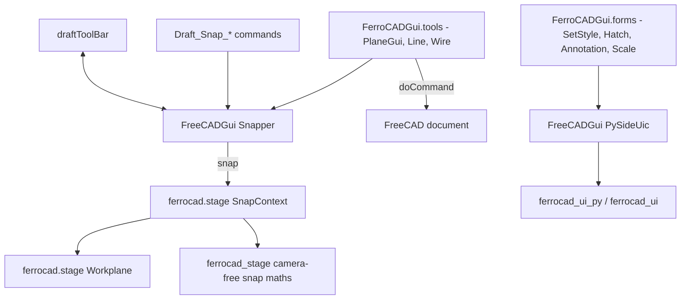
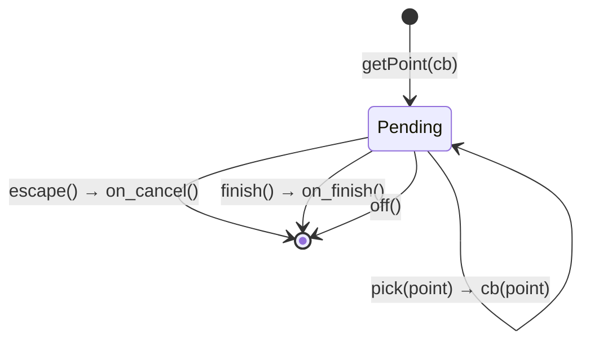

# Native Draft tools (Q4/Q5)

Status: reference (2026-10-24). Companion to
[`qt-strategy.md`](qt-strategy.md) §4.2/§5 (the design),
[`../tasks/qt-reduction.md`](../tasks/qt-reduction.md) Q4/Q5 (the execution plan),
[`../viewport/stage.md`](../viewport/stage.md) (the native stage), and
[`actions-and-tools.md`](actions-and-tools.md) (the command model). The round that built
it is logged in
[`../record/2026-10-24-q4-q5-draft-tools.md`](../record/2026-10-24-q4-q5-draft-tools.md).

These tools are **native FerroCAD code**, not upstream Draft scripts. They keep the
upstream *names* (`FreeCADGui.Snapper`, `draftToolBar`, `PlaneGui`, `Draft_Line`, …) so a
macro written for FreeCAD ports, but the behaviour is implemented over `ferrocad_stage`
and the headless form proxy. Nothing on this path imports Qt.

## 1. The call path



The Python layer holds **state and policy**; the geometry-free snap maths stays in
`ferrocad_stage`, and the shared source of truth for a workplane is one
`ferrocad.stage.Workplane` value.

## 2. `FreeCADGui.Snapper`

The module-level singleton is `FreeCADGui.Snapper` (the same object as
`FreeCADGui.draft.Snapper`).

### Modes

| Draft mode | Native | `SnapKind` |
| --- | --- | --- |
| `Grid` | yes | `Grid` |
| `Endpoint` | yes | `Vertex` |
| `Vertex` | yes | `Vertex` |
| `Midpoint` | yes | `EdgeMid` |
| `Center` | yes | `Centre` |
| `Origin` | yes | `Origin` |
| `Extension`, `Parallel`, `Perpendicular`, `Intersection`, `Angle`, `Special`, `Dimensions`, `Ortho`, `Lock` | **no** — enabling raises `NotImplementedError` | — |

`Snapper.mask` is the live list of enabled mode names; `active_snaps()` returns it,
`supported_modes()`/`unsupported_modes()` report the split, `setMode(name, on)` /
`toggle_snap(name)` change one, and `isEnabled()` reports the global switch.

### The snap control

The modes and the global switch are ordinary commands on the **`snap`** surface, which
the shell renders as a `Snap` split button beside `Grid`/`Axes`/`WP` in the viewport's
top-left pill:

| Command | Resources | Role |
| --- | --- | --- |
| `Draft_Snap_Lock` | `FerroCAD_Surface: "snap"` | the label: flips `isEnabled()`; the mode mask survives a lock |
| `Draft_Snap_Grid`, `…_Endpoint`, `…_Midpoint`, `…_Center`, `…_Origin`, `…_Vertex` | `FerroCAD_Surface: "snap"`, `FerroCAD_Parent: "Draft_Snap_Lock"`, `FerroCAD_Short: "<mode>"` | the caret's checklist |

Declaring the parent is what keeps the modes out of the action dock: the dock renders
only commands whose surface is `dock`, so the bottom pill stays selection verbs plus
`Search`. `FerroCAD_Short` lets the popover show `Grid` where `Snap Grid` would repeat
the control's name; the palette still searches the full `MenuText`. The modes are
**state** rows (they declare `Checkable`), so clicking one leaves the popover open and
a mask can be set in one visit; the dot follows `IsChecked`, and the menu closes on an
outside click, `Esc` or the caret. A provider radio row behaves the same way.

### State and snapping

| Member | Meaning |
| --- | --- |
| `affinity` | Feature tolerance in **world units** (default `1.0`) |
| `setEnabled(on)` / `toggleEnabled()` | the global switch (the `Snap` label); leaves `mask` untouched |
| `grid` / `setGrid(on)` / `toggleGrid()` | the workplane grid snap |
| `workplane` / `setWorkplane(wp)` | the active `ferrocad.stage.Workplane` |
| `context` / `snap_context` | the `ferrocad.stage.SnapContext` built from the above |
| `snap(point, candidates=None)` | resolve a world point → `(x, y, z)`; stores `snapInfo` |
| `snapInfo` | the last `ferrocad.stage.Snap` (`point`, `kind`, `local`, `major`) |
| `setAngle(deg)` | rotate the snap grid about the workplane normal |
| `constrain(axis_or_point)` / `unconstrain()` | axis/point constraint applied by `draftToolBar.validatePoint` |
| `setSelectMode(on)` | hide snapping while selecting |

`snap(point, candidates)` filters candidates by the modes in `mask`, then calls
`SnapContext.snap_point(point, candidates, affinity)`:

1. a candidate within `affinity` wins (ties go to the earlier candidate);
2. otherwise the point is projected onto the workplane and its local `(u, v)` rounded
   to the minor step; a node that is also a major intersection reports `major=True`;
3. a zero minor step returns the projected point as `SnapKind.Point`.

```python
import FreeCADGui
import ferrocad_stage as stage  # the app also installs it as `ferrocad.stage`

snapper = FreeCADGui.Snapper
snapper.setGrid(True)
snapper.snap((12.4, 7.6, 0.0))            # -> (12.0, 8.0, 0.0) on the default 1 mm grid

wp = stage.Workplane((10, 0, 5), (1, 1, 0), (-1, 1, 0))
snapper.setWorkplane(wp)
snapper.snap(wp.point(3.0, 4.0))          # -> the same point (f32 precision), kind "Grid"
```

### Point sessions

`getPoint(callback, *args, on_cancel=None, on_finish=None)` registers **one** async
request and returns immediately. A second request replaces the first (reported on
stderr); it never stacks.



The headless driver seam is `FreeCADGui.draft`:

| Call | Effect |
| --- | --- |
| `draft.pick(point)` | snap `point`, take the pending request, invoke `callback(snapped, *args)` once |
| `draft.escape()` | drop the pending request and call `Snapper.off()` (which runs `on_cancel`) |
| `draft.finish()` | take the pending request and run `on_finish` (Enter), without picking |

A tool registers `on_cancel=self.escape` and `on_finish=self.finish`, so the same
cancel/finish path serves a mouse-driven shell and a scripted test. Real viewport
clicks are not routed into these three calls yet (see §7).

## 3. `FreeCADGui.draftToolBar`

The task-panel adapter. The fields Draft's `gui_base_original` reads and writes exist
with their upstream names:

| Member | Behaviour |
| --- | --- |
| `sourceCmd` | the active tool; set by the tool, cleared by `offUi`/`escape` |
| `ui` | the adapter itself (upstream's `self.ui`) |
| `Activated()` / `Deactivated()` / `offUi()` | manage `sourceCmd` and `isTaskOn` |
| `escape()` | end snapping and finish the source command |
| `validatePoint(point)` | apply the current constraint and return the point |
| `makeFaceMode` | `True` by default, read by the line/wire commit |
| `mouse`, `isConstructionMode`, `autogroup`, `globalMode`, `wplabel`, `textValue`, `continueCmd`, `loadedPreferences`, `tray`, `taskUi` | panel state; `setAutoGroup` is live, the rest are placeholders |

`setStyleButton()` raises `NotImplementedError`: there is no Qt style widget, and
pretending otherwise would hide the gap.

## 4. `PlaneGui` (`FerroCADGui.tools`)

`FreeCADGui.PlaneGui` is the native working plane. It owns one
`ferrocad.stage.Workplane`.

| Member | Effect |
| --- | --- |
| `get_working_plane()` / `set_working_plane(wp)` | read/replace the frame |
| `get_placement()` | a `FreeCAD.Placement` (origin + rotation with +Z = the normal); the round trip back to a `Workplane` is exact to 1e-9 |
| `align_to_face(origin, normal)` / `align_to_view(direction)` | set the frame |
| `reset()` | back to the world plane |
| `_update_grid()` | returns the `{"view": {"grid_minor": …, "grid_major": …}}` request |
| `update_gui()` | records the `wplabel`-style label for the status channel; no Qt icon |
| `set_to_view()` | returns `{"view": {"workplane": "view"}}` |

Module helpers: `get_working_plane(update=True)`, `set_working_plane(wp)`,
`reroute_upstream_working_plane()`.

## 5. `Draft_Line` and `Draft_Wire`

Registered by importing `FerroCADGui.tools` (an existing registration is left alone;
`register_commands(replace=True)` overwrites it). The tool is a `Creator`:

1. `Activated()` starts a session: `draftToolBar.sourceCmd = tool`, `PlaneGui` is read,
   a first `InputHint` is shown, and `Snapper.getPoint` is armed.
2. Each `draft.pick(point)` appends a node, updates the hint, and re-arms.
3. `draft.finish()` (Enter) with at least two nodes queues
   `Draft.make_line(...)` / `Draft.make_wire(...)` through
   `QtCore.QTimer.singleShot(0, …)` and `FreeCADGui.doCommand`; the document gains one
   `Part::Feature`.
4. `draft.escape()` ends the session with no document change.

```python
import FreeCAD, FreeCADGui
import FerroCADGui.tools  # registers Draft_Line / Draft_Wire

doc = FreeCAD.newDocument("ToolDemo")
FreeCADGui.runCommand("Draft_Line")
FreeCADGui.draft.pick((0.0, 0.0, 0.0))
FreeCADGui.draft.pick((10.0, 0.0, 0.0))
FreeCADGui.draft.finish()
assert len(doc.Objects) == 1
```

The commit goes through `FerroCADGui.tools.make_line` / `make_wire`, which is also
installed on `Draft` when that module lacks them. The upstream `gui_lines` path is
**not** used; `tools.upstream_report()` explains why (see §7).

**Viewport routing (2026-10-27).** `Creator.Activated` asks the shell for
`python:draft` (`FreeCADGui._request_tool`); the command payload carries that id and
the shell starts `ferrocad_shell.tool_bridge("draft")` as a native
`ferrocad_stage.Tool`. A left click arrives with the resolved snap point and calls
`draft.pick`; `Esc`/`Enter` reach `draft.escape`/`draft.finish` through
`ferrocad_shell.tool_command("draft", …)`. The `Draft_Line`/`Draft_Wire` commands are
registered by importing `FerroCADGui.tools` (the edition opts in).

## 6. The Q5 forms (`FerroCADGui.forms`)

| Command | Form | Accept path |
| --- | --- | --- |
| `Draft_SetStyle` | `TaskPanel_SetStyle.ui` | writes the style parameters to the Draft `ParamGet`; presets round-trip under `StylePresets` |
| `Draft_Hatch` | `dialogHatch.ui` | writes the hatch preferences and applies `File`/`Pattern`/`Scale`/`Rotation`/`Translate` to a supported selection |
| `Draft_AnnotationStyleEditor` | `dialog_AnnotationStyleEditor.ui` | writes the annotation parameters and saves a named style in `Doc.Meta` |
| `Draft_Scale` | local `TaskPanel_Scale.ui` | writes the scale factors and applies `ScaleVector`/`Scale` to a supported selection |

Every command returns a `_payload`-compatible dialog spec (`title`, `fields`,
`accept`, `cancel`, `on_accept`). For a script or a test, drive the form directly:

```python
from FerroCADGui import forms

panel = forms.open_panel("Draft_SetStyle")
panel.apply({"textheight": 4.0})
panel.accept()            # commits; panel.reject() writes nothing
```

`fields()`/`values()` are JSON-ready; `apply()` rejects unknown names. The SetStyle
controller adds `presets()`, `save_preset(name)`, `delete_preset(name)`,
`load_preset(name)`, `select_preset(name)`; the annotation editor adds `styles()`,
`style_names()`, `select_style(name)`, `save_style(name)`; the hatch panel adds
`patterns()`.

## 7. What is not there yet

- **The upstream `gui_lines` route.** Still blocked by `SoEvent` picking, preview
  shapes and the `python/Draft` shim's missing `make_line`/`make_wire`; the headless
  `ViewObject` style properties are now present. `tools.upstream_report()` records the
  blockers.
- **Annotation fonts and live annotation updates.** SetStyle's shape subset
  (`LineColor`, `LineWidth`, `PointColor`, `PointSize`, `DrawStyle`, `ShapeColor`,
  `Transparency`, `DisplayMode`) now applies to the selection; the annotation-only
  fields persist as Draft defaults because the headless `ViewObject` has no font/text
  properties.
- **The nine Draft-only snap modes.** They toggle without raising; `mode_note()` and
  `snap_status()` report which are passthrough (`Near`, `WorkingPlane`) and which need
  a live cursor or an extension solver. The snap point is never invented.

## 8. Verifying it

```sh
# The whole Python suite (the stage-dependent tests skip when the extension is absent)
PYTHONPATH=python python3 -m pytest tests -q

# The focused suites
PYTHONPATH=python python3 -m pytest tests/test_draft_snapper.py tests/test_draft_tools.py tests/test_draft_forms.py -q

# The stage bindings (embedded Python acceptance suite + Rust units)
cargo test -q -p ferrocad_stage -p ferrocad_stage_py --offline

# The line/wire suite against the real Part kernel (the standalone pytest image has no Part)
cargo test -q -p ferrocad_part_py --test draft_tools --offline
```

The standalone pytest run uses a documented `Part.makePolygon` stub for the creation
tests; the in-image Rust test is the one that proves the real kernel path.

## 9. File map

| File | Role |
| --- | --- |
| `crates/ferrocad_stage/src/snap.rs` | `SnapContext::snap_point` (camera-free) |
| `crates/ferrocad_stage_py/src/{snap,workplane}.rs` | the `ferrocad.stage` spatial reference |
| `python/FreeCADGui/draft.py` | `Snapper`, `draftToolBar`, hints, sessions, snap commands |
| `python/FreeCADGui/__init__.py` | the headless window and `doCommand`/`addModule` |
| `python/FerroCADGui/tools.py` | `PlaneGui`, `Draft_Line`, `Draft_Wire` |
| `python/FerroCADGui/forms.py` | the four Q5 form controllers and commands |
| `python/FerroCADGui/Resources/ui/TaskPanel_Scale.ui` | the converted scale form |
| `tests/test_draft_snapper.py`, `tests/test_draft_tools.py`, `tests/test_draft_forms.py` | the acceptance suites |
| `crates/ferrocad_part_py/tests/draft_tools.rs` | the same tool suite with the real Part kernel |

## 10. Draft M3 conformance (`drafttests/test_modification.py`)

Status: measured 2026-10-26 against upstream `33adf61`. The harness runs upstream's
Draft unchanged (its package roots precede `python/`, so `import Draft` is the real
workbench):

```sh
python3 tools/conformance.py --root ../freecad-upstream --draft --files test_modification
```

| Run | pass | fail | error | skip |
| --- | --- | --- | --- | --- |
| before M3 | 17 | 0 | 16 | 0 |
| after this round | **22** | 1 | 10 | 0 |

Five tests moved from `error` to `pass`: `test_copy`, `test_move`, `test_rotate`,
`test_scale_rectangle`, `test_scale_spline`. Everything left is blocked on the
shared kernel, not on a missing Draft-layer call.

### What the layer now provides (`crates/ferrocad_py`)

- **Editor modes.** `DocumentObject.getEditorMode(name)` returns the flags stored by
  `setEditorMode`, which now writes the property's status bits (`ReadOnly`,
  `Hidden`, `NoRecompute`) instead of only firing the observer. Both upstream forms
  are accepted: the legacy int (`0` default, `1` ReadOnly, `2` Hidden, `3` both) and
  a name sequence (`["ReadOnly", "Hidden"]`). `Draft/draftutils/utils.py:957` reads
  `getEditorMode("Placement")` for move/rotate/scale.
- **Placement.** `Placement.isIdentity()` and the mutating `Placement.move(vector)`
  (writing back through a document property). `Draft.move`/`rotate`/`scale` branch
  on both.
- **Matrix.** `Matrix(otherMatrix)` and `Matrix(placement)` copy construction, and
  `Matrix.multiply(vector)` (matrix × vector returns a `Vector`), both used by
  `Draft.scale._get_scaled_matrix` and `DraftVecUtils`.
- **Quantities.** `App::PropertyVectorDistance` now builds a `Vector` property
  (Draft wire `Start`/`End`), and a `Quantity` accepts a plain number in `+`/`-`,
  `abs()`, rich comparisons, and `isEqual(other, tol=0)`. That is what
  `unittest.assertAlmostEqual(obj.Length, 8.0, delta=…)` needs.
- **Strict `addObject`.** An id that is neither a registered behaviour nor a known
  base/Python-feature type now raises `ValueError: Unknown C++ type '<id>'`, as
  upstream does. `Part::Prism` used to fabricate a bare `DocumentObject` with
  neither `Placement` nor `Shape`, which is why the Prism tests surfaced as
  attribute errors. The App/Part groups and the pytest suites are unchanged (Part
  **531 passed** / 0 failed / 0 errored / 12 skipped; no App-group failure mentions
  `Unknown C++ type`).

`tools/conformance.py`'s `DRAFT_FILES` now also runs `test_creation`, `test_array`,
`test_dwg` and `test_oca`, all of which are green:

| `--draft` module | pass | fail | error | skip |
| --- | --- | --- | --- | --- |
| `test_base` (helper module) | 0 | 0 | 0 | 0 |
| `test_grid_settings` | 5 | 0 | 0 | 0 |
| `test_pivy` | 2 | 0 | 0 | 0 |
| `test_airfoildat` | 2 | 0 | 0 | 0 |
| `test_import` | 4 | 0 | 0 | 0 |
| `test_creation` | 26 | 0 | 0 | 0 |
| `test_array` | 1 | 0 | 0 | 0 |
| `test_dwg` | 2 | 0 | 0 | 0 |
| `test_oca` | 2 | 0 | 0 | 0 |
| **whole group** | **44** | **0** | **0** | **0** |

Neighbouring modules measured with `--files` (the rest of the headless Draft suite):
`test_svg` 3/0/3/1, `test_dxf` 1/0/1/0, `test_draftgeomutils` 0/0/10/0;
`test_trimex` defines no test cases in this checkout. Against the start-of-round
baseline (`test_creation` 26, `test_array` 1, `test_import` 4, `test_dwg` 2,
`test_oca` 2, `test_svg` 2/0/4/1, `test_dxf` 1/0/1, `test_draftgeomutils` 0/0/10)
only `test_svg` moved (**+1 pass**, from `Matrix.multiply(vector)` in
`DraftVecUtils.get_rotation_matrix`).

### Remaining blockers (all kernel hand-offs)

| Test(s) | Blocker | Owner |
| --- | --- | --- |
| `test_offset_open`, `test_offset_rectangle_with_face`, `test_offset_closed_with_reversed_edge` | `obj.Shape` on a `Part::Feature(Python)` is a bare `Part.Shape` even when a `Part.Wire` was assigned, so `isinstance(obj.Shape, Part.Wire)` is false and `offsetWire` returns `None` (`Draft/offset.py:147`). The shape property getter must preserve the derived wrapper. | Part (`ferrocad_part_py`) |
| `test_scale_part_feature_arcs`, `test_scale_part_feature_lines` | `Part.Shape([subshape, …])` is not a constructor (`TypeError: expected a Part.Shape` at `test_modification.py:735`/`:791`); upstream builds a compound from a sequence. | Part (`ferrocad_part_py`) |
| `test_scale_wire` | A Draft wire's `Shape.Vertexes` are local. Upstream's `Part::Feature.Shape` carries the object `Placement` as its OCCT `Location`, so the test's global coordinates come back; `Shape.Placement` must equal `obj.Placement`. | Part (`ferrocad_part_py`) |
| `test_upgrade` | `shape.isClosed()` is true while `shape.Wires[0].isClosed()` is false for the same wire, so `Draft.upgrade` keeps "closing" the wire instead of making a face and `self.doc.ActiveObject` is a `Part::Feature` without `Proxy`. | Part (`ferrocad_part_py` shape queries) |
| `test_downgrade` | `Part.makePolygon([a, b, c, a, a])` raises `Part.OCCError: degenerate geometry`. OCC's `BRepBuilderAPI_MakePolygon::Add` ignores a point coincident with the previous one; `ferrocad_curves::wire::polygon` rejects it. (Upstream reaches that list because `PropertyVectorList` returns a live list and `Draft`'s wire proxy pops the repeated closing point; here the getter returns a fresh list, so the pop does not persist.) | kernel (`ferrocad_curves`, optionally the property getter) |
| `test_shape_2d_view`, `test_draft_to_techdraw` | `Part::Prism` is not implemented; `addObject` now reports `ValueError: Unknown C++ type 'Part::Prism'` at the creation line. The TechDraw case also needs `TechDraw::DrawPage`/`DrawSVGTemplate`/`DrawViewDraft`. | Part track (+ TechDraw for the second) |
| `test_draft_to_sketch` | `ModuleNotFoundError: No module named 'Sketcher'` (`Draft/make_sketch.py:92`). | Part/Sketcher track |

Part-kernel progress noted during measurement: `Shape.hashCode()` and the derived
`Part.Wire` wrapper (for directly constructed wires) landed while this round ran, so
`test_upgrade` gets past `upgrade.py:462`; `Part::Feature.Shape` still loses the
wrapper and the `Wires[0]` closure is still inconsistent. `Shape.fix()` /
`Shape.OrderedEdges` (the `test_draftgeomutils` blockers) and
`TechDraw.projectToSVG` (three `test_svg` errors) are likewise kernel/shims work,
not part of M3.
